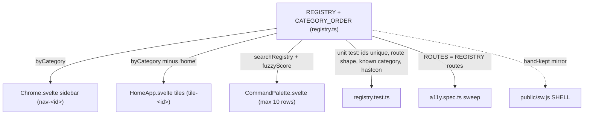
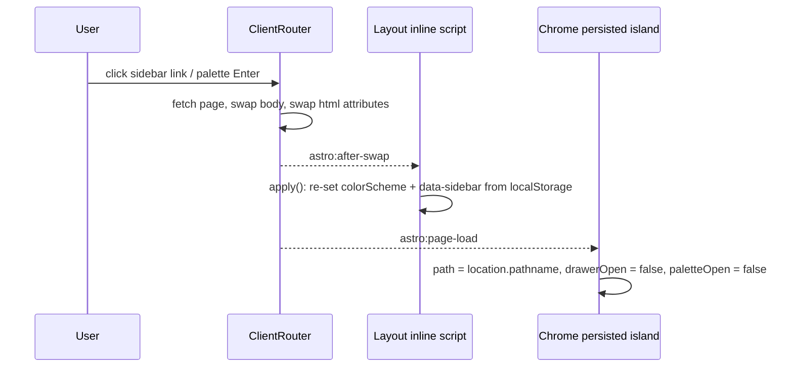
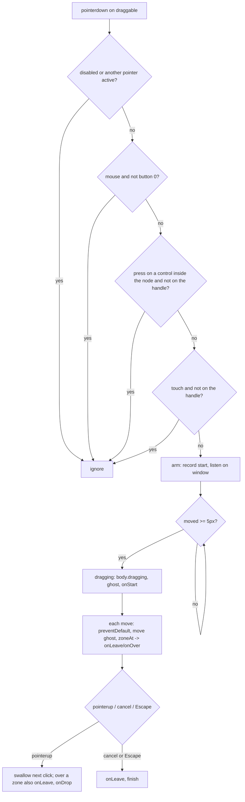

# App shell and navigation

The shell is everything that is not a tool: the Astro layout every page mounts, the fixed topbar and sidebar, the `ctrl+k` palette, the tool registry that all three render from, and the small shared pieces (icons, cards, explainers, markdown rendering, pointer drag-and-drop) tools reach for. Pages are static Astro wrappers around one Svelte 5 island; navigation between them is client-side through Astro's `ClientRouter`, and the shell islands survive those swaps.

_Describes the code as of v0.2.1 (unreleased; schema v12) — verify against source when in doubt._

## File map

| Path | Role |
| --- | --- |
| [Layout.astro](../../src/layouts/Layout.astro) | The one layout: `<head>`, `ClientRouter`, pre-paint theme/sidebar script, the three persisted islands, `<main class="page">`, service-worker register (prod) / unregister (dev), test-hook loader. |
| [Chrome.svelte](../../src/components/chrome/Chrome.svelte) | Topbar (hamburger, brand, sheet code, Search button), sidebar/drawer, collapse persistence, the `ctrl+k` listener, palette mounting. |
| [CommandPalette.svelte](../../src/components/chrome/CommandPalette.svelte) | The search dialog: input, listbox, keyboard model, focus trap and restore. |
| [NotificationEngine.svelte](../../src/components/chrome/NotificationEngine.svelte) | Persisted island that runs the timer/scheduler alarm engine and renders notices (see [notification-engine.md](notification-engine.md)). |
| [OfflineSetup.svelte](../../src/components/chrome/OfflineSetup.svelte) | Persisted island: the one-time post-install offline offer (documented with the service worker). |
| [registry.ts](../../src/lib/registry.ts) | `ToolDef`, `CATEGORY_ORDER`, `REGISTRY`, `byCategory()`, `searchRegistry()`. |
| [fuzzy.ts](../../src/lib/fuzzy.ts) | `fuzzyScore()` / `isSubsequence()` — the palette's matcher. |
| [icons.ts](../../src/lib/icons.ts), [Icon.svelte](../../src/components/Icon.svelte) | `ICONS` map of inlined Lucide stroke paths, `hasIcon()`, and the renderer. |
| [paths.ts](../../src/lib/paths.ts) | `href()` / `isPath()` — base-path-aware links. |
| [HomeApp.svelte](../../src/components/apps/HomeApp.svelte) | The home page: registry rendered as tiles. |
| [index.astro](../../src/pages/index.astro), [pages/tools/*.astro](../../src/pages/tools/) | Page wrappers. |
| [Card.svelte](../../src/components/Card.svelte), [Explainer.svelte](../../src/components/Explainer.svelte), [ColorField.svelte](../../src/components/ColorField.svelte), [CodeEditor.svelte](../../src/components/CodeEditor.svelte), [SqlEditor.svelte](../../src/components/SqlEditor.svelte) | Shared components (see below). |
| [markdown.ts](../../src/lib/markdown.ts), [prism.ts](../../src/lib/prism.ts) | Sanitised markdown → HTML with highlighted fences; the single Prism import point. |
| [dragdrop.ts](../../src/lib/dragdrop.ts) | Pointer-event drag-and-drop actions shared by the scheduler and the image editor. |
| [testMode.ts](../../src/lib/testMode.ts), [testHook.ts](../../src/lib/testHook.ts) | The `useful-test-mode` flag and the `window.__useful` hook the Playwright suite drives. |
| [theme.css](../../src/styles/theme.css), [global.css](../../src/styles/global.css) | Design tokens and base styles — see [design-system.md](design-system.md). |
| [nav.spec.ts](../../tests/local/nav.spec.ts), [a11y.spec.ts](../../tests/local/a11y.spec.ts), [registry.test.ts](../../src/lib/registry.test.ts), [fuzzy.test.ts](../../src/lib/fuzzy.test.ts) | Tests. |

## Page anatomy

Every route is a thin Astro file that imports `Layout` and mounts exactly one Svelte root with `client:only="svelte"`:

```astro
<Layout title="Timers">
  <TimersApp client:only="svelte" />
</Layout>
```

`Layout.astro` supplies, in order:

1. `<head>`: `<meta name="color-scheme" content="light dark">`, favicon and manifest links through `href()`, `<title>{title} · useful</title>`, `<ClientRouter />`, and an `is:inline` script that applies the persisted theme and sidebar state before first paint (below).
2. A bundled `<script>` calling `installTestHookIfEnabled()` — the test hook chunk is dynamically imported only when `localStorage['useful-test-mode'] === '1'`, so a real user never downloads it. The Playwright fixture ([helpers/app.ts](../../tests/local/helpers/app.ts)) sets that flag with `addInitScript` and waits for `window.__useful`.
3. Three islands with `client:load` and `transition:persist`: `Chrome` (`"chrome"`, receives `currentPath` from `Astro.url.pathname`), `NotificationEngine` (`"engine"`), `OfflineSetup` (`"offline"`).
4. `<main class="page">` with the slot — the "drawing sheet" frame styled in `global.css`.
5. In `import.meta.env.PROD`, an inline script registering the service worker at `<html data-sw-path>` (base-aware, so the scope is the base). In dev the inverse: unregister any leftover worker and delete `useful-cache-*` caches, because a worker serving cached Vite module URLs yields blank pages after edits.

Because the tool component is `client:only`, the server-rendered HTML for a page contains the shell but an empty `<main>`; tests wait for `main h1` before auditing.

## Registry: single source of truth

`REGISTRY` in `registry.ts` is a flat array of `ToolDef`:

| Field | Meaning |
| --- | --- |
| `id` | Stable slug; keys lists, the sidebar/tile testids (`nav-<id>`, `tile-<id>`) and the palette row's DOM `id` (`palette-option-<id>`; its testid is the constant `palette-option`). |
| `name` | Display name (note `number-conversion` is named "Programming", `colors` is named "Themes"). |
| `description` | One line shown on home tiles and in the palette. |
| `aliases` | Extra search terms the name lacks (`tz`, `prefs`, `remove bg`…). |
| `category` | Must be one of `CATEGORY_ORDER` — `Time`, `Scheduler`, `Images`, `Calculators`, `Generators`, `Playgrounds`, `App` (last, holds Home/Preferences/Settings). |
| `route` | App-absolute with trailing slash (`/tools/timers/`, `/`); always rendered through `href()`. |
| `icon` | Key into `ICONS`. |

`byCategory()` groups tools in `CATEGORY_ORDER` (categories the order list does not know are appended, but the unit test forbids them). `searchRegistry(query, tools = REGISTRY)` scores each tool with `fuzzyScore()` in three tiers so a name hit always outranks an alias hit, which outranks a category/description hit: `400 + nameScore`, else `200 + aliasScore`, else the best of category/description. Ties break alphabetically by name; an empty query returns everything in registry order.

`fuzzyScore()` is case-insensitive subsequence matching: +8 for matching at index 0, +6 for a match right after a word separator (` -_/.:`), +4 for continuing a consecutive run, +1 per matched char, minus small penalties for spread and leftover text, floored at 0.1 so a real match never ties with "no match" (`null`).



The dashed edge matters: the service worker's `SHELL` list is **not** derived from the registry — `sw.js` is a plain script outside the bundle, so it cannot import it. Everything else is: the a11y sweep builds its `ROUTES` from `REGISTRY`, so a registered tool is audited whether or not anyone remembered to add it. Adding a tool means touching the registry and `SHELL` — see the recipe at the end.

## Sidebar, drawer and collapse

`Chrome.svelte` uses one breakpoint for CSS and JS: `MOBILE_MQ = '(width < 64rem)'` (CSS range syntax, so there is no fractional-zoom gap between the two).

- **Desktop (≥ 64rem)**: the sidebar is fixed below the topbar (`top: var(--navbar-height)`, `z-index: 5`). Collapse is the attribute `html[data-sidebar='collapsed']`; the sidebar hides with `display: none` and `global.css` stops padding the body left. `toggleSidebar()` flips the attribute and writes `localStorage['useful-sidebar-collapsed'] = '1'` (or removes it).
- **Mobile (< 64rem)**: the sidebar is an off-canvas drawer (`translateX(-100%)` **and** `visibility: hidden`, so closed links leave the tab order and the accessibility tree) with `z-index: 30` over a `.drawer-backdrop` scrim (`z-index: 25`). The hamburger toggles `drawerOpen`; a click on the backdrop, an `astro:page-load`, or resizing across the breakpoint closes it. `kbd`, the Search label and the sheet code are hidden on mobile.
- The hamburger carries `aria-expanded` (drawer state on mobile, `!collapsed` on desktop) and `aria-controls="app-sidebar"`.
- The active link gets `aria-current="page"` via `isPath(path, tool.route)`; visually a `--color-primary-soft` fill with a 2px stamp-coloured inset rule.
- While the drawer **or** the palette is open, `document.body.style.overflow = 'hidden'`.

The persisted island's `currentPath` prop is only correct for the first document. `Chrome` therefore keeps its own `path` state and refreshes it from `window.location.pathname` on every `astro:page-load`.

## Palette keyboard model

`Chrome` owns the shortcut and the open state; `CommandPalette` owns everything inside the dialog.

| Key / gesture | Where | Effect |
| --- | --- | --- |
| `Ctrl+K` / `Cmd+K` (no Alt, no Shift, not a key-repeat) | `window` keydown in `Chrome` | `preventDefault`, toggle `paletteOpen`; on open, remember `document.activeElement` as `paletteOpener`. |
| Header Search button (`data-testid="open-palette"`) | `Chrome` | Opens with `e.currentTarget` as the opener (Safari never focuses clicked buttons, so `activeElement` would be `<body>`). |
| `Escape` | palette wrapper | `preventDefault` + `stopPropagation`, close. One Escape per layer: `Chrome`'s handler only closes the drawer when the palette is not open. |
| `ArrowDown` / `ArrowUp` | palette wrapper | Move `selected`, wrapping. |
| `Enter` | palette wrapper | `open(results[selected])`: close, then `navigate(href(tool.route))` from `astro:transitions/client`. |
| `Tab` | palette wrapper | `preventDefault` — the input is the only focusable control, so this is the focus trap. |
| IME composition (`isComposing` or `keyCode 229`) | palette wrapper | Ignored. |
| Mouse: `mouseenter` on a row | row | Selects it. |
| Mouse: `mousedown` on a row | row | Opens (mousedown, not click — click fires after the input has already lost focus). |
| `mousedown` anywhere else in the dialog | `.palette` | `preventDefault` so the input keeps focus. |
| Click on the backdrop | `.backdrop` | Close. |
| Browser back/forward (`astro:page-load`) | `Chrome` | Close. |

Handlers sit on the **wrapper**, not the input, so the dialog keeps working if focus ever lands elsewhere inside it. On mount the input is focused; the effect's cleanup calls `opener?.focus()` so focus returns to whatever opened it. Results are `searchRegistry(query).slice(0, MAX_RESULTS)` with `MAX_RESULTS = 10`; an effect clamps `selected` when the list shrinks and calls `scrollIntoView({ block: 'nearest' })` on the active row. ARIA: the input is `role="combobox"` with `aria-controls="palette-results"`, `aria-activedescendant` pointing at `palette-option-<id>`; the list is `role="listbox"`; a visually-hidden `role="status"` announces "N results". Under 30rem wide the description column is hidden.

## Theme

There is no theme toggle in the topbar. Settings → Appearance ([SettingsApp.svelte](../../src/components/apps/SettingsApp.svelte), `setTheme()`) writes `localStorage['useful-theme']` = `'light'` | `'dark'`, or removes it for `auto`, and sets `document.documentElement.style.colorScheme` to the value or `''`. `theme.css` declares `color-scheme: light dark` and every colour token as `light-dark(...)`, so that one inline style is the whole switch. The pre-paint script in `Layout.astro` replays it on load and after every swap.

## View transitions: what bites

`<ClientRouter />` makes every in-app link a client-side swap. Consequences the code already handles, and that a new feature must not undo:

- **`<html>` attributes are wiped on every swap.** `swapRootAttributes` replaces the root's attribute set with the incoming document's, which drops `style="color-scheme: …"` and `data-sidebar`. The inline `apply()` in `Layout.astro` runs once at load and again on `astro:after-swap`; because inline scripts execute once per full document load, the listener survives swaps. Regression test: `collapse and pinned theme survive CLIENT-SIDE navigation` in `nav.spec.ts`.
- **Persisted islands keep state but not props.** `Chrome`, `NotificationEngine` and `OfflineSetup` are `transition:persist`, so a timer keeps ticking and the offline offer cannot ask twice — but `Chrome`'s `currentPath` prop is stale after the first swap (hence the `astro:page-load` listener). Never assume a persisted island re-mounts.
- **Prefer `astro:page-load` over `DOMContentLoaded`** for anything that must run per page.
- **Test mode is a per-document import**, but the flag is per-profile, so the hook is present on every page the suite loads.
- Client-side navigation writes nothing to IndexedDB (`client-side navigation writes nothing` in `nav.spec.ts` snapshots every store before and after).



## Layering (z-index) and fixed sizes

| Layer | z-index | Source |
| --- | --- | --- |
| Desktop sidebar | 5 | `Chrome.svelte` |
| Topbar (`position: fixed`, height `--navbar-height` = 3.5rem) | 20 | `Chrome.svelte` |
| Drawer backdrop / mobile drawer (width `--sidebar-width` = 15rem) | 25 / 30 | `Chrome.svelte` |
| Palette backdrop | 50 | `CommandPalette.svelte` |
| Notification notices | 60 | `NotificationEngine.svelte` |
| Drag ghost | 1000 | `global.css` `.drag-ghost` |

The body gets `padding-top: var(--navbar-height)` and, on desktop while not collapsed, `padding-left: var(--sidebar-width)` (`global.css`).

## Shared components

| Component | What it is | Use it when |
| --- | --- | --- |
| `Card` (`title?` string, `children` / `actions?` snippets) | `<section class="card">` with corner registration marks, optional ruled header (`<h2>` in title-block voice) and an actions slot. | Any grouped block on a tool page. Every tool page is built from Cards. Its header is an `h2`, so keep page structure `h1` → Card → `h3` inside. |
| `Explainer` (`summary`, `children`, `testid = 'explainer'`) | Native `<details class="explainer">` / `<summary>` — keyboard toggling for free. | The "how to do it by hand" drop-downs under calculators and generators. |
| `Icon` (`name`, `size = 16`) | 24×24 viewBox stroke SVG from `ICONS`; unknown keys draw an empty square instead of throwing. | Anywhere a registry icon is shown. Add glyphs to `icons.ts` (Lucide inner markup), never as emoji. |
| `ColorField` (`value` bindable, `testid`, `id?`, `placeholder?`, `ariaLabel?`, `fallback?` = `#000000`, `alpha?` = false, `showSwatch?` = false, `oncommit?`) | Free-text CSS colour input plus a native `<input type="color">` kept in sync; text testid `X`, picker `X-pick`, alpha slider `X-alpha`, swatch `X-swatch`; `aria-invalid` when unparseable; `oncommit` fires on finalised edits only. With `alpha` on, the slider edits the alpha channel through `setAlpha` (re-emitting in the spelling you typed) and picking a colour PRESERVES the current alpha instead of flattening it to 6-digit hex. | Any colour input in generators/editors. Bind `value` for live previews; hook `oncommit` when a change should push an undo/save step; turn on `alpha`/`showSwatch` where transparency is meaningful (the image editor's fills). |
| `CodeEditor` (`initialDoc`, `extensions`, `language`, `ariaLabel`, `onDocChange`, `onRun`; exports `getText()`, `setText()`, `focus()`) | CodeMirror 6 chassis themed onto the blueprint tokens; `Mod-Enter` calls `onRun`; `language` lives in a `Compartment` so it can change without rebuilding. | Editable code buffers. `SqlEditor` wraps it with the engine's dialect for the SQL playground. |
| `.btn` family, `.page-header`, `.stack`, `.row`, `.grid-2`, `.table-wrap` + `.data-table`, `.eyebrow` | Global CSS classes, not components. | See [design-system.md](design-system.md). |

## Markdown and Prism

`renderMarkdown(md)` in `markdown.ts` is the only sanctioned markdown → HTML path (timer descriptions, TODO bodies, comments; consumers are `TimersApp`, `SchedulerApp`, `CalendarView`). It builds a `Marked` instance with `gfm: true` and `markedHighlight`, whose `highlight` maps `ALIASES` (`js`→`javascript`, `ts`→`typescript`, `py`→`python`, `sh`/`shell`→`bash`, `golang`→`go`, `yml`→`yaml`) and calls `Prism.highlight` when a grammar exists, otherwise HTML-escapes the code (marked-highlight treats the return value as HTML). The result always goes through `DOMPurify.sanitize` — backup import is an injection vector straight into rendered HTML, so sanitisation is not optional in a local-only app. It is client-only (DOMPurify needs a DOM).

`prism.ts` is the **one** Prism import point: it imports `prismjs` then the `typescript`, `python`, `go`, `rust`, `bash`, `json`, `sql`, `yaml` grammar components in that order. Grammar files are side-effect scripts that need the `Prism` global; with two importers Rollup can hoist them into a shared chunk that runs before the core (the hydration crash the regex tool hit). Import from `./prism`, never from `'prismjs'` — `RegexApp` and `markdown.ts` both do. Token colours are the `.token.*` rules in `global.css` on the blueprint inks (keywords in stamp, strings in success, numbers in warning, functions/tags in primary-strong).

## dragdrop.ts

Two Svelte actions replace the HTML5 drag API (which never fires on touch or pen):

```ts
use:draggable={{ data, label, handle, disabled, onStart, onEnd }}
use:dropzone={{ accepts, onOver, onLeave, onDrop }}
```

- `DragData = { kind: string; id: string }` — zones filter with `accepts(data)`.
- `DraggableOptions`: `data`, `label` (ghost text), `handle` (CSS selector, **required for touch**), `disabled`, `onStart`, `onEnd`.
- `DropZone`: `accepts?`, `onOver?(data, event)` (fires on every move — keep it cheap), `onLeave?(data)`, `onDrop(data, event)`.
- `dropzone` sets `data-droptarget` on its node and registers it in a module-level `Map`; the target at release is the innermost `[data-droptarget]` under the pointer whose `accepts` passes (`zoneAt()` walks outward past registered-but-uninterested zones).
- The ghost is a `.drag-ghost` div appended to `body` and moved with `transform`; `body.dragging` disables text selection and sets `cursor: grabbing` (both in `global.css`).
- Escape or `pointercancel` aborts. After a real drag the next `click` on the source is swallowed once (capture-phase), so dropping a calendar entry does not also open it.



Consumers: `SchedulerApp` (board cards), `CalendarView` (rescheduling), `ImageEditorApp` (layer reorder).

## Base path

`href(path)` prefixes `import.meta.env.BASE_URL` (Astro `base`, trailing slash guaranteed) onto an app-absolute path; `isPath(pathname, path)` compares ignoring trailing slashes. Every link, `navigate()` call, favicon/manifest URL, and the `data-sw-path` attribute goes through it, so setting `base` in `astro.config.mjs` (GitHub Pages) needs no other change. Registry routes are validated as `^\/([a-z0-9-]+\/)*$` by the unit test.

## Testing

- `npm run test:unit` (Vitest, `src/**/*.test.ts`): `registry.test.ts` — unique ids, route shape, every category in `CATEGORY_ORDER`, every icon key resolves via `hasIcon`, `byCategory` covers every tool once in order, `searchRegistry` tiering (name > alias, empty query returns all, no-match returns nothing). `fuzzy.test.ts` — subsequence semantics, prefix/word-boundary/consecutive preferences, case-insensitivity, positive floor.
- `npm test` (Playwright against a **production build** on port 4330, `tests/local/`): `nav.spec.ts` — sidebar navigation and `aria-current`, navigation writes nothing, `ctrl+k` + fuzzy + Enter, arrow keys, Search button + focus trap + focus restore, collapse persists across full reload and across client-side navigation with a pinned theme, Escape closes only the topmost layer, closed drawer links out of the tab order, drawer opens/closes below the breakpoint. `a11y.spec.ts` — for every route in the registry: no unnamed `button`/`a`/`summary`, no unlabelled field, no `img` without `alt`, exactly one `h1` in `main` and no skipped heading level; plus token contrast in both schemes and keyboard paths through the palette and explainers.

## Adding a tool

1. Write `src/components/apps/FooApp.svelte`. Start with `<div class="page-header"><h1>Foo</h1></div>` — the sweep requires exactly one `h1` inside `main`, and Card titles are `h2`s. Every button needs text or `aria-label`; every input a `<label for>`, wrapping label, or `aria-label`.
2. Add `src/pages/tools/foo.astro`: `Layout` + `<FooApp client:only="svelte" />`.
3. Append a `ToolDef` to `REGISTRY`: `route: '/tools/foo/'`, a `category` from `CATEGORY_ORDER`, an `icon` key that exists in `ICONS` (add the Lucide inner markup to `icons.ts` if not). Sidebar, home tiles and palette now show it; `registry.test.ts` fails if any field is off.
4. Add `'tools/foo/'` to `SHELL` in [public/sw.js](../../public/sw.js) and bump `CACHE_NAME` — see [service-worker-and-offline.md](service-worker-and-offline.md).
5. Run `npm run test:unit` and `npm test`; add a line under the unreleased heading in `CHANGELOG.md`. The a11y sweep picks the page up from the registry on its own — no list to extend.

## Known limits and decisions

- Two lists to keep in step (registry and `SHELL`); the unit test guards only the first. `sw.js` is a plain script outside the bundle, so it cannot import the registry — that one stays manual.
- The palette shows at most 10 results and searches names/aliases/category/description only — nothing inside a tool.
- No keyboard shortcut toggles the sidebar; only the hamburger.
- `Icon` renders an empty square for an unknown key so a typo degrades visibly rather than crashing the shell.
- Theme, sidebar collapse and test mode live in `localStorage`, not IndexedDB, so they are outside backups and are per browser profile.
- Developer-mode unlock in Settings is `sessionStorage` (`useful-inDeveloperMode`) — resets every session by design.
