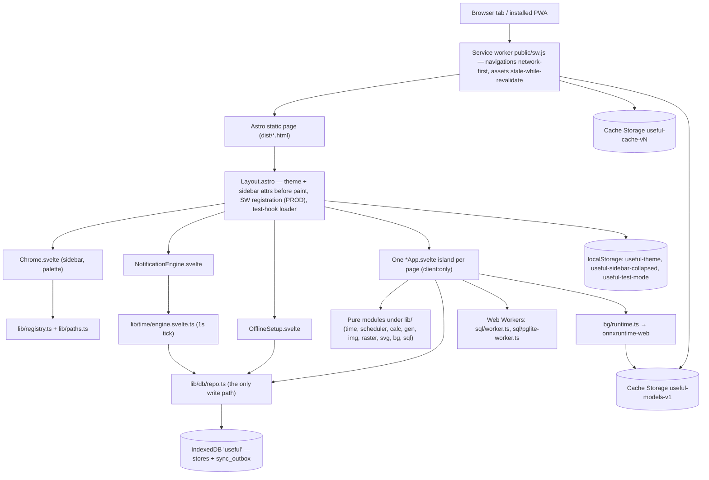

# Architecture

`useful` is a static Astro 7 site whose every page mounts one Svelte 5 island. There is no server: IndexedDB in the visitor's browser is the only copy of the data, a hand-written service worker makes the built site work offline, and the heavy optional pieces (an ML model, two SQL engines, a city dataset) load lazily on demand. This page is the maintainer's mental model — the stack, the runtime picture, the directory map, the cross-cutting systems and where each is documented, the invariants that must not break, and the recipe for adding a tool.

_Describes the code as of v0.4.0 (unreleased; schema v16) — verify against source when in doubt._

## The stack

| Layer | What | Where |
| --- | --- | --- |
| Static site | Astro 7, `@astrojs/svelte`, `<ClientRouter />` view transitions | [astro.config.mjs](../../astro.config.mjs), [Layout.astro](../../src/layouts/Layout.astro) |
| UI | Svelte 5 runes (`$state`/`$derived`/`$effect`), one root component per page mounted `client:only="svelte"` | [src/components/apps/](../../src/components/apps/) |
| Persistence | IndexedDB via `idb` 8, database `useful` (`DB_NAME`), `DB_VERSION` = 16 | [db.ts](../../src/lib/db/db.ts), [repo.ts](../../src/lib/db/repo.ts) |
| Offline | Hand-written service worker, precache + background crawl + runtime caching, registered only in production builds | [public/sw.js](../../public/sw.js), [offline.ts](../../src/lib/offline.ts) |
| Styling | Plain CSS custom properties, `light-dark()` for both themes in one place | [theme.css](../../src/styles/theme.css), [global.css](../../src/styles/global.css) |
| Heavy work | Module Web Workers for the SQL engines; `onnxruntime-web` (single-threaded wasm) for the background remover | [src/lib/sql/](../../src/lib/sql/), [runtime.ts](../../src/lib/bg/runtime.ts) |
| Tests | Playwright against a production build (`npm test`); Vitest for pure modules (`npm run test:unit`) | [playwright.config.ts](../../playwright.config.ts), [vitest.config.ts](../../vitest.config.ts) |
| Runtime | Node `>=22.12.0` for tooling only; the shipped `dist/` is static files | [package.json](../../package.json) |

Versions are pinned to ranges proven together (Astro 7 / Svelte 5 / idb 8); a major upgrade of any of them may change generated-code assumptions.

## Runtime picture

What happens on a page load, in order:

1. The service worker (production only) answers the navigation network-first with retry, falling back to the cached page, then the cached home page. Under `npm run dev` the layout instead unregisters any worker and deletes `useful-cache-*` caches, because a worker caching Vite module URLs serves stale code.
2. [Layout.astro](../../src/layouts/Layout.astro) runs an inline script before first paint that reads `useful-theme` and `useful-sidebar-collapsed` from localStorage onto `<html>`, and re-runs it on `astro:after-swap` because `<ClientRouter />` replaces the root attributes on every client-side navigation.
3. Three islands mount with `client:load` and `transition:persist` so they survive navigations: `Chrome` (topbar, sidebar, ctrl+k palette), `NotificationEngine` (calls `startEngine()`), `OfflineSetup` (the once-only post-install offer).
4. The page's own island mounts `client:only="svelte"` and reads from IndexedDB through [repo.ts](../../src/lib/db/repo.ts). Reading is all it may do on load — see invariants.
5. `installTestHookIfEnabled()` from [testMode.ts](../../src/lib/testMode.ts) dynamically imports [testHook.ts](../../src/lib/testHook.ts) only when `localStorage['useful-test-mode'] === '1'`; a real user never downloads that chunk.

Data lives in four places, deliberately:

| Store | Holds | Owner |
| --- | --- | --- |
| IndexedDB `useful` | Every user row (`STORES` in [types.ts](../../src/lib/db/types.ts)) plus the `sync_outbox` change queue (not in `STORES`, never exported) | [repo.ts](../../src/lib/db/repo.ts), [outbox.ts](../../src/lib/db/outbox.ts) |
| Cache Storage `useful-cache-v38` (`CACHE_NAME`) | App shell pages, fingerprinted `_astro/` assets, the SQL engines' wasm; purged by prefix on every version bump | [public/sw.js](../../public/sw.js) |
| Cache Storage `useful-models-v1` (`MODEL_CACHE`) | The background remover's model + ONNX runtime, ~15.8 MB, filled on an explicit click; never purged by a version bump | [runtime.ts](../../src/lib/bg/runtime.ts) and sw.js, kept in sync by hand |
| localStorage | `useful-theme`, `useful-sidebar-collapsed`, `useful-test-mode` — presentation and harness flags only, never data | [SettingsApp.svelte](../../src/components/apps/SettingsApp.svelte), [Chrome.svelte](../../src/components/chrome/Chrome.svelte), [testMode.ts](../../src/lib/testMode.ts) |

The live SQL databases live only in their worker's memory; [store.ts](../../src/lib/sql/store.ts) persists the SQL text needed to rebuild them (`sql_playgrounds`, one row per engine id). The raster image editor is session-only and writes nothing.

## Directory map

| Path | Contents |
| --- | --- |
| [src/pages/](../../src/pages/) | `index.astro`, `preferences.astro`, `settings.astro`, `tools/<slug>.astro`. Each is a stub: import `Layout`, import one app component, mount it `client:only="svelte"`. |
| [src/layouts/Layout.astro](../../src/layouts/Layout.astro) | The single layout: `<head>`, theme/sidebar pre-paint script, the three persistent islands, `<main class="page">`, SW registration (PROD) or teardown (dev). |
| [src/components/apps/](../../src/components/apps/) | One `*App.svelte` root per page (`TimersApp`, `SchedulerApp`, `SqlPlaygroundApp`, `SettingsApp`, `PreferencesApp`, `HomeApp`, …) plus page-specific sub-components (`CalendarView`, `ZonePicker`). |
| [src/components/chrome/](../../src/components/chrome/) | App shell islands: `Chrome.svelte`, `CommandPalette.svelte`, `NotificationEngine.svelte`, `OfflineSetup.svelte`, `OfflinePanel.svelte`. |
| [src/components/](../../src/components/) | Shared widgets: `Card`, `Explainer`, `Icon`, `ColorField`, `CodeEditor`, `SqlEditor`, `SandboxedPreview`. |
| [src/lib/db/](../../src/lib/db/) | The data layer: `types.ts` (entities + `STORES`), `db.ts` (`MIGRATIONS`, `getDB`), `repo.ts` (CRUD), `outbox.ts`, `export.ts` (backup), `persistence.ts` (persistent-storage request). |
| [src/lib/](../../src/lib/) top level | Cross-cutting modules: `registry.ts`, `paths.ts`, `fuzzy.ts`, `icons.ts`, `markdown.ts` + `prism.ts`, `exportFile.ts`, `dragdrop.ts`, `offline.ts`, `testMode.ts`, `testHook.ts`. |
| `src/lib/<domain>/` | Pure per-tool logic with co-located `*.test.ts`: `time/` (durations, timezones, `cities.json`, `engine.svelte.ts`), `scheduler/` (`rank`, `recurrence`), `calc/`, `gen/`, `img/`, `raster/`, `svg/`, `bg/`, `sql/`. |
| [text/](../../src/lib/text/) | Segmentation shared by every text tool: `tokenize.ts` (graphemes, words, sentences, paragraphs, lines, syllables, and the four numbers that all get called length). One layer, so counts, diffs and transformations cannot disagree about where a word starts. |
| [encode/](../../src/lib/encode/) | `base64.ts` — encode/decode for both alphabets over `TextEncoder`, validation that reports the offset where a string stopped being base64, and `data:` URL parse/build. Exists because `btoa` throws on non-Latin-1 text and `atob` returns rubbish instead of failing. |
| [template/](../../src/lib/template/) | `engine.ts` — the hand-rolled `{{placeholder}}` resolver: `render(template, scopes)` over an ordered scope chain (first hit wins) and `lint(template)`, which reads the names a template needs without resolving anything. Lookup only — no tags, no filters, no autoescaping. An unresolved name is an error carrying its offset, never an empty string. |
| [http/](../../src/lib/http/) | The HTTP playground: the request model, RFC 9110 header validation and the FORBIDDEN request-header list the browser drops silently, body building per kind, the `fetch` send path, and the failure classifier that tells a CORS guess apart from the mixed-content and same-origin cases it can be certain about. |
| [playground/](../../src/lib/playground/) | The web playground's pure parts: the session model and its `normalizeSession` guard, the lazy Sucrase type-stripper (`compileScript`, which returns a syntax error rather than throwing so the last good preview can stay up), and the standalone file set the `.zip` export writes. |
| [preview/](../../src/lib/preview/) | `document.ts` — the pure half of [SandboxedPreview.svelte](../../src/components/SandboxedPreview.svelte): document assembly, the `</script>` close-tag guard, the injected console shim and the channel check its messages are identified by. Pure so Vitest can reach the parts where a mistake is a security bug. |
| [src/styles/](../../src/styles/) | `theme.css` (tokens, both themes via `light-dark()`), `global.css` (reset, base elements, layout, shared classes). |
| [public/](../../public/) | `sw.js`, `manifest.webmanifest`, favicons, and the vendored ML assets under `models/` and `ort/` (with `models/PROVENANCE.txt`). |
| [tests/local/](../../tests/local/) | The Playwright suite: `*.spec.ts` per area, `helpers/` (`app.ts` fixture, `oracle.ts` typed comparator, `schema.ts` `TABLES` mirror), `fixtures/`, `trust-gate.ts`. |
| [tools/](../../tools/) | Node scripts: `preview-server.mjs` (static server for Playwright), `build-bg-assets.mjs`, `build-city-dataset.mjs`, `build-image-fixtures.mjs`. |
| [docs/](../) | `dev/` (these pages, plus `plans/`), `user/`. |
| [VERSION](../../VERSION), [CHANGELOG.md](../../CHANGELOG.md) | Release bookkeeping; see README "Versioning & releases". |

## Cross-cutting systems

Each has its own page. This table is the index.

| System | Lives in | Page |
| --- | --- | --- |
| Data layer: stores, migrations, `repo.ts` rules, outbox, backup export/import, tombstones, per-field stamps | [src/lib/db/](../../src/lib/db/) | [data-layer.md](data-layer.md) |
| Preferences singleton: what each tool remembers, `getSingleton`/`putSingleton`, `auto_remember_based_on_last_value` | [types.ts](../../src/lib/db/types.ts) `Preferences`, [PreferencesApp.svelte](../../src/components/apps/PreferencesApp.svelte) | [preferences.md](preferences.md) |
| Service worker and offline: `SHELL`, `CACHE_NAME`, background warm crawl, `useful-warm` message protocol, model bucket, "download everything" bundles, install offer | [public/sw.js](../../public/sw.js), [offline.ts](../../src/lib/offline.ts), [OfflinePanel.svelte](../../src/components/chrome/OfflinePanel.svelte), [OfflineSetup.svelte](../../src/components/chrome/OfflineSetup.svelte) | [service-worker-and-offline.md](service-worker-and-offline.md) |
| App shell and navigation: registry, sidebar/drawer, ctrl+k palette, view transitions, `href()`, theme/sidebar persistence | [registry.ts](../../src/lib/registry.ts), [paths.ts](../../src/lib/paths.ts), [src/components/chrome/](../../src/components/chrome/), [Layout.astro](../../src/layouts/Layout.astro) | [app-shell-navigation.md](app-shell-navigation.md) |
| Design system: blueprint tokens, both themes, shared classes, icons, contrast rules | [theme.css](../../src/styles/theme.css), [global.css](../../src/styles/global.css), [icons.ts](../../src/lib/icons.ts), [Icon.svelte](../../src/components/Icon.svelte) | [design-system.md](design-system.md) |
| Notification engine: 1 s tick, timer completion, missed detection, alarm loop, due scan for todos/events, `showNotification` via the SW registration | [engine.svelte.ts](../../src/lib/time/engine.svelte.ts), [NotificationEngine.svelte](../../src/components/chrome/NotificationEngine.svelte) | [notification-engine.md](notification-engine.md) |
| Testing: the Playwright data-integrity suite, the oracle, test mode + `window.__useful`, the trust gate, Vitest | [tests/local/](../../tests/local/), [testMode.ts](../../src/lib/testMode.ts), [testHook.ts](../../src/lib/testHook.ts) | [testing.md](testing.md) |
| Build and tooling: scripts, Astro/Vite config (`optimizeDeps.exclude` for ORT), `base` sub-path support, release procedure | [package.json](../../package.json), [astro.config.mjs](../../astro.config.mjs), [tools/](../../tools/) | [build-and-tooling.md](build-and-tooling.md) |
| Per-tool internals | `src/lib/<domain>/` + its `*App.svelte` | [tools/](tools/) — one page per tool |

## Invariants

These hold across the whole codebase. Each one is a data-loss, offline, or accessibility bug when broken, and each is checked by a test named in [testing.md](testing.md).

- **No server.** No fetch to any origin but our own; the ML assets, the city dataset, the SQL engines and Prism are all vendored or bundled. Adding a sync backend later is meant to be a drop-in on top of `sync_outbox`, not a rewrite.
- **A preview frame never gets `allow-same-origin`.** [SandboxedPreview.svelte](../../src/components/SandboxedPreview.svelte) is the only iframe that runs foreign markup, and its sandbox is `allow-scripts` alone. The two flags together let a framed document remove its own sandbox, and what it frames is either user code or a stranger's HTML — either one reaching this app's IndexedDB would be a real vulnerability. The frame's origin is opaque, so its `postMessage` traffic arrives as `origin: 'null'` and is identified by `event.source` plus a channel tag instead.
- **IndexedDB is JSON-only.** Rows are plain JSON shapes: no `Date`, no `Blob`, no class instances, no Svelte proxies. `repo.ts` JSON-round-trips every row (`toPlain`) so a `$state` proxy cannot throw `DataCloneError`, and the backup export/import (`export.ts`) and the typed comparator in [oracle.ts](../../tests/local/helpers/oracle.ts) both depend on it. Images never enter IndexedDB; the SVG editor stores its layer stack as JSON, the SQL playground stores SQL text.
- **Every write goes through `repo.ts`.** `put`/`patch`/`bulkPut`/`putReconciled`/`putSingleton`/`softDelete`/`softDeleteMany` are the only sanctioned write paths; they stamp `updated_at`, queue the row in the outbox inside the same transaction, and keep deletes soft. Never `getDB().put` from a component. `patch` for edits (it re-reads the row first), `putSingleton` for single-row tables, `putReconciled` for content you did not author (it never stamps `now`).
- **Page load writes nothing.** Opening a page, rendering a calendar, ticking a timer, scanning due items — none of it may write. Writes happen only as consequences of user actions (or a running timer's deadline passing). `data.spec.ts` "loading a page writes nothing" and `nav.spec.ts` "client-side navigation writes nothing" enforce it, and [testMode.ts](../../src/lib/testMode.ts) explains why writing-on-read is a data-loss risk in its own right.
- **Migrations are append-only and guarded.** Never edit a shipped entry of `MIGRATIONS` in [db.ts](../../src/lib/db/db.ts). Every store-creating migration names stores with string literals and guards with `db.objectStoreNames.contains(...)`; it must describe the schema at that version forever, never iterate the live `STORES` map. A schema change moves three files in lockstep: `types.ts`, `db.ts`, and the `TABLES` mirror in [schema.ts](../../tests/local/helpers/schema.ts) (plus README Tables). Data sweeps (v6) leave clocks exactly as they were.
- **Heavy bundles are lazy and outside the precache.** `onnxruntime-web`, CodeMirror's SQL dialects, `utif2`, `exifr`, `piexifjs` and `cities.json` load via dynamic `import()` on first use. `@sqlite.org/sqlite-wasm` and `@electric-sql/pglite` are ordinary imports inside `sql/worker.ts` / `sql/pglite-worker.ts`, and those module workers are constructed only when a session starts. The U²-Net model and the ORT wasm are fetched from `public/` into `useful-models-v1` on an explicit click, never imported. None of it is in `SHELL`; `payload.spec.ts` watches the network to prove none of it rides along with a page that does not use it.
- **Every page is in the accessibility sweep.** `a11y.spec.ts` runs over every registered route (its `ROUTES` list is derived from `REGISTRY`, so registering a tool is what puts it in the sweep — verified for 0.2.0: all eight new pages were audited without a line being added to the spec): unnamed controls, unlabelled fields, heading structure, token-level contrast in both themes, the keyboard path through the chrome. AA contrast holds in both themes; anything a mouse can do, a keyboard can do.
- **Routes render through `href()`.** Every app-absolute link and `navigate()` call goes through [paths.ts](../../src/lib/paths.ts) so the site works under a sub-path `base`; the service worker derives `BASE` from its own registration scope for the same reason.
- **Markdown is sanitized on the one path.** User markdown (timer descriptions, todo bodies, comments) renders only through [markdown.ts](../../src/lib/markdown.ts) (`marked` + DOMPurify + bundled Prism); a backup import is an injection vector straight into rendered HTML.
- **No push.** With no server there is no push; the engine fires only while some tab of the app is open, and completions that elapsed while closed surface as MISSED on the next open. Do not promise otherwise in UI copy.

## Adding a tool

The short version; the standing checklist in [plan-phases.md](plans/plan-phases.md) is the authority and [build-and-tooling.md](build-and-tooling.md) has the release half.

1. Pure logic in `src/lib/<domain>/*.ts` with co-located `*.test.ts` (Vitest picks up `src/**/*.test.ts`).
2. A root component `src/components/apps/<Name>App.svelte`; state is component-local runes; reads/writes only via [repo.ts](../../src/lib/db/repo.ts).
3. A page `src/pages/tools/<slug>.astro`: import `Layout`, mount the component `client:only="svelte"`.
4. Append a `ToolDef` to `REGISTRY` in [registry.ts](../../src/lib/registry.ts) (id, name, description, aliases, category, route with trailing slash, icon key from [icons.ts](../../src/lib/icons.ts)). Sidebar, home tiles and the palette pick it up; `registry.test.ts` checks the icon resolves.
5. Add the route to `SHELL` in [public/sw.js](../../public/sw.js) and bump `CACHE_NAME`. The a11y sweep needs nothing: [a11y.spec.ts](../../tests/local/a11y.spec.ts) reads `REGISTRY`.
6. If it remembers anything: a field on `Preferences` in [types.ts](../../src/lib/db/types.ts), the same field in `TABLES` in [schema.ts](../../tests/local/helpers/schema.ts), a read-out on the Preferences page, and a README Tables note. If it needs a store: a new appended, guarded migration in [db.ts](../../src/lib/db/db.ts) as well — the backup covers `Object.keys(STORES)` automatically.
7. Anything heavy behind `await import(...)`; if it must work offline, register a bundle in `OFFLINE_BUNDLES` in [offline.ts](../../src/lib/offline.ts).
8. Playwright spec in `tests/local/` driving the real UI and asserting isolated deltas through the oracle; a CHANGELOG entry under the unreleased heading (bump `VERSION` first if the newest heading is dated; a migration is at least a minor bump).

Details per step: [app-shell-navigation.md](app-shell-navigation.md), [data-layer.md](data-layer.md), [preferences.md](preferences.md), [service-worker-and-offline.md](service-worker-and-offline.md), [testing.md](testing.md).

## Known limits and decisions

- **Static host only, no COOP/COEP.** SQLite runs in-memory (no OPFS) and ORT runs single-threaded (`numThreads = 1`) because both would need `SharedArrayBuffer`, which needs headers a static host cannot be assumed to send.
- **The service worker is hand-written, not generated.** It paces its background crawl (`WARM_DELAY_MS`, `WARM_MAX_ASSETS`) and retries 429/5xx because static hosts rate-limit bursts and a precache must never degrade the live app. `SHELL` is a hand-maintained list, so a forgotten page still works online but not offline until visited.
- **The outbox is written but never drained.** `sync_outbox` and the `field_updated_at` stamps exist so a sync backend can be added without a data migration; today only backup merge-import consumes the stamps (per-field folding on `FIELD_MERGED_STORES`).
- **The `sync_outbox` store is outside `STORES`** and so outside backups by design — it describes this device, not the data.
- **`sql_playgrounds` is keyed by engine id, not a UUID,** because a Postgres snapshot can never be replayed into SQLite.
- **`docs/dev/plans/`** holds the original plan and phase list; they describe intent at the time and are not kept in sync with the code the way these pages are.
