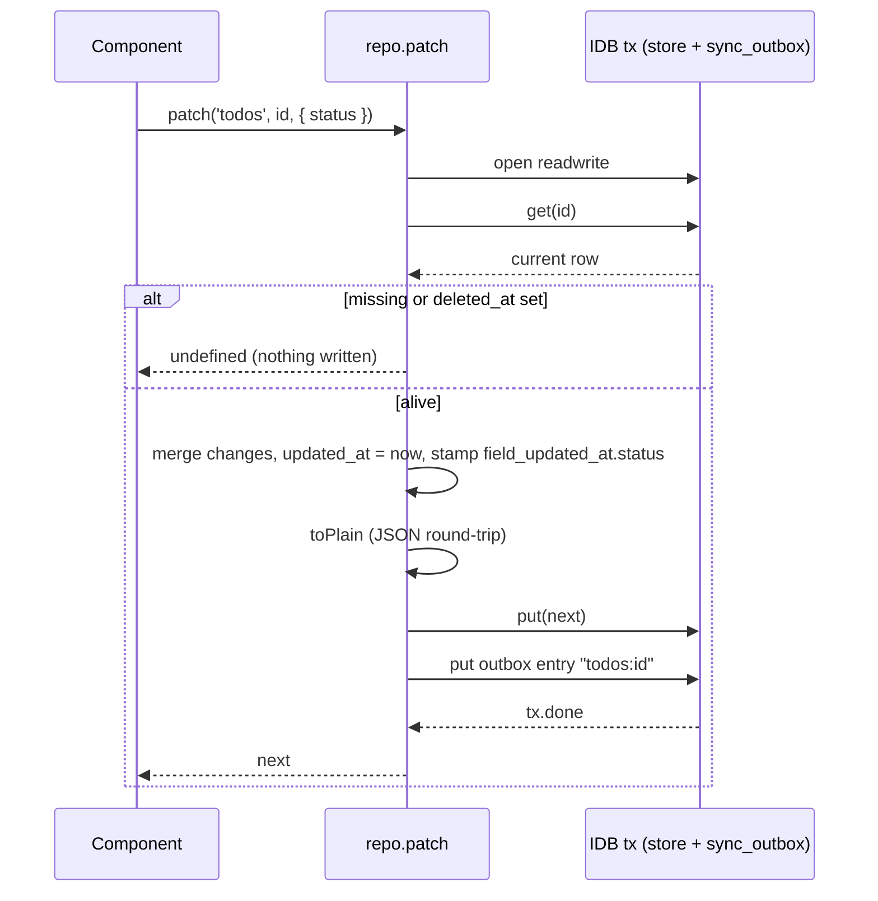
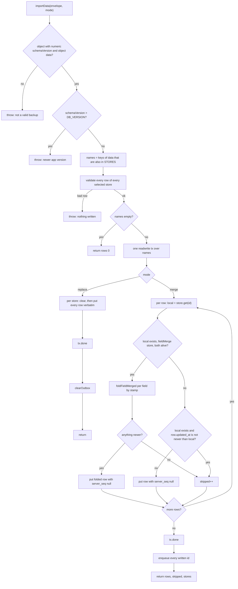

# Data layer

IndexedDB is the source of truth. There is no server: every row a tool creates lives in one database (`useful`) in the visitor's browser profile, and the only way it leaves is the JSON backup file. Four modules under `src/lib/db/` own it — the schema ([types.ts](../../src/lib/db/types.ts)), the connection and migrations ([db.ts](../../src/lib/db/db.ts)), the only sanctioned read/write path ([repo.ts](../../src/lib/db/repo.ts)), and backup export/import ([export.ts](../../src/lib/db/export.ts)) — plus a change queue that nothing drains yet ([outbox.ts](../../src/lib/db/outbox.ts)) and a persistent-storage request ([persistence.ts](../../src/lib/db/persistence.ts)).

_Describes the code as of v0.3.0 (schema v13) — verify against source when in doubt._

## File map

| File | Role |
| --- | --- |
| [types.ts](../../src/lib/db/types.ts) | Entity interfaces (`SyncFields`, `Preferences`, `Timer`, `Stopwatch`, `Event`, `Todo`, `TodoComment`, `SvgDocument`, `SqlPlayground`, `Sprite`, `NapkinTemplate`, `NapkinCalculation`, `ConfigSchema`) and the `STORES` map — every backed-up store, its indexes and its `singleton` / `fieldMerge` flags. `FIELD_MERGED_STORES` is derived from it. |
| [db.ts](../../src/lib/db/db.ts) | `DB_NAME = 'useful'`, the ordered `MIGRATIONS` list, `DB_VERSION = MIGRATIONS.length`, `getDB()` (memoised `openDB` from `idb`), `closeDB()` for the test harness. |
| [repo.ts](../../src/lib/db/repo.ts) | `all`, `get`, `byIndex`, `put`, `patch`, `bulkPut`, `putReconciled`, `canonicalRow`, `getSingleton`, `putSingleton`, `softDelete`, `softDeleteMany`, `withSyncFields`, `newId`, `nowIso`, `domainKeys`, `SYNC_META`, `SINGLETON_ID`. |
| [export.ts](../../src/lib/db/export.ts) | `exportData`, `downloadExport`, `importData` (modes `'replace'` / `'merge'`), `clearAllData`, the `ExportEnvelope` shape. |
| [outbox.ts](../../src/lib/db/outbox.ts) | The `sync_outbox` store: `enqueueIn`, `enqueue`, `drainOutbox`, `clearOutbox`, `outboxKey`. |
| [persistence.ts](../../src/lib/db/persistence.ts) | `requestPersistentStorage` (`navigator.storage.persist`) and `storageEstimate`. |
| [tests/local/helpers/schema.ts](../../tests/local/helpers/schema.ts) | The test harness's own `TABLES` mirror of the schema — column names, types, nullability, foreign keys, flags. |
| [tests/local/data.spec.ts](../../tests/local/data.spec.ts), [oracle.ts](../../tests/local/helpers/oracle.ts) | The data-integrity suite and its typed comparator. |
| [testHook.ts](../../src/lib/testHook.ts) | `window.__useful` — raw (unfiltered) reads/writes and pass-throughs to repo/export for the Playwright suite. Test mode only. |

## Store map

Every store is keyed on `id` (`keyPath: 'id'`) except `sync_outbox` (`keyPath: 'key'`). Every row in a `STORES` store carries `SyncFields`: `id`, `updated_at`, `deleted_at`, `server_seq`, and — on `fieldMerge` stores — `field_updated_at`.

| Store | Since | Indexes | singleton | fieldMerge | Foreign keys | Holds |
| --- | --- | --- | --- | --- | --- | --- |
| `preferences` | v1 | — | yes | yes | — | The one settings row: per-tool defaults and last-used values (see [preferences.md](preferences.md)). |
| `sync_outbox` | v2 | — | — | — | — | Change queue. **Not in `STORES`**: never exported, never validated by the suite. |
| `timers` | v3 | — | — | — | — | Countdown timers; running ones store an absolute `end_at`. |
| `stopwatch` | v3 | — | yes | — | — | The one stopwatch: `started_at`, `elapsed_before_pause_ms`, `laps`, `state`. |
| `events` | v4 | `start`, `series_id` (v8) | — | — | `series_id → events` (nullable) | Calendar events, including recurring series and the detached occurrences pulled out of them. |
| `todos` | v4 | `status`, `due_date` | — | yes | `recurrence_parent_id → todos` (nullable) | TODOs incl. recurrence rule and kanban `rank`. |
| `todo_comments` | v4 | `todo_id` | — | — | `todo_id → todos` | Comment child rows. |
| `svg_documents` | v5 | — | — | — | — | SVG-editor documents; `layers` is plain JSON. |
| `sql_playgrounds` | v7 | — | — | — | — | One workspace per engine, **row id = engine id** (`sqlite` / `pglite`): `buffer`, `snapshot`, `snapshot_at`. Written by [sql/store.ts](../../src/lib/sql/store.ts) through `put`/`patch` with an explicit `id`, not `withSyncFields`' UUID. |
| `sprites` | v9 | — | — | — | — | Sprite-editor documents: `size`, `rows` (array of strings), `colors` (character → colour); plain JSON. |
| `napkin_templates` | v10 | — | — | — | — | Napkin-math templates: `name`, `description`, `formula_latex`, `formula_json`, `fields`. |
| `napkin_calculations` | v10 | `template_id` | — | — | `template_id → napkin_templates` | One set of inputs run through a template, with its `result`. Deleted with the template. |
| `config_schemas` | v11 | — | — | — | — | Config-playground schemas: `name`, `format` (`json` / `yaml`), `fields` (the Field/Type tree as JSON), `source` (the parse-mode document text). Read back through `normalizeSchemaRow`, never trusted. |
| `notes` | v12 | `parent_id`, `tags` (multiEntry) | — | yes | `parent_id → notes` (nullable, self-referencing) | Notebook notes: `title`, `body_md`, `aliases`, `parent_id`, `tags`. Folders are notes. Read through `normalizeNote`; a missing, self or cyclic parent reads as root. Backlinks are computed, never stored. |
| `note_assets` | v12 | `note_id` | — | — | `note_id → notes` | Images pasted into a note: `name`, `mime`, `bytes`, `data` (base64). Capped per asset; deleted with the note. |

The foreign keys exist only in the test mirror ([schema.ts](../../tests/local/helpers/schema.ts) `references`) — IndexedDB enforces nothing; `assertInvariants` in the suite checks that every live child points at an existing parent.

Flags:

- `singleton` — one logical row under `SINGLETON_ID = 'singleton'`, read/written only through `getSingleton`/`putSingleton`. Creating such a row with `withSyncFields()` would mint a random UUID per device; if sync ever lands, every device converges on the same row only because the id is fixed.
- `fieldMerge` — rows carry `field_updated_at` (column → ISO stamp). `put`/`patch`/`bulkPut`/`putSingleton` write the stamps; `importData` in merge mode consumes them (`foldFieldMerged`). The comment on `SyncFields.field_updated_at` in `types.ts` still says nothing consumes the stamps; that predates `foldFieldMerged` and is stale.

## Migration history

`MIGRATIONS` in [db.ts](../../src/lib/db/db.ts) is an ordered array; `DB_VERSION` is its length, so appending a migration bumps the version. `getDB()` runs `MIGRATIONS[oldVersion .. length-1]` in order inside the one `versionchange` transaction. Migrations may be `async` but must only await requests on that transaction.

| Version | Change |
| --- | --- |
| v1 | `preferences` store. Frozen to a string literal — it used to iterate `STORES`, which would have created tomorrow's stores at v1 on a fresh install and crashed when a later migration created them again (`ConstraintError`). |
| v2 | `sync_outbox` (`keyPath: 'key'`). Local-only change queue; not in `STORES`. |
| v3 | `timers`, `stopwatch`. |
| v4 | `events` (+ index `start`), `todos` (+ `status`, `due_date`), `todo_comments` (+ `todo_id`). |
| v5 | `svg_documents`. |
| v6 | No schema change: a data sweep. Opens a cursor over each of the seven stores that existed at v6 (named as literals, skipped when the database lacks one) and, for each row with `deleted_at` set, rewrites it keeping only `TOMBSTONE_KEEP` (`id`, `updated_at`, `deleted_at`, `server_seq`, `field_updated_at`). Clocks are left exactly as stored — restamping a cleanup pass would beat real edits and resurrect deletions under LWW. |
| v7 | `sql_playgrounds`. |
| v8 | `events` gains the `series_id` index. The recurrence columns themselves need no migration: readers default them. |
| v9 | `sprites`. |
| v10 | `napkin_templates`, `napkin_calculations` (+ index `template_id`). |
| v11 | `config_schemas`. |
| v12 | `notes` (+ indexes `parent_id`, `tags` multiEntry — the first multiEntry index in the schema), `note_assets` (+ index `note_id`). |

Conventions, each enforced by nothing but review:

- **Never edit a shipped migration.** Append.
- **String literals + `contains()` guard.** Every store-creating migration names stores with literals and wraps creation in `if (!db.objectStoreNames.contains('…'))`. A migration must describe the schema at that version forever, independent of what `STORES` grows into.
- A schema change is at least a minor version bump and a CHANGELOG entry (see README).

## Repo API

`repo.ts` is the only sanctioned write path. Rules it enforces (from the file header): reads filter tombstones; writes stamp `updated_at` and queue the row in the outbox in the same transaction; `patch` re-reads before writing; `putReconciled` never stamps `now`.

| Function | Semantics |
| --- | --- |
| `all(store)` | `getAll`, minus rows with `deleted_at`. |
| `get(store, id)` | One row, or `undefined` if missing **or tombstoned**. |
| `byIndex(store, index, value)` | `getAllFromIndex`, tombstones filtered. No caller in the app today. |
| `withSyncFields(fields)` | Attaches `id: crypto.randomUUID()`, `updated_at: now`, `deleted_at: null`, `server_seq: null`. Build new rows with it — except singletons and `sql_playgrounds` (fixed ids). |
| `put(store, row)` | Whole-row upsert. Stamps `updated_at = now`; on `fieldMerge` stores stamps every domain key of `row` in `field_updated_at`. For new rows or rows read moments ago in the same handler; otherwise use `patch`. |
| `patch(store, id, changes)` | **The default edit path.** Re-reads the row inside the write transaction, merges `changes`, stamps `updated_at` and (on `fieldMerge` stores) only the changed keys. Returns `undefined` — writes nothing — if the row is missing or tombstoned, so an edit never resurrects a delete. |
| `bulkPut(store, rows)` | `put` for many rows in one transaction, one shared `at`. No caller in the app today. |
| `putReconciled(store, row, contentAt)` | Re-save content you did not author (folds, healers) preserving `updated_at = contentAt`. Still queued. Used only through the test hook (`repoReconcile`) today. |
| `canonicalRow(rows)` | Deterministic duplicate winner: lowest `id` by byte order (not `localeCompare`). No caller today. |
| `getSingleton(store)` | `get(store, SINGLETON_ID)`. `undefined` until first write. |
| `putSingleton(store, fields)` | Upsert under `SINGLETON_ID`: spreads the existing row, then `fields`, forces `deleted_at: null` (writing settings revives), preserves `server_seq`. Stamps only the passed keys (+ `deleted_at` when reviving a tombstone). |
| `softDelete(store, id)` / `softDeleteMany(store, ids)` | Replace the row with a tombstone (below). No-op on missing or already-deleted rows. |
| `domainKeys(row)` / `SYNC_META` | Keys of a row minus `id`, `updated_at`, `deleted_at`, `server_seq`, `field_updated_at`. Ordinary writes stamp domain keys only; `deleted_at` is stamped explicitly by the delete and revive paths, and `id`/`server_seq`/`field_updated_at` are never stamped. |

Two things every write shares:

- **JSON round-trip.** `toPlain(row)` = `JSON.parse(JSON.stringify(row))` before the IndexedDB `put`. Svelte 5 `$state` values are Proxies, which structured clone rejects with `DataCloneError` — silently, in fire-and-forget handlers. Rows are JSON-shaped by design, so the round-trip both strips reactivity and guarantees clonability. Side effects worth knowing: `undefined` values are dropped, `Date`s become strings, `NaN` becomes `null`, and anything binary (`Blob`, `ArrayBuffer`, canvases) is destroyed. Never call `getDB().put` directly.
- **Same-transaction outbox.** Every write opens `db.transaction([store, OUTBOX_STORE], 'readwrite')` and calls `enqueueIn(tx, store, id, at)` so the row and its queue entry commit together. `enqueueIn` is synchronous on purpose: awaiting a non-IndexedDB promise mid-transaction lets the browser auto-commit it.



## Tombstones

A delete never removes a key. `softDelete` replaces the row with `tombstone(store, row, at)`: `id`, `updated_at = at`, `deleted_at = at`, `server_seq` (kept), and — if present — a copy of `field_updated_at` with every former domain key plus `deleted_at` stamped `at`. **No domain field survives.** This is the v6 slim-tombstone rule: a deleted timer's label must not sit in IndexedDB or ride into the next backup. Reads (`all`/`get`/`byIndex`) hide tombstones; `patch` refuses them; `putSingleton` revives one by writing over it with `deleted_at: null`; the test hook's `raw*` helpers see them.

`db.ts` `TOMBSTONE_KEEP`, `repo.ts` `SYNC_META`, `data.spec.ts` `SYNC_FIELDS` and `PreferencesApp.svelte` `SYNC_FIELDS` are four hand-copied lists of the same five names. Keep them equal.

## Backup format and import

`exportData()` reads every `STORES` store in **one** readonly transaction (a per-store read could capture a parent from before an edit and its child from after) and returns:

```json
{ "schemaVersion": 7, "exportedAt": "2026-…Z", "data": { "preferences": [ … ], "timers": [ … ], … } }
```

Rows are exported verbatim, tombstones included. `sync_outbox` is not exported. `downloadExport()` serialises with two-space indentation to `useful-backup-YYYY-MM-DD.json` via a temporary `<a download>`. `BACKED_UP_STORES = Object.keys(STORES)` — a store added to the map is in the next backup with no other change; the module throws at load if that list is ever empty.

`importData(envelope, mode = 'merge')`:

- **Version gate.** Not an object with a numeric `schemaVersion` and an object `data` → `Not a valid useful backup file`. `schemaVersion > DB_VERSION` → rejected (`Backup is from a newer app version…`). Older is accepted; rows are written as-is with no per-row up-conversion.
- **Store selection.** Only names present in both `envelope.data` and `STORES` are touched. Unknown stores in the file are ignored; stores the file lacks are left alone (so an older backup cannot wipe a store it never knew).
- **Validate everything first.** `validate()` walks every selected row before any write: must be a non-array object with a non-empty string `id` and `updated_at`; `deleted_at` null or string; `server_seq` null or number. Domain fields are not checked. A failure throws with nothing written — the Settings page relies on that for its "nothing was changed" message.
- **`'replace'`** — per store: `clear()`, then `put` each row unchanged (`server_seq` included). After commit, `clearOutbox()` — the queue described data that no longer exists. It is never the default: a caller that omits the mode gets the fold, because forgetting an argument must not wipe a device.
- **`'merge'`** — per row, read the local copy:
  - both alive on a `fieldMerge` store → `foldFieldMerged`: for each domain field present in the incoming row, take the incoming value if its stamp (`field_updated_at[field]`, falling back to the row's `updated_at`) is strictly newer than the local one; union stamps to the max; row `updated_at` = max of both. Nothing newer → skipped. Otherwise write with `server_seq: null`.
  - anything else (ordinary store, or either side tombstoned) → whole-row LWW: write only if `row.updated_at > local.updated_at` (ties keep local, so a same-instant tombstone is never undone), with `server_seq: null`. The backup's `server_seq` belongs to whatever server that device talked to; keeping it would mark the row already-synced.
  - after commit, `enqueue` every written id with its stored `updated_at`.
- Returns `{ rows, skipped, stores }`; `skipped` counts merge rows the local copy beat.



`clearAllData()` clears every `STORES` store plus `sync_outbox`. It sits behind the Settings page's developer unlock.

## The outbox

`sync_outbox` rows are `{ key: "<store>:<id>", store, id, updated_at, queued_at }` (`error`/`error_at` are declared but never written). Every repo write and every merge-imported row is queued; replace-import and `clearAllData` empty it. **Nothing drains it** — `drainOutbox` is called only by the test hook. It exists so a sync backend later is a drop-in and so "changed since" never has to rely on a timestamp watermark. It is not backed up.

## Persistent storage

`requestPersistentStorage()` returns `'unsupported'` when `navigator.storage.persist` is absent, `'granted'` if `persisted()` is already true or `persist()` succeeds, else `'denied'`. Called only from the Settings page's "Request persistent storage" button; nothing calls it automatically. `storageEstimate()` is exported but has no caller.

## JSON-native only

Because every write is JSON round-tripped and every backup is a JSON file, the database holds only what JSON can carry: strings, numbers, booleans, null, arrays, objects. That is why:

- The image converter/resizer/compressor never store images — their only write is `convert_jpg_quality` on `preferences`.
- The image editor is session-only; its layer tree holds decoded bitmaps and never touches the database.
- The background remover's model lives in Cache Storage (`useful-models-v1`), not IndexedDB.
- The SQL playground stores SQL text (`buffer`, `snapshot`); the live database is in a Web Worker's memory.
- SVG documents *do* persist because `SvgLayer` structures are text-only, so they survive export/import byte-identically (the round-trip test proves it per column).

A tool that needs binary persistence would need a separate store outside `STORES` with its own export path; nothing like that exists today.

## Three files in lockstep

The schema is described in three places that must change together, or the suite lies:

1. [types.ts](../../src/lib/db/types.ts) — the interface **and** the `STORES` entry (flags, indexes). Adding the interface and forgetting `STORES` is the easy miss, and it fails loudly rather than quietly: `STORES` is what `exportData` iterates, so the store would be absent from every backup, and "a backup covers every store" is the test that catches it.
2. [db.ts](../../src/lib/db/db.ts) — an appended migration creating the store/indexes with literals.
3. [tests/local/helpers/schema.ts](../../tests/local/helpers/schema.ts) — a `TABLES` entry with every column's `type`, `nullable`, `references`, and the same `singleton`/`fieldMerge` flags.

`STORE_NAMES` in the mirror drives "a backup covers every store" (`exportData` keys must equal it exactly), the per-table round-trip test, and `assertInvariants` (singleton cardinality, FK targets). A column missing from the mirror is a column no test writes or compares. README's Tables section and CHANGELOG are the human-facing fourth and fifth copies.

## How it is tested

[data.spec.ts](../../tests/local/data.spec.ts) runs against a production build through `window.__useful` ([testHook.ts](../../src/lib/testHook.ts)) with the comparator in [oracle.ts](../../tests/local/helpers/oracle.ts):

- `loading a page writes nothing` — `/settings/` and `/` leave `rawDumpAll()` byte-identical.
- `a backup covers every store` — `exportData().data` keys equal `STORE_NAMES`.
- `every column survives a backup round trip` — per `TABLES` entry: build a row with `buildRow` (unicode, quotes, newlines, both booleans, large ints, floats), `repoPut`, export, replace-import, `assertSameDb` (typed: `1` ≠ `"1"`, `true` ≠ `1`, absent ≠ null, floats exact), then `assertInvariants`.
- `patch changes only the field it names` — `assertIsolatedDelta` across every store.
- `delete is a tombstone, not a hole` and `a tombstone keeps no payload` — the raw row survives with `deleted_at` and only `SYNC_FIELDS` keys, in the store and in the export.
- `the v6 migration strips payloads…` — `closeDb`, delete the database, rebuild it at version 5 with a fat tombstone, reload, assert the sweep stripped it with clocks intact.
- `a corrupt backup is rejected without changing anything`, `merge import never regresses a newer local row`, `merge import never resurrects a newer tombstone`, `restoring an older backup does not wipe stores it never covered`.
- `per-field merge folding` — two devices editing different `preferences` fields both keep theirs; nothing-newer counts as skipped; a fold never resurrects a newer tombstone.
- `sabotage:` — deliberate faults (restamped row, unrelated write, hard delete, orphaned FK on a synthetic schema, type confusion) that the oracle must catch; `trust-gate.ts` fails the run if this group did not execute.

Every other spec (`time`, `scheduler`, `svg-editor`, `sql-playground`, `images`, …) uses `dumpAll`/`assertIsolatedDelta` to assert its tool writes exactly the rows it claims and that opening a page writes nothing. There are no vitest units for `src/lib/db/`.

## Known limits and decisions

- **One browser profile is the only copy.** No sync, no cloud. Persistent storage is opt-in and may be denied; the app cannot stop a "clear site data".
- **Backups from a newer schema are refused outright**, even when the added stores would simply be ignored — cheaper than reasoning about forward compatibility.
- **Import does not migrate rows.** A v5 backup restored into a v7 database keeps whatever shape its rows had (e.g. fat tombstones), because `MIGRATIONS` run on database open, not on import.
- **Merge is per-field only where `fieldMerge` is set** (`preferences`, `todos`); everything else is whole-row LWW on `updated_at`, and any tombstone on either side forces whole-row.
- **Validation is structural**, not semantic: a row with an unknown domain field, or a wrong-typed one, imports fine.
- **The outbox is never drained.** One entry per row ever written (keyed `store:id`, so re-writes overwrite rather than append); it only shrinks on replace-import or `clearAllData`.
- **Only the v5→v6 upgrade has a migration test.** Fresh installs at every version rely on the literal + `contains()` convention, not on a test.

## How to add a store

1. **`types.ts`** — add the entity interface (extending `SyncFields`, JSON-shaped fields only) and a `STORES` entry with its indexes and flags. Decide `singleton` (one logical row → `getSingleton`/`putSingleton`) and `fieldMerge` (independent columns worth merging per field).
2. **`db.ts`** — append one migration: `if (!db.objectStoreNames.contains('name')) { const s = db.createObjectStore('name', { keyPath: 'id' }); s.createIndex(…) }`. Literals only. Do not touch earlier entries. `DB_VERSION` bumps by itself.
3. **`tests/local/helpers/schema.ts`** — add the `TABLES` entry: every domain column with `type`, `nullable`, `references` (parent store name for FKs), plus the flags. The round-trip, FK and singleton checks pick it up on the next run.
4. Write to it only through `repo.ts`. New rows via `withSyncFields` unless the id is meaningful (singleton, engine id).
5. Update the README Tables section and add a CHANGELOG line naming the new schema version; bump `VERSION` at least minor.
6. Backup export/import needs no change — `BACKED_UP_STORES` is `Object.keys(STORES)`.

Adding a **field** to an existing store needs no migration (rows are schemaless objects); it needs the interface, the `TABLES` column, and — for `preferences` — see [preferences.md](preferences.md).
