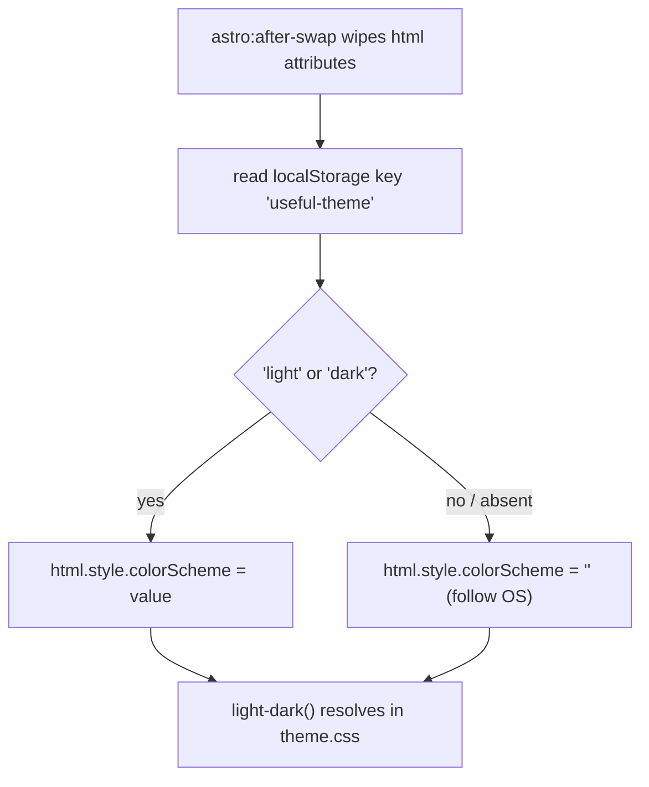

# Design system

Every colour, size, line weight and radius in the app comes from one file: [theme.css](../../src/styles/theme.css) declares the tokens, [global.css](../../src/styles/global.css) spends them on base elements and a small set of utility classes, and components spend them again in scoped `<style>` blocks. There is no second palette, no per-tool colour, and no theme-switching CSS: both schemes are written into every token with `light-dark()`, so the whole switch is one `color-scheme` value on `<html>`. The shell that consumes all of this is documented separately in [app-shell-navigation.md](app-shell-navigation.md).

_Describes the code as of v0.3.0 (schema v13) — verify against source when in doubt._

## File map

| Path | Role |
| --- | --- |
| [theme.css](../../src/styles/theme.css) | Every token. `:root` only — 103 lines, no other selectors, no media queries. |
| [global.css](../../src/styles/global.css) | Reset, base element styles, the drafting grid on `body`, Prism token colours, the sheet frame (`main.page`), utility classes, drag-ghost styling, the two breakpoints. |
| [Layout.astro](../../src/layouts/Layout.astro) | Imports both stylesheets; the pre-paint script that pins the theme and replays it after every client-side swap. |
| [Card.svelte](../../src/components/Card.svelte) | The one grouping block: registration marks, optional ruled header, actions slot, an optional `heading` snippet for a header that is a control, and a `collapsible` mode that makes the whole card a `
`. |
| [Explainer.svelte](../../src/components/Explainer.svelte) | Dashed-border `
` disclosure. |
| [ColorField.svelte](../../src/components/ColorField.svelte) | Text + native picker colour input. |
| [Icon.svelte](../../src/components/Icon.svelte), [icons.ts](../../src/lib/icons.ts) | 24×24 stroke-icon renderer and the glyph registry. |
| [a11y.spec.ts](../../tests/local/a11y.spec.ts) | The sweep that holds the contrast rules to numbers. |

## The blueprint

The app is drawn, not styled: a gridded drafting field with opaque sheets floated on it, ruled in three inks — primary linework, pencil annotation, hairline — plus one hot "stamp" accent used the way a surveyor's stamp is, sparingly and only where it means something. Light is dark-blue ink on white drafting paper, dark is chalk-white linework on a cyanotype field; nothing is rounded and nothing casts a soft shadow, because a straightedge does not draw corners and paper does not glow.

## Semantic tokens

Every value is a `light-dark(light, dark)` pair. Use the token, never the literal.

| Token | light / dark | Meaning, and where it may be used |
| --- | --- | --- |
| `--color-primary` | `#1c4c9c` / `#e8eef7` | Primary linework and brand fill. `.btn-primary` background, checkbox `accent-color`, `::selection`, `.btn:hover` border. |
| `--color-primary-strong` | `#102a56` / `#ffffff` | The heavier weight of the same ink. Link colour, `.btn-primary:hover`, Prism functions/tags. |
| `--color-primary-soft` | `#d9e5f6` / `#24488f` | A tint fill, never a text colour. Inline `<code>` background, active nav row, selected/highlighted rows. |
| `--color-on-primary` | `#ffffff` / `#142e63` | Text drawn **on** `--color-primary`. Only ever paired with it. |
| `--color-stamp` | `#a55f0b` / `#f2c53d` | The one hot accent. Focus rings, the active-item inset rule, the drag ghost's border, Prism keywords, the brand mark, `.eyebrow-stamp`. State and identity only — never decoration, never body text. |
| `--bg-color` | `#e9eef6` / `#142e63` | The drafting field behind the sheet. `body`, `<pre>` blocks. |
| `--surface-color` | `#f8fbfe` / `#1a3a77` | Sheet/card/control surface. Cards, inputs, `.btn`, `.table-wrap`, the drag ghost. |
| `--surface-raised-color` | `#ffffff` / `#1f4287` | One step above the surface, for things stacked on a card. |
| `--text-color` | `#14305e` / `#e8eef7` | Body text and the heaviest rules (the `.page-header` and title-block borders). |
| `--text-muted-color` | `#3f5c8c` / `#aac2e8` | Pencil annotation: labels, eyebrows, table headers, secondary copy, disabled button text, Prism comments/punctuation. Still ≥ 4.5:1 — it is text, not decoration. |
| `--border-color` | `#b7c8de` / `#33528f` | **Decorative** hairlines only: card edges, table cell rules, the sheet's dashed trim mark, disabled hatching. Not enough contrast to identify a control. |
| `--border-strong-color` | `#5f7aa6` / `#8099c9` | Boundaries that **identify a control**: inputs, `.btn`, `.table-wrap`, the sheet frame, card registration marks. ≥ 3:1 against the surface (WCAG 1.4.11). |
| `--color-success` | `#17703a` / `#5fd68a` | Success text/marks; Prism strings. |
| `--color-danger` | `#b93a21` / `#ff8a7d` | Error text, `.btn-danger`, invalid input borders. |
| `--color-warning` | `#9a5b00` / `#ffa94d` | Warning text; Prism numbers. The dark value is deliberately **not** the stamp yellow — feedback must never read as brand. |
| `--scrim-color` | `rgb(16 42 94 / 0.45)` / `rgb(4 16 30 / 0.6)` | Overlay wash behind dialogs and the drawer. An ink wash, not neutral black, so the field stays blue. |
| `--grid-fine-color` | 7% ink / 5% chalk | The 24 px graph line on `body`. |
| `--grid-major-color` | 13% ink / 9% chalk | The 120 px graph line on `body`. |

The comment block at the top of `theme.css` is the short version of this table; keep the two in step.

### Scales

| Group | Tokens | Values |
| --- | --- | --- |
| Spacing | `--space-1` … `--space-6` | `0.2 / 0.4 / 0.6 / 0.8 / 1.2 / 2` rem |
| Type size | `--font-size-sm`, `-base`, `-lg`, `-xl`, `-2xl` | `0.85 / 1 / 1.2 / 1.5 / 2` rem |
| Annotation | `--font-size-eyebrow` | `0.7rem` — the one size intended for every annotation-register label, so the voice cannot drift |
| Tracking | `--tracking-label`, `--tracking-wide`, `--tracking-brand` | `0.18em` (eyebrows, table headers, card titles) / `0.08em` (h1, buttons, form labels) / `0.24em` (the wordmark, Chrome only) |
| Rhythm | `--line-height` | `1.55` |
| Radius | `--radius-sm`, `-md`, `-lg`, `-full` | **All `0px`.** They exist so component CSS can name intent; the drafting language has no curves. |
| Elevation | `--shadow-1`, `--shadow-2` | `none` / one hard throw. `--shadow-1` is declared `none` on purpose: cards and tables reference it so a future flat-to-lifted decision is one edit, but today sheets do not float. `--shadow-2` is for overlays only (palette, dialogs, notices, the mobile drawer, ZonePicker, the calendar hover preview). |
| Grid | `--grid-fine-size`, `--grid-major-size` | `24px` / `120px` |
| Layout | `--page-max-width`, `--navbar-height`, `--sidebar-width` | `60rem` / `3.5rem` / `15rem` |

Typography is monospace everywhere: `--font-body` is `ui-monospace, "Cascadia Code", Consolas, "SF Mono", monospace`, set once on `html`, and nothing overrides it with a proportional face.

## Light and dark

`:root` declares `color-scheme: light dark` and writes both schemes into every token with `light-dark()`. That means:

- The default is **the OS preference**, resolved by the browser. No media query, no class, no duplicate palette.
- Pinning a scheme is one inline style: `document.documentElement.style.colorScheme = 'light' | 'dark'`, which re-resolves every `light-dark()` on the page.
- Settings → Appearance (`setTheme()` in [SettingsApp.svelte](../../src/components/apps/SettingsApp.svelte)) writes `localStorage['useful-theme']` and sets that inline style; `auto` removes the key and sets `''`. There is no theme toggle in the topbar.

The pinned value has to be applied **before first paint**, or the page flashes the OS scheme first. `Layout.astro` does this with an `is:inline` script in `<head>` that reads `localStorage` and sets `colorScheme` (and the sidebar-collapse attribute) synchronously. The complication is `ClientRouter`: `swapRootAttributes` replaces the root element's whole attribute set with the incoming document's on every client-side navigation, which drops the `style="color-scheme: …"` the script just wrote. The same `apply()` therefore re-runs on `astro:after-swap`; the listener survives swaps because inline scripts execute once per full document load.

Regression test: `collapse and pinned theme survive CLIENT-SIDE navigation` in [nav.spec.ts](../../tests/local/nav.spec.ts).

## Layout primitives

The sheet and its frame live in `global.css`; everything else is a small utility class.

| Class / selector | What it draws | When to use |
| --- | --- | --- |
| `main.page` | The drawing sheet: `--page-max-width` centred, a 1.5px `--border-strong-color` inner rule, a 1px dashed `--border-color` outline offset 5px (the trim mark), on a 94%-opacity surface so the grid shows faintly through. | Supplied by `Layout.astro`. Never add another. |
| `main.page::after` | The title block — `SHEET UF-001 · REV A · SCALE NTS`, right-aligned under a heavy `--text-color` rule at the bottom of every page. | Automatic. It is generated content, so it is decorative and not in the accessibility tree. |
| `.page-header` | The sheet's header strip: flex, title left, actions right, ruled off below with a 1.5px `--text-color` border. | The first element of every tool island, wrapping the page's single `<h1>`. |
| `.stack` | Vertical flex, `--space-4` gap. | The default page body layout. |
| `.row` | Horizontal flex, centred, `--space-2` gap, wrapping. | Button clusters, inline label/control pairs. |
| `.grid-2` | `repeat(auto-fit, minmax(18rem, 1fr))`, `--space-4` gap. | Two-up card layouts that should collapse to one column on their own. |
| `.table-wrap` + `.data-table` | Materials-schedule table: strong-bordered scroll container; header cells in eyebrow voice under a 1.5px rule, body cells separated by 1px dashed hairlines, last row unruled. | Any tabular output. Always wrap the table — `.table-wrap` owns `overflow-x`. |
| `.muted` | `color: var(--text-muted-color)`. | Secondary copy inside a block that is otherwise body text. |
| `.btn`, `.btn-primary`, `.btn-danger`, `.btn-sm` | Square, 1.5px ruled, uppercase, letterspaced. Hover **doubles the line weight** (border colour plus a 1px box-shadow ring) rather than glowing. Disabled is 45° hatching, the drafting way to mark a void — not opacity. `.btn-danger` recolours the text only. | All buttons; there is no button component. |
| `.drag-ghost`, `body.dragging` | The pointer-following ghost (stamp-bordered, fixed, `z-index: 1000`) and the no-select/`grabbing` body state. | Written by [dragdrop.ts](../../src/lib/dragdrop.ts); do not restyle per tool. |
| `.checkerboard` | The transparency checkerboard: a 16px `repeating-conic-gradient` in `--border-color`. Alternate squares are `transparent`, so whatever the element sits on shows through — it is a drop-in for the hand-rolled copies that predate it. | Behind anything that can be see-through: image previews, colour swatches, editor canvases. Give the element its own `background-color` on top and the alpha composites over the checks. |

Two breakpoints, both in `global.css`, both CSS range syntax:

- `width < 44rem` — the sheet becomes the page: `main.page` loses its margin, border, outline and translucency. There is no margin left to draw a frame in.
- `width >= 64rem` — `html:not([data-sidebar='collapsed']) body` gets `padding-left: var(--sidebar-width)`. `Chrome.svelte` uses the same `64rem` for its `MOBILE_MQ`, so CSS and JS cross over together with no fractional-zoom gap.

`body` always carries `padding-top: var(--navbar-height)` to clear the fixed topbar, and paints the two-scale grid as four `linear-gradient` background layers (fine horizontal, fine vertical, major horizontal, major vertical). Content sits on opaque surfaces, so the grid reads as paper margin and never runs under body text.

## Typography and the drafting annotations

Base element styles carry most of the voice:

- `h1` is `--font-size-2xl`, **uppercase**, `--tracking-wide`. `h2`/`h3` are plain size steps. All of `h1`–`h4` get `line-height: 1.2` and `text-wrap: balance`; `p` gets `text-wrap: pretty`.
- `label` is small, muted, uppercase, `--tracking-wide`, block, with a `--space-1` bottom margin — form labels are annotations, not headings.
- `input` / `select` / `textarea` are full-width, surface-filled, 1px `--border-strong-color`. `input[type=checkbox]` opts out of the width and takes `accent-color: var(--color-primary)`.
- `dialog` is given back `margin: auto`, because the blanket `* { margin: 0 }` reset would otherwise pin native dialogs to the top-left.
- `pre` is a sheet inset on `--bg-color` with a hairline border; `:not(pre) > code` gets a `--color-primary-soft` chip.

The **eyebrow** is the annotation register — the "FIG. 01 —" voice. `.eyebrow` is `--font-size-eyebrow`, 600, uppercase, `--tracking-label`, in pencil ink. `.eyebrow-stamp` recolours it to `--color-stamp` and is for **at most one label per view**; recurring structural labels stay on the plain version so the stamp stays a stamp. Currently exactly one place uses it ([FileTransferApp.svelte](../../src/components/apps/FileTransferApp.svelte)). The same uppercase / `--tracking-label` voice is re-cut at other sizes, though: `.data-table th` and the sidebar and home category headings keep `--font-size-eyebrow`, `Card`'s `<h2>` and `Explainer`'s `
` drop to `--font-size-sm`, and the title block and the topbar sheet code hardcode `0.64rem`. One size for every annotation label is the token's intent, not something anything enforces.

Prism token colours ([global.css](../../src/styles/global.css)) are the blueprint inks, not a syntax theme: comments muted italic, keywords stamp, strings success, numbers warning, functions/classes/tags primary-strong, operators/punctuation muted, properties/variables plain text. `CodeEditor.svelte` maps the same tokens onto CodeMirror so highlighted markdown and the live editors agree.

## Components

| Component | Notes that matter to the design system |
| --- | --- |
| [Card.svelte](../../src/components/Card.svelte) | Corner registration marks are eight positioned `linear-gradient` background layers — a 10px × 1.5px and a 1.5px × 10px arm per corner, in `--border-strong-color` via a local `--tick` variable — over a `--surface-color` fill with a hairline border. Header is optional (`title` and/or `actions`) and its `<h2>` is in title-block voice. Because the title is an `h2`, page structure must be `h1` → Card → `h3`; the a11y sweep fails on a skipped level. Two opt-ins: `heading` replaces the `<h2>` with a snippet, for a header that is a control rather than a word (the notebook types the note's title into it) — the title-block voice is scoped to Card's own `<h2>`, so a snippet cannot inherit it and must bring its own type; and `collapsible` renders the card as a `
` with the header as its `
`, `open` seeding the initial state, the marker drawn as a ▸ / ▾ in `--text-muted-color` and the header's rule dropped while closed. |
| [Explainer.svelte](../../src/components/Explainer.svelte) | Native `
`, so keyboard toggling and the accessibility tree come free. Dashed `--border-strong-color` border, 88%-opacity surface, summary in eyebrow voice that goes from muted to full ink on hover and while open. |
| [ColorField.svelte](../../src/components/ColorField.svelte) | Text input plus a 2.9rem native `<input type="color">`. Sets `aria-invalid` when the text does not parse, and the invalid state is drawn as a `--color-danger` **border** — a colour change alone would not be enough, so the field also carries the ARIA state. Opt into `alpha` for a slider (a native picker cannot express alpha) and `showSwatch` for a `.checkerboard` preview; both are off by default, so the callers that predate them are untouched. |
| [Icon.svelte](../../src/components/Icon.svelte) | See below. |

## Icons

`Icon` renders a fixed chassis — `viewBox="0 0 24 24"`, `fill="none"`, `stroke="currentColor"`, `stroke-width="2"`, round caps and joins, `aria-hidden="true"` — and injects the inner markup of one entry from `ICONS`. Icons therefore inherit the surrounding ink automatically and are never given their own colour. `size` (default 16) sets both width and height.

`ICONS` in [icons.ts](../../src/lib/icons.ts) holds the inner markup of selected [Lucide](https://lucide.dev) icons (ISC), hand-inlined rather than imported from a package: the app needs a handful of glyphs, they must bundle statically for the offline PWA, and stroke-drawn line icons are the blueprint language. The 22 current keys:

`house`, `sliders-horizontal`, `timer`, `watch`, `globe`, `calendar-days`, `binary`, `camera`, `hard-drive-download`, `palette`, `blend`, `layers`, `regex`, `qr-code`, `image`, `scaling`, `shrink`, `settings`, `pen-tool`, `database`, `scissors`, `brush`.

To add a glyph:

1. Copy the **inner** markup of the Lucide icon (paths/circles/lines only — no `<svg>` wrapper, no `stroke`/`fill` attributes, since the chassis supplies them) into `ICONS` under a kebab-case key. `palette` is the one exception that carries `fill="currentColor"`, on its four dots.
2. Reference the key from the tool's `ToolDef.icon` in [registry.ts](../../src/lib/registry.ts). `registry.test.ts` asserts every registry icon resolves through `hasIcon()`.
3. Never use an emoji as an icon, and never a raster image.

An unknown key renders `<rect x="4" y="4" width="16" height="16"/>` — an empty box — rather than throwing, so a registry typo degrades visibly instead of taking the shell down with it. The `{@html}` is safe because `ICONS` is static app-internal markup, never user input.

## Accessibility rules

Three rules, and the tokens that exist to satisfy them:

| Rule | Threshold | Token to use |
| --- | --- | --- |
| Text against its background | ≥ 4.5:1 (WCAG 1.4.3 AA) | `--text-color`, `--text-muted-color`, `--color-danger`, `--color-success` — all four are held to text contrast, muted included, because muted copy is still copy. |
| Boundaries that **identify a control** | ≥ 3:1 (WCAG 1.4.11) | `--border-strong-color`. Inputs, buttons, table wrappers and the sheet frame all use it. |
| Purely decorative rules | none | `--border-color`. Card edges, cell hairlines, the trim mark. Never use it to outline a control. |

Focus is never removed: `input`, `select`, `textarea`, `button` and `a` get `outline: 2px solid var(--color-stamp)` with a 2px offset on `:focus-visible`. The stamp is the same hue in both schemes, so focus reads identically on paper and on the cyanotype field.

Colour is never the only channel. Disabled buttons are hatched (and `:disabled`), invalid colour fields carry `aria-invalid`, the active nav row has a soft fill **and** an inset stamp rule **and** `aria-current="page"`.

### How the sweep verifies it

[a11y.spec.ts](../../tests/local/a11y.spec.ts) runs under `npm test` (Playwright against a production build) and checks contrast at the **token** level rather than by sampling rendered pixels — the palette is defined once and every page inherits it, so that is where a regression comes from. For each of `light` and `dark` it writes `localStorage['useful-theme']`, sets `colorScheme`, reloads, then reads each token off `documentElement` with `getComputedStyle`, resolves it to RGB through a throwaway probe `` (which is what collapses the `light-dark()` pair), and computes the WCAG relative-luminance ratio in the page:

| Assertion | Pair | Floor |
| --- | --- | --- |
| `bodyText` | `--text-color` on `--bg-color` | 4.5 |
| `surfaceText` | `--text-color` on `--surface-color` | 4.5 |
| `mutedOnSurface` | `--text-muted-color` on `--surface-color` | 4.5 |
| `danger` | `--color-danger` on `--surface-color` | 4.5 |
| `success` | `--color-success` on `--surface-color` | 4.5 |
| `strongBorder` | `--border-strong-color` on `--surface-color` | 3 |

This is why the dark `--color-danger` is `#ff8a7d` and not the original `#ff6f61`: the latter measured 4.0:1 on the dark surface and failed the sweep. Error text is exactly the text you cannot afford to lose.

The same file also sweeps **every** registered route for structure — no `button`/`a[href]`/`summary` without an accessible name, no `input`/`select`/`textarea` without a label (`label[for]`, a wrapping label, `aria-label` or `aria-labelledby`), no `img` without `alt`, exactly one `h1` inside `main`, and no heading level skipped on the way down. Its `ROUTES` array is a hand-kept mirror of the registry, so a new tool must be added to it. Two keyboard paths are asserted too: the palette opens, filters and navigates with the keyboard alone, and an explainer `
` opens on Enter.

## Do / don't for a new tool

**Do**

- Spend tokens. Every colour, gap, size and border comes from `var(--…)`.
- Build the page as `.page-header` with one `<h1>`, then `Card`s (whose titles are `h2`s), then `h3` inside.
- Reach for `.stack` / `.row` / `.grid-2` / `.table-wrap` before writing layout CSS.
- Use `--border-strong-color` for anything a user has to see the edge of, `--border-color` for decoration.
- Put annotation-register text in `.eyebrow`, in pencil ink.
- Let `Icon` inherit `currentColor`.

**Don't**

- Hardcode a colour, or introduce a token in a component. `theme.css` is the only place a palette value may be written.
- Round a corner, add a soft shadow, or fade something out to signal disabled — square edges, `--shadow-2` for overlays only, hatching for voids.
- Use `--color-stamp` for decoration. It marks state (focus, active, drag, alarm) and identity (the brand mark); a second stamped thing on screen devalues the first.
- Use `--color-warning` or `--color-danger` as an accent. Feedback colours mean feedback.
- Colour-only status. Pair it with text, an ARIA attribute, or a shape.
- Override `--font-body` with a proportional face, or ship an emoji where a glyph belongs.

## Known limits and decisions

- **`--font-mono` is an alias of `--font-body`**, not a second stack — the body face is already monospace. It exists because code, colour values and numeric readouts ask for "the mono face" by name; if the body face ever stops being monospace, that one line is what has to change. (Before v0.2.0 the token was referenced by ten files and defined by none: eight fell back to `ui-monospace, monospace` and two, having no fallback, silently inherited.)
- **The sweep does not measure every token.** `--color-stamp`, `--color-warning`, `--color-primary` / `--color-on-primary`, `--color-primary-soft` and `--border-color` are unchecked; a change to any of them will not be caught by CI.
- **Contrast is checked on the tokens, not on the composition.** Text on `--color-primary-soft`, or muted text on `--surface-raised-color`, is nobody's assertion.
- **`--shadow-1` is `none`** while several components still reference it. That is deliberate (one edit flips every sheet to lifted), but reading the CSS suggests an elevation that is not drawn.
- **The radius scale is four names for `0px`.** Also deliberate, and also confusing to read for the first time.
- **The title block is fixed text.** `SHEET UF-001 · REV A · SCALE NTS` is a CSS `content` string; it is not derived from the version, the route, or anything else.
- **`--surface-raised-color` has no rule in `global.css`** — it exists for component CSS only.
- Theme choice lives in `localStorage`, so it is per browser profile and outside backups.
