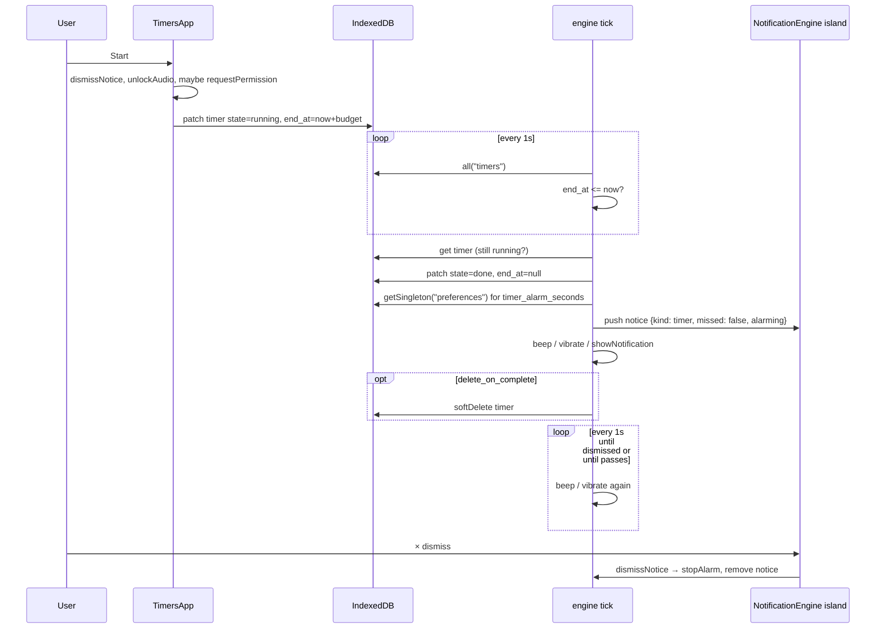
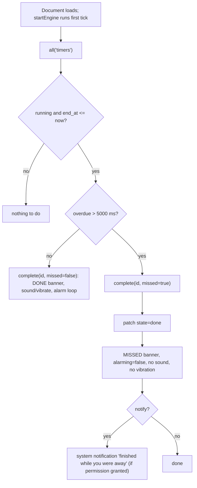

# Notification engine

One always-mounted Svelte island runs a one-second tick that completes expired timers, keeps their alarms ringing, and raises DUE/NOW banners for scheduler items — while the app is open in any tab. It has no server behind it: nothing can fire when the app is fully closed, and completions that elapsed while closed are surfaced as MISSED on the next open. Writes are consequences of user actions only; the tick itself never writes.

_Describes the code as of v0.4.0 (unreleased; schema v14) — verify against source when in doubt._

## Where it lives

| File | Role |
| --- | --- |
| [engine.svelte.ts](../../src/lib/time/engine.svelte.ts) | The engine: `engineState`, `startEngine`, `refreshTimers`, `dismissNotice`, `stopAlarm`, `unlockAudio`, `MAX_ALARM_SECONDS`, and the private `complete`, `scanDue`, `beep`, `showNotification`. Module-level runes, so every island shares one state. |
| [NotificationEngine.svelte](../../src/components/chrome/NotificationEngine.svelte) | The island. `$effect(() => startEngine())` and the fixed bottom-right banner list (`role="status"`, `aria-live="polite"`, `data-testid="timer-notice"`). |
| [Layout.astro](../../src/layouts/Layout.astro) | Mounts it once: `<NotificationEngine client:load transition:persist="engine" />`. The layout uses `ClientRouter`, so client-side navigations keep the island (and the module state) alive. |
| [TimersApp.svelte](../../src/components/apps/TimersApp.svelte) | The only caller of `unlockAudio` and `Notification.requestPermission`; calls `dismissNotice` from `start` and `reset` so acting on a timer silences it. |
| [PreferencesApp.svelte](../../src/components/apps/PreferencesApp.svelte) | Edits `timer_alarm_seconds` (1–25, imports `MAX_ALARM_SECONDS`). |
| [types.ts](../../src/lib/db/types.ts) | `Timer`, `Todo`, `Event`, `Preferences.timer_alarm_seconds`. |

Consumers: `TimersApp` renders `engineState.timers` and `engineState.now`; `PreferencesApp` imports `MAX_ALARM_SECONDS` and nothing else. No other module touches the engine.

## State

`engineState` (`$state`):

- `timers: Timer[]` — every live timer row, refreshed each tick by `refreshTimers()` (`all('timers')`).
- `notices: CompletionNotice[]` — the banners. `{ id, kind: 'timer' | 'todo' | 'event', label, missed, at, alarming }`. `id` is the source row's id; the list is keyed in the island by `id + at`.
- `now: number` — `Date.now()` at the last tick; the timers page derives its countdowns from it.

Module-level, non-reactive:

- `alarms: Map<id, { until, sound, vibrate }>` — notices still ringing.
- `firedDue: Set<string>` — scheduler due moments already announced in this document.
- `audioCtx: AudioContext | null` — created only by `unlockAudio`.
- `stop` — the running engine's disposer; `startEngine` is idempotent and returns it.

None of this is persisted. A full reload starts from empty notices, empty alarms, empty fired-set, no AudioContext.

## The tick

`startEngine()` runs `tick()` once immediately, then every 1000 ms via `setInterval`. Each tick:

1. `engineState.now = Date.now()`.
2. `refreshTimers()`.
3. For every timer with `state === 'running'` and `Date.parse(end_at) <= now`: `complete(id, overdue > MISSED_THRESHOLD_MS)` where `MISSED_THRESHOLD_MS = 5_000`.
4. `scanDue(now)` — the scheduler scan (below).
5. Alarm loop: for each entry in `alarms`, if its notice is gone or `now >= until` → `stopAlarm(id)`; otherwise `beep()` if `sound` and `navigator.vibrate([300, 150, 300])` if `vibrate`.

Three full-store reads happen per tick (`timers`, `todos`, `events`). That is the accepted cost of having no per-item scheduling.

### Timer fires while the app is open

`complete(id, missed)`:

- Re-reads the row (`get`) and returns if it is gone or no longer `running` — another tab's engine may have got there first. This is a check-then-patch, not one transaction, so it is best-effort dedup.
- `patch` to `state: 'done', end_at: null, paused_remaining_ms: null`. If `patch` returns nothing (row tombstoned meanwhile), stop.
- Reads `preferences.timer_alarm_seconds`; `alarmSeconds = min(MAX_ALARM_SECONDS, max(0, value ?? MAX_ALARM_SECONDS))`.
- `alarming = !missed && (sound || vibrate) && alarmSeconds > 0`.
- Appends the notice (label copied from the row, so a self-deleting timer's banner still reads correctly), and if `alarming` registers the alarm with `until = now + alarmSeconds * 1000`.
- If not missed: one `beep()` if `sound`, `navigator.vibrate([200, 100, 200])` if `vibrate`.
- If `notify`: `showNotification` with title `Timer done: <label>` or `Timer finished while you were away: <label>`, body `useful — timers`, tag `useful-timer-<id>`.
- If `delete_on_complete`: `softDelete('timers', id)` — a tombstone, not a hole.
- `refreshTimers()`.

### App reopened after the deadline → MISSED

"Missed" is measured, not inferred: any completion found more than 5 s past its deadline is treated as missed — including a tab that was frozen or a machine that slept past the deadline while the page stayed open.

## Alarm loop

- A live completion with sound or vibration on rings on every tick until one of: the banner's × (`dismissNotice`), the timer being used again (`TimersApp.start` / `reset` call `dismissNotice`), or `until` passing.
- `stopAlarm(id)` removes the map entry, calls `navigator.vibrate(0)` to cancel a vibration in progress, and clears the notice's `alarming` flag. The banner stays until dismissed; `alarming` only drives the pulse animation and `data-alarming`.
- Cap: `MAX_ALARM_SECONDS = 25`. The Preferences page clamps input to 1–25 (`saveAlarmSeconds`); the engine clamps whatever is stored to 0–25, so a hand-written `0` would disable the loop while still showing the banner.
- Missed completions never ring. Scheduler notices never ring (`alarming: false`).

## Sound and the AudioContext

Autoplay policy blocks audio that was not unlocked by a gesture. `unlockAudio()` creates the module-level `AudioContext` (or resumes a suspended one) and is called from `TimersApp.start` — the click that arms the timer. `beep()` returns silently unless `audioCtx.state === 'running'`; when it plays, it schedules three 880 Hz sine blips 0.35 s apart with a short gain envelope.

Limit that follows from this: after a full document load, `audioCtx` is `null` until some timer is started or resumed in that document. A timer started before a reload that fires afterwards gets its banner, vibration and system notification, but no beep. Client-side navigations between tools do not reset this (the module persists); only a full load does. Where `AudioContext` construction throws, `audioCtx` stays `null` and sound is silently unavailable.

## Notifications and permission

- The "Show notification" checkbox only renders when `typeof Notification !== 'undefined'` (`canNotify` in TimersApp).
- Permission is requested in `TimersApp.start`, only when the timer has `notify` and `Notification.permission === 'default'`. A `denied` result (or an already-denied state on a notify timer) sets `notifyDenied`, which shows the "Notifications are blocked for this site" note. Nothing else in the app requests permission.
- `showNotification` returns unless permission is `granted`. It prefers `registration.showNotification` from the service worker (the constructor throws on Android Chrome) and falls back to `new Notification` where no registration exists (dev builds). Failures are swallowed — the banner still shows.
- The scheduler's `notify` flags on TODOs and events therefore only produce system notifications if permission was already granted, in practice by starting a notify timer once. The in-app banner needs no permission.

## What can and cannot fire

| Situation | Banner | Sound | Vibrate | System notification |
| --- | --- | --- | --- | --- |
| App open in this tab (or another tab / installed window) | yes | if unlocked in that document | if `navigator.vibrate` exists | if permission granted |
| App fully closed when the deadline passes | on next open, as MISSED | no | no | on next open, if permission granted |
| TODO due / event start, app open, within 60 s of the moment | yes (DUE / NOW) | no | no | if permission granted |
| TODO due / event start passed while closed | no | no | no | no |

There is no push: no server, no Push subscription, no service-worker-side timers. Every tab runs its own engine with its own notices and alarms; the tab whose `complete` wins shows the banner and rings, other tabs see `state: 'done'` on their next `refreshTimers` and show nothing.

## How the scheduler plugs in

`scanDue(now)` runs every tick after the timer pass:

- Reads `all('todos')` and `all('events')`.
- A TODO qualifies when `notify`, `status !== 'completed'`, and both `due_date` and `due_time` are set; the due instant is ``new Date(`${due_date}T${due_time}`)`` — local time. Date-only TODOs never notify.
- An event qualifies when `notify`; the instant is `Date.parse(start)`.
- Fire window: `now >= due` and `now - due <= DUE_FIRE_WINDOW_MS` (60 000). Keys `todo:<id>:<date>T<time>` / `event:<id>:<start>` go into `firedDue`, so an item fires once per document.
- Fires a notice (`kind: 'todo'` → tag DUE, `kind: 'event'` → tag NOW, `alarming: false`) and `showNotification('Due now: …' / 'Starting now: …', 'useful — scheduler', 'useful-todo-<id>' / 'useful-event-<id>')`.

Because the fired-state is in memory, a reload inside the 60 s window re-announces the item. That is the accepted trade: writing "fired" would break the rule that page loads write nothing. Anything due more than 60 s ago is never surfaced — there is no MISSED for scheduler items.

A new source should follow the same shape: read its rows on the tick, compute the instant, dedupe with an in-memory key, push a `CompletionNotice`, call `showNotification`. Never write.

## Zero-write rules

- The tick writes only inside `complete`: the `patch` to `done` (a consequence of the user having started that timer) and the optional `softDelete` for `delete_on_complete`. A page load with idle, paused or done timers writes nothing.
- `scanDue` never writes. Dismissing a banner never writes. Notices, alarms and fired keys are memory only.
- Nothing is written per tick for a running timer: display recomputes from the stored `end_at`.

## Tests

- [time.spec.ts](../../tests/local/time.spec.ts) (`npm run test:data`, production build, oracle-audited): expiry → `done` + banner; MISSED via a `rawPut` running row 60 s overdue; ringing until dismissed (`data-alarming`); Run again interrupts the alarm; the alarm-seconds preference caps ringing while the banner persists; delete-on-complete leaves a tombstone and a banner. Sound is unchecked in these tests (headless).
- [scheduler.spec.ts](../../tests/local/scheduler.spec.ts): `a todo due just now raises a DUE banner (no writes)` — asserts the database is byte-identical after the banner appears.
- No unit tests cover `engine.svelte.ts` directly — it imports only `repo` and the row types. The duration helpers the timers page formats with are unit-tested in [duration.test.ts](../../src/lib/time/duration.test.ts).

## Known limits and why

- 1 s tick, three full-store reads per tick — simple and correct; no scheduling structure to keep in sync with edits from other tabs.
- 5 s missed threshold — anything later than a normal tick gap is not "live"; ringing for a timer that ended an hour ago would be noise.
- 60 s scheduler window, in-memory fired-state — keeps loads write-free at the price of a possible repeat after reload and no missed-item history.
- Sound needs a start gesture in the current document — autoplay policy; there is no gesture to piggyback on at load.
- Multi-tab dedup is best-effort (`get` then `patch`, not one transaction).
