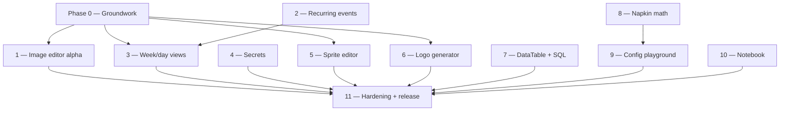

# useful — Version 0.2.0 plan

What 0.2.0 adds, split into phases that can each cut a release on their own. The
feature list comes from [TODO](TODO); two of the tools were sketched by hand —
three sketches, because the configuration playground has two modes — and those
sketches are the UI brief (kept in [sketches/](sketches/)). Section
references (§) point at [plan.md](plan.md), which still describes the 0.1.0
product and is not superseded by this file — where the two disagree about an
existing tool, plan.md describes intent and the code wins.

Written 2026-08-19 against the shipped 0.1.0 code (VERSION already reads
`0.2.0`, CHANGELOG already has an empty `0.2.0 (unreleased)` stanza, schema
v7, `CACHE_NAME` `useful-cache-v11`).

> **Progress:** phases are marked DONE in the overview table and on their own
> heading as they land. Everything else is still plan.

---

## Standing checklist — applies to EVERY phase

Inherited from [plan-phases.md](plan-phases.md) — items 1–5 as written there,
except that item 5 swaps its permission-fallback clause for the `ROUTES` list —
plus one addition (item 6) now that the documentation tree exists.

1. **If the data model changed:**
    1. All three schema files move in lockstep: [types.ts](../../../src/lib/db/types.ts),
       an **appended, `contains()`-guarded** migration in
       [db.ts](../../../src/lib/db/db.ts), and the `TABLES` mirror in
       [schema.ts](../../../tests/local/helpers/schema.ts) (plus the Tables
       section of [README.md](../../../README.md)).
    2. No sync regressions: every write goes through
       [repo.ts](../../../src/lib/db/repo.ts) (`patch()` for edits,
       `putSingleton` for singletons), rows stay JSON-native, page load writes
       nothing. `npm test` green **including the trust gate**.
    3. The new store rides backup export/import automatically — verify the
       round-trip test picked it up.
2. **Tests:** pure logic gets Vitest; anything touching UI + data layer gets a
   Playwright spec driving the real UI and asserting isolated deltas through the
   oracle. Both suites pass.
3. **CHANGELOG.md:** entries under the current unreleased version's `Features` /
   `Bug Fixes` / `Other` headings. Note the DB version whenever a migration
   ships.
4. **PWA:** new pages added to `SHELL` in [sw.js](../../../public/sw.js) +
   `CACHE_NAME` bumped; new tools registered in
   [registry.ts](../../../src/lib/registry.ts) with an icon in
   [icons.ts](../../../src/lib/icons.ts); links built with `href()`.
5. **Accessibility:** keyboard operability and AA contrast for anything new. The
   sweep in [a11y.spec.ts](../../../tests/local/a11y.spec.ts) reads its routes
   from the registry (since Phase 0), so registering the tool is what enrols it
   — there is no list to extend, and no way to ship a page unaudited.
6. **Docs:** every user-visible feature gets its page under
   [docs/dev/](../) and [docs/user/](../../user/) — new tools get a new page,
   changes to existing tools edit the existing page. A phase is not done while
   its docs describe the old behaviour. The dev page carries a mermaid diagram
   for anything with more than one moving part and a plain-words explanation of
   how it sits on the shared layers (storage, preferences, service worker),
   matching the 0.1.0 pages; the user page leads with the gotchas.

---

## Decisions taken up front

These are settled; the phases below assume them. Each records why, because the
reasons are the part that ages.

1. **Everything stays self-hosted.** No runtime CDN, ever — including the
   `https://esm.run/@cortex-js/compute-engine` import in the TODO's MathLive
   snippet. Assets are vendored into `public/` by a `tools/build-*.mjs` script
   with provenance and checksums, exactly like the segmentation model.
2. **Heavy engines stay lazy and become offline bundles.** Anything over a
   megabyte is `import()`ed from inside its own island, gets a matcher in
   [payload.spec.ts](../../../tests/local/payload.spec.ts), and — if it is a
   stable asset rather than a fingerprinted chunk — registers an `OfflineBundle`
   in [offline.ts](../../../src/lib/offline.ts) so "download everything" covers
   it.
3. **Recurring events expand virtually, never materialize.** The rule lives on
   the row; occurrences are computed at render and scan time. Materializing rows
   would need a top-up trigger, and the only available trigger is page load —
   which is forbidden by the zero-write-on-load invariant.
4. **New generators write nothing** unless they own documents. Secrets and the
   logo generator are stateless like the rest of Generators; sprites, napkin-math
   templates, config schemas and notes own documents and get stores.
5. **Hand-roll the small engines; import the large ones.** Schema inference,
   JSON-Schema-ish validation and faker-style data generation are ~300, ~150 and
   ~20 KB-of-word-lists of pure logic respectively, and the npm options are
   unmaintained (`to-json-schema`, 2020), 0.0.x (`genson-js`), 4 MB with Node
   shims (`quicktype-core`), CSP-hostile (`ajv` compiles with `new Function`) or
   25× heavier for less fit (`@faker-js/faker`'s English minimum is ~416 KB).
   MathLive, the Compute Engine, `yaml` and CodeMirror's language packages are
   imported.
6. **PDF export means `window.print()` with a real print stylesheet.** It costs
   zero bytes, and it is the only option that renders KaTeX and inline SVG at
   full fidelity with selectable text. The rasterizing libraries (`html2pdf.js`,
   `jsPDF.html()`) go through `html2canvas`, which is unreleased since 2022 and
   turns every formula into an unselectable bitmap. Accept the two costs: the
   user finishes in the browser's print dialog, and the filename can only be
   seeded through `document.title`.
7. **One markdown path.** [markdown.ts](../../../src/lib/markdown.ts) grows into
   a factory with hooks (wiki links, mermaid fences, relative images, footnotes)
   and keeps its unconditional `DOMPurify.sanitize`. Retoken's `render.ts` —
   remark/rehype/shiki with `allowDangerousHtml` and no sanitizer — is **not**
   ported; a backup file is an untrusted input and that is the hole
   `markdown.ts` exists to close.
8. **Ported code adopts this app's plumbing.** Downloads go through
   [exportFile.ts](../../../src/lib/exportFile.ts), rasterization through
   [convert.ts](../../../src/lib/img/convert.ts), SVG helpers through
   [build.ts](../../../src/lib/svg/build.ts), colors through
   [color.ts](../../../src/lib/gen/color.ts). No second copy of a helper this
   app already has.

---

## Open questions

Answers change what gets built. Each is tagged with the phase that needs it; the
phase can start without it only where noted. **Q1–Q5 were answered 2026-08-19**
and the phases below are written to the answers, not the defaults.

| # | Question | Needed by | Answer / default if unanswered |
|---|----------|-----------|-----------------------|
| Q1 | Recurring events: store an IANA `tz` per event (a 09:00 weekly meeting stays 09:00 through DST, and stays in its original zone if you travel) or expand in the device's current zone? | Phase 2 | **ANSWERED: expand in the device's current zone.** No `tz` field. Wall time is still preserved across DST for anyone staying put; a traveller sees the event at their new local wall time |
| Q2 | Should recurring events support an end — `until` date, `count`, or neither? And should the same be offered for recurring TODOs? | Phase 2 | **ANSWERED: `until` on both, no `count`** — one shared field in the shared rule editor |
| Q3 | Editing "all events" in a series: re-fold previously overridden occurrences (Apple) or leave overrides alone (Google)? | Phase 2 | Google semantics — overrides win |
| Q4 | Week start: the month grid hard-codes Sunday. Add a Monday/Sunday preference now? | Phase 3 | **ANSWERED: add the preference now**, read by the month grid and the new week grid alike |
| Q5 | On mobile (<44rem) the month grid hides entries. Auto-switch to day view, or keep month plus a manual switch? | Phase 3 | Manual switch |
| Q6 | Secrets: the TODO asks for WPA and WEP. randomkeygen.com has been rebuilt and no longer offers WEP, 160/504-bit WPA or CodeIgniter keys (see Phase 4). Ship a WiFi/WPA generator only, or also WEP behind a "broken since 2007" warning? | Phase 4 | WPA only; WEP omitted |
| Q7 | Sprite editor scope: a faithful port of retoken's (single frame, single layer, square 4–48 grid, no undo), or grown with undo/frames/sheet export? | Phase 5 | Faithful port + undo/redo; frames deferred |
| Q8 | Sprite editor category: Images (next to the SVG editor) or Generators (where the TODO lists it)? | Phase 5 | Images |
| Q9 | Logo badge mode: pull in `lucide-static` (1998 icons, ISC, ~813 KB lazy chunk) or restrict badges to emoji plus the ~22 glyphs already inlined in `icons.ts`? | Phase 6 | `lucide-static`, lazily loaded |
| Q10 | Should the DataTable also back the query-results grid, or only the table browser as the TODO's wording implies? | Phase 7 | Both — results client-side, browser pushed down |
| Q11 | Napkin math: does the code generator need `compile()`-quality output, or is a hand-written MathJSON→language emitter enough? (`expr.compile()` self-disables under a strict CSP and silently falls back.) | Phase 8 | Hand-written emitter |
| Q12 | Notebook: does "all the features from retoken" include Excalidraw drawings? That is the app's only React dependency, 59 MB installed, and a documented `clsx` hoisting hazard. | Phase 10 | Deferred to a later phase, behind an offline bundle |
| Q13 | Notebook: keep `$…$` math? It needs 60 self-hosted KaTeX font files (~1.2 MB) precached and is the main obstacle to a self-contained HTML export. | Phase 10 | Keep, sharing MathLive's fonts from Phase 8 |
| Q14 | Notebook: is WYSIWYG (Milkdown Crepe, ~8.5 MB installed, the whole ProseMirror stack) worth it, or is source-mode-plus-live-preview enough? | Phase 10 | Crepe — it is the headline feature of the port |
| Q15 | Should wiki links resolve inside timer/TODO/event descriptions too? They share `renderMarkdown`, so "everywhere" is the default unless gated. | Phase 10 | Everywhere |
| Q16 | Notebook folders: self-referencing `parent_id` (folders are notes) or flat plus tags? | Phase 10 | `parent_id` |

---

## Phase overview

| Phase | Goal | New deps | DB | Notes |
|-------|------|----------|----|-------|
| 0 ✅ | Groundwork + the bugs the docs pass turned up | — | — | **DONE 2026-08-19.** Unblocks 1, 3, 5, 6 |
| 1 ✅ | Image editor: alpha, CSS colours, transparent layers | — | — | **DONE 2026-08-19.** Built on Phase 0's `ColorField` |
| 2 ✅ | Scheduler: recurring events | — | v8 | **DONE 2026-08-19.** |
| 3 ✅ | Scheduler: week + day views | — | 2 prefs | **DONE 2026-08-19.** Built on Phase 2's expander |
| 4 ✅ | Secrets generator | — | — | **DONE 2026-08-19.** |
| 5 ✅ | Sprite editor (port) | — | v9 | **DONE 2026-08-19.** |
| 6 ✅ | Logo generator (port) | `@dicebear/*`, `jdenticon`, `lucide-static` | — | **DONE 2026-08-19.** |
| 7 ✅ | DataTable + SQL playground | — | — | **DONE 2026-08-19.** Adds `src/lib/table/` |
| 8 ✅ | Napkin math | `mathlive`, `@cortex-js/compute-engine` | v10 | **DONE 2026-08-19.** Adds `src/lib/codegen/` |
| 9 ✅ | Configuration playground | `yaml`, `@codemirror/lang-json`, `@codemirror/lang-yaml` | v11 | **DONE 2026-08-21.** Extends `src/lib/codegen/` |
| 10 | Notebook | `@milkdown/*`, `mermaid`, `katex`, CodeMirror markdown | v12 | Heaviest; most open questions |
| 11 | Hardening + release | — | — | |

Schema numbers assume this order. Ship out of order and the migration numbers
renumber — the migration list is append-only, so whoever lands first takes v8.

---

## Phase 0 — Groundwork — DONE (2026-08-19)

**Goal:** the small shared changes later phases depend on, plus the four defects
the 0.1.0 documentation pass turned up. Nothing user-facing except the fixes.

**Scope:**

1. **`ColorField` learns alpha.** Opt-in props `alpha?: boolean` (default off, so
   Gradients / Glassmorphism / Themes / SVG editor stay byte-identical) and
   `showSwatch?: boolean`. When on: a preview swatch over a checkerboard, an
   alpha range input (`data-testid={testid}-alpha`), and a native picker that
   **preserves** the current alpha instead of overwriting the text with 6-digit
   hex. The picker keeps emitting plain `#rrggbb` when alpha is 1, so the three
   existing `-pick` assertions in `generators.spec.ts` stay green.
2. **`setAlpha()` in [color.ts](../../../src/lib/gen/color.ts)**: parse, replace
   alpha, re-emit **in the same family** as the input — hex stays hex (8-digit
   when translucent), a named colour becomes `rgb(r g b / a)` while translucent
   and returns to the name at alpha 1, `transparent` reads as `rgb(0 0 0 / 0)`.
   Pure, unit-tested, no DOM.
3. **`resolveFillStyle(color): string | null`** in the same module: `null` for
   anything the parser rejects. Canvas silently paints unparseable `fillStyle`
   as opaque black; a text field that invites `transparent` and `red` needs a
   guard before it invites typos too.
4. **`--font-mono` token.** Eight components already write
   `var(--font-mono, ui-monospace, monospace)` and two write it with no
   fallback, but nothing defines it. Add it to
   [theme.css](../../../src/styles/theme.css) as an alias of the (monospace)
   body face.
5. **Shared `.checkerboard` utility** in
   [global.css](../../../src/styles/global.css). Four components hand-roll a
   transparency checkerboard today — the identical `repeating-conic-gradient` in
   the image converter, image editor and SVG editor, and a four-`linear-gradient`
   variant in the background remover — and Phases 1, 5 and 6 all want it.
6. **`a11y.spec.ts` derives its routes from the registry.** `ROUTES` is a
   hand-maintained array of 22 paths; a page forgotten there ships unaudited
   while the suite stays green. `registry.ts` is plain TS with one local import,
   so the spec can import it directly. Six new pages are coming.
7. **Version drift.** `package.json` still says `0.1.0` while `VERSION` says
   `0.2.0`. Sync it, and note in
   [build-and-tooling.md](../build-and-tooling.md) which is authoritative.

**Bug fixes (found while documenting 0.1.0):**

- **The post-install offline offer can reappear, and answering it doesn't record
  an answer.** `offline_prompt_seen` is written only by the "Not now" button;
  dismissing with Escape records nothing, and finishing the download inside the
  dialog neither closes it nor records the answer (`OfflineSetup.svelte` mounts
  `OfflinePanel` without `onfinished`).
- **Backup import defaults to Restore, not Merge.** That is what the code does
  (`importMode = $state('replace')`, and `importData(envelope, mode =
  'replace')`) — the destructive option is the preselected one. **Decided:
  default to Merge**; Restore stays available behind its existing confirm, and
  the docs follow.
- **A stale comment on `SyncFields.field_updated_at`** claims nothing consumes
  the per-field stamps. `foldFieldMerged` in
  [export.ts](../../../src/lib/db/export.ts) has consumed them since Phase 1 and
  `data.spec.ts` proves it.
- **`heic` is a search alias for the image converter**, which rejects HEIC. Drop
  the alias or support the format.

**Data model:** none.

**Tests:** unit — `setAlpha` round-trips (hex→hex8, named→slash-rgb, transparent
→opaque, oklch keeps oklch), `resolveFillStyle` rejects garbage. Playwright —
the existing suites must stay green unchanged; a new case asserts the offline
prompt records an answer on every exit path.

**Docs:** update [design-system.md](../design-system.md) (the new token and
utility), [preferences.md](../preferences.md) and
[settings-backup-preferences.md](../../user/settings-backup-preferences.md)
(import default), [testing.md](../testing.md) (registry-driven a11y sweep).

**CHANGELOG:** Bug Fixes (the four above), Other (token, utility, a11y sweep,
version sync).

---

## Phase 1 — Image editor: alpha, CSS colours, transparent layers — DONE (2026-08-19)

**Goal:** the TODO's image-editor item — colour fill layers with an alpha
channel, transparent layers, and CSS colour names.

Most of this already works and nobody can find it. `FillLayer.color` is a free
CSS string handed straight to `ctx.fillStyle`, so `transparent`, `rebeccapurple`,
`#ff000080` and `rgb(255 0 0 / 50%)` all render correctly **today** if you type
them into the text box. What is missing is the UI: no alpha slider, no
checkerboard preview, no transparent preset, no validation, and a native picker
that silently drops alpha on use.

**Scope:**

1. Fill-layer editing uses the Phase 0 `ColorField` with `alpha` and
   `showSwatch` on, plus quick presets: **Transparent**, **White**, **Black**.
2. **"+ Transparent layer"** — a fill layer created with `color: 'transparent'`.
   Also make the blank-canvas "Transparent" checkbox create a real `Background`
   fill at `transparent` rather than creating no layer at all, so it can be
   recoloured later. (`model.ts` already describes the background as a real fill
   layer; the transparent path is the exception.)
3. Layer-list dots for fills sit on the shared checkerboard, so a translucent or
   fully transparent fill reads honestly instead of blending into the row.
4. Invalid colour strings never paint: `render.ts` skips a fill/stroke/text whose
   colour fails `resolveFillStyle`.
5. A hint where the two knobs meet: colour alpha and layer opacity multiply, and
   the layer list's `50%` badge only reflects opacity.
6. The export card says so when a composite with alpha is exported as JPG (it
   flattens onto white — correct, and surprising next to a checkerboard preview).
   **As built:** read from the rendered composite through a 64x64 downscale
   rather than inferred from the layer tree — a transparent layer that
   something opaque covers is not transparency, and a warning that never turns
   off is a warning nobody reads.

**Not in scope:** an `alpha` field on the layer. Colour alpha and `layer.opacity`
are already multiplicative in the render pipeline; a second knob for the same
thing would confuse undo coalescing and the layer badge. The colour string stays
the single source of truth.

**Data model:** none (the editor is session-only by design and must stay so —
the whole-session zero-write assertion is part of the suite).

**Tests:** unit — the Phase 0 colour helpers. Playwright, via the existing
`probePixels` helper — `rgb(255 0 0 / 50%)` exports as roughly `[255,0,0,128]`;
`transparent` exports alpha 0; `rebeccapurple` exports `[102,51,153,255]`; the
alpha slider at 25 % lands near alpha 64; picking a colour after setting alpha
keeps the alpha; opacity 50 % × alpha 50 % ≈ 64; `notacolor` paints nothing
rather than black; a translucent fill exported as JPG flattens onto white; and
`dumpAll()` is unchanged across the whole session.

**Docs:** [tools/image-editor.md](../tools/image-editor.md) and
[user/image-editor.md](../../user/image-editor.md).

**CHANGELOG:** Features.

---

## Phase 2 — Scheduler: recurring events — DONE (2026-08-19)

**Goal:** events repeat, with the same "one row per user action, zero rows per
render" discipline the rest of the scheduler keeps.

TODOs already recur, but through a model that cannot be reused: the successor is
spawned when a TODO is *completed*. Events are never completed, so there is no
trigger — which is why they expand virtually instead.

**Design:**

- The rule lives on the event row. Occurrences are computed by a new pure module
  `src/lib/scheduler/occurrences.ts` exposing `occurrencesBetween(ev, fromMs,
  toMs)` and `nextOccurrenceOnOrAfter(ev, ms)`, called from the calendar's
  `$derived` and from the notification scan. Nothing is written by either.
- **Wall-time stepping, not UTC arithmetic.** The anchor is the existing `start`;
  stepping happens on local dates (reusing `addDays` / `addMonthsClamped` /
  the weekday scan already in `recurrence.ts`, exported for the purpose) and the
  wall time is re-applied through `wallTimeToInstant`. That is what keeps a 09:00
  weekly meeting at 09:00 across a DST boundary while its UTC instant shifts.
  The zone is **the device's current zone**, not a stored one (Q1) — so no `tz`
  field, and a traveller sees the series at their new local wall time. Duration
  is the anchor's `end - start`, re-applied per occurrence.
- **Month-end steps from the anchor, not from the previous occurrence.** "Every
  month" from the 31st gives Feb 28/29 and Apr 30 — and then May 31 again, not
  May 30.
- **Exceptions follow iCal.** The parent carries `exdates: string[]` (cancelled
  occurrence instants). A single modified occurrence becomes an ordinary event
  row — "detached" — carrying `series_id` and `original_start`. The expander is
  `expand(rule) − exdates − {detached.original_start} + detached rows`. Deleting
  an occurrence is one `patch` of the parent; moving one is one new row; "this
  and following" is two rows (patch the parent's `until`, insert a new series);
  "all" is one patch of the parent and leaves already-detached occurrences
  alone (Q3 — Google semantics, overrides win). Skips are **not** tombstones —
  `all()` hides
  tombstones, so a skipped occurrence would come back as a hole nobody can see.
- **Notifications** compute each series' next occurrence inside the existing 1 s
  tick instead of parsing a single `start`, dedup on
  `event:${id}:${occurrenceStart}`, and give each occurrence its own dismissable
  notice.
- **Occurrence identity in the UI.** Entries and the modal receive
  `{ event, occStart, occEnd, detached }` rather than a raw row, and saving or
  deleting a recurring occurrence asks for a scope: this event / this and
  following / all events.
- The TODO rule editor and `describeRule` move into a shared
  `RecurrenceFields.svelte` so both kinds of recurrence read the same.

**Data model — migration v8.** `Event` gains `recurrence: RecurrenceRule | null`,
`exdates: string[]`, `series_id: string | null`,
`original_start: string | null` (no `tz` — Q1); `RecurrenceRule` gains optional
`until` and no `count` (Q2), offered on recurring TODOs through the same shared
editor;
`STORES.events` gains a `series_id` index (the only part that needs the version
bump). Readers default missing keys at read time — no backfill, because a
backfill on load is a write on load. Mirror in `schema.ts` (`series_id` as a
self-reference to `events`), README Tables, CHANGELOG.

**Tests:** unit (`occurrences.test.ts`) — daily/weekly/monthly expansion in a
range; `interval > 1` alignment to the anchor; the weekdays rule; inclusive
`until`; month-end clamping across 2023/2024 February; DST spring-forward and
fall-back in `America/Toronto` and `Europe/London` keep wall time; an anchor
inside a spring-forward gap; `exdates` removal; detached rows shadowing by
`original_start`; a malformed rule (the oracle's generic suite will write an
array into that column) yields `[]` rather than throwing; `nextOccurrenceOnOrAfter`
never looks backwards; an occurrence cap so an unbounded daily rule cannot hang a
render.
Playwright — a weekly event shows four-plus entries in the month grid while
`dumpAll()` stays byte-identical across reload and month navigation; dragging one
occurrence writes exactly one new row with `series_id` set and the parent
untouched; deleting one occurrence changes only the parent's `exdates`; "this and
following" changes exactly two rows; deleting a series soft-deletes its detached
rows in the same action (the FK invariant must stay green); a due-window
occurrence fires a notice with no writes.

**Docs:** [tools/scheduler.md](../tools/scheduler.md),
[user/scheduler.md](../../user/scheduler.md) (including: recurring-event
notifications still only fire while a tab is open).

**CHANGELOG:** Features; note DB v8 and that v8 backups will not import into
0.1.0 builds.

---

## Phase 3 — Scheduler: week and day calendar views — DONE (2026-08-19)

**Goal:** the month grid gains week and day siblings.

**Design:**

- One `TimeGridView.svelte` with `days: 1 | 7` and an anchor date — the day view
  is the same component with one column.
- Layout: a 24-hour gutter (~3rem/hour) in a scrollable container that opens
  around 07:00; an **all-day lane** above it for all-day events, multi-day spans
  and date-only TODOs; timed entries positioned by `(startMin/1440)` with a 15
  minute minimum height. Overlaps: sort by start, cluster transitively
  overlapping entries, assign columns greedily, split the width.
- Dropping: one dropzone per day column plus one for the all-day lane, both
  through the existing pointer-event
  [dragdrop.ts](../../../src/lib/dragdrop.ts) so mouse, touch and pen keep
  sharing one path. The drop slot comes from `clientY` snapped to 15 minutes,
  with a snap line while dragging; `ondropitem` grows a `time` argument so a drop
  can set an event's time of day (preserving duration) or a TODO's `due_time`.
- The entry chip and its hover preview move into `CalendarEntry.svelte`, shared
  by all three views.
- A month/week/day segmented control, persisted as a **new**
  `scheduler_calendar_view` preference rather than widening `scheduler_view` —
  writing `'week'` into the existing field would make a 0.1.0 build silently fall
  back to the list. The control is the only way views change: below 44rem the
  month grid keeps hiding entries and the user switches by hand (Q5), because an
  automatic width-driven switch would fight a persisted choice.
- **Week start becomes a preference** (Q4): a Monday/Sunday setting on the
  Preferences page, read by the month grid (which hard-codes Sunday today) and
  the new week grid alike, defaulting to Sunday so nothing shifts under anyone
  who never opens it. The day-of-week header row and the leading-blank
  calculation both derive from it.
- Keyboard: roving tabindex across day columns and slots, Enter to create at the
  focused slot, and slot buttons named ("Add event on 2026-06-12 at 09:00") —
  the a11y sweep fails on unnamed controls.
- Multi-day events currently render only on their start day. A week view makes
  that visible; the all-day lane should span them.
- Touch: the hour column must still pan when a finger lands on empty space, so
  only entries and slot buttons take the gesture.

**Data model:** two new optional preference fields —
`scheduler_calendar_view` and `scheduler_week_start` — mirrored in `schema.ts`.
No migration.

**Tests:** unit — slot/position maths, the overlap-column packer, and the
week-start-aware grid maths (leading blanks and header order for both starts).
Playwright — switching views writes only the preferences row; a week drop onto a
slot changes one row and sets the time; a touch drag through CDP touch events
works in the week grid; changing week start reorders the month header without
touching any event row; rendering any view writes nothing.

**Docs:** as Phase 2's pages.

**CHANGELOG:** Features.

---

## Phase 4 — Secrets generator — DONE (2026-08-19)

**Goal:** `/tools/secrets/` — generate keys, secrets and passwords, on-device,
with no persistence.

**A finding that changes the brief:** randomkeygen.com has been rebuilt. The
generators the TODO names — CodeIgniter encryption keys, 160-bit and 504-bit WPA
keys, 64/128/152/256-bit WEP keys — **no longer exist on that site**. What it
offers now is roughly fifty tools; the catalogue below is extracted from the
site's current bundle. WEP is absent there for a good reason: it has been
breakable in minutes since 2007. See Q6.

**Scope — the catalogue.** Each entry is a card: value, regenerate, copy, and a
plain-word line saying what it is for and how much entropy it carries.

| Group | Generators |
|-------|------------|
| Passwords | Strong (16 from an 88-char set, ~103 bits); Fort Knox (32 from the same, ~206 bits); Alphanumeric (24 from 62, ~142 bits); Memorable (word-joined passphrase); PIN (n digits); pronounceable |
| Keys & secrets | API key (`sk_live_` + 32 alphanumeric); JWT secret (**32/48/64 random bytes for HS256/HS384/HS512, base64** — never a password charset); HMAC secret; AES key by bit length; salt; IV; 128/256-bit hex |
| Framework | Django `SECRET_KEY` (50 chars from its exact set); Laravel `base64:`-prefixed 32 bytes; Flask (48 hex); WordPress salts (64 chars incl. a literal space) |
| Identifiers | UUID v4 (`crypto.randomUUID`); UUID v7 (hand-rolled — time-ordered, index-friendly, no native API and none coming); MongoDB ObjectId (24 hex) |
| Network & 2FA | WiFi/WPA passphrase (8–63, default 20, from a 74-char set); TOTP/2FA secret (RFC 4648 base32 over 20 bytes); WireGuard-style key; recovery keys; backup codes |

Explicitly **not** offered: UUID v1 (leaks the host MAC by design) and, by
default, WEP.

**Design notes:**

- Entropy comes from `crypto.getRandomValues` with **rejection sampling** —
  `getRandomValues(new Uint8Array(1))[0] % 88` is measurably biased because 256
  is not a multiple of 88. Draw a large buffer once and refill on rejection
  rather than pulling four bytes per character.
- The entropy figure shown is `floor(len × log2(setSize))`, computed from the
  actual set. (randomkeygen's own WiFi label is wrong — it computes against 72
  characters for a 74-character set.)
- Nothing is stored, nothing is logged, values never enter the URL, and the page
  makes that explicit. Regenerating replaces the value in place.
- An `Explainer` per group covering what the number means and when each kind is
  the right one — JWT secrets in particular, where RS256/ES256 need a keypair
  rather than a secret and the tool should say so instead of pretending.

**Data model:** none.

**Tests:** unit — every generator's length and alphabet; the rejection sampler is
uniform over a large sample and never returns out of range; UUID v4 and v7
version/variant nibbles are correct and v7's timestamp prefix is monotonic across
milliseconds; base32 padding; entropy maths. Playwright — each card produces a
value that matches its documented shape, regenerating changes it, copy works, and
the page writes nothing.

**Docs:** `docs/dev/tools/secrets.md`, `docs/user/secrets.md` (with the honest
gotchas: a generated secret is only as safe as where you paste it; nothing is
stored, so copy it before leaving; WEP is broken).

**CHANGELOG:** Features.

---

## Phase 5 — Sprite editor (port) — DONE (2026-08-19)

**Goal:** retoken's pixel-sprite editor, as a document tool.

The port is unusually clean: 988 lines of Svelte plus four lib modules, **zero
npm dependencies**, and a document shape that is already pure JSON —
`{ size, rows: string[], colors: Record<char, cssColor> }`.

**Scope:**

1. The editor: square grid 4–48 with resize (pad/truncate), a text-grid paint
   mode (drag to paint, arrow-key navigation, per-cell colour) and a preview mode
   rendering the sprite as one `<rect>` per pixel with the seven CSS keyframe
   animations (all disabled under `prefers-reduced-motion`). Undo/redo over
   paint, resize and legend edits, a drag stroke coalescing into one entry — the
   one addition to the faithful port (Q7); frames, timelines and sheet export
   stay out.
2. The legend: character → CSS colour, add/recolour/remove, with `.`, space and
   empty reserved for transparent. Colours stay behind retoken's strict
   `isSafeColor` allowlist — that check is what makes the SVG export and the
   inline styles safe.
3. Persistence modelled on the SVG editor: named documents in a new `sprites`
   store, debounced autosave through `repo.patch`, flush on
   `pagehide`/`visibilitychange`, resume the last-open document with **no writes
   on load**, stale-write guard on the in-flight save.
4. Examples: the 14 pet species × 4 stages ship as a read-only bundled module
   behind a "Load example" picker that writes into the open document. They are
   never seeded into IndexedDB. Lazy-import the module so the editor's own chunk
   stays small.
5. Export through this app's pipeline: TXT/JSON (download + copy), SVG, and
   PNG rasterized **at** the target size (which keeps pixels crisp without
   fighting smoothing), plus copy-as-PNG to match the QR and SVG-editor
   conventions.
6. Import: paste JSON. Accept both retoken's `format: 'retoken-sprite'` and this
   app's own string so files move between the two.
7. Registered under **Images**, beside the SVG editor rather than under
   Generators where the TODO lists it (Q8) — it owns documents, and every other
   document tool lives there. Search aliases `pixel`, `pixel art`, `sprite`.

**Data model — migration v9.** `sprites`: `name`, `size`, `rows` (json),
`colors` (json). `Preferences` gains `sprite_last_doc_id`, mirroring
`svg_last_doc_id`. Note for the harness: the generic suite's `json` sample value
is an array, so the normalizer must tolerate a non-object legend rather than
assuming a record.

**Tests:** unit (retoken has none for these) — `parseJson` hardening (format
check, single-char keys, `isSafeColor`, ragged rows, negative sizes),
`resizeSprite`/`blankSprite`, `toSvgString` XML escaping, the text round-trip,
and an invariant sweep over the bundled examples (square, safe colours, expected
sizes). Playwright — create → paint → reload → identical JSON; autosave writes
exactly one row; export writes nothing; a document survives a backup round trip.

**Docs:** `docs/dev/tools/sprite-editor.md`, `docs/user/sprite-editor.md`.

**CHANGELOG:** Features; note DB v9.

---

## Phase 6 — Logo generator (port) — DONE (2026-08-19)

**Goal:** retoken's logo designer, restricted to the two modes the TODO asks for.

Retoken's component has four tabs. **Generators** (DiceBear avatars or Jdenticon
identicons, seeded from text) and **Badge** (a Lucide icon or an emoji on a
coloured tile) are in scope. **Upload** is out. **SVG editor** is out because
this app already has a much better one — the retoken panel is an earlier fork of
the same lineage. Offer "Open in SVG editor" instead, creating an `svg_documents`
row with the generated markup as one pasted-SVG layer.

**Scope:**

1. Generators tab: DiceBear (seed + a style grid over the collection, debounced)
   and Jdenticon (value, allowed hues, saturation/lightness ranges, background,
   padding).
2. Badge tab: icon or emoji on a tile — shape, colours, padding, corner
   treatment.
3. Result card: download SVG, copy markup, download/copy PNG at a chosen size,
   through the shared export pipeline.
4. Port `lib/icon/model.ts` and the generator half of `build.ts` into
   `src/lib/gen/logo.ts`, importing `escapeXml` / `svgDataUri` from
   [svg/build.ts](../../../src/lib/svg/build.ts) rather than duplicating them.
5. All three engines stay behind `import()` inside their panel, with the
   memoized promise cleared on failure so a transient error doesn't wedge the
   tab.
6. **Attribution.** Thirteen DiceBear styles carry CC-BY-4.0 artwork and four
   (`avataaars`, `avataaarsNeutral`, `bottts`, `botttsNeutral`) ship under a
   bespoke "free for personal and commercial use" notice; the remaining fourteen
   are CC0-1.0 or MIT. The tool shows the style's licence; the README and CHANGELOG
   record it. Lucide's ISC credit line comes across from retoken along with its
   "no brand logos" rule.

**Dependencies:** `@dicebear/core` (MIT, ~6 KB bundled), `@dicebear/collection`
(MIT meta-package; 31 styles landing as one ~2.0 MB lazy chunk, ~672 KB gzip),
`jdenticon` (MIT, ~5.5 KB chunk), and — subject to Q9 — `lucide-static` (ISC,
~813 KB chunk, 1998 icons). All lazy; a tab never opened downloads nothing. The
service worker's background crawl will precache them, so the CHANGELOG should say
the offline footprint grows by roughly 2.8 MB.

**Data model:** none. Output is deterministic from a few hundred bytes of config,
so nothing needs saving; if "remember my last logo" is wanted later it is one
JSON preference field, never the generated SVG.

**Tests:** unit — the pure builders (badge composition, XML escaping, config
normalization, the data-URI wrapper). Playwright — each tab produces an SVG,
downloads carry the right mime and filename, engines do **not** load until their
tab is opened (a payload assertion), and the page writes nothing.

**Docs:** `docs/dev/tools/logo-generator.md`, `docs/user/logo-generator.md`.

**Outcome:** [logo.ts](../../../src/lib/gen/logo.ts) +
[LogoGeneratorApp.svelte](../../../src/components/apps/LogoGeneratorApp.svelte),
19 unit tests and 8 specs. Two deviations from the plan above, both deliberate:

- **DiceBear loads with the page**, not on a tab click, because Generators /
  DiceBear *is* the default view — the alternative is an empty page until a
  button is pressed. Jdenticon and Lucide stay behind their controls, and the
  payload suite asserts all three (none appear on any other page).
- The licence split is **14 / 13 / 4** as predicted, but it is now enforced: a
  unit test reads `node_modules/@dicebear/*/package.json` and fails if an
  upgrade relicenses a style or adds an unlabelled one.

**CHANGELOG:** Features; Other for the dependency/licence note.

---

## Phase 7 — DataTable and the SQL playground — DONE (2026-08-19)

**Goal:** replace the playground's plain results table and 50-row table browser
with retoken's DataTable — filters, sorting, search, CSV, and paging pushed into
the engine.

The SQL *runtime* in this app is already a near-verbatim port of retoken's — the
adapters, both workers, the PGlite engine and the protocol are byte-identical,
and only `client.ts` and `types.ts` differ, by the exercise-checking half
(`comparator.ts`, `DesiredState`, `checkSolution`) having been stripped. What was
deliberately left behind is the display layer. This phase brings it over.

**Scope:**

1. Port `src/lib/table/{types,filter,format,csv,to-sql}.ts` **with their 176
   Vitest cases**, `src/lib/sql/table-schema.ts` with its own eight,
   `DataTable.svelte`, and `table/{FilterBuilder,FilterCondition}.svelte`.
   Re-skin onto blueprint tokens; swap the inline download for
   `exportFile.ts`.
2. **Table browser**: manual mode, exactly as retoken's `DbViewer` drives it —
   filters and sort compiled to SQL, keyset paging when the table has a
   single-column key, OFFSET otherwise.
3. **Query results**: client-side mode over the rows `exec` already returned,
   giving filter/sort/CSV at zero protocol cost and replacing the current
   200-row cap with paging (subject to Q10).
4. A small `inferSchema(rows, columns?)` helper for the results grid: prefer
   engine-declared types, else sniff per column.
5. Fix the two known weaknesses while porting rather than inheriting them:
   `SELECT count(*)` should not run in cursor mode (it is the one full scan left,
   and only the row-count readout wants it), and when a keyset cursor cannot seek
   past a NULL in the sort column, fall back to an OFFSET query for that page
   instead of silently re-serving page 1.
6. Harden `to-sql` for Postgres: `lower()` / `ILIKE` / `trim()` emitted straight
   onto a `uuid`, `json` or enum column raises at runtime on PGlite (SQLite
   tolerates it). Cast to text for text-kind operators on non-character types,
   with tests.
7. Optional protocol additions, if Q10 says results should be paged: an
   `execDescribed` message returning column names and types (so an empty or
   duplicate-named result set still gets headers) and a `tableMeta` message so
   the browser stops pulling 50 unused rows after every run.

**Not in scope:** paging an arbitrary user query by wrapping it as a subquery. It
breaks on multi-statement buffers, non-SELECT statements, DDL that must not
re-run, and CTE/ORDER BY/LIMIT interactions.

**Data model:** none — filters and page size are deliberately not persisted, so
the isolation oracle keeps its current expectations.

**Tests:** the ported unit suites, plus Playwright — a filter pushes down and
narrows the rows, sorting toggles, cursor paging walks 30 rows in pages of 10 on
both engines, CSV downloads with the right content, and filtering/paging/
exporting writes nothing to IndexedDB. The existing spec's `sql-results` /
`sql-table-rows` test ids need to move onto the new wrappers.

**Docs:** [tools/sql-playground.md](../tools/sql-playground.md),
[user/sql-playground.md](../../user/sql-playground.md).

**CHANGELOG:** Features; Other for the shared `src/lib/table/` module.

**Outcome:** `src/lib/table/` (5 modules, 193 ported cases),
[table-schema.ts](../../../src/lib/sql/table-schema.ts) (8),
[infer-schema.ts](../../../src/lib/sql/infer-schema.ts) (12 new),
[DataTable.svelte](../../../src/components/DataTable.svelte) and the two filter
components, both grids wired, `execDescribed` + `tableMeta` in both workers, and
6 new Playwright cases. Deviations worth recording:

- **`DbViewer.svelte` was not ported.** Its ~90 lines of driving logic moved into
  `SqlPlaygroundApp` instead; its wrapper duplicated four elements whose test ids
  the existing spec asserts on.
- **The existing spec needed one edit, not zero.** The test-id scheme held, but a
  Postgres boolean now renders as a `✓ Yes` pill rather than the raw `true` the
  old markup printed — a display improvement the plan had not accounted for.
- **The `toNumber` fix needed a second half.** Correcting the character class
  makes `'abc'` strip to `''`, and `Number('')` is `0` — so a no-digits guard had
  to go in, or every non-numeric string would have parsed as zero.
- **Duplicate result column names still collapse in the row objects.** The scope
  asked for headers, and headers are fixed; values need positional rows on both
  engines. Recorded in Known limits rather than glossed.

---

## Phase 8 — Napkin math — DONE (2026-08-19)

**Goal:** `/tools/napkin-math/` — self-documenting back-of-the-envelope
calculations. Type a formula, get typed input fields, run named calculations
against it, keep a library of templates, and generate code from any of it.

The UI brief is [sketches/napkinMath.excalidraw.svg](sketches/napkinMath.excalidraw.svg):
one column with a template name, the formula, a description, a **Fields** card
(one row per variable: type, required, allowed-values), a **Calculations**
section (inputs on the left, result, name + save; calculation history on the
right), and an **Export & Import** section (live JSON, downloads for all
templates and all calculations, the code generator, and an import box). A
collapsible sidebar holds the template library.

**Design:**

- **Entry is MathLive.** `<math-field>` in a thin Svelte wrapper; the editor is
  dynamically imported inside the island so its 843 KB never reaches another
  page.
- **Multi-letter names need `onInlineShortcut`.** Without it `count` becomes
  `c·o·u·n·t`. The hook rewrites an identifier-shaped run to `\mathrm{name}`,
  which is also what makes the Compute Engine treat it as one symbol.
- **The Compute Engine is mandatory, not optional.** MathLive's bundle contains
  no import of it at all — it looks the engine up on a global symbol, and
  `getValue('math-json')` silently returns an empty expression when it is
  missing. Install `@cortex-js/compute-engine` as a direct dependency and import
  it for its side effect. (MathLive 0.110 pins exactly 0.58.0 while the
  standalone latest is 0.115.0; whichever is installed directly is the one that
  ships. Round-trip `getValue('math-json')` → `ce.box().evaluate()` on both
  before choosing.)
- **Variables come from `expr.unknowns` / `freeVariables`**, not from walking the
  tree — the engine correctly excludes bound indices (`Sum`, `Integrate`) and
  constants like π, which a naive walker reports as user inputs.
- **Evaluation uses `evaluate()` / `N()` with a pushed scope** per calculation,
  not `expr.compile()`. Compilation builds JavaScript and instantiates it, so a
  strict CSP disables it engine-wide — and its default `fallback: true` means it
  degrades silently rather than erroring.
- **Fonts are vendored.** Copy MathLive's 20 KaTeX `.woff2` files (254 KB) into
  `public/` via a `tools/build-math-assets.mjs` with provenance, and set
  `MathfieldElement.fontsDirectory` before the first mathfield is constructed.
  Set `soundsDirectory = null` to skip 227 KB of `.wav`, and assert with a
  Playwright network check that no `.wav` is requested (a known MathLive issue
  reports requests continuing in some versions). They are stable assets rather
  than fingerprinted chunks, so they register an `OfflineBundle` in
  [offline.ts](../../../src/lib/offline.ts) per Decision 2 — and Phase 10's
  KaTeX shares that one bundle rather than vendoring a second copy (Q13).

**Scope:**

1. **Template editor** — name, formula, description; fields derived from the
   formula's free variables, each with a type (integer / number — the set stays
   numeric, MathJSON has no string arithmetic), a required toggle, and an
   allowed-values constraint: a sign choice (positives only / positive and
   negative) with an independent **no zero** toggle, which is what the sketch's
   two composite labels decompose into. The constraint is enforced on
   calculation input, checked on import, and re-emitted as a guard clause in the
   generated code. Fields survive a formula edit: a variable that is still
   present keeps its settings.
2. **Calculations** — one input per field, a live result, a name, and Save.
   Saved calculations list beside the inputs, each recallable and editable, as in
   the sketch's "calculation history".
3. **Template library** — a collapsible sidebar listing saved templates by name
   and description, with search.
4. **Export** — a live JSON box for the current template (updating as you type,
   copy button beside it) carrying the **template only**, never its saved
   calculations; download this template as JSON; download all templates; and a
   separate download for all calculations — the saved instances from section 2,
   as their own file.
5. **Import** — paste JSON or choose a file, for a template or for calculations
   against the loaded template. Both paths validate: shape, types, field
   consistency, and a formula that parses. An imported string is never evaluated
   as code, and rendered text goes through the sanitizer.
6. **Code generator** — the shared `src/lib/codegen/` module lands here:
   - "Normal": a plain function with a docstring per language — **Python,
     JavaScript, Go, Rust** — with parameters named and typed from the fields,
     the description as the docstring, and the formula emitted from MathJSON.
   - "Webcomponent": a dependency-free, framework-free custom element with plain
     form inputs that recomputes on input, showing the formula read-only. No CSS
     beyond what is needed to be styleable from outside; no CDN references. Two
     ways to show the formula: pre-render it at build time with MathLive's SSR
     entry (the generated component then ships no math JavaScript, only a small
     stylesheet plus the shared fonts), or leave a plain-text fallback.
   - The card itself, per the sketch: a **Language** dropdown (the four above
     plus "Webcomponent"), a **Generate** button, and **Copy text** /
     **Download** on the produced source, through `exportFile.ts` with a
     per-language extension.
   - The hand-written MathJSON→language emitter (Q11) has to cover more than
     add/subtract/multiply/divide: `Power`, `Sqrt`/`Root`, `Rational`, `Negate`,
     `Abs`, `Exp`/`Ln`/`Log`, the trig set, `Min`/`Max`,
     `Floor`/`Ceil`/`Round`, and precedence-correct parenthesization per
     language. Operators outside that table surface a named "unsupported
     operator" error in the UI rather than emitting a silently wrong function,
     and the table is the same one the evaluator whitelists.

**Data model — migration v10.** Two stores: `napkin_templates` (name,
description, formula LaTeX, formula MathJSON, fields as JSON) and
`napkin_calculations` (`template_id` FK, name, values as JSON, result). Both
JSON-native. `Preferences` gains the last-open template id.

**Tests:** unit — free-variable extraction over a corpus of formulas (including
bound indices and constants), field reconciliation across formula edits,
evaluation against hand-computed cases including division and powers, the
import validators (malformed JSON, wrong shape, unknown fields, hostile strings),
and every code emitter's output for a fixed template (golden files, including
identifier sanitization and per-language escaping). Playwright — typing a formula
creates the right fields; saving a template writes exactly one row; saving a
calculation writes exactly one row and nothing else; reload restores; export/
import round-trips; the generated web component is *loaded in a page* and
computes the same answer as the app; and MathLive is not fetched on any other
route.

**Docs:** `docs/dev/tools/napkin-math.md` (including the CSP/compile note and the
font vendoring), `docs/user/napkin-math.md`.

**CHANGELOG:** Features; note DB v10 and the new dependencies with their sizes.

**Outcome:** built as scoped, with four of this section's design claims
corrected by probing the real libraries. All are written up in
[tools/napkin-math.md](../tools/napkin-math.md) under "What we measured":

- **`expr.compile()` does not exist** in Compute Engine 0.115, so Q11's premise
  is moot — the hand-written emitter is the only option, not the better one.
- **"Evaluate with a pushed scope" leaks.** `ce.parse()` declares unknowns
  globally, so `assign` inside a pushed scope survives `popScope` and the next
  calculation returns the previous answer. `expr.subs()` instead.
- **A numeric result can be complex.** `sqrt(-4)` reports a real part of 0, so
  the four-predicate check is what stops the page showing a confident zero.
- **MathLive's built-in inline shortcuts corrupt variable names** — `sqrtish`
  becomes a square root, `count*rate` swallows the operator. Neither reproduces
  the failure the plan predicted, and the fix is to clear the whole table. This
  could only be found with a real keystroke stream.

Also corrected: the emitted code needs `_round` and `_mod` helpers, because the
engine rounds half away from zero and floors its modulo while Python,
JavaScript, Go and Rust each disagree in a different place.

---

## Phase 9 — Configuration playground — DONE (2026-08-21)

**Goal:** `/tools/config-playground/` — understand, validate and generate
JSON/YAML. Two modes, sketched in
[sketches/configurationPlaygroundParseMode.excalidraw.svg](sketches/configurationPlaygroundParseMode.excalidraw.svg)
and
[sketches/configurationPlaygroundCreateMode.excalidraw.svg](sketches/configurationPlaygroundCreateMode.excalidraw.svg).

One **Switch to Parse** / **Switch to Create** control moves between them and
the schema in hand survives the switch, so a hand-built schema can be checked
against a real document without retyping it.

**Parse mode.** Paste a JSON or YAML document into a syntax-highlighted editor
with the language package's completion on; the format is sniffed from the text
(a leading `{` or `[` is JSON) with a manual override for the ambiguous cases.
It is validated as you type — a **Valid** badge or the error shown in place —
can be linted and prettified, and its schema is extracted into a Field/Type
table carrying a **schema name**. Below that, the code generator.

**Create mode.** Build the same Field/Type table by hand — add and remove rows,
pick types from a dropdown — under the same schema name field, with a JSON/YAML
toggle picking the output format, the same code generator, and an **Examples**
card with an **Amount** input that generates *n* sample documents in that
schema, copyable and downloadable.

**Design:**

- **Editor**: the existing CodeMirror chassis with `@codemirror/lang-json` and
  `@codemirror/lang-yaml`, lazily loaded into the `language` compartment the way
  `SqlEditor` already swaps dialects.
- **YAML is `yaml` (eemeli), not `js-yaml`.** Two reasons, both decisive.
  `js-yaml` **discards comments entirely**, so a prettify pass would silently
  delete every comment in the user's document — data loss, not a formatting nit.
  And `js-yaml` throws on the *first* error with zero-indexed marks, while
  `yaml` collects multiple errors carrying `pos: [from, to]` character offsets
  that drop straight into CodeMirror diagnostics. (`@codemirror/lang-yaml` ships
  no linter, so that mapping is ours to write either way — about fifteen lines
  given those offsets.) Note the `js-yaml` in `node_modules` is a build-time
  transitive of Astro, not ours to use.
- **Schema inference is hand-rolled**, ~300 lines of pure logic: merge across
  samples, integer vs number by `Number.isInteger` across *all* values, enum when
  distinct values are few and repeat, optional when a key is missing from any
  sample, nullable tracked separately from optional, and format detection
  (email / phone / uri / date / date-time) by regex. That is precisely the part
  the npm options do not do.
- **Validation is hand-rolled too** — a recursive interpreting validator over
  that small type system, ~150 lines. `ajv` compiles schemas with `new
  Function`, which a hardened CSP blocks, and its standalone mode is build-time
  only, which is useless for a schema inferred from text pasted a second ago.
- **Nested objects** are the open UI problem the sketch flags. Proposal: the
  table renders a flattened path per row (`address.city`, `workplaces[].name`)
  with indentation and a collapse toggle per branch — one control model for both
  modes, and it round-trips to a real tree.
- **YAML/JSON fidelity traps** get explicit handling and an `Explainer`: the
  Norway problem (`NO` as boolean under YAML 1.1), sexagesimals (`12:30` → 750),
  leading zeros, integers past `MAX_SAFE_INTEGER`, duplicate keys, anchors and
  aliases (with `maxAliasCount` set — the tool eats untrusted pasted text and
  billion-laughs is a real input), `.nan`/`.inf`, non-string mapping keys, tabs,
  and line folding.
- **Generated data is hand-rolled and seeded** — a `mulberry32` PRNG plus curated
  word lists, ~10–20 KB, mapping straight from the inferred formats. Faker's
  English minimum is ~416 KB for a worse fit, and its bare root import pulls all
  129 locales.

**Code generator** (extends Phase 8's `src/lib/codegen/`): a **parser** (validate
input and surface each field) or a **generator** (faker-style samples), in
**Python, JavaScript, Go, Rust** as plain typed functions/classes with
docstrings, or as a **web component** — for the parser, paste a document and get
validation plus a per-field table; for the generator, pick a count, press a plain
form button, get that many documents. Framework-free, unstyled, styleable. Same
card shape as Phase 8 and the same in both modes: a Parser/Generator toggle, a
**Language** dropdown (the four plus "Webcomponent"), and **Copy text** /
**Download** on the produced source.

**Data model — migration v11.** `config_schemas`: name, format (`json`/`yaml`),
fields as JSON, plus the source document for parse mode. `Preferences` gains the
last mode and the last-open schema.

**Tests:** unit — inference across a corpus (nested objects, arrays of objects,
mixed types → unions, optional keys, enum thresholds, every format heuristic);
the validator against valid and invalid documents per type; YAML edge cases
(comments survive prettify, multiple errors reported with positions, alias bombs
rejected, `NO`, `12:30`, big integers); the seeded generator is reproducible from
a seed and always satisfies its own schema (property-style: generate 100, then
validate all 100); every code emitter against golden files. Playwright — invalid
input shows an error and blocks generation; prettify preserves comments; schema
extraction fills the table; create mode round-trips to parse mode; example
generation and download; and one generated web component of each kind is loaded
and exercised.

**Docs:** `docs/dev/tools/config-playground.md`, `docs/user/config-playground.md`.

**CHANGELOG:** Features; note DB v11 and the new dependencies.

**Outcome:** built as scoped — `src/lib/config/` (model, formats, inference,
validation, generation, word lists, parsing), `src/lib/codegen/config.ts` +
`configWebcomponent.ts`, [ConfigEditor.svelte](../../../src/components/ConfigEditor.svelte)
over the CodeMirror chassis, and
[ConfigPlaygroundApp.svelte](../../../src/components/apps/ConfigPlaygroundApp.svelte);
197 unit cases across seven files and 12 Playwright cases. Written up in
[tools/config-playground.md](../tools/config-playground.md). Decisions taken
while building, beyond the plan:

- **Extraction is live only while the table is the extractor's own work.**
  "The schema in hand survives the switch" and "its schema is extracted as you
  type" conflict the moment a hand-built schema meets a pasted document: live
  extraction would overwrite it on the first keystroke. So extraction stops
  rewriting the table once the fields came from anywhere else — opened from the
  library, or carried through Create and back — and parse mode instead reports
  how the document fits the schema in hand. **Extract from document** resumes
  the live behaviour, and the page says which state it is in.
- **Nested objects** render as the plan proposed: one flattened path per row
  (`address.city`, `workplaces[].name`) with indentation and a collapse toggle
  per branch, editable in Create mode and read-only in Parse mode.
- **`maxAliasCount` is a `toJS()` option in `yaml` 2.9, not a parse option**,
  and `parseDocument` never expands aliases; the bomb is caught where it
  would expand and reported as an ordinary error.
- **The octal audit keys on the source text**, because YAML 1.2 reads `0123`
  as the number 123 and a check on the parsed value would never fire.
- **Emitted code unrolls the schema per language; the web component
  interprets it.** The four-language files carry explicit per-field checks and
  assignments (readable, no runtime schema), while the component embeds the
  fields as data and one shared `CONFIG_JS_RUNTIME` interpreter — with drift
  tests holding that runtime to `validate.ts` and `generate.ts`. The format
  checks the emitted Python, JavaScript and Go carry are `formats.ts`'s own
  pattern sources, kept portable (RE2-safe, no flags) for exactly that reuse;
  only Rust, with no regex in its standard library, gets hand-rolled
  approximations.
- **Three honest limits, stated in the output itself:** the Rust parser uses
  `serde_json` (Rust has no JSON in its standard library); a YAML-format parser
  takes already-decoded data rather than pretending to parse YAML without a
  dependency; and the web component accepts JSON input only.
- **No schema import/export beyond the library.** The plan lists none and the
  sketch's "Schema Export" heading is the table itself; the generated code and
  the example documents are the things that leave the page.

---

## Phase 10 — Notebook

**Goal:** `/tools/notebook/` — a linked set of markdown documents built on
retoken's editor, exportable to Markdown, HTML and PDF.

The heaviest phase, with the most open questions (Q12–Q16). Land it last, and
consider splitting it: the store, the editor and wiki links are one shippable
increment; diagrams, math and drawings are another.

**The port (hybrid).** Retoken's editor is ~3,700 lines across five components
and five lib modules. Take: Milkdown **Crepe** for WYSIWYG (Q14 — it is the
headline of the port; source-mode-plus-preview is the fallback), the CodeMirror
source mode, the **footnote system** (542 lines of logic plus a 555-line test
file, a gutter that jumps between reference and definition, orphan/duplicate
reporting, and `Alt+0` as the one key for "the other half of this"), the
**DiagramDialog** (mermaid with context-aware completion, eight templates, and
live preview that
keeps the last good picture while showing the parse error), and the
**`AssetStore`** interface. Throw away `render.ts` and Shiki, and re-point the
preview at this app's `marked` + `DOMPurify` + Prism pipeline (Decision 7).
Defer Excalidraw (Q12). Keep `$…$` / `$$…$$` math (Q13), rendered with KaTeX
over the fonts Phase 8 already vendors — the same `OfflineBundle`, not a second
copy; it is also the one thing the self-contained HTML export has to inline
rather than link.

Two details worth carrying over unchanged: retoken already protects `[[...]]`
through the Crepe round-trip (undoing remark-stringify's bracket escaping), and
its footnote repair exists because Milkdown parses footnote references but has no
node for definitions and drops them — the definitions are harvested out of the
canvas and edited in their own dialog.

**Wiki links (net-new — retoken has none).**

- Syntax `[[Title]]` and `[[Title|Label]]`, resolved by **title**, not id, and
  live everywhere `renderMarkdown` runs — note bodies, and timer / TODO / event
  descriptions too (Q15), since they share the one renderer.
- Notes gain `aliases: string[]`; renaming pushes the old title on, so existing
  links keep resolving and "create this note" never offers a duplicate of
  something just renamed. Offer, as one explicit action, to rewrite the *n* notes
  that link here — one `bulkPut`.
- An unresolved link renders as a distinct affordance that creates the note.
- Scanning reuses retoken's `maskCode`, which blanks code spans while preserving
  every character offset — that is what stops `[[x]]` inside a code sample being
  treated as a link *and* what makes a rename rewrite safe to apply to the
  original string.
- **Backlinks are computed, never stored.** Backup import writes straight into
  IndexedDB, so a stored index goes stale on restore, and rebuilding it on load
  is a write on load. Memoize per note, keyed on `updated_at`.

**Exports.**

- **Markdown**: the source, with assets referenced or inlined.
- **HTML**: one self-contained file — CSS inlined from a TypeScript template
  (not the hashed global stylesheet), images as data URLs, mermaid pre-rendered
  to inline SVG. Never emit a script tag pointing at a CDN; the no-CDN rule
  applies to what the app *produces*, not only what it loads.
- **PDF**: `window.print()` plus a real `@media print` stylesheet — `@page`
  margins, `break-inside: avoid` on figures and tables, exact colour for code
  backgrounds, scrolling containers expanded. Neither repo has a single print
  rule today, so the stylesheet is greenfield and improves every page in the app.
  Label the button "Print / Save as PDF" because the filename cannot be set.

**Data model — migration v12.** `notes` (fieldMerge; `title`, `body_md`,
`aliases`, self-referencing `parent_id` for folders per Q16, `tags` with a
multiEntry index) and a separate `note_assets` child store holding base64.
Keeping images out of the note rows is what keeps `all('notes')`, the list view
and the link scan cheap — the same reasoning that made comments their own store.

**Two data-safety facts that need designing for, not discovering:**

- Base64 inflates by a third, and backup export builds one pretty-printed JSON
  string of the entire database before creating the Blob. A notebook with a few
  dozen screenshots is the first feature capable of making backup export fail on
  memory. Needs a per-asset cap and a size readout in Settings.
- A self-referencing `parent_id` is new to the harness: the FK-orphan check and
  the generated-row builder assume parent and child live in different tables, and
  a generated row can self-parent or cycle. Handle it explicitly, and decide what
  happens to children when a parent is deleted (cascade or reparent to root).

**Payload:** add Milkdown/ProseMirror, mermaid, KaTeX and Excalidraw matchers to
`payload.spec.ts` **before writing any notebook code**, so the existing
home-page and light-page assertions guard the feature from day one.

**Tests:** unit — wiki-link tokenizer (including `[[x]]` inside code, inside
inline code, escaped, and empty), alias resolution, rename rewriting, the
backlink builder, the HTML exporter's self-containment (no external URL survives)
and the markdown round-trip. Playwright — create/rename/link/backlink flows;
autosave writes exactly one row and reload restores; the footnote round-trip
survives a WYSIWYG→source→WYSIWYG cycle; an unresolved link creates a note; HTML
export contains no external references; print stylesheet applied (via Chromium's
PDF path as *verification*, not as the shipping mechanism); nothing heavy loads
on other routes.

**Docs:** `docs/dev/tools/notebook.md`, `docs/user/notebook.md`.

**CHANGELOG:** Features; note DB v12 and the dependency footprint honestly.

---

## Phase 11 — Hardening and release

**Goal:** the cross-cutting gates, then cut 0.2.0.

**Scope:** accessibility sweep over every new page (now registry-driven, so the
sweep picks them up automatically — verify it did); payload discipline re-checked
against the real build for MathLive, DiceBear, Lucide, Milkdown, mermaid and
KaTeX; the offline audit re-run (fresh install → no network → everything works
except undownloaded bundles) with the new bundles registered and sized; a review
of what the background crawl now precaches by default; docs refreshed against
what actually shipped; README feature list and Tables section updated; and the
release itself — `VERSION`, a dated CHANGELOG heading, `package.json` in sync.

**Tests:** both suites green including the trust gate; a manual install/offline
checklist recorded in the commit.

**CHANGELOG:** Other, plus the release.

---

## Ordering

- Phase 0 blocks 1 (needs `ColorField` alpha), 3, 5 and 6 (need the checkerboard
  and the registry-driven a11y sweep) — but it is half a day of work.
- Phase 3 needs Phase 2's occurrence expander to draw a recurring event in a week
  grid.
- Phase 9 extends the `src/lib/codegen/` module Phase 8 introduces. If Phase 9
  ships first, it owns the module and Phase 8 extends it instead.
- Phases 4, 7 and 10 depend on nothing but Phase 0's housekeeping.
- Phase 11 is last.

---

## Deliberately out of scope for 0.2.0

- **A sync backend.** Everything here keeps the sync-shaped invariants (soft
  deletes, per-field stamps, one row per action) so it stays possible, and none
  of it assumes a server.
- **Excalidraw drawings** in the notebook, pending Q12.
- **Sprite frames, animation timelines, GIF and sprite-sheet export** — Q7.
- **Paging arbitrary SQL queries** in the engine (Phase 7's "not in scope").
- **Migrating recurring TODOs to the virtual model.** They keep
  spawn-on-complete; two recurrence models in one tool is a known wart, recorded
  rather than fixed, because changing it would rewrite rows users already have.
- **`count`-limited recurrence**, WEP key generation, and UUID v1 — each rejected
  above with a reason.
