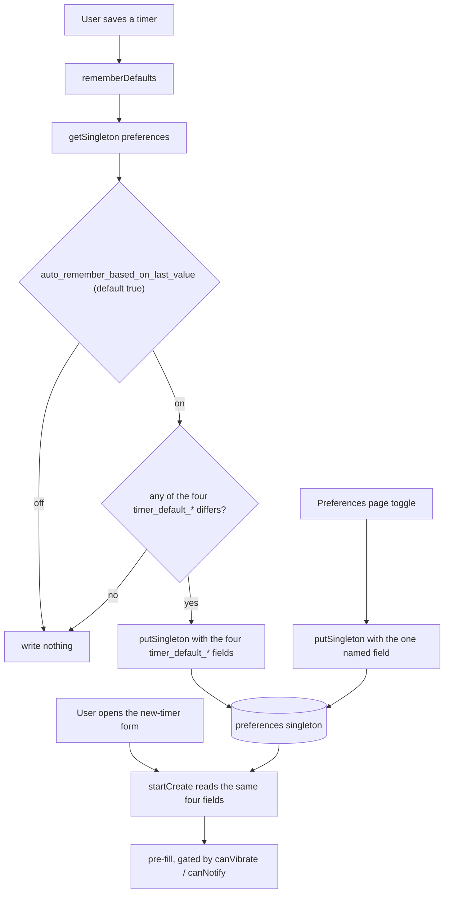

# Preferences

`preferences` is the app's one settings-style table: a single IndexedDB row holding per-tool defaults and last-used values. It is a `singleton` store (fixed id) and a `fieldMerge` store (per-column timestamps), every field is optional, and the row grows as tools are used. Twelve components write it; none of them writes on render. The store, its flags and the backup rules that apply to it are described in [data-layer.md](data-layer.md) — this page covers the row itself.

_Describes the code as of v0.3.0 (unreleased; schema v12) — verify against source when in doubt._

## File map

| File | Role |
|---|---|
| [types.ts](../../src/lib/db/types.ts) | The `Preferences` interface (every field, all optional) and the `STORES.preferences` entry: `{ indexes: [], singleton: true, fieldMerge: true }`. |
| [repo.ts](../../src/lib/db/repo.ts) | `SINGLETON_ID = 'singleton'`, `getSingleton`, `putSingleton` — the only sanctioned access path. |
| [db.ts](../../src/lib/db/db.ts) | Migration v1 creates the store (`keyPath: 'id'`, no indexes). Adding a *field* needs no migration. |
| [PreferencesApp.svelte](../../src/components/apps/PreferencesApp.svelte) | The `/preferences/` page: editable timer defaults, alarm duration, the auto-remember switch, and a read-only dump of everything else. |
| [SettingsApp.svelte](../../src/components/apps/SettingsApp.svelte) | `/settings/` — backup, storage, offline, theme, developer unlock. Writes **no** preference field (theme is `localStorage`). |
| [schema.ts](../../tests/local/helpers/schema.ts) | The test harness's column mirror. A field missing here is a field no test writes or compares. |
| [export.ts](../../src/lib/db/export.ts) | `foldFieldMerged` — the per-field merge that `fieldMerge` exists for. |

Writers, one per tool: [TimersApp.svelte](../../src/components/apps/TimersApp.svelte), [SchedulerApp.svelte](../../src/components/apps/SchedulerApp.svelte), [TimezonesApp.svelte](../../src/components/apps/TimezonesApp.svelte), [PhotographyApp.svelte](../../src/components/apps/PhotographyApp.svelte), [ImageConverterApp.svelte](../../src/components/apps/ImageConverterApp.svelte), [ImageResizerApp.svelte](../../src/components/apps/ImageResizerApp.svelte), [ImageCompressorApp.svelte](../../src/components/apps/ImageCompressorApp.svelte), [SvgEditorApp.svelte](../../src/components/apps/SvgEditorApp.svelte), [SqlPlaygroundApp.svelte](../../src/components/apps/SqlPlaygroundApp.svelte), [OfflinePanel.svelte](../../src/components/chrome/OfflinePanel.svelte), [OfflineSetup.svelte](../../src/components/chrome/OfflineSetup.svelte). One reader that is not a writer: [engine.svelte.ts](../../src/lib/time/engine.svelte.ts).

## The singleton contract

- **One row, fixed id.** Everything lives under `SINGLETON_ID = 'singleton'`. Never build the row with `withSyncFields()` — that mints a random UUID per device, so a future sync would leave one preferences row per device and `(await all('preferences'))[0]` would be nondeterministic.
- **Read with `getSingleton<Preferences>('preferences')`.** It is `get(store, SINGLETON_ID)`, so it returns `undefined` until the first write **and** for a tombstoned row. Every reader must therefore handle `undefined` and every field being absent.
- **Write with `putSingleton('preferences', { … })`.** It spreads the stored row, applies only the fields you pass, forces `deleted_at: null` (writing a preference revives a tombstoned row), preserves `server_seq`, stamps `updated_at`, and — because the store is `fieldMerge` — stamps `field_updated_at` for the passed keys only. Never `put` a whole preferences object: that restamps every column and hands a merge a row-wide claim it did not earn.
- **Pass a `Partial<Preferences>`.** Callers write `putSingleton<Partial<Preferences>>('preferences', { scheduler_view: v })`. There is no repo-level validation — an unknown key would be stored happily, and would show up in the page's "Remembered values" table.
- **All fields optional.** There is no seeding, no defaults row, no migration that fills anything in. "Not set" is the normal state; the default lives in the reader (see below).

## Every field

`type` is the TypeScript type in [types.ts](../../src/lib/db/types.ts); the `schema.ts` mirror column type is in brackets where they differ in name.

| Field | Type | Absent means | Written by | When |
|---|---|---|---|---|
| `timer_default_sound` | `boolean` | new timers play a sound (`?? true`) | `PreferencesApp` · `TimersApp.rememberDefaults` | ticking the box; saving a timer with auto-remember on |
| `timer_default_vibrate` | `boolean` | off (`?? false`) | `PreferencesApp` · `TimersApp.rememberDefaults` | as above |
| `timer_default_notify` | `boolean` | off (`?? false`) | `PreferencesApp` · `TimersApp.rememberDefaults` | as above |
| `timer_default_delete_on_complete` | `boolean` | off (`?? false`) | `PreferencesApp` · `TimersApp.rememberDefaults` | as above |
| `timer_alarm_seconds` | `number` (1–25) `[integer]` | ring for `MAX_ALARM_SECONDS` = 25 | `PreferencesApp.saveAlarmSeconds` | the number input's `change`, clamped to 1–25 and written only when it differs from the stored value |
| `auto_remember_based_on_last_value` | `boolean` | on (`?? true`) | `PreferencesApp` | ticking the box |
| `scheduler_view` | `'list' \| 'board' \| 'calendar'` `[text]` | the list view | `SchedulerApp.setView` | clicking a view button |
| `scheduler_calendar_view` | `'month'` / `'week'` / `'day'` `[text]` | the month grid | `SchedulerApp.setCalView` | picking a calendar range. A separate field from `scheduler_view` on purpose: an older build reading `'week'` there would fall back to the list |
| `scheduler_week_start` | `0` (Sunday) or `1` (Monday) `[integer]` | Sunday | `PreferencesApp` | choosing a week start; read by the month AND week grids |
| `tz_last_from` | `string` (IANA zone) | the browser's own zone | `TimezonesApp.remember` | picking a zone from search, "my zone", or swap |
| `tz_last_to` | `string` (IANA zone) | the browser's own zone | `TimezonesApp.remember` | as above |
| `photo_last_format` | `'mft' \| 'apsc' \| 'apsc-canon' \| 'ff'` `[text]` | `mft` (the page's own initial value) | `PhotographyApp.rememberFormat` | changing the set-A sensor-format `<select>` |
| `convert_jpg_quality` | `number` `[integer]` | each tool's own initial value — 85 (converter, resizer), 75 (compressor) | `ImageConverterApp` · `ImageResizerApp` · `ImageCompressorApp`, each `rememberQuality` | the quality slider's `change` |
| `svg_last_doc_id` | `string` (an `svg_documents` id) | nothing is resumed | `SvgEditorApp.openDoc` | opening or creating a document — **not** when resuming one on load (`openDoc(doc, { remember: false })`) |
| `sql_last_engine` | `string` (`'sqlite'` / `'pglite'`) | `sqlite` (first entry of `engines`) | `SqlPlaygroundApp.pickEngine` | switching engines |
| `offline_prompt_seen` | `boolean` | the post-install offer has not been made | `OfflineSetup.close` | clicking "Not now" in the install dialog |
| `offline_ready_at` | `string` (UTC ISO) `[timestamp]` | no offline download has ever completed | `OfflinePanel.start` | after **every** chosen bundle reports `done` |

Plus the `SyncFields` every row carries: `id`, `updated_at`, `deleted_at`, `server_seq`, `field_updated_at`.

Fields the app does **not** keep here, despite looking like preferences: the theme (`localStorage` key `useful-theme`, set in `SettingsApp`), the sidebar collapse state (`localStorage`, [Chrome.svelte](../../src/components/chrome/Chrome.svelte)), and the developer-mode unlock (`sessionStorage` key `useful-inDeveloperMode`). None of them is in a backup.

## How a tool reads a default

The pattern is the same everywhere, and it is deliberately dumb:

```ts
onMount(async () => {
  const prefs = await getSingleton<Preferences>('preferences');
  if (typeof prefs?.convert_jpg_quality === 'number') quality = prefs.convert_jpg_quality;
});
```

Rules that fall out of it:

- **The default lives in the component**, as its `$state` initialiser. The preference only overwrites it when present and usable. There is no central defaults table, so the same fallback can (and does) differ per tool — the compressor starts at 75, the converter and resizer at 85.
- **Validate before applying.** A stored value is untrusted: it can come from an older build, a hand-edited backup, or another device. `SchedulerApp` accepts only `'board'`/`'calendar'` (anything else stays on `list`), `TimezonesApp` checks `isValidZone` rather than list membership (so alias zones like `Europe/Kyiv` work), `PhotographyApp` checks `formatById`, `SqlPlaygroundApp` looks the id up in `engines`, `SvgEditorApp` does a `get()` on the document id and silently skips a missing or deleted one, and `engine.svelte.ts` clamps `timer_alarm_seconds` into `0 … MAX_ALARM_SECONDS`.
- **Reading writes nothing.** A tool that cannot use the stored value leaves it alone rather than "correcting" it. A stale `svg_last_doc_id` pointing at a deleted document is never cleaned up — it is simply not resumed.

## Auto-remember

`auto_remember_based_on_last_value` (default **on**) governs exactly one thing: whether saving a timer overwrites the four `timer_default_*` fields.

`TimersApp.rememberDefaults()` re-reads the singleton, returns immediately when the switch is off, and otherwise writes the four fields **only if at least one differs** from what is stored — so an unchanged save writes nothing at all. `TimersApp.startCreate()` reads the same four fields back to pre-fill a new timer's form, further gated by capability (`canVibrate`, `canNotify`), so an unsupported option is never pre-checked.

Nothing else in the app consults the switch. The other "last used" fields (`scheduler_view`, `tz_last_*`, `photo_last_format`, `convert_jpg_quality`, `svg_last_doc_id`, `sql_last_engine`) are remembered unconditionally.



## The Preferences page

[PreferencesApp.svelte](../../src/components/apps/PreferencesApp.svelte) loads the row once on mount into a plain `$state` object and renders three editable cards plus one read-only table:

- **Timer defaults** — the four `timer_default_*` checkboxes, each with its own hard-coded fallback (`sound` true, the rest false).
- **Alarm** — `timer_alarm_seconds`, a number input bounded by `MAX_ALARM_SECONDS` (imported from [engine.svelte.ts](../../src/lib/time/engine.svelte.ts), currently 25) and clamped to a minimum of 1 on change.
- **Behaviour** — the `auto_remember_based_on_last_value` switch.
- **Remembered values** — every remaining key on the row, rendered as `key` / `JSON.stringify(value)` rows. It is driven by subtraction: `otherFields` filters out the page's own `SYNC_FIELDS` set and its `KNOWN` set (the six editable fields), so **any** field added to `Preferences` shows up here with no page change. That is the point — nothing stored is invisible to the user.

Each control writes exactly one field via `setPref(key, value)` → `putSingleton('preferences', { [key]: value })`. There is no save button and no whole-row write. The page's `SYNC_FIELDS` constant is a fourth hand-copy of the same five sync-field names (see the tombstones section of [data-layer.md](data-layer.md)); keep it equal to `repo.SYNC_META`.

## Invariants

- **Preferences are written only from a user action.** No `onMount`, no `$effect`, no render path may call `putSingleton('preferences', …)`. Every writer is an event handler — a click, a `change`, a save. The data suite enforces this globally (`loading a page writes nothing`, and `assertIsolatedDelta` on every tool spec), and several call sites carry the comment saying so.
- **One field per write.** Pass only the keys the action actually changed. `putSingleton` stamps exactly the keys it is given; a wider write claims columns the user did not touch and can beat another device's real edit on the next merge.
- **Never `put`/`patch` the row directly.** `getSingleton`/`putSingleton` only. `patch` would refuse a tombstoned row instead of reviving it, and `put` would restamp every column.
- **Never assume a field exists.** Read with `?.` and a fallback; the row can be absent entirely.
- **Skip the write when nothing changed.** `saveAlarmSeconds` and `rememberDefaults` both compare first. Writing an identical value still bumps `updated_at`, still queues an outbox entry, and still restamps the column — a free way to lose a merge.

## Merge, backup and delete

All of it is the generic data-layer behaviour ([data-layer.md](data-layer.md)); the parts that matter for this row:

- `preferences` is `fieldMerge`, so a **merge**-import folds it column by column (`foldFieldMerged`): each domain field takes the incoming value when its `field_updated_at` stamp — falling back to the row's `updated_at` — is strictly newer. Ties keep local. Two devices that changed different preference fields both keep their edit.
- A **replace**-import overwrites the row wholesale, dropping any field the backup's row does not carry (the store is cleared first).
- Fields the incoming row does not contain are left alone by the fold; local-only fields survive.
- If either side is a tombstone, the fold is skipped and whole-row LWW applies, so a merge can never resurrect a deleted preferences row.
- A tombstoned preferences row keeps no values at all (v6 slim tombstones), and `getSingleton` returns `undefined` for it — every tool falls back to its built-in default until the next write revives the row.

## How to add a field

1. **[types.ts](../../src/lib/db/types.ts)** — add the optional property to `Preferences` with a comment saying what it is and who owns it. JSON-shaped values only (string, number, boolean, plain array/object) — every write is JSON round-tripped and every backup is a JSON file.
2. **[tests/local/helpers/schema.ts](../../tests/local/helpers/schema.ts)** — add the matching column to the `preferences` `TABLES` entry: `name`, `type` (`text` / `integer` / `real` / `boolean` / `json` / `date` / `timestamp`), `nullable: true`, `references: null`. Without this the round-trip test never writes or compares the column.
3. **The writer** — an event handler calling `putSingleton<Partial<Preferences>>('preferences', { your_field: value })`, and a reader on mount that validates before applying.
4. **[PreferencesApp.svelte](../../src/components/apps/PreferencesApp.svelte)** — only if the field should be *editable*. A boolean added to `BOOL_PREFS` is covered automatically (`KNOWN` is built from it); a field with its own card must be added to `KNOWN` by hand, or it renders twice: once as a control and once in the read-only table. A field that is merely remembered needs no page change — it appears under "Remembered values" automatically.
5. **No migration.** Rows are schemaless objects; the store already exists from v1 and `DB_VERSION` does not move. Backup coverage is automatic (`BACKED_UP_STORES = Object.keys(STORES)`).
6. Update the README Tables bullet and the CHANGELOG if the field is user-visible.

## How it is tested

There are no vitest units for `preferences`; everything is Playwright against a production build, through `window.__useful` ([testHook.ts](../../src/lib/testHook.ts)). The recurring shape is `assertIsolatedDelta(before, after, [{ store: 'preferences', id: 'singleton' }])` — "this action wrote the singleton and nothing else".

| Spec | What it pins |
|---|---|
| [data.spec.ts](../../tests/local/data.spec.ts) | `loading a page writes nothing` (`/settings/` and `/` byte-identical); the per-table round trip uses `preferences` as its `T`; the `per-field merge folding` group uses `tz_last_from`/`tz_last_to` on this row — different fields both survive, nothing-newer counts as `skipped`, and a fold never resurrects a newer tombstone. |
| [time.spec.ts](../../tests/local/time.spec.ts) | `panel toggles write only the singleton and drive the timer form`; `the alarm duration preference caps the ringing`; `with auto-remember off, saving a timer leaves the set defaults alone`; a plain timer save is an isolated delta of one timer row **plus** the singleton. |
| [scheduler.spec.ts](../../tests/local/scheduler.spec.ts) | `switching views and browsing the calendar writes nothing (except the view pref)`. |
| [calculators.spec.ts](../../tests/local/calculators.spec.ts) | `picking a sensor format writes only the preferences singleton and survives reload`. |
| [images.spec.ts](../../tests/local/images.spec.ts) | `changing the JPG quality remembers it in preferences only, restored on reload`, and the compressor's isolated delta. |
| [svg-editor.spec.ts](../../tests/local/svg-editor.spec.ts) | Creating a document writes the document row plus the singleton (`svg_last_doc_id`) and nothing else. |
| [sql-playground.spec.ts](../../tests/local/sql-playground.spec.ts) | Two engine workspaces plus the remembered engine, and the choice coming back after reload. |
| [offline.spec.ts](../../tests/local/offline.spec.ts) | `offline_ready_at` set after a bundle download; the install offer appearing once and recording the answer. |
| [nav.spec.ts](../../tests/local/nav.spec.ts), [a11y.spec.ts](../../tests/local/a11y.spec.ts) | `/preferences/` is reachable from the sidebar and is in the axe sweep. |

Nothing asserts the *contents* of the "Remembered values" table beyond `data-testid="preferences-field"` / `data-field` being available for it.

## Known limits and decisions

- **No validation layer.** `putSingleton` will store any key with any JSON value. The only guards are the readers, per tool. A backup from a build with a field this one does not know keeps that field on the row forever, visible under "Remembered values".
- **Defaults are duplicated, not shared.** Each component owns its own fallback, and `PreferencesApp` hard-codes a second copy for the four timer booleans. Two places can disagree; today they do not.
- **Remembered values are never garbage-collected.** `svg_last_doc_id` can outlive its document; `tz_last_*` can hold a zone a future browser stops accepting. Readers are expected to ignore what they cannot use.
- **The auto-remember switch covers timers only** — the other "last used" fields ignore it. It is named generically because it was added for the timer defaults and the pattern was expected to spread.
- **`offline_prompt_seen` is written by the dialog's "Not now" button.** Closing the dialog another way (Escape) runs `onclose`, which only sets `open = false`, so the offer can be made again; and `OfflineSetup` mounts `OfflinePanel` without an `onfinished` handler, so completing the download from inside the dialog neither closes it nor records the answer.
- **One row means one merge unit for tombstones.** Deleting the preferences row (nothing in the UI does this; `clearAllData` clears rather than tombstones) would drop every setting at once, and per-field folding is skipped whenever either side is a tombstone.
- **The `Preferences` interface, the `schema.ts` mirror and the README bullet are three hand-maintained copies.** Only the first two are checked by anything, and only indirectly: a column missing from the mirror is a column no test exercises.
