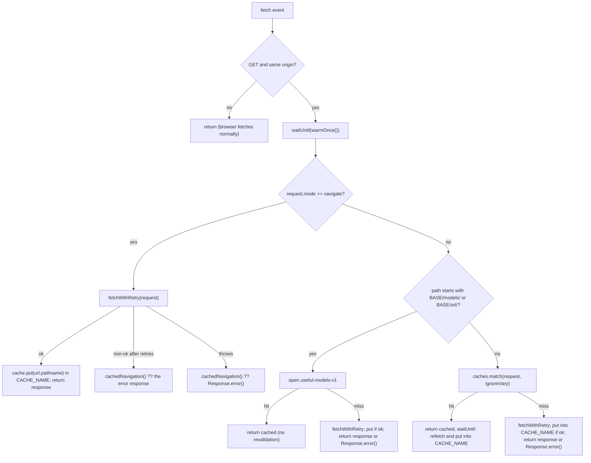
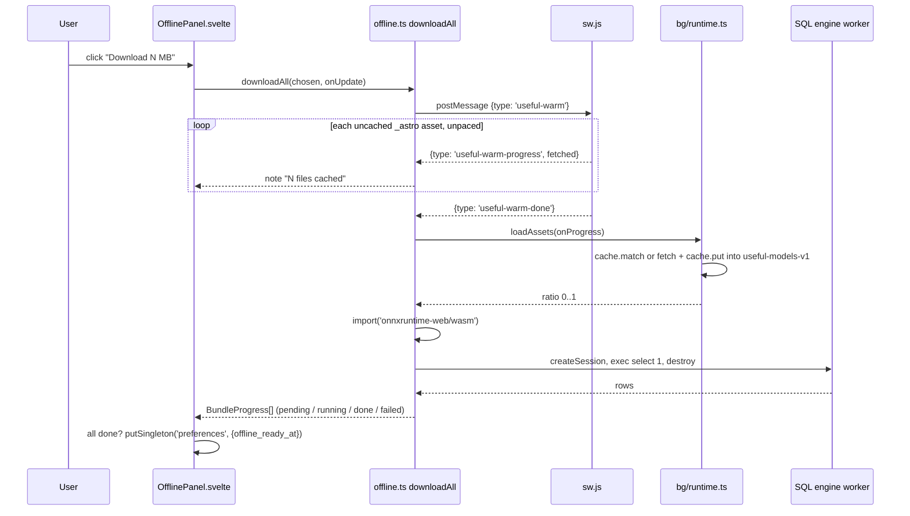

# Service worker & offline

One hand-written service worker ([sw.js](../../public/sw.js)) makes the static build work with no network: it precaches the app shell at install, crawls the fingerprinted `_astro/` asset graph in the background, and serves navigations network-first and everything else stale-while-revalidate. Heavy optional freight (the background remover's model, the SQL engines, the maths fonts) is never precached; [offline.ts](../../src/lib/offline.ts) lists those as explicit "bundles" that a user downloads on purpose from the post-install dialog or Settings → Offline.

_Describes the code as of v0.3.0 (unreleased; schema v12) — verify against source when in doubt._

## Three tiers

| Tier | What | Where it lives | Filled by | Purged by |
|---|---|---|---|---|
| Precache | `SHELL`: every page route + `favicon.svg`, `favicon-maskable.svg`, `manifest.webmanifest` + the thirty-seven `figlet/*.flf` fonts (596.5 KB) | Cache `CACHE_NAME` (`useful-cache-v30`) | `precacheShell()` at `install` | `activate` of a worker with a different `CACHE_NAME` |
| Runtime cache | Every same-origin GET the page makes: `_astro/` JS/CSS/wasm/data chunks, navigated HTML | Same `useful-cache-v30` | The `fetch` handler (stale-while-revalidate) and the background crawl `warmAssetCache()` | Same version bump |
| Lazy bundles | Background remover model + ONNX runtime under `models/` and `ort/` | Cache `MODEL_CACHE` (`useful-models-v1`) — deliberately outside `CACHE_PREFIX` | `loadAssets()` in [runtime.ts](../../src/lib/bg/runtime.ts), or the SW's cache-first branch | Never by the SW; only `clearAssets()` (Background remover → "Remove downloaded model") or the user clearing site data |
| Lazy bundles | The 20 KaTeX faces + their stylesheet under `math/` | Cache `FONT_CACHE` (`useful-fonts-v1`) — also outside `CACHE_PREFIX` | The `math-fonts` bundle in [offline.ts](../../src/lib/offline.ts), or the SW's cache-first branch | Never by the SW; only the user clearing site data |

The maths fonts need their own bucket for the same reason the model does, plus one more: they are stable, unfingerprinted files under `public/`, and the crawl below can only find fingerprinted `_astro/` assets — it does not parse CSS `url()`. Being outside `CACHE_PREFIX` also means a `CACHE_NAME` bump does not evict 263 KB of bytes that never change.

The SQL engines are lazy too, but they are ordinary fingerprinted `_astro/` assets (`sqlite3-*.wasm`, `pglite-*.wasm`, `pglite-*.data`, `initdb-*.wasm`, their worker chunks) so they land in the runtime cache, not a bucket of their own. A `CACHE_NAME` bump therefore drops them and they are fetched again on next use.

## File map

| File | Role |
|---|---|
| [public/sw.js](../../public/sw.js) | The worker: `CACHE_NAME`, `CACHE_PREFIX`, `SHELL`, `MODEL_CACHE`, `ML_PREFIXES`, `FONT_CACHE`, `FONT_PREFIXES`, `fetchWithRetry`, `precacheShell`, `warmAssetCache`, `warmOnce`, the `install` / `activate` / `message` / `fetch` listeners |
| [src/layouts/Layout.astro](../../src/layouts/Layout.astro) | Registers `${base}/sw.js` in production builds only; in dev unregisters any worker and deletes `useful-cache-*`. Mounts `OfflineSetup` with `transition:persist` |
| [src/lib/offline.ts](../../src/lib/offline.ts) | `OfflineBundle`, `OFFLINE_BUNDLES`, `OFFLINE_TOTAL_BYTES`, `downloadAll`, `warmAppAssets` (the `useful-warm` message client), `isInstalled` |
| [src/components/chrome/OfflineSetup.svelte](../../src/components/chrome/OfflineSetup.svelte) | Post-install "Make it work offline?" dialog; writes `offline_prompt_seen` |
| [src/components/chrome/OfflinePanel.svelte](../../src/components/chrome/OfflinePanel.svelte) | The bundle picker + progress list, shared by the dialog and Settings → Offline; writes `offline_ready_at` |
| [src/components/apps/SettingsApp.svelte](../../src/components/apps/SettingsApp.svelte) | Hosts `<OfflinePanel />` in the "Offline" card |
| [src/lib/bg/runtime.ts](../../src/lib/bg/runtime.ts) | `MODEL_CACHE`, `BG_ASSETS`, `BG_TOTAL_BYTES`, `assetsReady`, `clearAssets`, `loadAssets` — the model bucket's writer |
| [src/lib/math/fonts.ts](../../src/lib/math/fonts.ts) | `FONT_CACHE`, `MATH_ASSETS`, `MATH_FONT_BYTES`, `fontsReady`, `ensureFontCss` — the font bucket's writer |
| [src/lib/sql/engines.ts](../../src/lib/sql/engines.ts) | The `engines` list the engine bundles boot; wasm arrives through `new Worker(new URL('./worker.ts', import.meta.url))` in [adapter.ts](../../src/lib/sql/adapter.ts) and the same call on `'./pglite-worker.ts'` in [pglite-adapter.ts](../../src/lib/sql/pglite-adapter.ts) |
| [public/manifest.webmanifest](../../public/manifest.webmanifest) | Installability: `display: standalone`, relative `id` / `start_url` / `scope` (`./`), SVG `any` + `maskable` icons |
| [src/lib/paths.ts](../../src/lib/paths.ts) | `href()` — base-aware paths for the registration URL, model URLs, links |
| [astro.config.mjs](../../astro.config.mjs) | `base` (commented out = root); `optimizeDeps.exclude: ['onnxruntime-web']` for dev |
| [tests/local/offline.spec.ts](../../tests/local/offline.spec.ts), [tests/local/payload.spec.ts](../../tests/local/payload.spec.ts) | The offline audit and payload discipline suites |

## How it works

### Registration (production only)

`Layout.astro` puts `href('/sw.js')` on `<html data-sw-path>` and, when `import.meta.env.PROD`, registers it on `window` `load`. Registering from `${base}/sw.js` gives the worker a scope equal to the Astro base, which is how the worker learns the base at all (`BASE = new URL(self.registration.scope).pathname`). Nothing else in the app talks to the registration; there is no update UI and no `beforeinstallprompt` handling.

### Install: shell only

`precacheShell()` fetches each `SHELL` URL with `fetchWithRetry` and `cache.put`s the ok ones. Failures are swallowed (offline during install — the fetch handler fills the gap later). Then `self.skipWaiting()`. The shell is small on purpose: an install must never compete with the booting app for a static host's rate limit (GitHub Pages answers bursts with 503).

`fetchWithRetry` makes up to `RETRY_ATTEMPTS = 3` attempts with exponential backoff (`RETRY_BASE_MS = 300`) on `429/500/502/503/504` and on thrown network errors; the last attempt's response is returned even if it is still an error status, and it throws only when that last attempt threw.

### Activate: purge, claim, crawl

1. Delete every cache whose name starts with `CACHE_PREFIX` (`useful-cache-`) and is not `CACHE_NAME`. Scoped to the prefix because Cache Storage is per origin, not per scope — a path-multiplexing gateway can put several of these apps on one origin, and a bare "delete everything that isn't mine" would make them evict each other.
2. `self.clients.claim()`.
3. `warmOnce()` — the paced background crawl, inside `waitUntil` so the worker stays alive for it. Clients are already claimed, so nothing waits on it.

### The background crawl (`warmAssetCache`)

Starts from `SHELL`, walks a queue. For each URL: on a cache hit, use it; on a miss, `sleep(WARM_DELAY_MS = 120)` (only when `paced`), `fetchWithRetry`, count it, `cache.put` if ok. Then, if the content-type matches `html|javascript|css`, read the text and enqueue:

- every `_astro/[A-Za-z0-9_.\-]+` match, normalised onto `BASE + match` (covers `/_astro/x.js`, `/base/_astro/x.js` and Vite's bare `_astro/x.js` in `__vite__mapDeps`);
- every quoted relative specifier `'./x'` / `"../x"` / `` `./x` `` (the bundler emits dynamic imports with backticks), resolved against the current URL and kept only if it starts with `ASSET_PREFIX` (`BASE + '_astro/'`).

Only `ASSET_PREFIX` paths are ever enqueued, so `models/` and `ort/` are unreachable by the crawl by construction, and `CRAWL_SKIP` (`/\.(wasm|data)$/`) keeps it off the SQL engines' binaries. `WARM_MAX_ASSETS = 600` caps a run; the 0.2.0 build emits 309 files under `_astro/`, of which the crawl reaches 336 URLs in all (28 pages, 299 scripts, 6 stylesheets, the icons and manifest — 16.5 MB; the largest are compute-engine 2.4 MB, DiceBear 1.9 MB, the city dataset 1.4 MB and the notebook editor 1.3 MB) plus four loose string literals that 404 harmlessly.

The skip rule is a 0.2.0 change. Before it, the wasm and `.data` files of both SQL engines were reached too — they are referenced by `_astro/...` strings inside their worker chunks, which the engines chunk references — so every install quietly pulled 16.8 MB of Postgres and SQLite in the background, and unticking "Postgres engine" in Settings → Offline stopped nothing. Now those four files (`pglite-*.wasm` 9.6 MB, `pglite-*.data` 6.0 MB, `sqlite3-*.wasm` 824 KB, `initdb-*.wasm` 386 KB) are reached only by their engine bundle, which boots the engine, and by the fetch handler when the playground is actually used. "The app itself" is the code; the engines are the engines.

[tools/audit-precache.mjs](../../tools/audit-precache.mjs) runs the same walk statically over `dist/` — it reads `SHELL`, `WARM_MAX_ASSETS` and `CRAWL_SKIP` out of `sw.js` so it cannot drift — and prints what the crawl reaches by type, the largest files, what under `_astro/` it does not reach, and whether the cap would cut a run short (exit 1). Run it after `npm run build` before a release; the numbers above are its output.

Browsers kill idle workers and a paced crawl mostly sleeps, so a run is routinely cut short. `warmOnce()` memoises one in-flight promise per worker instance and flips `warmDone` when a run completes; a restarted worker re-runs it (cache hits cost no delay, so it resumes where it stopped). `activate` fires once, so the `fetch` handler also calls `event.waitUntil(warmOnce())` on every same-origin GET to re-kick it.

### The fetch handler

Details that matter:

- Navigations are keyed by bare `url.pathname` and matched with `NAV_OPTS = { ignoreVary: true, ignoreSearch: true }`, so `/tools/x/?id=a` and `/tools/x/?id=b` share the `/tools/x/` entry. `cachedNavigation()` tries the exact request, then the path with a trailing slash, then `BASE` (home) — the offline fallback for an unknown route is the home page.
- `MATCH_OPTS = { ignoreVary: true }` everywhere: servers send `Vary: Origin`, module `import()` requests carry an `Origin` header and install-time fetches do not, and without `ignoreVary` cached chunks would not be served to module loads.
- The stale-while-revalidate branch uses the global `caches.match`, so it can answer from any bucket on the origin; the revalidated copy is always written to `CACHE_NAME`.
- Non-ok responses are never cached. `respondWith` always resolves with a real `Response` (`Response.error()` on failure) because resolving with anything else makes Chromium report a synthetic 503.
- Non-GET and cross-origin requests are not intercepted at all.

### "Download everything" (`downloadAll`)

`OFFLINE_BUNDLES` in [offline.ts](../../src/lib/offline.ts):

| id | label | `bytes` (declared) | `ready()` | `run()` |
|---|---|---|---|---|
| `app` | The app itself | 0 | `null` (only the worker knows) | `warmAppAssets` → posts `{ type: 'useful-warm' }` to `navigator.serviceWorker.controller` |
| `bg-model` | Background remover model | `BG_TOTAL_BYTES` = 15,805,971 | `assetsReady()` | `loadAssets(onProgress)` then `import('onnxruntime-web/wasm')` |
| `sqlite` | SQLite engine | 1,200,000 | `null` | boot the engine: `engine.createSession()`, `exec('select 1;')`, `destroy()` |
| `pglite` | Postgres engine | 12,000,000 | `null` | same |

`OFFLINE_TOTAL_BYTES` is the sum (about 29 MB as displayed by `formatBytes`). The engine numbers are hand-written estimates for the dialog's copy: the wasm is fingerprinted build output under a name that changes every build, so nothing at runtime can look its real size up. Measured by hand in the current `dist/`: `sqlite3-*.wasm` ≈ 0.86 MB; PGlite is `pglite-*.wasm` ≈ 10.1 MB + `pglite-*.data` ≈ 6.3 MB + `initdb-*.wasm` ≈ 0.4 MB + its worker chunk ≈ 0.6 MB, i.e. noticeably more than the 12 MB shown.

Rules baked into the flow:

- Bundles run **in order**, one at a time. `downloadAll` never throws: a failed bundle is recorded as `failed` with its message and the rest still run.
- The SW crawl in response to `useful-warm` runs with `paced: false` (no 120 ms sleeps) — the person asked and is waiting. Progress is `fetched` counts, not bytes; the app cannot know the graph's size.
- If there is no `navigator.serviceWorker.controller` (dev build, the very first load before the worker has claimed the page, service workers disabled), `warmAppAssets` resolves immediately and the `app` bundle reports Done without caching anything.
- `offline_ready_at` is written only when **every** chosen bundle finished `done`. Unpicked bundles are not touched.
- The model bundle's `ready()` is the only one that can answer honestly; the panel shows "already downloaded" for it and nothing for the others.

### The post-install offer (`OfflineSetup`)

Mounted once in `Layout.astro` with `transition:persist="offline"` so client-side navigation cannot mount it twice. `offer()` fires on `appinstalled` (Chromium) and on mount when `isInstalled()` is true (display-mode `standalone` / `window-controls-overlay`, or iOS `navigator.standalone`) — the second catches installs the event never reports. It reads `preferences.offline_prompt_seen` and returns if set. Only the `Not now` button's `close()` writes `offline_prompt_seen: true`: the dialog mounts `<OfflinePanel />` without an `onfinished` handler, so a finished download leaves the dialog open, and Escape (the `<dialog>` cancel path) closes it while writing nothing — after either the offer can come back. The same panel stays reachable from Settings → Offline regardless.

Both flags live on the `preferences` singleton ([types.ts](../../src/lib/db/types.ts)), which is a normal store: they ride backup export/import like every other preference.

## Cache versioning rules

- **Bump `CACHE_NAME` whenever `SHELL` changes or `sw.js` changes meaningfully.** `activate` only purges caches whose name differs; a constant name makes that step dead code and lets a previous deploy's (or a poisoned) entry live forever. Adding a page without a bump means existing installs never precache it (they still get it on visit via the fetch handler).
- **No apostrophes inside the `SHELL` array — not even in a comment.** [tools/audit-precache.mjs](../../tools/audit-precache.mjs) reads the array by matching single-quoted strings out of `sw.js`, so a contraction in a comment reads as a shell path and the audit reports files that were never referenced.
- Never rename `CACHE_PREFIX` casually — it is what makes the purge safe on a shared origin, and `Layout.astro`'s dev teardown deletes by the same prefix (hard-coded string `'useful-cache-'` there).
- `MODEL_CACHE` must **not** start with `CACHE_PREFIX`; that is the whole reason a version bump does not re-download 15 MB. It is declared twice — `MODEL_CACHE` in `sw.js` and `MODEL_CACHE` in `runtime.ts` — and the two must stay identical. `ML_PREFIXES` in the SW and `BG_ASSETS` in `runtime.ts` must agree on the paths too.
- Model files are treated as immutable: cache-first, no revalidation. Ship a changed model under a new filename (and update `BG_ASSETS`, sizes from `public/models/PROVENANCE.txt`).
- SQL engine assets are fingerprinted, so a new build gets new names automatically; the old ones die with the old cache.

## Adding a page or a heavy asset

**A new page**: add its route (relative to base, trailing slash) to `SHELL` and bump `CACHE_NAME`. Small unfingerprinted `public/` files a page cannot work without go in `SHELL` too — the crawl only discovers fingerprinted `_astro/` assets, so nothing else would ever reach them (the ASCII-art fonts are the first of these; `tools/build-figlet-fonts.mjs` fails if one is missing from the list). Its chunks need nothing — the crawl discovers them from the HTML. One other hand-maintained route list exists and must be updated too: [registry.ts](../../src/lib/registry.ts) (sidebar, home tiles, palette search — and the a11y sweep, whose `ROUTES` is derived from `REGISTRY`). `SHELL` and the registry are the two lists that can drift; at 0.2.0 they hold the same 28 routes.

**A new lazy chunk** (a dynamic `import()` or a `new URL(..., import.meta.url)` asset that Vite fingerprints into `_astro/`): nothing to do. Stale-while-revalidate caches it on first use and the crawl reaches it if any cached JS/CSS/HTML mentions it. Add a matcher to `HEAVY` in `payload.spec.ts` if it must never ride along with pages that do not use it.

**A new heavy public asset that must survive version bumps** (the model pattern): put it under `public/<dir>/`, add `BASE + '<dir>/'` to `ML_PREFIXES` (or introduce a new bucket + branch in the fetch handler), fetch it from app code into the same bucket with progress, and add an `OfflineBundle` to `OFFLINE_BUNDLES` so the panel offers it. Extend the payload test that asserts the shell cache holds no `/models/` or `/ort/` paths.

## Dev vs prod

| | `astro dev` | `astro build` + a static server |
|---|---|---|
| Worker | Not registered. `Layout.astro` unregisters any leftover registration and deletes `useful-cache-*` (the model bucket is left alone) | Registered from `${base}/sw.js` on `load` |
| Why | The worker caches Vite's module URLs and serves stale code after edits (blank pages) | — |
| ORT loader | `ort.env.wasm.wasmPaths` pins only the wasm; the unbundled package resolves its own `.mjs` from `node_modules` (`optimizeDeps.exclude`) | Pinned to `ORT_LOADER_URL` (`/ort/ort-wasm-simd-threaded.mjs`), served by the model bucket offline |
| Offline panel | The `app` bundle resolves instantly with no controller | Full flow |

Playwright runs against a production build served by `tools/preview-server.mjs` for exactly this reason ([playwright.config.ts](../../playwright.config.ts)).

## Base path

`astro.config.mjs` `base` is off (root) by default. Everything derives from it rather than hard-coding `/`:

- App code: `href()` in [paths.ts](../../src/lib/paths.ts) prefixes `import.meta.env.BASE_URL` — used for the registration URL, `BG_ASSETS` URLs, `ORT_LOADER_URL`, links.
- The worker: `BASE` from its own registration scope; `SHELL`, `ASSET_PREFIX`, `ML_PREFIXES` and the crawl's `_astro/` normalisation all build on it.
- The manifest: `id`, `start_url`, `scope` are `./` and icon `src`s are relative, so it resolves under any prefix without editing.

## Tests

- [tests/local/offline.spec.ts](../../tests/local/offline.spec.ts) — the offline audit. (1) Settings → Offline with the light bundles (`app`, `sqlite`) picked: both reach `Done`, `pglite`'s state element never renders, "Last downloaded" appears, and the only DB delta is the `preferences` singleton with `offline_ready_at` set (`assertIsolatedDelta`). (2) A synthetic `appinstalled` event opens the dialog once; dismissing writes `offline_prompt_seen` and only that; a second event and a reload stay quiet. (3) After the download, `context.setOffline(true)` and a navigation to `/tools/photography/` — a page the profile never opened — renders its heading and `ph-focal` control. That last one is the whole promise of the feature.
- [tests/local/payload.spec.ts](../../tests/local/payload.spec.ts) — payload discipline, watching real requests: the home page and a light tool pull none of `HEAVY` (ONNX runtime, model, SQLite, Postgres, city dataset, CodeMirror); opening the background remover fetches no `u2netp`/`.wasm`; the SQL playground loads SQLite and not PGlite; and the `useful-cache-*` bucket contains no `/models/` or `/ort/` paths after the worker takes control.
- [tests/local/background-remover.spec.ts](../../tests/local/background-remover.spec.ts) — downloads the model through the tool's button, cuts the network, runs inference (only Cache Storage can satisfy it), then "Remove downloaded model" returns the tool to "Not downloaded" — all with a byte-identical database.

There are no unit tests for `sw.js` itself; it is only exercised through the production build in Playwright.

## Known limits and decisions

- **No update notification.** A new `sw.js` installs and activates immediately (`skipWaiting` + `clients.claim`), but the page already open keeps its JS until the next navigation or reload; navigations are network-first so the next load is fresh. Fingerprinted names mean the old page never receives a mismatched chunk from the revalidated cache.
- **The crawl is best-effort.** Paced at 120 ms, capped at 600 files, cut short whenever the browser terminates the worker; it converges over normal use, and the panel's `app` bundle is the guaranteed path.
- **`ready()` is `null` for the app and engine bundles.** Hashed URLs make "is it cached?" unanswerable from the app; the honest UI shows nothing rather than a guess.
- **Declared sizes are copy, not truth.** See the table above; PGlite in particular downloads more than 12 MB.
- **A version bump re-fetches the SQL engines** because they live in the app cache. That is accepted: they are fingerprinted, and moving them into a survive-bumps bucket would need a second `ML_PREFIXES`-style rule keyed on names that change every build.
- **No Cache Storage, no offline model.** `cacheStorage()` in `runtime.ts` returns `null` in insecure contexts and some private modes; the tool still works but downloads each session, and `assetsReady()` reports false.
- **Storage is evictable** unless the user grants persistence (Settings → Storage → "Request persistent storage", [persistence.ts](../../src/lib/db/persistence.ts)). Both cache buckets and IndexedDB go together when the browser evicts or the user clears site data.
- **The offline fallback for an unknown route is the home page**, not a 404 — `cachedNavigation()`'s last resort is `BASE`.
