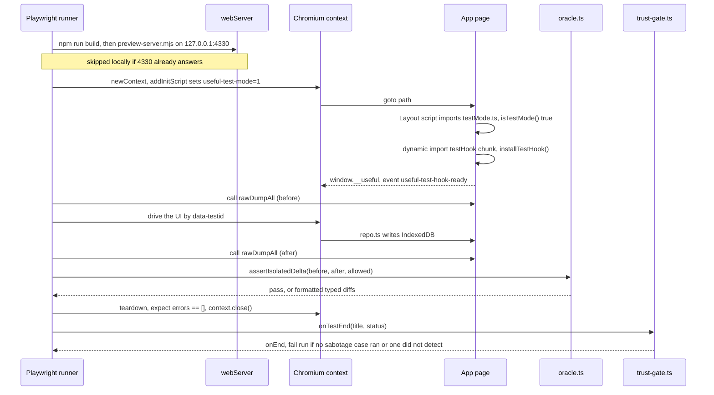

# Testing

Two suites. `npm test` is a Playwright suite that builds the production site, serves `dist/` on a local port, drives the real UI in Chromium and audits every IndexedDB write through a typed oracle exposed by a test-only hook (`window.__useful`); a reporter fails the run unless the oracle was shown to catch injected faults. `npm run test:unit` is Vitest over the pure modules under `src/lib/` — 1,709 cases as of 0.3.0's thirteenth phase, several of which check this app's own cryptography against OpenSSL's. There is no server, so the two things worth guarding are a backup that does not round-trip and a write that changes more than it claimed to — both suites exist to catch those.

_Describes the code as of v0.3.0 (unreleased; schema v13) — verify against source when in doubt._

## Suites at a glance

| Command | Runner | Runs | Config |
|---|---|---|---|
| `npm test` (identical to `npm run test:data`) | Playwright | `tests/local/*.spec.ts` against a production build on `http://127.0.0.1:4330` | [playwright.config.ts](../../playwright.config.ts) |
| `npm run test:data:ui` | Playwright `--ui` | same suite, interactive | same |
| `npm run test:unit` | Vitest (`vitest run`) | `src/**/*.test.ts`, Node environment, no DOM | [vitest.config.ts](../../vitest.config.ts) |

Playwright needs its Chromium download once (`npx playwright install chromium`); the config declares no `projects`, so it runs the default browser (Chromium) only.

## What `npm test` really does

[playwright.config.ts](../../playwright.config.ts):

- `testDir: './tests/local'`, `retries: 0` ("a flaky data test is an untrustworthy data test"), `timeout: 60_000` per test. Suites that boot wasm or download bundles call `test.slow()` (triples the timeout).
- `webServer.command`: `npm run build && node tools/preview-server.mjs --port 4330 --dir dist`. A **production build**, because the service worker only registers in production ([Layout.astro](../../src/layouts/Layout.astro) gates it on `import.meta.env.PROD`) and a suite that never loads it tests a path no user runs. **Not** `astro preview`: Astro 7's preview daemonizes itself under a non-TTY stdin, Playwright sees the process exit and aborts. [preview-server.mjs](../../tools/preview-server.mjs) is a foreground static server bound to `127.0.0.1` with static-host trailing-slash semantics (`/x/` → `x/index.html`, `/x` → 301 to `/x/`).
- `reuseExistingServer: !process.env.CI` — locally, if something already answers on 4330 the build step is **skipped** and that server is used as-is.
- `use: { baseURL, trace: 'retain-on-failure' }` — traces land in `test-results/` (gitignored).
- `reporter: [['list'], ['./tests/local/trust-gate.ts']]`.

**Do not pass `--reporter=list` (or any `--reporter`) on the command line.** A CLI reporter replaces the config's reporter list, which drops the trust gate; the run then cannot fail for a missing sabotage group. This is why [docs/dev/plans/TODO](plans/TODO) calls it out.

Every test gets its own browser context (fresh origin storage, fresh IndexedDB, fresh service-worker registration) from the `app` fixture, so specs never share state and can run in parallel workers.

## The oracle model

Three helper files under [tests/local/helpers/](../../tests/local/helpers/):

**[app.ts](../../tests/local/helpers/app.ts)** — the `test` fixture that every spec imports. It creates a context, runs `context.addInitScript` to set `localStorage['useful-test-mode'] = '1'` *before the first navigation*, collects `console.error` and `pageerror` into `errors`, and exposes:

| Member | What it does |
|---|---|
| `goto(path = '/')` | `page.goto`, then waits up to 15 s for `window.__useful` |
| `call(method, ...args)` | `page.evaluate` of `window.__useful[method](...args)` |
| `dumpAll()` / `dump(store)` / `get(store, id)` | `rawDumpAll` / `rawDump` / `rawGet` — raw rows, tombstones and `server_seq` included |
| `errors` | at teardown the fixture asserts `errors` is `[]`, so any console error or uncaught exception fails the test |

**[schema.ts](../../tests/local/helpers/schema.ts)** — `TABLES`, the harness's own mirror of the app schema (`name`, `fieldMerge`, `singleton`, `columns[]` with `type` / `nullable` / `references`), plus `STORE_NAMES`, `tableOf`, `sampleValue` (values chosen to break naive code: quotes, backslash, newline, non-ASCII, `-2147483649`, `62.4999`, both booleans, `[]`) and `buildRow` (a full row with `id`, `updated_at`, `deleted_at: null`, `server_seq: null`, `field_updated_at: {}` for field-merged tables, and every column filled). This mirror is hand-maintained; a store that is not in it is not covered by the generic round-trip loop.

**[oracle.ts](../../tests/local/helpers/oracle.ts)** — the comparators:

- `diffValues(expected, actual)` — typed, recursive. `1` ≠ `"1"`, `true` ≠ `1`, `null` ≠ `undefined` ≠ absent key, `[]` ≠ `null`, floats compare with `Object.is`. Returns `Diff[]` with `path`, both values and both type names.
- `diffDb(expected, actual)` — pairs rows by `String(r.id)` per store and reports missing rows and per-field diffs.
- `assertSameDb(before, after, label)` — zero diffs or fail with `formatDiffs` output.
- `assertIsolatedDelta(before, after, allowed)` — the collateral-damage detector: after a UI action, every diff must fall on an `{ store, id }` in `allowed`. Most real data loss shows up here, not in the targeted assertion.
- `assertInvariants(db, label, tables = TABLES)` — unique ids per store, at most one live row in a `singleton` table, and every non-null `references` column on a live row pointing at an existing parent. Tombstones (`deleted_at` set) are excluded from the singleton and FK checks.

**The sabotage group** — `data.spec.ts` ends with `test.describe('sabotage: the oracle can go red')`: a restamped row, an unrelated write, a hard delete, an orphaned child (against a synthetic two-table schema, so the FK proof runs even though the real schema only has `todos.recurrence_parent_id` and `todo_comments.todo_id`), and the type separations. Each asserts the oracle **throws**.

**[trust-gate.ts](../../tests/local/trust-gate.ts)** — a Playwright `Reporter`. `onTestEnd` counts every test whose title path contains `sabotage:` and how many of those passed. `onEnd` writes `tests/local/.results/results.json` (`sabotage`, `trustworthy`, per-test results; gitignored), prints `self-verification N/N injected faults detected` or `NOT TRUSTWORTHY — the sabotage cases did not run`, and if the run otherwise passed but `trustworthy` is false it returns `{ status: 'failed' }`. A filtered run (`-g something`) that skips the sabotage group therefore fails, by design.

### A spec run, end to end

## The test-mode hook

[src/lib/testMode.ts](../../src/lib/testMode.ts):

- `TEST_MODE_KEY = 'useful-test-mode'`; `isTestMode()` is true only when `localStorage[TEST_MODE_KEY] === '1'` (storage errors → false).
- `installTestHookIfEnabled()` — if the flag is set, `await import('./testHook')` then `installTestHook()`. The dynamic import keeps the hook in its **own chunk** (`dist/_astro/testHook.*.js`), so a real user downloads only this loader. It is called from a bundled `<script>` in [Layout.astro](../../src/layouts/Layout.astro); an unbundled inline `import('../lib/testHook.ts')` would resolve against the page URL and 404 in the production build.

[src/lib/testHook.ts](../../src/lib/testHook.ts) — `installTestHook()` puts a `TestHook` object on `window.__useful` and dispatches `useful-test-hook-ready`:

| Method | Path | Purpose |
|---|---|---|
| `rawDump(store)`, `rawDumpAll()`, `rawGet(store, id)` | `getDB()` directly | Reads that **bypass** [repo.ts](../../src/lib/db/repo.ts): tombstones and `server_seq` visible. `rawDumpAll` reads every store in one readonly transaction so the snapshot is consistent. |
| `rawPut(store, row)`, `rawDelete(store, id)` | `getDB()` directly | Fixtures and deliberate corruption (sabotage, migration tests) |
| `repoPut`, `repoPatch`, `repoReconcile`, `repoSoftDelete` | `put` / `patch` / `putReconciled` / `softDelete` from repo.ts | Writes through the **real** repo, so tests exercise shipped behaviour |
| `outbox()`, `enqueue(store, id, updatedAt)` | [outbox.ts](../../src/lib/db/outbox.ts) | `drainOutbox` / `enqueue` for the local change queue |
| `exportData()`, `importData(envelope, mode?)` | [export.ts](../../src/lib/db/export.ts) | The backup pipeline |
| `stores()` | `Object.keys(STORES)` | Store names as the app sees them |
| `closeDb()` | `closeDB()` in [db.ts](../../src/lib/db/db.ts) | Drops the tab's connection so a test can `indexedDB.deleteDatabase('useful')` and rebuild it at an older version — an open connection blocks `deleteDatabase` forever |

Invariants and facts worth knowing:

- The flag must be set **before** the first navigation; the layout script runs once per page load. `addInitScript` in the fixture is what guarantees this.
- The install path is not gated on `PROD`, so setting the flag by hand in the dev server also installs the hook — but the suite never runs against dev (see pitfalls).
- As of this version nothing other than `installTestHookIfEnabled` / `installTestHook` reads `isTestMode()`. The comment at the top of `testMode.ts` describes the contract the flag was created for (no automatic writes so snapshots are attributable); the "loading a page writes nothing" guarantee is enforced by the specs themselves (`dumpAll()` before and after navigation), not by branching on the flag.

## Per-spec coverage

All specs import `test` from `helpers/app` and select by `data-testid`. "Zero writes" below means `expect(await app.dumpAll()).toEqual(before)`; "isolated" means `assertIsolatedDelta`.

| Spec | Covers | Key invariants |
|---|---|---|
| [data.spec.ts](../../tests/local/data.spec.ts) | The data layer itself | Page loads write nothing; a backup covers every `STORE_NAMES` entry; **every table in `TABLES`** survives export → `importData(..., 'replace')` byte-for-byte (`assertSameDb`, then `assertInvariants`); `patch` changes only its row; delete is a tombstone that keeps **no payload** (only `id`, `updated_at`, `deleted_at`, `server_seq`, `field_updated_at`), in the DB and in the export; the v6 migration strips old fat tombstones without restamping clocks (rebuilds the DB at v5 via `closeDb`); a corrupt envelope is rejected without half-applying; merge import never regresses a newer local row or resurrects a newer tombstone; an older backup does not wipe stores it never mentioned; per-field folding for field-merged stores (both devices keep their newer field, row clock is the max, `server_seq` reset to null); the sabotage group |
| [nav.spec.ts](../../tests/local/nav.spec.ts) | Sidebar, mobile drawer, ctrl+k palette | Client-side navigation writes nothing; `aria-current` tracks the page; palette fuzzy search, arrow keys, focus trap and focus restore; sidebar collapse and pinned theme survive both a full reload (pre-paint script) and client-side navigation (`astro:after-swap` re-apply); Escape closes only the topmost layer; closed drawer links are out of the tab order |
| [a11y.spec.ts](../../tests/local/a11y.spec.ts) | Every route in the registry — `ROUTES` is derived from `REGISTRY`, so registering a tool audits it | No visible control without an accessible name, no visible field without a label, no `` without `alt`, exactly one `h1` inside `main`, no skipped heading level; token contrast (`--text-color`, `--text-muted-color`, `--color-danger`, `--color-success` ≥ 4.5 on `--surface-color`; `--border-strong-color` ≥ 3) in both light and dark; keyboard path through the palette and explainer disclosures |
| [payload.spec.ts](../../tests/local/payload.spec.ts) | Payload discipline, by watching real network requests | Home and a light tool page load none of the `HEAVY` bundles (ONNX runtime, model, SQLite, PGlite, cities, CodeMirror); opening the background remover fetches no model/wasm; the SQL playground loads SQLite only; `figlet` reaches the ASCII-art page as one lazy chunk and its picker fetches fewer than all thirty-seven `.flf` files; the `useful-cache-*` precache holds nothing under `/models/` or `/ort/` |
| [offline.spec.ts](../../tests/local/offline.spec.ts) | Settings → Offline and the install offer | Downloading the light bundles writes only `preferences.offline_ready_at`; the `appinstalled` dialog appears once and `offline_prompt_seen` is remembered; after the download, with `context.setOffline(true)`, a **never-visited** page still renders |
| [time.spec.ts](../../tests/local/time.spec.ts) | Timers, timer options, alarm loop, preferences panel, stopwatch, timezones | Creating a timer writes the timer row plus the preferences singleton (defaults) and nothing else; a running timer survives reload from `end_at` with zero writes; pause banks `paused_remaining_ms`; expiry → `done` + banner; a long-past deadline surfaces as MISSED; delete-on-complete tombstones; alarm rings until dismissed, capped by `timer_alarm_seconds`; auto-remember off leaves defaults alone; stopwatch writes only its singleton and keeps counting across reload; timezone conversion is exact (Edmonton → Tokyo) and remembers the pair; a non-IANA city (Osaka) resolves through the lazily loaded GeoNames chunk |
| [scheduler.spec.ts](../../tests/local/scheduler.spec.ts) | Todos, events, comments, board, calendar, recurrence, drag | Every create/status/reorder/drop writes exactly one row; a same-position drop writes nothing; completing a recurring todo spawns exactly one successor and reload spawns none; delete tombstones the todo **and** its comments with FKs intact; the due scan raises a DUE banner with zero writes; drags are real pointer drags (`pointerDrag`) and CDP touch drags (`touchDrag`) for list, board and calendar |
| [text-tools.spec.ts](../../tests/local/text-tools.spec.ts) | Diff, Similarity, Text analysis | All zero-write. Diff: the marked ranges, the word-level pass inside a rewritten line, the whitespace/case options changing what is EQUAL but never what is shown, the unified patch's hunk headers at two context sizes, a loaded CRLF file raising the line-ending note (a `<textarea>` normalises to LF, so it must be `setInputFiles`), a binary file refused by name. Similarity: five algorithms in one table, sorting, stepping the cost matrix move by move, the Damerau swap, the Jaro formula with its numbers, both limits. Analysis: counts, the readability formulas to one decimal, SMOG counting down the sentences it needs, the stop-word toggle, n-grams, and transformations leaving the source text untouched |
| [base64.spec.ts](../../tests/local/base64.spec.ts) | Base64, all four combinations | Zero-write. `café` encodes (where `btoa` throws) and decodes; the alphabet, padding and wrap options; a broken string reports the character position; an encoded PNG is identified from its BYTES, so a data URL mislabelled `image/jpeg` still reads as a PNG; a PDF says what it is instead of previewing; the CSS copy shape |
| [hashing.spec.ts](../../tests/local/hashing.spec.ts) | Twelve digests, HMAC, salt and pepper | **Nothing is written across the whole session.** The FIPS/RFC digests of `abc` reach the screen for the platform's algorithms and this app's; the format selector changes shape not value; salt and pepper change the digest and the printed formula follows; SHAKE returns the requested length; HMAC matches the published HMAC-SHA256 vector and SHAKE is absent from its list; the password-storage refusal is on the page |
| [encryption.spec.ts](../../tests/local/encryption.spec.ts) | AES-GCM, RSA, ECDH, bcrypt, one-time pad | **Nothing is written across the whole session.** A password round trip through the self-describing bundle; a wrong password fails as authentication; RSA generates, round-trips and refuses 200 bytes with the number and the words "hybrid encryption"; both sides of a key agreement match and the teaching demo agrees with itself as its exponents change; bcrypt hashes at cost 4 in its worker and verifies both ways; the pad's key is as long as the message and different every time |
| [jwt.spec.ts](../../tests/local/jwt.spec.ts) | Decode, verify, sign | **Nothing is written across the whole session.** The specification's example decodes and verifies with its own secret; a tampered payload still DECODES and stops verifying; `alg: none` is flagged and refused; a signed HS384 token reads back and verifies; three malformed shapes each get their own message |
| [ascii-art.spec.ts](../../tests/local/ascii-art.spec.ts) | A picture as characters, words as a FIGlet banner | **Nothing is written across the whole session** — not even the chosen font. A gradient PNG becomes an exact 80×20 rectangle (80 columns of a 2:1 image on cells twice as tall as they are wide) that runs dark to light, reverses when inverted and halves with the width knob; the picker draws a font only once its row is scrolled to, and draws it in the typed word; spacing and alignment change the block but never make it ragged; colour mode paints spans and reaches the SVG as `<tspan fill="…">`; the `.txt`, `.svg` and `.png` downloads carry the right names and bytes; an undecodable file says so |
| [file-tree.spec.ts](../../tests/local/file-tree.spec.ts) | Building a tree, reading a listing, the drawing options | **Nothing is written across the whole session**, imports and exports included. `tree` output round-trips back to the same tree; a Windows `dir` listing takes its root name from its own header; an unreadable line is listed with its number rather than dropped; the ASCII charset, trailing slashes, both emoji modes, an edited emoji rule, and all four root modes; a REAL pointer drag re-parents a file and a drag that would put a folder inside itself is refused with a reason; the `.txt`, `.svg`, `.png` and `.json` downloads, and the `.json` read back into the same tree |
| [crontab.spec.ts](../../tests/local/crontab.spec.ts) | Reading an expression, the builder, systemd, where the line goes | **Nothing is written across the whole session.** The sentence for a plain schedule, a range and a step; a macro expanded and named; a caret under the exact bad character; a six-field expression refused by name; the day-of-month/day-of-week OR warning appearing and disappearing; the command picked out of a pasted line; five ascending runs in the browser zone; "never runs" for 30 February; the builder writing an expression from its controls and reading one back (including a shape it cannot draw, left as typed); the timer unit, and the OR case refused rather than quietly ANDed |
| [placeholders.spec.ts](../../tests/local/placeholders.spec.ts) | Filler text, the nine image generators, sizes and export | **Nothing is written across the whole session.** Text counted, reproduced from its seed and changed by another; the lorem opening dropped, `
` wrapping, an exact word count; office speak carrying none of lorem; every generator drawn at the requested INTRINSIC size (`naturalWidth`, not the CSS box — a wrong-sized SVG fits the box perfectly); the aspect lock moving the other side and leaving the typed one alone; the icon set arriving only when the icon generator is picked; an SVG and a PNG download of the right size and magic bytes; a batch of three zipped, named in order, and three genuinely different pictures |
| [docker-compose.spec.ts](../../tests/local/docker-compose.spec.ts) | `compose_projects`, the builder, templates, snippets and import | Building and editing write NOTHING; saving writes exactly one row and the isolated-delta assertion names it; a reload reopens the same project without writing; editing a saved project updates its row rather than adding one; delete is a tombstone. The ports editor disables itself under host networking and says why; a duplicate host port and an undeclared volume are errors that clear when fixed; document keys come out in spec order. A stack loads without being saved, a snippet is injected (renamed on a name clash, its volume declared, its host port moved when taken), a template downloads as a real `.zip` whose `compose.yaml` parses, and an import lists `build:` and `labels:` rather than dropping them |
| [calculators.spec.ts](../../tests/local/calculators.spec.ts) | Number conversion, photography, file transfer | All computation is zero-write; hand-computed expected values (bit ops for 5, m4/3 → FF equivalents, stop deltas, 1 GB @ 100 Mbps = 1 min 20 s); picking a sensor format writes only `preferences.photo_last_format`; explainers toggle from the keyboard |
| [generators.spec.ts](../../tests/local/generators.spec.ts) | Colors, harmonies, theme builder, gradients, glassmorphism, regex, QR | All zero-write; copy buttons verified against the real clipboard (`grantPermissions`); QR round-trip: download the PNG through the export pipeline, upload it to the reader, decode back; camera affordance is feature-detected without prompting for permission |
| [images.spec.ts](../../tests/local/images.spec.ts) | Converter, resizer, compressor | Pixels never touch IndexedDB; the one write is `preferences.convert_jpg_quality`; downloads verified by magic bytes; TIFF via bundled decoder, broken TIFF fails gracefully; AVIF fixture decodes and previews at its own aspect; target-percent/size search reports honestly |
| [background-remover.spec.ts](../../tests/local/background-remover.spec.ts) | The real u2netp model through ONNX Runtime | Whole session zero-write (snapshot **before** `goto`); model state "Not downloaded" → "Ready"; subject centre alpha 255, corner alpha 0 in preview and exported PNG; cutoff/mask/solid-colour re-tune without re-running; JPG + transparent warns; after an explicit download, inference works with `setOffline(true)` (Cache Storage only) and the download can be removed; touch-up brushes survive the sliders and reach the export |
| [svg-editor.spec.ts](../../tests/local/svg-editor.spec.ts) | `svg_documents` | Create/edit writes the document row plus `preferences.svg_last_doc_id` only; reload resumes byte-identically with zero writes; canvas drag persists only that document; undo/redo save the reverted state; colour commit is one undo step and a stray quote is escaped in the export; cleared numeric fields never persist null; per-vertex curves and control-handle drags; boolean subtract proven by exported pixels; SVG/PNG export is zero-write; delete is a tombstone |
| [image-editor.spec.ts](../../tests/local/image-editor.spec.ts) | The session-only raster editor | An entire import → edit → export session leaves the DB byte-identical; first image sets the canvas; effects nest under the selected image; crop/eraser/fill scoping; opacity and blend modes by pixel probe; groups by drag-to-nest; scale handles; EXIF stripped by default and edited fields embedded in JPG while GPS never survives (re-parsed with `exifr`, fixture built with `piexifjs`); remove-background mask layer; undo/redo by button and keyboard; restore brush |
| [sql-playground.spec.ts](../../tests/local/sql-playground.spec.ts) | Real SQLite (sqlite-wasm) and Postgres (PGlite) in workers | Opening writes nothing; running saves one `sql_playgrounds` row keyed by engine id; snapshot save/restore/forget; wipe keeps the snapshot; `.sql` export; Postgres is a separate workspace and remembered in `preferences.sql_last_engine`; a syntax error keeps the database |
| [sprite-editor.spec.ts](../../tests/local/sprite-editor.spec.ts) | `sprites` | A sprite is one row through create / paint / reload; autosave is one row and opening writes only the remembered id; loading, resuming and looking around write nothing; one drag is one undo step; the legend refuses a colour that could escape into the export; import replaces the grid and filters a hostile legend; exports are the right files and write nothing; resize squares and clamps; delete is a tombstone that leaves the store consistent |
| [secrets.spec.ts](../../tests/local/secrets.spec.ts) | Passwords, keys, tokens, identifiers | Every card fills itself on load and nothing is written; categories are `
` — the first open, the rest closed but still generating, independent of each other, toggled by click or Enter and never remembered across a reload; each generator's documented shape; regenerate in place vs regenerate-all; the length option moves both the value and the claimed entropy; identifiers are labelled as identifiers; copy reaches the clipboard; the page says nothing is kept and explains WEP |
| [logo-generator.spec.ts](../../tests/local/logo-generator.spec.ts) | DiceBear, Jdenticon, the badge tab | Opening draws and writes nothing; picking a style swaps artwork and licence; Jdenticon reacts to its own knobs; icon and emoji badges; downloads carry the right filename and type; an engine is not downloaded until asked for, and no engine rides along with any other page; "Open in SVG editor" hands over one pasted-SVG layer |
| [napkin-math.spec.ts](../../tests/local/napkin-math.spec.ts) | `napkin_templates`, `napkin_calculations`, the generated code and web component | A formula becomes typed fields with nothing written until Save; a template is one row, a reload restores it; saving a calculation saves the unsaved template with it and the calculation is never inside the template file; export / import round-trip, a bad import refused with a reason; the generated web component computes what the app computed in a real page, carries a typeset formula and its fonts (or leaves them to the page), defines the helper a sum calls; the generated Python carries the page's guards; insert buttons start a formula that parses; sum / product / integral reach code; the Code card forgets on a new formula; an unsupported operator is refused by name; descriptions reach inputs and code; highlighting; no sound is ever fetched and MathLive stays off every other route |
| [config-playground.spec.ts](../../tests/local/config-playground.spec.ts) | `config_schemas`, parse / create modes, generated parsers and generators | Pasting extracts a schema with nothing written; saving is one row and a reload restores it; invalid JSON is flagged in place and the last good schema stays; the YAML 1.1 traps are named and quoting cures them; prettify keeps YAML comments; a hand-built schema survives the switch and checks a real document; examples generate to the schema and download; no fields → nothing to generate; every language's parser names the fields; the parser and generator web components work in a real page; the Data card tabulates on demand and goes stale honestly; delete is a tombstone and the library empties |
| [notebook.spec.ts](../../tests/local/notebook.spec.ts) | `notes`, `note_assets`, the Crepe / CodeMirror editor, the drawing canvas, exports, the sidebar's bulk operations | A drawing is one `note_assets` row named `drawing.excalidraw.png`, shown as an image with the ✏ affordance, reopened by it as "Edit drawing" and updated in place (still one row), with Excalidraw and React absent from the page until the button is pressed, no CDN touched, and every font it asks for served from `/excalidraw/fonts/`; loading writes nothing, a new note is one row and autosave one patch, a reload restores without writing; `[[links]]` resolve, create on click and come back as backlinks; footnotes survive WYSIWYG → source → WYSIWYG; renaming keeps old links working and offers the rewrite; nesting, and deleting a parent moves children up; a deep link to a missing note offers to create it; the HTML export is one self-contained file; the print stylesheet hides the app; ticking rows in the library reveals the bulk panel without remounting the editor, and it tags (isolated to the selected rows), exports `.zip`s read back with `zipEntries`, moves (no cycle offered, the open note's field follows) and deletes (survivors reparented, the open note stays open, the receipt outlives the panel); a row's × deletes that note and folding the library drops the selection; the editor stays off every other route |

## Unit tests

`vitest run` over `src/**/*.test.ts` — plain Node, no DOM. Modules with browser dependencies pass fakes (e.g. [history.test.ts](../../src/lib/raster/history.test.ts) uses stand-in canvas objects to prove bitmaps are passed by reference, never copied).

| Area | Files |
|---|---|
| Registry / shell | [registry.test.ts](../../src/lib/registry.test.ts) (unique ids, app-absolute routes with trailing slash, known categories, every icon key resolves, `searchRegistry`), [fuzzy.test.ts](../../src/lib/fuzzy.test.ts) |
| Text | [tokenize.test.ts](../../src/lib/text/tokenize.test.ts) (grapheme vs code point vs UTF-16 vs UTF-8 counts, hyphen/apostrophe words, abbreviation-aware sentences, the syllable heuristic **including the words it gets wrong**) |
| Encoding | [base64.test.ts](../../src/lib/encode/base64.test.ts) (RFC 4648 vectors, UTF-8 round trips where `btoa` throws, both alphabets, wrapped bodies, the reported offset of a bad character, `data:` URLs), [sniff.test.ts](../../src/lib/encode/sniff.test.ts) (magic numbers, container brands, SVG's absence of one) |
| Diff | [myers.test.ts](../../src/lib/diff/myers.test.ts) (the paper's own example at cost 5, a hundred random pairs reconstructed both ways, the budget fallback), [text.test.ts](../../src/lib/diff/text.test.ts) (row pairing, inline parts, line endings, `diff -u` output including the missing-newline marker) |
| Similarity and analysis | [edit.test.ts](../../src/lib/text/edit.test.ts) (published Jaro/Jaro-Winkler values, the OSA-vs-unrestricted Damerau case, the traceback's ops), [analysis.test.ts](../../src/lib/text/analysis.test.ts) (each readability formula against arithmetic done by hand, SMOG's thirty-sentence floor, n-grams inside a sentence), [transform.test.ts](../../src/lib/text/transform.test.ts) |
| Hashing | [digest.test.ts](../../src/lib/hash/digest.test.ts) (RFC 1321, FIPS 180-4 and FIPS 202 vectors, **plus** agreement with OpenSSL across the block boundaries and with WebCrypto for SHA-256), [index.test.ts](../../src/lib/hash/index.test.ts) (every digest and HMAC against OpenSSL on both code paths, the composition formulas) |
| Encryption | [crypto.test.ts](../../src/lib/crypto/crypto.test.ts) (AES round trip, a flipped bit refused, fresh salt/IV per run, RSA's size limit, both sides of ECDH on every curve, `modPow`, the pad's short-key refusal), [jwt.test.ts](../../src/lib/crypto/jwt.test.ts) (the specification's example, tampering, `alg: none`, algorithm confusion, a round trip per asymmetric algorithm) |
| ASCII art | [image.test.ts](../../src/lib/ascii/image.test.ts) (ramp shape and monotonicity, luminance, the cell-aspect compensation, box averaging proved on a one-pixel checkerboard, alpha compositing onto the background, the width clamps), [render.test.ts](../../src/lib/ascii/render.test.ts) (SVG geometry, colour-run grouping, XML escaping, the CSS-colour filter, alignment, and the `fitRows` opt-out the file tree needs), [provenance.test.ts](../../src/lib/ascii/provenance.test.ts) (the FIGfont header parser — space hardblank, `tlf2a` — the licence matcher, **the refusal**, Latin-1 transcoding, and the vendored fonts re-checksummed against the catalogue and checked against `SHELL`) |
| File tree | [model.test.ts](../../src/lib/tree/model.test.ts) (purity — every edit leaves its input untouched — the cycle refusals in `move`, sorting, `fromEntries` inferring folders and promoting a file that turned out to have children, and the import validator naming the node it refused), [parse.test.ts](../../src/lib/tree/parse.test.ts) (all six formats against output shaped as the real commands print it, the sniffer, the root-name rule, and the warnings), [render.test.ts](../../src/lib/tree/render.test.ts) (both charsets to the character, the last-child corner, deep nesting, all four root modes, full paths, both emoji modes, a dotfile having no extension, and `displayWidth` counting monospace cells rather than UTF-16 units) |
| Crontab | [cron.test.ts](../../src/lib/cron/cron.test.ts) (every syntax form and every macro; `5/10` read as Vixie reads it; `5-7` in day-of-week meaning Fri/Sat/Sun because the 7 is folded onto 0 only after ranges expand; "restricted" meaning "does not start with a star"; error offsets; the description for each shape; next runs across month ends, leap years and the OR rule, and an expression that never runs; the `OnCalendar=` translation and its refusal; the builder round-tripping every preset) |
| Placeholders | [placeholder.test.ts](../../src/lib/placeholder/placeholder.test.ts) (the PRNG deterministic per seed; text honouring counts, clamps, the HTML wrap and the corpus rule; every image generator PARSED — with a small XML parser in the test file, since node has no `DOMParser` — for size, structure and escaping; the noise filter carrying the seed; the fifteen scenes each parsing and cropping rather than distorting; batch naming and clamping; the aspect maths) |
| Docker Compose | [compose.test.ts](../../src/lib/compose/compose.test.ts) (the model re-shaping anything at all, emit writing only what was set, the short/long port and mount syntaxes, key order — including that re-emitting an unchanged project is byte-identical — and every validator: cycles reported as a path, ranges expanded before comparing ports, undeclared volumes/networks/secrets/configs, host networking, `service_healthy` with no healthcheck), [catalogue.test.ts](../../src/lib/compose/catalogue.test.ts) (table-driven over EVERY stack and snippet — validates, parses, pins a tag on every image, survives a store round trip — plus injection, the archive read back with `zipEntries`, and the importer reporting what it cannot represent) |
| Time | [duration.test.ts](../../src/lib/time/duration.test.ts), [timezone.test.ts](../../src/lib/time/timezone.test.ts), [cities.test.ts](../../src/lib/time/cities.test.ts) |
| Scheduler | [rank.test.ts](../../src/lib/scheduler/rank.test.ts), [recurrence.test.ts](../../src/lib/scheduler/recurrence.test.ts) |
| Calculators | [numberBase.test.ts](../../src/lib/calc/numberBase.test.ts), [photography.test.ts](../../src/lib/calc/photography.test.ts), [transfer.test.ts](../../src/lib/calc/transfer.test.ts) |
| Generators | [color.test.ts](../../src/lib/gen/color.test.ts), [harmony.test.ts](../../src/lib/gen/harmony.test.ts), [theme.test.ts](../../src/lib/gen/theme.test.ts), [gradient.test.ts](../../src/lib/gen/gradient.test.ts), [glass.test.ts](../../src/lib/gen/glass.test.ts), [regexgen.test.ts](../../src/lib/gen/regexgen.test.ts), [regexTester.test.ts](../../src/lib/gen/regexTester.test.ts), [qr.test.ts](../../src/lib/gen/qr.test.ts) |
| Images | [convert.test.ts](../../src/lib/img/convert.test.ts), [targetSize.test.ts](../../src/lib/img/targetSize.test.ts), [pipeline.test.ts](../../src/lib/bg/pipeline.test.ts) (pre/post-processing and `applyPaint`), [exif.test.ts](../../src/lib/raster/exif.test.ts), [transform.test.ts](../../src/lib/raster/transform.test.ts), [history.test.ts](../../src/lib/raster/history.test.ts) |
| SVG | [build.test.ts](../../src/lib/svg/build.test.ts), [history.test.ts](../../src/lib/svg/history.test.ts) |
| SQL | [pg-sql.test.ts](../../src/lib/sql/pg-sql.test.ts) |
| Notebook | [markdown.test.ts](../../src/lib/markdown.test.ts), [footnotes.test.ts](../../src/lib/notebook/footnotes.test.ts), [wiki.test.ts](../../src/lib/notebook/wiki.test.ts), [export.test.ts](../../src/lib/notebook/export.test.ts), [assets.test.ts](../../src/lib/notebook/assets.test.ts), [mermaid.test.ts](../../src/lib/notebook/mermaid.test.ts), [drawing.test.ts](../../src/lib/notebook/drawing.test.ts) (the `.excalidraw.png` convention, the filename slug, and the vendored-font list against `public/excalidraw/PROVENANCE.txt` — names, order, presence on disk and the byte total), [model.test.ts](../../src/lib/notebook/model.test.ts), [bulk.test.ts](../../src/lib/notebook/bulk.test.ts) (the bulk operations' selection, move-target, reparent-on-delete and filename rules), [zip.test.ts](../../src/lib/zip.test.ts) (the stored ZIP writer: CRC-32, round trip, signatures, corruption refused) |

The standing rule from [docs/dev/plans/TODO](plans/TODO): a feature that touches both the UI and the data layer needs both a spec and unit tests.

## Adding tests for a new tool

1. **Registry first.** Add the tool to [registry.ts](../../src/lib/registry.ts); `registry.test.ts` will fail on a bad route shape, unknown category or missing icon.
2. **`SHELL` in [public/sw.js](../../public/sw.js)** — the one route list still maintained by hand; miss it and the page is not precached (see [build-and-tooling.md](build-and-tooling.md)). The a11y sweep needs nothing: its `ROUTES` is `REGISTRY`-derived, so a registered tool is audited automatically.
3. **New store?** Append a migration in [db.ts](../../src/lib/db/db.ts), add the entity to [types.ts](../../src/lib/db/types.ts), and mirror it in `TABLES` in [schema.ts](../../tests/local/helpers/schema.ts) with the right `fieldMerge`, `singleton` and `references`. That one entry extends `data.spec.ts`'s round-trip loop, `assertInvariants` and the export-coverage check to the new store for free.
4. **New heavy dependency?** Add a matcher to `HEAVY` in [payload.spec.ts](../../tests/local/payload.spec.ts) and keep the import dynamic.
5. **Write `tests/local/<tool>.spec.ts`** in the house pattern: `import { test, expect } from './helpers/app'`; put `data-testid` attributes on the controls the test needs; `const before = await app.dumpAll()` — *before* `app.goto()` when the page load itself must be zero-write; drive the UI; then either `expect(await app.dumpAll()).toEqual(before)` for stateless tools or `assertIsolatedDelta(before, after, [{ store, id }])` naming exactly the rows the action is allowed to touch. Debounced saves need `expect.poll(...)`, not a fixed wait. Include the "reload writes nothing / restores state" case for anything persisted, and a keyboard-toggle case for explainer disclosures if the page has them.
6. **Pure logic** goes in `src/lib/<area>/*.ts` with a sibling `*.test.ts`.
7. Run `npm test` and `npm run test:unit`; the trust-gate line at the end must read `self-verification N/N injected faults detected`.

## Pitfalls

- **Dev server vs production build.** The suite always builds. In `astro dev` there is no service worker, `onnxruntime-web` is served unbundled (`optimizeDeps.exclude`) and the ORT loader path pin in [runtime.ts](../../src/lib/bg/runtime.ts) is not applied — offline, payload and background-remover behaviour differ from what ships. Reproduce failures against `dist/`, e.g. `npm run build && node tools/preview-server.mjs --port 4330 --dir dist`.
- **A stale server on 4330 is reused.** With `reuseExistingServer` on locally, a preview-server left running from an earlier session serves the *old* `dist/`; kill it (or rebuild first) after changing source.
- **The hook is only there when the flag was set before load.** Opening the site by hand and typing `window.__useful` in the console gives `undefined` until `localStorage.setItem('useful-test-mode','1')` and a reload.
- **Any console error fails the test.** The fixture asserts `errors` is empty at teardown; a `console.error` inside the app (or a 404 in production) fails a spec that otherwise passed.
- **`--reporter` on the CLI disables the trust gate.** See above. Likewise a `-g` filter that excludes every `sabotage:` title ends `NOT TRUSTWORTHY` and fails.
- **Drag tests use pointer events, not `dragTo()`.** The app's drag and drop ([dragdrop.ts](../../src/lib/dragdrop.ts)) is pointer-based; Playwright's `dragTo()` drives the HTML5 drag API, a different pipeline no touchscreen has. `pointerDrag` in [scheduler.spec.ts](../../tests/local/scheduler.spec.ts) does press → several `mouse.move` steps → release (the first move crosses the drag threshold; later moves let the drop target update). Touch drags go through a CDP session: `Input.dispatchTouchEvent` with `touchStart` / `touchMove` / `touchEnd`. Canvas drags in the SVG and raster editors call `scrollIntoViewIfNeeded()` first — an earlier download click may have scrolled the canvas off-screen, and mouse events at off-viewport coordinates hit nothing.
- **Snapshot placement matters.** `before = await app.dumpAll()` taken *after* `goto` cannot see a write the page made while loading; the image-editor and background-remover specs deliberately snapshot first.
- **`retries: 0`.** A test that passes on retry is a bug report, not a pass. Use `expect.poll` for async saves instead of loosening assertions.
- **`test.slow()` suites** (a11y sweep, offline, payload, background remover, SQL playground, the image editor's model-backed cases) take minutes on first run: wasm engines boot from disk and the model is real, not stubbed.
- **Fixtures.** [tests/local/fixtures/](../../tests/local/fixtures/) holds `sample.tiff` and `broken.tiff` (generated by [build-image-fixtures.mjs](../../tools/build-image-fixtures.mjs)) and one AVIF photo used by `images.spec.ts`; PNG/JPG/WebP inputs are encoded in-page with a canvas. The other checked-in files there (`png_sample_file_*.png`, the JPG/WebP/TIFF/SVG samples) are not referenced by any spec as of this version.
- **Environment-dependent case.** `generators.spec.ts`'s camera test accepts either the scan button or the "no camera" note (whichever the machine has) but requires exactly one and that permission state stays `prompt`.
