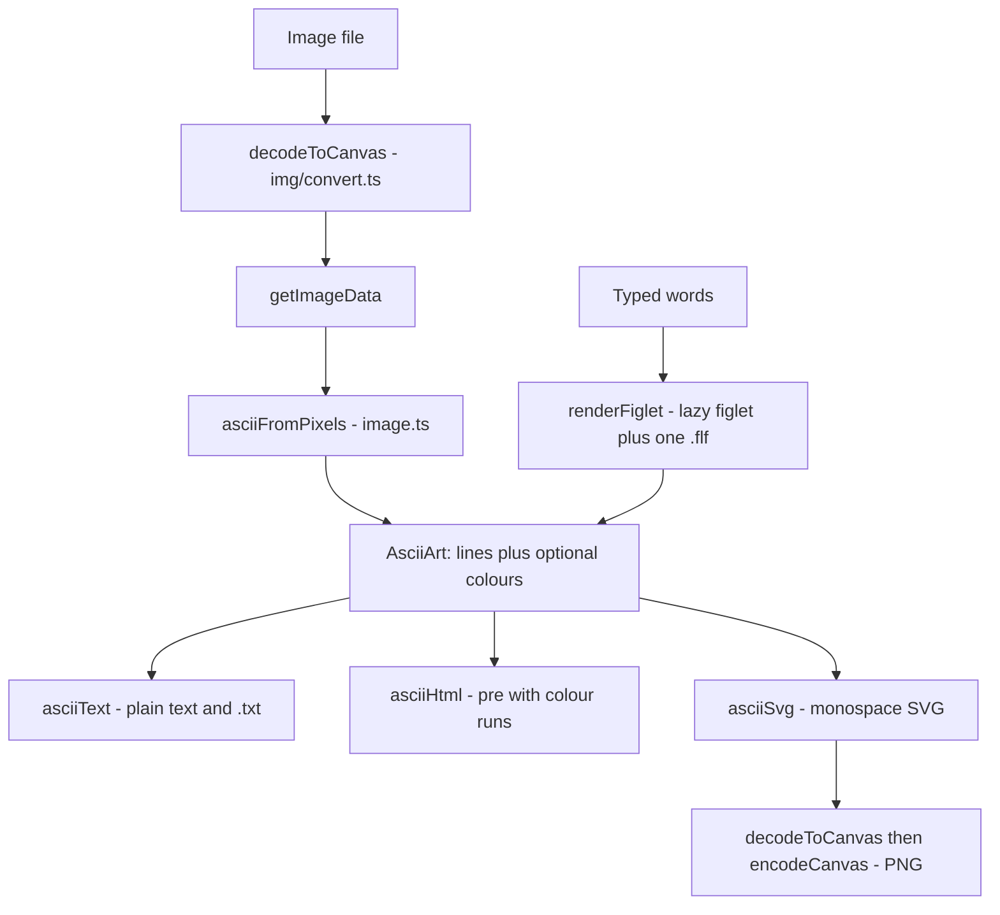

# ASCII art

`/tools/ascii-art/` — an image as characters, or words as a FIGlet banner. A stateless Svelte island over three pure modules; nothing on the page is written anywhere, including the chosen font.

_Describes the code as of v0.4.0 (unreleased; schema v13) — verify against source when in doubt._

## File map

| Path | Role |
| --- | --- |
| [image.ts](../../../src/lib/ascii/image.ts) | Pixels → characters: ramps, luminance, cell-aspect compensation, box averaging, per-cell colour |
| [render.ts](../../../src/lib/ascii/render.ts) | Characters → picture: monospace SVG and HTML on one grid |
| [fonts.ts](../../../src/lib/ascii/fonts.ts) | The vendored FIGlet catalogue, the lazy loader, layouts and alignment |
| [fonts.json](../../../src/lib/ascii/fonts.json) | Generated catalogue — id, name, style, bytes, SHA-256, basis, terms |
| [AsciiArtApp.svelte](../../../src/components/apps/AsciiArtApp.svelte) | The page |
| [build-figlet-fonts.mjs](../../../tools/build-figlet-fonts.mjs) | Vendors `public/figlet/*.flf` + `PROVENANCE.txt`; refuses a font it cannot account for |
| [ascii-art.spec.ts](../../../tests/local/ascii-art.spec.ts), [image.test.ts](../../../src/lib/ascii/image.test.ts), [render.test.ts](../../../src/lib/ascii/render.test.ts), [provenance.test.ts](../../../src/lib/ascii/provenance.test.ts) | Playwright and Vitest |

## The pipeline

A figlet banner is an `AsciiArt` with `colours: null`, which is why copy, `.txt`, `.svg` and `.png` are written once and work for both modes.

## Three things the conversion has to get right

1. **A character cell is not square.** Monospace cells are about twice as tall as they are wide, so `rowsFor()` multiplies `columns × (height / width)` by the cell's width/height ratio (0.5 by default). Skip it and every picture arrives at double height. `render.ts` lays out on exactly the same ratio — character advance taken as 0.6 em — so the SVG and PNG reproduce what the text block shows.
2. **A cell is an average, not a sample.** Each output cell owns a source rectangle computed from exact fractions (`floor(col * width / columns)`), so nothing is dropped or double-counted when the image does not divide evenly, and averages it. A unit test converts a one-pixel checkerboard and asserts mid-grey: a point sampler would return pure black or pure white and the picture would shimmer as the width changes.
3. **Transparency has to land somewhere.** Pixels are composited over the chosen background *before* averaging — compositing afterwards gives a different answer wherever alpha varies inside one cell — so a transparent PNG does not arrive as a rectangle of `@`.

Ramps are stored **lightest-first**, so the character index is a straight multiply and `invert` is one flag at the top. The 70-step ramp is Paul Bourke's, written darkest-first as he published it and reversed in code rather than retyped.

## Output

| Format | How |
| --- | --- |
| Text | The rows joined; every line padded to the same width, so a banner sits square inside a comment box |
| HTML | A `<pre>` with the grid in its inline style, one `` per run of one colour |
| SVG | Uncoloured rows are one `<text>` with `textLength` + `lengthAdjust="spacing"`, which pins the row to the grid even in a reader's slightly different monospace face. Coloured rows place each run at an explicit `x` |
| PNG | The SVG, through [decodeToCanvas](../../../src/lib/img/convert.ts) (an ``, so no script runs) and `encodeCanvas` — the PNG is exactly what the SVG draws |

Colours are grouped into runs before they are written: a photograph's flat areas become one span instead of eighty. Every character is XML-escaped, and every colour passes `cssColour()` — hex or a bare keyword, anything else becomes `inherit` — because the HTML path writes into a `style=""` attribute where a semicolon would start a second declaration.

## The fonts, and the licence gate

Thirty-seven fonts ship in `public/figlet/`, 596.5 KB together, precached with the shell (they are unfingerprinted `public/` files the background crawl cannot discover). `figlet` itself is a lazy chunk; each `.flf` is fetched when a row of the picker scrolls into view or a font is chosen, and registered with `parseFont()` — **not** figlet's own `loadFont`, whose URL comes from a configured `fontPath` and would break under a sub-path base.

| Style | Fonts |
| --- | --- |
| Stroke | Standard, Slant, Small, Mini, Bigfig, Doom, Varsity, Epic, Broadway, Cyberlarge, Cybermedium |
| Script | Script, Caligraphy, Fraktur |
| Shadow | Shadow, Ghost, Slant Relief |
| 3-D | 3D Diagonal, 3D-ASCII, Terrace, Big Money ×4 |
| Blocks | Pagga, Future, Blocks, ANSI Regular, ANSI Shadow, ANSI Compact, Electronic, Classy, Coder Mini |
| Decorative | Fire Font-k, Bloody, Delta Corps Priest 1, Reverse |

### The two bases, and why there are two

Twenty of the thirty-seven state redistribution terms in their own header — mostly the classic FIGlet grant, plus MIT and the WTFPL. The other seventeen state nothing at all: most of the FIGlet library predates anyone thinking about licences, and the 1990s fonts were posted to alt.ascii-art with a name, an email address and no terms (`ANSI Shadow` records its author as `?`; `Bloody` names only who converted it).

Refusing all seventeen means shipping eight fonts, so [build-figlet-fonts.mjs](../../../tools/build-figlet-fonts.mjs) has a second route — and it is deliberately not "shrug and copy it". A font takes it only by being marked `basis: 'package'` in the catalogue, **one font at a time**, which records that a maintainer read the header and found: the file ships inside the `figlet` npm package, whose `LICENSE.txt` is the MIT licence, and the header names its author or origin. `PROVENANCE.txt` says in those words that this is weaker than a per-font grant, and quotes what the header does say underneath each entry.

A font with neither still fails the build, and the refusal names what a maintainer has to do about it. Three unit cases hold the shape: the default is still a refusal, `basis: 'package'` has to be asked for per font, and a font marked `package` whose header *does* state terms is reported as `header` — the basis is read from the file, never from the catalogue. One more checks that a majority still stand on their own terms, which is a smell test rather than a rule: if it ever inverts, the catalogue has drifted from "fonts we can account for" to "fonts we liked the look of".

Two format details bite anyone touching the parser: the six-character signature prefix is `flf2a` plus the hardblank **character**, which may itself be a space (`Future`), so fields are read from `slice(6)` rather than by splitting the line; and TOIlet fonts announce themselves as `tlf2a`.

Test hooks are prefixed `aa-`: `aa-mode`, `aa-text`, `aa-layout`, `aa-align`, `aa-fonts`, `aa-font-<id>`, `aa-font-card`, `aa-banner-error`, `aa-file`, `aa-input-info`, `aa-error`, `aa-columns`, `aa-ramp`, `aa-colour`, `aa-invert`, `aa-background`, `aa-foreground`, `aa-output-card`, `aa-output`, `aa-size`, `aa-copy`, `aa-copy-html`, `aa-copy-svg`, `aa-download-txt`, `aa-download-svg`, `aa-download-png`, `aa-feedback`.
