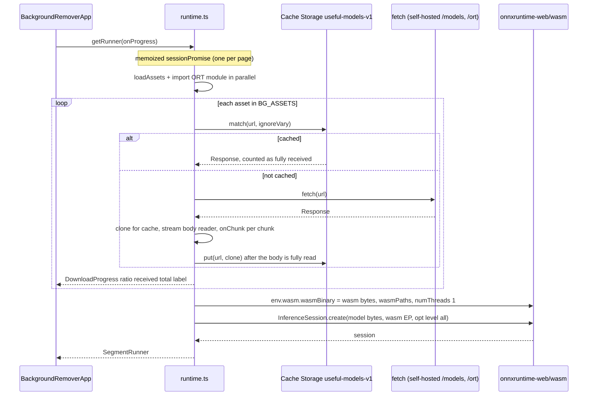

# Background remover

Cuts the subject out of a photo with a salient-object segmentation model (U²-Net small) run by ONNX Runtime Web, entirely in the browser tab. The model and runtime are self-hosted, downloaded once on an explicit click into their own Cache Storage bucket, and reused by the image editor's per-layer "Remove background". The tool performs zero database writes.

_Describes the code as of v0.5.0 (unreleased; schema v16) — verify against source when in doubt._

## File map

| File | Role |
| --- | --- |
| [pipeline.ts](../../../src/lib/bg/pipeline.ts) | The pure half: `MODEL_SIZE`, `resizeRgba`, `resizeMask`, `preprocess`, `maskFromOutput`, `blurMask`, `refineMask`, `applyMask`, `applyPaint`, `maskToAlphaRgba`, `maskToGreyRgba`, `segmentImage`, `SegmentRunner`. Typed-array math only, no DOM, no ONNX types. |
| [runtime.ts](../../../src/lib/bg/runtime.ts) | Asset delivery and inference: `MODEL_CACHE`, `BG_ASSETS`, `BG_TOTAL_BYTES`, `ORT_LOADER_URL`, `assetsReady`, `clearAssets`, `loadAssets`, `getRunner`, `resetRunner`. |
| [canvas.ts](../../../src/lib/bg/canvas.ts) | Canvas glue: `canvasToImage`, `imageToCanvas`, `maskToCanvas`, `computeMask`, `applyMaskToCanvas`, `parseHexColor`. |
| [BackgroundRemoverApp.svelte](../../../src/components/apps/BackgroundRemoverApp.svelte) | `/tools/background-remover/` |
| [ImageEditorApp.svelte](../../../src/components/apps/ImageEditorApp.svelte) | `removeBackgroundForSelected` — the editor's reuse. |
| [render.ts](../../../src/lib/raster/render.ts) / [model.ts](../../../src/lib/raster/model.ts) | `MaskLayer` and how the editor composites it. |
| [offline.ts](../../../src/lib/offline.ts) | `modelBundle` — the "Make it work offline" panel entry. |
| [sw.js](../../../public/sw.js) | `MODEL_CACHE` / `ML_PREFIXES` — the service worker's side of the model cache. |
| [build-bg-assets.mjs](../../../tools/build-bg-assets.mjs) | Vendors the model and runtime into `public/`, writes the provenance record. |
| [PROVENANCE.txt](../../../public/models/PROVENANCE.txt) | Source, licence, byte size and sha256 of each vendored file. |

## Model and runtime provenance

Both halves are **self-hosted** — no CDN is contacted at runtime — and committed to the repo so a fresh clone builds a working app without network access.

| Asset | Path | Source | Licence | Bytes |
| --- | --- | --- | --- | --- |
| U²-Net small (`u2netp`), 320×320 input | `public/models/u2netp.onnx` | rembg's release asset (`github.com/danielgatis/rembg/releases/download/v0.0.0/u2netp.onnx`); model from `github.com/xuebinqin/U-2-Net` | Apache-2.0 | 4,574,861 |
| ONNX Runtime Web kernels | `public/ort/ort-wasm-simd-threaded.wasm` | `node_modules/onnxruntime-web@1.22.0/dist/` | MIT | 11,210,254 |
| ONNX Runtime Web loader | `public/ort/ort-wasm-simd-threaded.mjs` | same | MIT | 20,856 |

`BG_TOTAL_BYTES` sums to 15,805,971 — `formatBytes` renders it as "15.8 MB", which is what the download button shows. `node tools/build-bg-assets.mjs` downloads the model (skips if present; `--force` re-fetches), copies the two ORT files verbatim out of `node_modules` (so they always match the installed package), and rewrites `PROVENANCE.txt` with sha256 hashes. The build script's header records why BriaAI RMBG and `@imgly/background-removal` were **not** used: both carry non-commercial terms.

## Lazy download into its own cache

The assets are excluded from the service worker's install precache so an install stays small for everyone who never opens the tool. They live in Cache Storage bucket `useful-models-v1` (`MODEL_CACHE`, mirrored in `sw.js`), whose name deliberately does **not** start with the app's cache prefix: the service worker purges `useful-cache-*` on every version bump, and re-downloading 15 MB because a stylesheet changed would be indefensible. `sw.js` serves anything under `models/` or `ort/` (`ML_PREFIXES`) cache-first from that bucket with no revalidation, and fills it on a miss.

The page's own path (`loadAssets` → `loadAsset` per asset, in `BG_ASSETS` order):

Points worth knowing:

- Progress `ratio` is `min(1, received / BG_TOTAL_BYTES)` so a compressed transfer or a drifted vendored size can never push the bar past 100 % or backwards. `label` names the asset in flight.
- The model and the wasm are handed to ORT as **bytes already in memory** (`env.wasm.wasmBinary`), so the two big files are never fetched twice. Only the 20 KB loader module is imported by URL; in production `env.wasm.wasmPaths` pins `mjs` to `ORT_LOADER_URL` (`/ort/ort-wasm-simd-threaded.mjs`) and `wasm` to the hosted copy. Left alone the bundle resolves the loader as a `/_astro/…` sibling of its own chunk — a URL no build step emits, which fails as "Failed to fetch dynamically imported module". In dev only `wasm` is pinned — a dev server refuses to module-import a file in `public/`, and the unbundled package resolves its own loader from `node_modules`.
- `numThreads = 1`: threads need `SharedArrayBuffer`, which needs COOP/COEP headers a static host cannot be assumed to send. Execution provider is `wasm` (the `onnxruntime-web/wasm` entry point — CPU only, one wasm file).
- `getRunner` memoizes the session promise; a failed load resets it so a later attempt is not poisoned. `resetRunner` exists as a test seam only.
- If Cache Storage is unavailable (insecure context, some private modes) `cacheStorage()` returns `null`; the tool still works but re-downloads each session and `assetsReady` reports `false`.
- The component's **Download model** button calls `loadAssets` and then `import('onnxruntime-web/wasm')` so ORT's small JS chunk is pulled while the browser is demonstrably online (the service worker caches it on the way past); nothing is instantiated until a real run. **Remove downloaded model** calls `clearAssets`, which deletes the whole bucket. `assetsReady` (every asset present) drives the "Ready — the model is cached" / "Not downloaded" state line, and is re-checked after every download and run.
- The Settings → Offline panel's `modelBundle` in `offline.ts` reuses `assetsReady`, `BG_TOTAL_BYTES` and `loadAssets` and does the same ORT chunk import.

## Pre/post-processing pipeline

`computeMask(canvas, onProgress)` in `canvas.ts` = `getRunner` then `segmentImage(canvasToImage(canvas), runner)`. `segmentImage` returns a full-resolution `Float32Array` mask in 0..1, kept separate from compositing so the knobs re-tune without another inference pass.

1. **Resize down.** `resizeRgba(image.data, w, h, 320, 320)` — bilinear, mapping destination pixel centres back into the source (a corner-aligned map biases everything up-left by half a pixel). Done in TS rather than with the canvas scaler so the pipeline is deterministic across browsers and testable in node.
2. **Normalize.** `preprocess`: RGB → NCHW `Float32Array(3·320·320)`. Each channel is divided by the image's **maximum channel value, not 255** — that is what U²-Net's `ToTensorLab` did during training and rembg kept it — then ImageNet mean `[0.485, 0.456, 0.406]` / std `[0.229, 0.224, 0.225]`. Alpha is ignored (a transparent pixel would otherwise read as black and the model would segment the checkerboard). An all-black image falls back to dividing by 255 rather than producing NaNs.
3. **Run.** The `SegmentRunner` wraps the input in an ORT `Tensor('float32', input, [1, 3, 320, 320])`, runs the session and returns the **first** output's data as a `Float32Array`.
4. **Rescale the saliency map.** `maskFromOutput`: min/max normalize to 0..1 (the network's output is ordered, not calibrated — the reference implementation does the same). A flat output yields an all-zero mask instead of a divide-by-zero.
5. **Resize up.** `resizeMask(mask, 320, 320, w, h)` — same bilinear centre-aligned resample, single channel.

Compositing (per knob change, no inference):

- `refineMask(mask, w, h, { cutoff, feather })` — `cutoff` is a percentage (UI 0–90): alpha at or below `cutoff/100` becomes 0 and what survives is rescaled `(v - limit) / (1 - limit)` so raising the cutoff clears haze without dimming the subject. `feather` (UI 0–8 px) runs `blurMask`, a two-pass separable box blur (≈ gaussian) with the radius rounded. Always returns a new array; never mutates its input.
- `applyPaint(mask, keep, remove)` — folds the touch-up brushes in: `value = max(mask, keepAlpha) · (1 − removeAlpha)`, both read from the alpha channel of RGBA bitmaps. **Keep wins over the model; remove wins over keep** (painting "cut away" over your own "bring back" erases it rather than fighting it). A paint layer sized for a different image reads as unpainted (`?? 0`, not NaN). Returns the input untouched when both layers are `null`.
- `applyMask(image, mask, background)` — the mask becomes the alpha channel. With no background: `alpha = mask · sourceAlpha`, so an already-transparent source stays transparent. With an `RgbColor` background: RGB is linearly composited over the colour and alpha is 255 — the result is opaque, which is what a JPG export needs (the choice must be made before encoding, not after).
- `maskToAlphaRgba` — black pixels with the mask as alpha (a clip source, used by the editor). `maskToGreyRgba` — opaque greyscale (the "Show the mask" preview).

In `BackgroundRemoverApp.svelte` the derived chain is `finalMask = applyPaint(refineMask(mask, w, h, {cutoff, feather}), paintData.keep, paintData.remove)` — brushes are applied **last**, so a deliberate stroke always beats the sliders — and `output = showMask ? maskToCanvas(finalMask, w, h, 'grey') : applyMaskToCanvas(decoded.canvas, finalMask, {}, background)` (the `{}` matters: `applyMaskToCanvas` would otherwise refine a second time on top of `finalMask`). `background` is `parseHexColor(bgColor)` when `bgMode === 'color'`, else `null` (anything but `#rrggbb` is treated as transparent). `kept` is the mean of `finalMask` as a percentage — the one-number summary shown next to the dimensions and the run time (`elapsedMs`).

### Touch-up paint layers

Two hidden canvases, `paintKeep` and `paintRemove`, sized to the decoded image (recreated if the size differs) and not reactive; `paintVersion` is bumped on every stroke segment and read by the `paintData` / `painted` deriveds. `strokeSegment` draws white round-capped lines in two passes — a wide pass at alpha 0.35 and a 0.7-width solid core — to get a soft edge without `ctx.filter` (absent in older Safari). Pointer events on the preview canvas map from its CSS box to canvas pixels (`toImagePoint`); a tap paints a dot; the stroke is pinned to its `pointerId` and pointer-captured. Brush size 4–200 (default 40). "Clear touch-ups" (`clearPaint`) drops both canvases; picking a new file also clears them along with the mask.

The preview itself is painted straight onto a `<canvas>` (`previewCanvas`) from `output` (or the decoded image before a run) — encoding a blob per slider nudge would burn seconds on a large photo.

## Export

`exportBlob` runs `encodeCanvas(output, format, quality)` from [convert.ts](../../../src/lib/img/convert.ts) — the same encoder as the other image tools, so a JPG export flattens whatever transparency is left onto white. Download filename is `outputFilename(file.name, format)` with `-no-bg` inserted before the extension (`subject.png` → `subject-no-bg.png`), via `downloadBlob` from [exportFile.ts](../../../src/lib/exportFile.ts). **Copy (always PNG)** encodes PNG at quality 100 and calls `copyPng` regardless of the chosen format. `format` defaults to PNG for a `.png` input and JPG otherwise; `quality` defaults to 90 and is **not** persisted (this tool does not read or write `convert_jpg_quality`). When `format === 'jpg'` and the background is transparent the UI shows "JPG cannot store transparency — the removed background will come out white" instead of silently whitening.

## How the image editor reuses it

`removeBackgroundForSelected` in `ImageEditorApp.svelte` lazily imports `lib/bg/canvas` (the runtime must not ride along for anyone who only draws an arrow). It flattens the selected image layer's bitmap into a `width × height` canvas — rotated by its quarter turns via `renderBase` when needed, children (erasers, crops) deliberately **not** applied — calls `computeMask` with a "Downloading the model… N%" status, then builds a `MaskLayer` (`kind: 'mask'`, `source: maskToCanvas(mask, w, h, 'alpha')`, `rect` = the image's rect, `quarter: 0`, `invert: false`) named "Background removed" and pushes it into the image layer's `children`, selecting it. Nothing is baked: `render.ts` composites a mask layer as a full-canvas stencil (opaque outside the rect, the mask inside it, or `1 − mask` when `invert` is set) with `destination-in`, so the mask clips only that layer, moves/scales/rotates with it, and deleting it restores the background. The editor gets no cutoff/feather/brush controls; corrections there are the editor's own eraser and restore brushes.

## Invariants

- The whole tool performs **zero IndexedDB writes** — no store of its own, no preferences. Every Playwright test wraps its work in a zero-write window.
- The pixels never leave the device; the only fetches are the app's own `/models/` and `/ort/` files.
- Model assets are never precached and never live under the app's `useful-cache-*` prefix; `MODEL_CACHE` must stay identical in `runtime.ts` and `sw.js`.
- Sliders and brushes re-tune the cached mask; only "Remove background" / "Run again" runs inference.
- Brushes are layered over the refined mask, never burnt into it, so cutoff/feather and a re-run keep them.
- `preprocess` divides by the image maximum, ignores alpha, and never emits NaN; `maskFromOutput` never divides by zero.
- Sizes in `BG_ASSETS` are the vendored files' real sizes from `PROVENANCE.txt`; regenerate both together.

## Tests

- Unit (vitest): [pipeline.test.ts](../../../src/lib/bg/pipeline.test.ts) — `resizeRgba` (identity, flat colour up/down, centre sampling, degenerate sizes), `preprocess` (NCHW + ImageNet, divide-by-max not 255, all-black without NaN, alpha ignored), `maskFromOutput` (rescale, flat → zeros), `resizeMask`, `refineMask` (default no-op copy, cutoff rescale, feather gradient), `blurMask`, `applyMask` (alpha channel, existing transparency kept, background compositing opaque, clamping), `applyPaint` (untouched when nothing painted, keep forces subject, remove cuts, mismatched layer reads unpainted, remove over keep wins, soft edges blend), the two mask bitmaps, and `segmentImage` with a fake runner (320×320 tensor in, mask scaled back, runner failure propagates).
- Browser (Playwright, production build, real model — not stubbed): [background-remover.spec.ts](../../../tests/local/background-remover.spec.ts). A canvas-drawn dark disc on a pale field is exactly the salient object the model finds, so the centre must survive and the corners must not. Tests: "Not downloaded" state, run, "Ready" + remove-download button, preview alpha 255 at the subject / 0 at the corner, `subject-no-bg.png` at 200×150 probed by pixel, database byte-identical; cutoff only ever keeps less and does not re-run (no progress element), mask view is opaque grey, solid colour makes corners opaque, JPG note appears only with a transparent background, JPG export corner is green and opaque; download via the button, then `context.setOffline(true)` and a successful run (only possible from Cache Storage), then remove → "Not downloaded"; touch-up brushes bring a corner back, survive a cutoff change, cut a hole, reach the export, and "Clear touch-ups" restores the model's mask.
- Editor integration in [image-editor.spec.ts](../../../tests/local/image-editor.spec.ts): remove background nests a "Background removed" mask at depth 1, invert flips it, deleting it restores the background; the restore brush un-erases part of a removed background.

## Known limits and decisions

- Fixed 320×320 model input: fine detail (flyaway hair, glass, low-contrast edges) is where it struggles; the Explainer points users at the touch-up brushes and the image editor.
- One session per page; the first run pays wasm instantiation plus a ~4.4 MB graph parse, and a big picture "can take a few seconds" (single-threaded SIMD, no WebGPU).
- Progress reporting is per-asset and sequential; the "checking" state on mount is `assetsReady`, which is `false` wherever Cache Storage is unavailable even if the files were just fetched.
- The mask is min/max normalized per image, so an image with no salient object still gets *something* highlighted (the brightest region of the map); a truly flat output is the only all-zero case.
- Inputs are the picker's PNG/JPG/WebP/AVIF; decoding is `decodeToCanvas` from the image tools, so the `accept` list is the only thing narrowing it (an SVG forced past the picker would decode fine).
