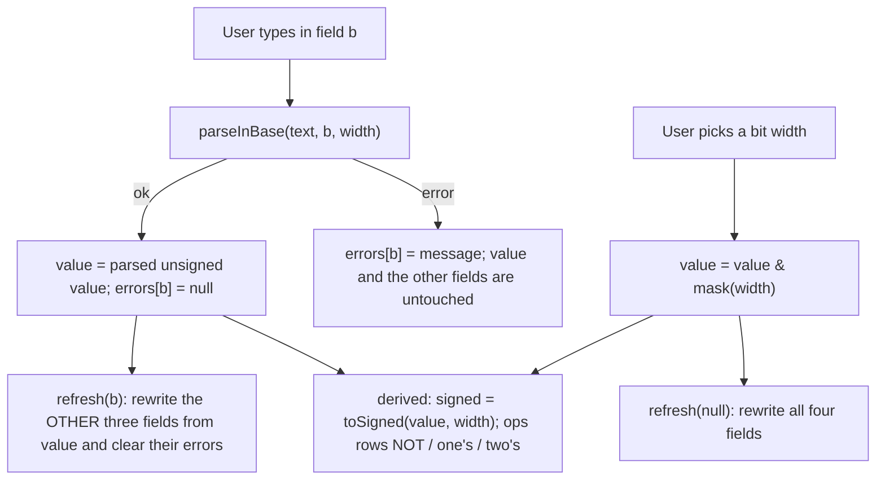
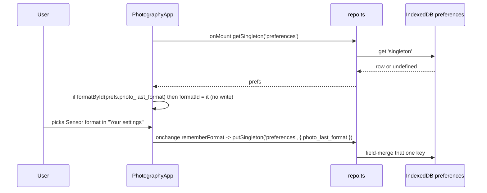

# Calculators

Three stateless calculator tools — number-base conversion with bit-width operations, photography equivalence and light stops, and file-transfer time — each a Svelte island over a pure-function module in `src/lib/calc/`. None of them writes to IndexedDB while computing; the single deliberate write in the group is the photography tool remembering the sensor format in `preferences.photo_last_format`.

_Describes the code as of v0.3.0 (unreleased; schema v13) — verify against source when in doubt._

## File map

| Path | Role |
| --- | --- |
| [numberBase.ts](../../../src/lib/calc/numberBase.ts) | Base parsing/formatting, signed/unsigned readings, NOT / one's / two's complement — all `bigint` |
| [photography.ts](../../../src/lib/calc/photography.ts) | Sensor formats, total-light equivalence, stop formulas, 1/3-stop snapping, shutter parse/format |
| [transfer.ts](../../../src/lib/calc/transfer.ts) | Size and speed unit tables, `transferSeconds`, duration and rate formatting |
| [NumberBaseApp.svelte](../../../src/components/apps/NumberBaseApp.svelte) | `/tools/number-conversion/` — page title "Programming" |
| [PhotographyApp.svelte](../../../src/components/apps/PhotographyApp.svelte) | `/tools/photography/` |
| [FileTransferApp.svelte](../../../src/components/apps/FileTransferApp.svelte) | `/tools/file-transfer/` |
| [Explainer.svelte](../../../src/components/Explainer.svelte) | The "by hand" disclosure used on every calculator page |
| [number-conversion.astro](../../../src/pages/tools/number-conversion.astro), [photography.astro](../../../src/pages/tools/photography.astro), [file-transfer.astro](../../../src/pages/tools/file-transfer.astro) | Route shells; each mounts its app with `client:only="svelte"` |
| [registry.ts](../../../src/lib/registry.ts) | Sidebar/palette entries (`number-conversion`, `photography`, `file-transfer`, category `Calculators`) |
| [types.ts](../../../src/lib/db/types.ts) | `Preferences.photo_last_format` |

## Conventions shared by all three

- All maths lives in `src/lib/calc/*.ts` as pure functions with vitest specs beside them. The Svelte apps hold only view state (`$state` strings for inputs, `$derived` results) and format the output.
- Stateless: nothing on these pages touches `repo.ts` while computing. The Playwright suite dumps the whole database before and after each scenario and asserts equality. The one exception is `rememberFormat()` in the photography app, wired to the format `<select>`'s `onchange` — never to a render effect.
- Invalid input never produces a stale or wrong result. Photography and file transfer: the `$derived` yields `null` and the page shows a `role="alert"` message instead of the estimate. Number conversion is per-field — the offending field gets a `role="alert"` error and the canonical value (so the other three fields) is left at the last good parse.
- `Explainer` is a native `
/
` with a `summary` prop and a `testid` prop (default `explainer`), so keyboard toggling and the accessibility tree come for free. Every explainer on these pages has a unique testid (`explainer-twos`, `explainer-equivalence`, `explainer-bits-bytes`, …).
- Test hooks: `data-testid` prefixes are `nb-` (number base), `ph-` (photography), `ft-` (file transfer).

## Number conversion ("Programming")

### API — `numberBase.ts`

Types: `Base = 2 | 8 | 10 | 16`, `BitWidth = 8 | 16 | 32 | 64`, `BIT_WIDTHS`, `BASE_LABELS`, `ParseResult = { ok: true; value: bigint } | { ok: false; error: string }`.

| Function | In → out | Notes |
| --- | --- | --- |
| `span(width)` | → `bigint` | 2^width |
| `mask(width)` / `maxUnsigned(width)` | → `bigint` | 2^width − 1 |
| `minSigned(width)` | → `bigint` | −2^(width−1) |
| `parseInBase(text, base, width)` | → `ParseResult` | Trims, lowercases, strips spaces and underscores, strips the base prefix (`0b`/`0o`/`0x`; none for decimal), validates digits per base. Decimal only: a leading `-` or `−` (U+2212) is allowed and the magnitude is encoded via `toUnsigned` |
| `formatInBase(value, base, width)` | → `string` | Zero-padded to the width: binary `width` digits, hex `width/4`, octal `ceil(width/3)` (8→3, 16→6, 32→11, 64→22); decimal never padded. Hex output is lowercase |
| `groupDigits(digits, size)` | → `string` | Groups from the right with spaces (`"00000101"`, 4 → `"0000 0101"`) |
| `toSigned(value, width)` | → `bigint` | `value ≥ 2^(w−1) ? value − 2^w : value` |
| `toUnsigned(value, width)` | → `bigint` | `((value mod 2^w) + 2^w) mod 2^w` |
| `onesComplement(value, width)`, `bitwiseNot` | → `bigint` | `value XOR mask(width)`; `bitwiseNot` is the same function under a second name |
| `twosComplement(value, width)` | → `bigint` | `(onesComplement + 1) & mask(width)` |

### Maths

Everything is `bigint` because 64-bit values exceed `Number`'s safe range. The canonical form is the **unsigned** value in `[0, 2^width)`; "signed" is a per-display interpretation (`toSigned`), never separate state.

- Accepted decimal range is the union of signed and unsigned: `[−2^(w−1), 2^w)`. `-5` at 8 bits parses to `251n`; `255` also parses (signed reading −1). `-129` at 8 bits errors "Below the signed 8-bit minimum (-128)"; `256` errors "Doesn't fit in 8 bits (max 255)" (the max is spelled in the input's base with its prefix, unpadded — `0xff` for hex).
- Two's complement negates the signed reading modulo 2^w, so `twosComplement(0) = 0` and `twosComplement(2^(w−1)) = 2^(w−1)` (−128 has no positive counterpart in 8 bits). The unit spec's hand table covers 8/16/32/64 bits, including `0xdeadbeef` at 32 bits.

### App flow

`NumberBaseApp.svelte` keeps `width`, the canonical `value` (initially `5n` at 8 bits), one text string per base and one error slot per base.

- The field being typed in is never rewritten, so `0xFF` stays as typed while the other three fields update.
- Width change: `value & mask(width)` runs after `bind:value` has already updated `width`, so shrinking truncates to the low bits like a register move; growing is a no-op on the bits — there is no sign extension (8-bit `251` = −5 becomes 16-bit `251` = +251).
- The range hint next to the selector is `unsigned 0 … maxUnsigned(width) · signed minSigned(width) … maxUnsigned(width) >> 1n`.
- Under the decimal field, `signed: <n>` (`nb-signed`) appears only when `toSigned(value) !== value`, i.e. the top bit is set.
- Operations table rows (`nb-op-not`, `nb-op-ones`, `nb-op-twos`): binary grouped in fours via `groupDigits(formatInBase(v, 2, width), 4)`, hex padded, decimal unsigned, and a Signed column `toSigned(result, width)`. NOT and one's complement are the same computation shown twice on purpose — the tool teaches them as separate ideas.
- Seven explainers: binary→decimal, decimal→binary, hex↔binary, octal↔binary, NOT, one's, two's (the last interpolates the live `value` / `signed`).

## Photography

### API — `photography.ts`

Types: `SensorFormatId = 'mft' | 'apsc' | 'apsc-canon' | 'ff'`, `SensorFormat { id, label, crop }`, `Settings { focal, aperture, iso }`.

| Function | In → out | Notes |
| --- | --- | --- |
| `FORMATS` | `SensorFormat[]` | Micro 4/3 2.0, APS-C 1.5, APS-C (Canon) 1.6, Full frame 1.0 — in that order |
| `formatById(id)` | → `SensorFormat \| null` | |
| `equivalentSettings(s, fromCrop, toCrop)` | → `Settings` | `r = fromCrop / toCrop`; focal × r, aperture × r, iso × r² |
| `shutterStops(t1, t2)` | → `number` | `log2(t1/t2)` |
| `isoStops(i1, i2)` | → `number` | `log2(i1/i2)` |
| `apertureStops(n1, n2)` | → `number` | `2·log2(n1/n2)` |
| `sensorStops(crop1, crop2)` | → `number` | `2·log2(crop1/crop2)` |
| `snapAperture(n)` | → `number` | Nearest nominal 1/3-stop f-number (see tables); `NaN` unless `n > 0` |
| `snapIso(iso)` | → `number` | Nearest nominal 1/3-stop ISO; `NaN` unless `iso > 0` |
| `snapFocal(mm)` | → `number` | Not a stop scale: whole mm, one decimal below 10 mm; `NaN` unless `mm > 0` |
| `parseShutter(text)` | → `number \| null` | Seconds from `1/250`, `0.5`, `2`, `2s`, `0.4s`; trailing `s` and internal whitespace stripped; `null` for junk, zero, negatives, or a zero denominator |
| `formatShutter(seconds)` | → `string` | ≥ 1 s: `2s` / `1.5s` (one decimal); < 1 s: `1/round(1/s)`; `—` for non-positive |
| `formatStops(stops)` | → `string` | Rounded to 2 decimals, leading `+` or `−` (U+2212), `0` when it rounds to zero |

### Equivalence model (total light)

Per-area exposure is identical across formats at the same f-number, shutter and ISO; what differs is the sensor area collecting it. To match total light (and therefore noise and depth of field) when moving from crop `c1` to crop `c2`, with `r = c1/c2`:

| Quantity | Equivalent |
| --- | --- |
| Focal length | × r |
| f-number | × r |
| ISO | × r² |
| Shutter | unchanged |

Worked example (unit-tested and the app's defaults): 20 mm f/2.8 ISO 200 on Micro 4/3 → 40 mm f/5.6 ISO 800 on full frame. The ISO rise offsets the dimmer f-number, so image brightness is unchanged.

The app computes a row for every entry in `FORMATS` (including the source format, flagged `source` and highlighted) and snaps each: `snapFocal`, `snapAperture`, `snapIso`. Because the source row is also snapped, an entered f/3.0 displays as f/3.2 in its own row. The Shutter column is `formatShutter(scene.shutterSec)` for every row.

### Stops

Set A is "Your settings" (format, focal, aperture, shutter, ISO). Set B is the comparison (format, aperture, shutter, ISO — no focal length, because focal length does not move light). Each component is exact, not snapped, and reads "how many stops A sits above B on that dial":

| Row | Formula | Meaning string (positive case) |
| --- | --- | --- |
| Shutter | `shutterStops(tA, tB)` | "A stays open N stops longer — more light." |
| Aperture | `apertureStops(NA, NB)` | "A's aperture passes N stops less light." |
| ISO | `isoStops(isoA, isoB)` | "A is N stops brighter from gain — no light moved." |
| Sensor | `sensorStops(cropA, cropB)` | "A's sensor gathers N stops less total light." |

Totals (positive = A brighter / gathers more; aperture and sensor flip sign because a higher f-number or crop means less light):

- `exposure = shutter − aperture + iso` — "Image brightness"
- `totalLight = shutter − aperture − sensor` — "Total light" (ISO is gain, not light, so it is swapped for the sensor term)

`fmtX` in the app spells the magnitude as `1 stop` / `2 stops` / `0.83 stops` — singular only when the rounded value is exactly 1. Reference case from the spec: A Micro 4/3, B APS-C, identical settings → sensor `+0.83`, exposure `0`, total light `−0.83`.

### 1/3-stop snapping tables

Both snap functions index a nominal table by rounding the exact log position; values off the end of the table fall back to the exact geometric value at 2 significant digits.

- Aperture: index `round(6·log2(N))` into `APERTURE_THIRDS` (f/1.0 = index 0 … f/32 = index 30): 1.0, 1.1, 1.2, 1.4, 1.6, 1.8, 2, 2.2, 2.5, 2.8, 3.2, 3.5, 4, 4.5, 5.0, 5.6, 6.3, 7.1, 8, 9, 10, 11, 13, 14, 16, 18, 20, 22, 25, 29, 32. Fallback `2^(index/6)` (so 0.7 → 0.71, 45 → ~45).
- ISO: index `round(3·log2(iso/25))` into `ISO_THIRDS` (ISO 25 = index 0 … 102400 = index 36): 25, 32, 40, 50, 64, 80, 100, 125, 160, 200, 250, 320, 400, 500, 640, 800, 1000, 1250, 1600, 2000, 2500, 3200, 4000, 5000, 6400, 8000, 10000, 12800, 16000, 20000, 25600, 32000, 40000, 51200, 64000, 80000, 102400. Fallback `25·2^(index/3)`.

Snapping applies only to the equivalent-settings table. The stops table uses the raw inputs, which is why f/2.8 vs f/4 reads `−1.03` (nominal 2.8 is really 2^1.5) rather than `−1`.

### What is remembered

`photo_last_format` on the `preferences` singleton (`'mft' | 'apsc' | 'apsc-canon' | 'ff'`). Only set A's format; set B and every numeric field are view state that resets on reload.

Restore validates the stored id through `formatById`, so an unknown value is ignored rather than crashing the select. The write is fire-and-forget (`void putSingleton(...)`). The Preferences page lists the key read-only under "Remembered values" (it is not in that page's `KNOWN` set, so it falls into `otherFields`).

## File transfer

### API — `transfer.ts`

| Export | Shape | Notes |
| --- | --- | --- |
| `SIZE_UNITS` | `SizeUnit[] { id, label, bytes }` | KB 1e3, MB 1e6, GB 1e9, TB 1e12 — decimal |
| `SPEED_UNITS` | `SpeedUnit[] { id, label, bitsPerSecond, kind }` | Kbps 1e3, Mbps 1e6, Gbps 1e9 (`kind: 'bits'`); KBps 8e3, MBps 8e6 (`kind: 'bytes'`) |
| `sizeUnitById(id)`, `speedUnitById(id)` | → unit or `null` | |
| `transferSeconds(sizeBytes, speedBitsPerSecond, overheadPercent = 0)` | → `number \| null` | `(sizeBytes × 8) / (speed × (1 − overhead/100))`; `null` unless size > 0, speed > 0 and 0 ≤ overhead < 100 |
| `formatDuration(seconds)` | → `string` | `—` for NaN/negative/Infinity; < 1 s two significant digits (`0.4 s`); < 60 s three (`10 s`); otherwise the two most significant of d/h/min/s with the minor unit rounded and carried (`1 min 20 s`, `1 h 4 min`, `2 d 8 h`; 7 170 s → `2 h`, never `1 h 60 min`) |
| `speedBothWays(bitsPerSecond)` | → `string` | `"100 Mbps = 12.5 MB/s"` — each side picks the largest scale ≤ the value, 3 significant digits (`humanRate`) |

### Maths

Decimal units throughout (KB = 1000 B) — what drives and ISPs advertise. Bits vs bytes is carried in the unit table (`kind`), so the UI cannot conflate Mbps with MB/s: the byte units simply carry `bitsPerSecond` eight times larger. Overhead trims the usable link: 1 GB over 100 Mbps is 80 s; at 20 % overhead it is 80 / 0.8 = 100 s.

### App

Defaults 1 GB, 100 Mbps, overhead 0. Inputs are strings; `num` accepts any finite number and leaves range checks to `transferSeconds` (an empty overhead field is treated as `0`). When the result is `null` the Estimate card is not rendered and an alert asks for a positive size and speed with overhead below 100 %. The Estimate card shows `formatDuration`, a raw seconds line (rounded and locale-grouped at ≥ 100 s, else 3 significant digits), `speedBothWays(bps)` as "Link speed", and — only when overhead > 0 — "After overhead" with `speedBothWays` of the effective rate.

## Tests

| File | Runner | Covers |
| --- | --- | --- |
| [numberBase.test.ts](../../../src/lib/calc/numberBase.test.ts) | vitest (`npm run test:unit`) | Parsing per base, prefixes/separators, negative decimals as two's complement, range on both ends, padding, grouping, signed round-trip, hand-computed NOT/one's/two's table across all widths |
| [photography.test.ts](../../../src/lib/calc/photography.test.ts) | vitest | Crop factors, the 20 mm f/2.8 → 40 mm f/5.6 example, exact stop formulas (m4/3 vs APS-C ≈ 0.83), snapping including table fallbacks, shutter parse/format, `formatStops` sign trimming |
| [transfer.test.ts](../../../src/lib/calc/transfer.test.ts) | vitest | Unit tables, hand-computed durations across unit combinations, overhead, null on impossible input, `formatDuration` carry, `speedBothWays` |
| [calculators.spec.ts](../../../tests/local/calculators.spec.ts) | Playwright (`npm test`) | Each page end-to-end with `dumpAll()` before/after asserting zero writes; the format pick audited with `assertIsolatedDelta` to `preferences/singleton` and restored after a reload that itself writes nothing; explainers toggle from the keyboard on all three pages |
| [a11y.spec.ts](../../../tests/local/a11y.spec.ts) | Playwright | The three routes are in the every-page sweep (accessible names, labelled fields, heading structure); palette keyboard navigation lands on Photography; an explainer opens from the keyboard |
| [offline.spec.ts](../../../tests/local/offline.spec.ts), [payload.spec.ts](../../../tests/local/payload.spec.ts) | Playwright | Use `/tools/photography/` as the "light tool" probe: served from cache offline, and pulls none of the heavy bundles |

## Known limits and decisions

- No sign extension on width growth, and truncation on width shrink — deliberate register-move semantics; the canonical value is unsigned so nothing else would be well-defined.
- Minus is decimal-only. A leading `-` in binary/octal/hex is a validation error; negatives in those bases are their two's-complement bit patterns.
- `formatShutter` shows every sub-second value as `1/N` with N rounded, so 0.7 s renders as `1/1` and 0.6 s as `1/2`. It only ever displays the parsed set-A shutter, which the user typed.
- The four fixed crop factors are the plan's; there is no custom-crop or 1-inch/medium-format entry. The model ignores lens transmission (T-stops), sensor generation and diffraction — it is pure geometry.
- Snap tables end at f/32 and ISO 102400 (start f/1.0 and ISO 25); beyond them the geometric value replaces the marketing number.
- Transfer estimates are theoretical throughput: no latency, ramp-up or retransmission model beyond the flat overhead percentage.
- The photography preference is written on every change of the set-A select; `putSingleton` field-merges and stamps only that key. Set B's format is never remembered.
