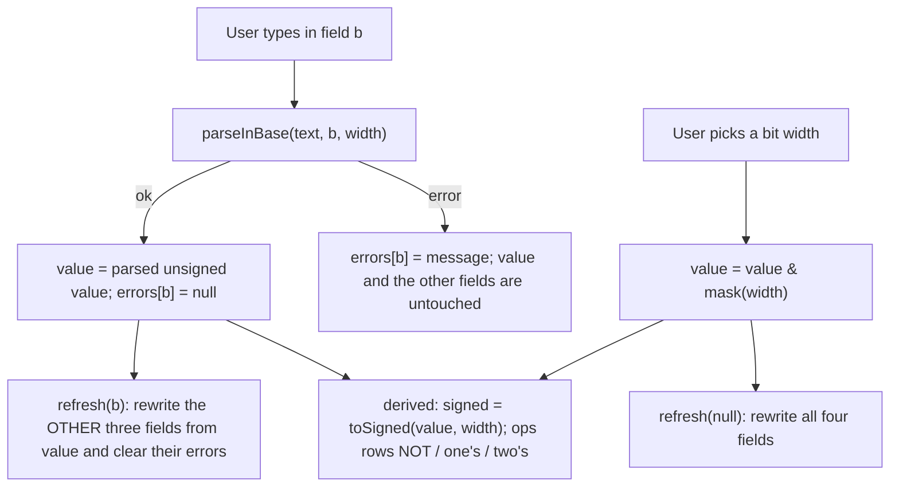
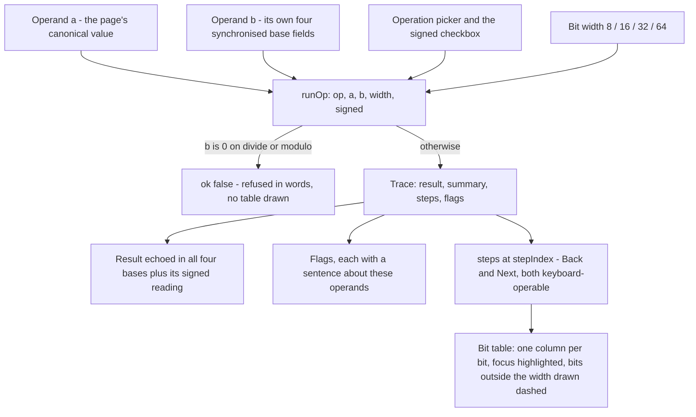
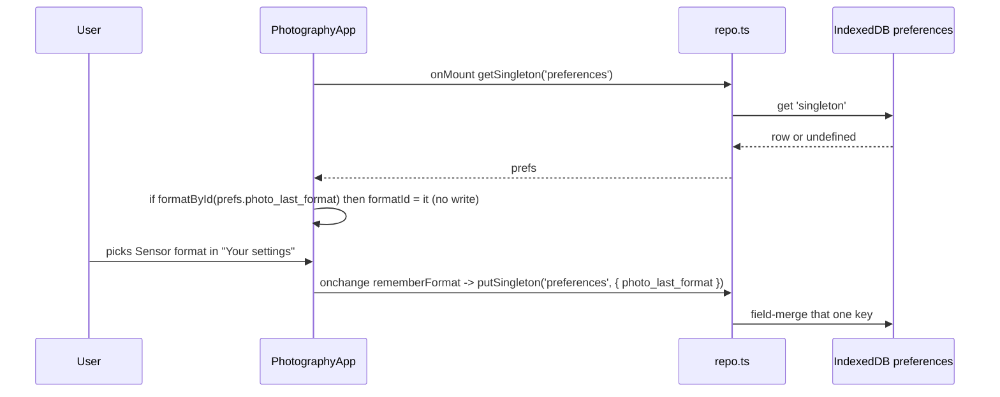
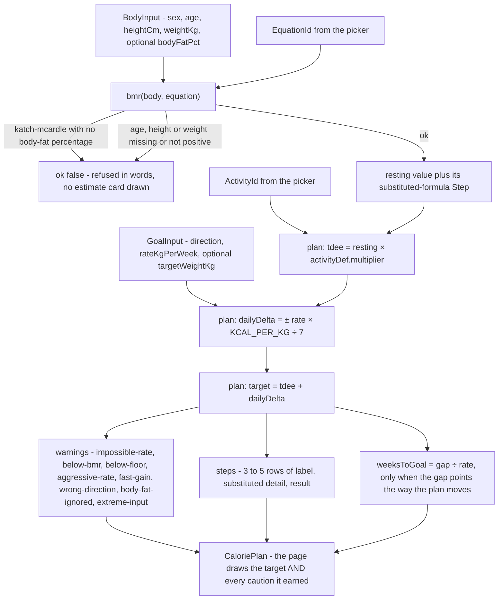
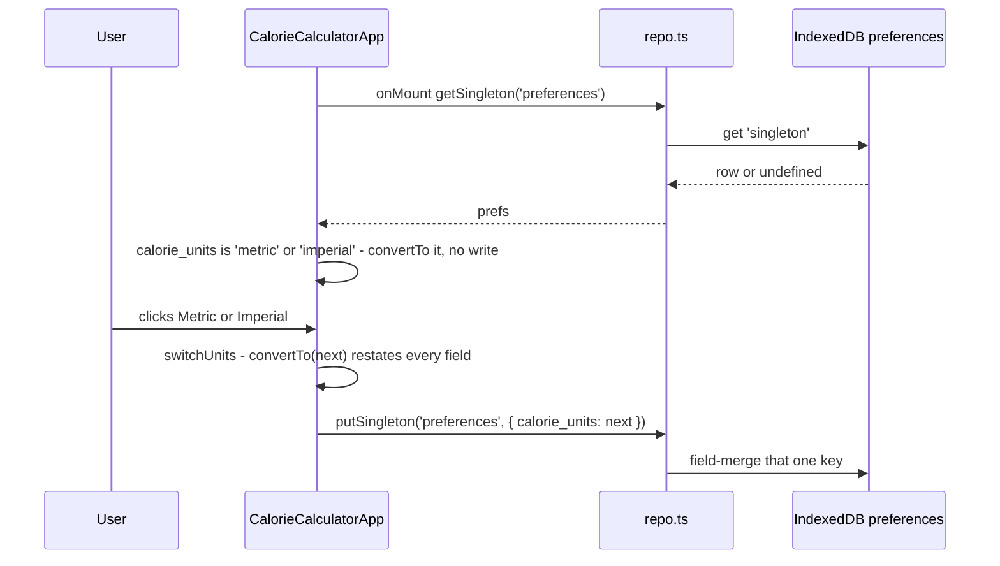

# Calculators

Four calculator tools — number-base conversion with bit-width operations and a step-by-step visualizer for the binary ones, photography equivalence and light stops, file-transfer time, and daily calorie planning — each a Svelte island over a pure-function module in `src/lib/calc/`. None of them writes to IndexedDB while computing; the two deliberate writes in the group are the photography tool remembering the sensor format in `preferences.photo_last_format` and the calorie tool remembering the unit system in `preferences.calorie_units`.

_Describes the code as of v0.5.0 (schema v16) — verify against source when in doubt._

## File map

| Path | Role |
| --- | --- |
| [numberBase.ts](../../../src/lib/calc/numberBase.ts) | Base parsing/formatting, signed/unsigned readings, NOT / one's / two's complement — all `bigint` |
| [binaryOps.ts](../../../src/lib/calc/binaryOps.ts) | The eleven two-operand operations, each returning the answer **and** the steps that produced it — ripple add/subtract, shift-and-add multiply, restoring long division, columnar AND/OR/XOR, and the three shifts |
| [photography.ts](../../../src/lib/calc/photography.ts) | Sensor formats, total-light equivalence, stop formulas, 1/3-stop snapping, shutter parse/format |
| [transfer.ts](../../../src/lib/calc/transfer.ts) | Size and speed unit tables, `transferSeconds`, duration and rate formatting |
| [calories.ts](../../../src/lib/calc/calories.ts) | The three resting-rate equations, the five activity multipliers, `plan()` with its `steps[]` and `warnings[]`, the intake floors, and the kg⇄lb / cm⇄ft-in helpers |
| [NumberBaseApp.svelte](../../../src/components/apps/NumberBaseApp.svelte) | `/tools/number-conversion/` — page title "Programming" |
| [PhotographyApp.svelte](../../../src/components/apps/PhotographyApp.svelte) | `/tools/photography/` |
| [FileTransferApp.svelte](../../../src/components/apps/FileTransferApp.svelte) | `/tools/file-transfer/` |
| [CalorieCalculatorApp.svelte](../../../src/components/apps/CalorieCalculatorApp.svelte) | `/tools/calories/` — page title "Daily calories" |
| [Explainer.svelte](../../../src/components/Explainer.svelte) | The "by hand" disclosure used on every calculator page |
| [number-conversion.astro](../../../src/pages/tools/number-conversion.astro), [photography.astro](../../../src/pages/tools/photography.astro), [file-transfer.astro](../../../src/pages/tools/file-transfer.astro), [calories.astro](../../../src/pages/tools/calories.astro) | Route shells; each mounts its app with `client:only="svelte"` |
| [registry.ts](../../../src/lib/registry.ts) | Sidebar/palette entries (`number-conversion`, `photography`, `file-transfer`, `calories`, category `Calculators`) |
| [types.ts](../../../src/lib/db/types.ts) | `Preferences.photo_last_format`, `Preferences.calorie_units` |

## Conventions shared by all four

- All maths lives in `src/lib/calc/*.ts` as pure functions with vitest specs beside them. The Svelte apps hold only view state (`$state` strings for inputs, `$derived` results) and format the output.
- Stateless: nothing on these pages touches `repo.ts` while computing. The Playwright suite dumps the whole database before and after each scenario and asserts equality. The two exceptions are `rememberFormat()` in the photography app and `switchUnits()` in the calorie app, each wired to its own control's handler — never to a render effect.
- Invalid input never produces a stale or wrong result. Photography and file transfer: the `$derived` yields `null` and the page shows a `role="alert"` message instead of the estimate. Number conversion is per-field — the offending field gets a `role="alert"` error and the canonical value (so the other three fields) is left at the last good parse. Daily calories replaces the whole Estimate card with a "Not enough to work with" card carrying the refusal (`cal-problem`, `role="alert"`).
- `Explainer` is a native `
/
` with a `summary` prop and a `testid` prop (default `explainer`), so keyboard toggling and the accessibility tree come for free. Every explainer on these pages has a unique testid (`explainer-twos`, `explainer-equivalence`, `explainer-bits-bytes`, `explainer-calories`, …).
- Test hooks: `data-testid` prefixes are `nb-` (number base), `ph-` (photography), `ft-` (file transfer), `cal-` (daily calories).

## Number conversion ("Programming")

### API — `numberBase.ts`

Types: `Base = 2 | 8 | 10 | 16`, `BitWidth = 8 | 16 | 32 | 64`, `BIT_WIDTHS`, `BASE_LABELS`, `ParseResult = { ok: true; value: bigint } | { ok: false; error: string }`.

| Function | In → out | Notes |
| --- | --- | --- |
| `span(width)` | → `bigint` | 2^width |
| `mask(width)` / `maxUnsigned(width)` | → `bigint` | 2^width − 1 |
| `minSigned(width)` | → `bigint` | −2^(width−1) |
| `parseInBase(text, base, width)` | → `ParseResult` | Trims, lowercases, strips spaces and underscores, strips the base prefix (`0b`/`0o`/`0x`; none for decimal), validates digits per base. Decimal only: a leading `-` or `−` (U+2212) is allowed and the magnitude is encoded via `toUnsigned` |
| `formatInBase(value, base, width)` | → `string` | Zero-padded to the width: binary `width` digits, hex `width/4`, octal `ceil(width/3)` (8→3, 16→6, 32→11, 64→22); decimal never padded. Hex output is lowercase |
| `groupDigits(digits, size)` | → `string` | Groups from the right with spaces (`"00000101"`, 4 → `"0000 0101"`) |
| `toSigned(value, width)` | → `bigint` | `value ≥ 2^(w−1) ? value − 2^w : value` |
| `toUnsigned(value, width)` | → `bigint` | `((value mod 2^w) + 2^w) mod 2^w` |
| `onesComplement(value, width)`, `bitwiseNot` | → `bigint` | `value XOR mask(width)`; `bitwiseNot` is the same function under a second name |
| `twosComplement(value, width)` | → `bigint` | `(onesComplement + 1) & mask(width)` |

### Maths

Everything is `bigint` because 64-bit values exceed `Number`'s safe range. The canonical form is the **unsigned** value in `[0, 2^width)`; "signed" is a per-display interpretation (`toSigned`), never separate state.

- Accepted decimal range is the union of signed and unsigned: `[−2^(w−1), 2^w)`. `-5` at 8 bits parses to `251n`; `255` also parses (signed reading −1). `-129` at 8 bits errors "Below the signed 8-bit minimum (-128)"; `256` errors "Doesn't fit in 8 bits (max 255)" (the max is spelled in the input's base with its prefix, unpadded — `0xff` for hex).
- Two's complement negates the signed reading modulo 2^w, so `twosComplement(0) = 0` and `twosComplement(2^(w−1)) = 2^(w−1)` (−128 has no positive counterpart in 8 bits). The unit spec's hand table covers 8/16/32/64 bits, including `0xdeadbeef` at 32 bits.

### App flow

`NumberBaseApp.svelte` keeps `width`, the canonical `value` (initially `5n` at 8 bits), one text string per base and one error slot per base.

- The field being typed in is never rewritten, so `0xFF` stays as typed while the other three fields update.
- Width change: `value & mask(width)` runs after `bind:value` has already updated `width`, so shrinking truncates to the low bits like a register move; growing is a no-op on the bits — there is no sign extension (8-bit `251` = −5 becomes 16-bit `251` = +251).
- The range hint next to the selector is `unsigned 0 … maxUnsigned(width) · signed minSigned(width) … maxUnsigned(width) >> 1n`.
- Under the decimal field, `signed: <n>` (`nb-signed`) appears only when `toSigned(value) !== value`, i.e. the top bit is set.
- Operations table rows (`nb-op-not`, `nb-op-ones`, `nb-op-twos`): binary grouped in fours via `groupDigits(formatInBase(v, 2, width), 4)`, hex padded, decimal unsigned, and a Signed column `toSigned(result, width)`. NOT and one's complement are the same computation shown twice on purpose — the tool teaches them as separate ideas.
- Seven explainers: binary→decimal, decimal→binary, hex↔binary, octal↔binary, NOT, one's, two's (the last interpolates the live `value` / `signed`).

### Operation visualizer

A second card below the Operations table: two operands, an operation, and the
working. [binaryOps.ts](../../../src/lib/calc/binaryOps.ts) does the arithmetic
and returns a `Trace` — the answer plus the steps that produced it — and
`NumberBaseApp.svelte` only draws it. Operand **a** is the page's canonical
value from the card above, so the page keeps one number that means something;
operand **b** has its own synchronised set of the same four base fields, parsed
by the same `parseInBase` and truncated by the same `mask(width)` on a width
change.

`runOp(op, a, b, { width, signed })` returns `{ ok: true, trace }`, or
`{ ok: false, error }` for the one refusal there is — division by zero, which
is refused in words rather than answered with an infinity. `BINARY_OPS` is the
catalogue the picker renders: add, subtract, multiply, divide, modulo, AND, OR,
XOR, and the three shifts. Logical and arithmetic right shift are separate
**operations** rather than one operation with a mode, because the difference
between them is the lesson.

`signed` changes the RESULT BITS of division and modulo only. Everywhere else
it changes how the answer is read, not what it is — `signedMatters` on the
`OpDef` says which, the page states it in a line under the picker, and a unit
test proves the claim by running every other operation both ways over every
vector and asserting the bits match.

A `Trace` is:

| Field | What |
| --- | --- |
| `result` | The answer, unsigned within the width |
| `summary` | One or two sentences about the operation as a whole |
| `steps[]` | `text` (a full sentence), `focus` (the bit positions this step works on), `rows` (the whole drawn table **after** this step), `value` (the answer so far) and `emit` (the one bit of it this step decided, where it decided one) |
| `flags[]` | `id`, `label`, `on`, and a sentence about what the flag means for THESE operands — never a bare boolean |

A `TraceRow` is a label plus exactly `width` characters of `0`, `1` or a space
for a column not yet decided, and optionally `lostHigh` / `lostLow`: bits that
fell off the top or the bottom of the width. The app pads those to the widest
row in the step so every column still lines up under its bit number, and draws
them with a dashed border rather than a tint — a tinted background sits under
`--text-muted-color` and drops it below the ratio the a11y sweep checks that
token at.

**The trace contract** is what keeps the drawing honest, and
[binaryOps.test.ts](../../../src/lib/calc/binaryOps.test.ts) holds it to it:
`steps` is never empty, `steps.at(-1).value === result`, and where every step
emits a bit, OR-ing those bits alone reproduces `result`. Multiply is checked a
step further — the partial-product rows are read back out of the **drawn**
bit strings, summed, and compared with the answer. A picture that cannot be
replayed into the result is decoration.

Per operation, what the trace shows:

- **add / subtract** — one step per column, right to left, with the carry-in
  or borrow-in row drawn above the operands. Both flags are always present and
  told apart: carry (or borrow) asks whether the **unsigned** answer fit,
  signed overflow asks whether the **signed** one did. Overflow is decided by
  comparing `toSigned(a) + toSigned(b)` with `toSigned(result)` rather than by
  bit-fiddling, so it is right by construction.
- **multiply** — shift-and-add: one step per multiplier bit, a partial-product
  row added for each 1, and the bits that shift past the top drawn falling off
  in the out-of-width columns. Flags: bits dropped (unsigned) and signed
  overflow, which can genuinely differ — `0xFF × 0xFF` at 8 bits drops
  bits but is the correct signed answer for −1 × −1.
- **divide / modulo** — restoring long division, one quotient bit per step,
  most significant first. Signed operands are divided as **magnitudes** and the
  sign is applied in its own final step, which is both the honest trace and
  what makes truncation toward zero visible: −7 / 2 is −3, not −4, and
  the remainder takes the sign of the dividend so `(a / b) * b + a % b == a`
  still holds. The one overflowing division — the most negative value by
  −1 — is named.
- **AND / OR / XOR** — one step per column, no carries, no borrows.
- **shifts** — one step per place moved, naming the bit that left and what
  filled in. Past the width the answer is the mathematical one in a single
  step, with a flag saying that C calls this undefined and that x86 would mask
  the count while ARM gives zero.

## Photography

### API — `photography.ts`

Types: `SensorFormatId = 'mft' | 'apsc' | 'apsc-canon' | 'ff'`, `SensorFormat { id, label, crop }`, `Settings { focal, aperture, iso }`.

| Function | In → out | Notes |
| --- | --- | --- |
| `FORMATS` | `SensorFormat[]` | Micro 4/3 2.0, APS-C 1.5, APS-C (Canon) 1.6, Full frame 1.0 — in that order |
| `formatById(id)` | → `SensorFormat \| null` | |
| `equivalentSettings(s, fromCrop, toCrop)` | → `Settings` | `r = fromCrop / toCrop`; focal × r, aperture × r, iso × r² |
| `shutterStops(t1, t2)` | → `number` | `log2(t1/t2)` |
| `isoStops(i1, i2)` | → `number` | `log2(i1/i2)` |
| `apertureStops(n1, n2)` | → `number` | `2·log2(n1/n2)` |
| `sensorStops(crop1, crop2)` | → `number` | `2·log2(crop1/crop2)` |
| `snapAperture(n)` | → `number` | Nearest nominal 1/3-stop f-number (see tables); `NaN` unless `n > 0` |
| `snapIso(iso)` | → `number` | Nearest nominal 1/3-stop ISO; `NaN` unless `iso > 0` |
| `snapFocal(mm)` | → `number` | Not a stop scale: whole mm, one decimal below 10 mm; `NaN` unless `mm > 0` |
| `parseShutter(text)` | → `number \| null` | Seconds from `1/250`, `0.5`, `2`, `2s`, `0.4s`; trailing `s` and internal whitespace stripped; `null` for junk, zero, negatives, or a zero denominator |
| `formatShutter(seconds)` | → `string` | ≥ 1 s: `2s` / `1.5s` (one decimal); < 1 s: `1/round(1/s)`; `—` for non-positive |
| `formatStops(stops)` | → `string` | Rounded to 2 decimals, leading `+` or `−` (U+2212), `0` when it rounds to zero |

### Equivalence model (total light)

Per-area exposure is identical across formats at the same f-number, shutter and ISO; what differs is the sensor area collecting it. To match total light (and therefore noise and depth of field) when moving from crop `c1` to crop `c2`, with `r = c1/c2`:

| Quantity | Equivalent |
| --- | --- |
| Focal length | × r |
| f-number | × r |
| ISO | × r² |
| Shutter | unchanged |

Worked example (unit-tested and the app's defaults): 20 mm f/2.8 ISO 200 on Micro 4/3 → 40 mm f/5.6 ISO 800 on full frame. The ISO rise offsets the dimmer f-number, so image brightness is unchanged.

The app computes a row for every entry in `FORMATS` (including the source format, flagged `source` and highlighted) and snaps each: `snapFocal`, `snapAperture`, `snapIso`. Because the source row is also snapped, an entered f/3.0 displays as f/3.2 in its own row. The Shutter column is `formatShutter(scene.shutterSec)` for every row.

### Stops

Set A is "Your settings" (format, focal, aperture, shutter, ISO). Set B is the comparison (format, aperture, shutter, ISO — no focal length, because focal length does not move light). Each component is exact, not snapped, and reads "how many stops A sits above B on that dial":

| Row | Formula | Meaning string (positive case) |
| --- | --- | --- |
| Shutter | `shutterStops(tA, tB)` | "A stays open N stops longer — more light." |
| Aperture | `apertureStops(NA, NB)` | "A's aperture passes N stops less light." |
| ISO | `isoStops(isoA, isoB)` | "A is N stops brighter from gain — no light moved." |
| Sensor | `sensorStops(cropA, cropB)` | "A's sensor gathers N stops less total light." |

Totals (positive = A brighter / gathers more; aperture and sensor flip sign because a higher f-number or crop means less light):

- `exposure = shutter − aperture + iso` — "Image brightness"
- `totalLight = shutter − aperture − sensor` — "Total light" (ISO is gain, not light, so it is swapped for the sensor term)

`fmtX` in the app spells the magnitude as `1 stop` / `2 stops` / `0.83 stops` — singular only when the rounded value is exactly 1. Reference case from the spec: A Micro 4/3, B APS-C, identical settings → sensor `+0.83`, exposure `0`, total light `−0.83`.

### 1/3-stop snapping tables

Both snap functions index a nominal table by rounding the exact log position; values off the end of the table fall back to the exact geometric value at 2 significant digits.

- Aperture: index `round(6·log2(N))` into `APERTURE_THIRDS` (f/1.0 = index 0 … f/32 = index 30): 1.0, 1.1, 1.2, 1.4, 1.6, 1.8, 2, 2.2, 2.5, 2.8, 3.2, 3.5, 4, 4.5, 5.0, 5.6, 6.3, 7.1, 8, 9, 10, 11, 13, 14, 16, 18, 20, 22, 25, 29, 32. Fallback `2^(index/6)` (so 0.7 → 0.71, 45 → ~45).
- ISO: index `round(3·log2(iso/25))` into `ISO_THIRDS` (ISO 25 = index 0 … 102400 = index 36): 25, 32, 40, 50, 64, 80, 100, 125, 160, 200, 250, 320, 400, 500, 640, 800, 1000, 1250, 1600, 2000, 2500, 3200, 4000, 5000, 6400, 8000, 10000, 12800, 16000, 20000, 25600, 32000, 40000, 51200, 64000, 80000, 102400. Fallback `25·2^(index/3)`.

Snapping applies only to the equivalent-settings table. The stops table uses the raw inputs, which is why f/2.8 vs f/4 reads `−1.03` (nominal 2.8 is really 2^1.5) rather than `−1`.

### What is remembered

`photo_last_format` on the `preferences` singleton (`'mft' | 'apsc' | 'apsc-canon' | 'ff'`). Only set A's format; set B and every numeric field are view state that resets on reload.

Restore validates the stored id through `formatById`, so an unknown value is ignored rather than crashing the select. The write is fire-and-forget (`void putSingleton(...)`). The Preferences page lists the key read-only under "Remembered values" (it is not in that page's `KNOWN` set, so it falls into `otherFields`).

## File transfer

### API — `transfer.ts`

| Export | Shape | Notes |
| --- | --- | --- |
| `SIZE_UNITS` | `SizeUnit[] { id, label, bytes }` | KB 1e3, MB 1e6, GB 1e9, TB 1e12 — decimal |
| `SPEED_UNITS` | `SpeedUnit[] { id, label, bitsPerSecond, kind }` | Kbps 1e3, Mbps 1e6, Gbps 1e9 (`kind: 'bits'`); KBps 8e3, MBps 8e6 (`kind: 'bytes'`) |
| `sizeUnitById(id)`, `speedUnitById(id)` | → unit or `null` | |
| `transferSeconds(sizeBytes, speedBitsPerSecond, overheadPercent = 0)` | → `number \| null` | `(sizeBytes × 8) / (speed × (1 − overhead/100))`; `null` unless size > 0, speed > 0 and 0 ≤ overhead < 100 |
| `formatDuration(seconds)` | → `string` | `—` for NaN/negative/Infinity; < 1 s two significant digits (`0.4 s`); < 60 s three (`10 s`); otherwise the two most significant of d/h/min/s with the minor unit rounded and carried (`1 min 20 s`, `1 h 4 min`, `2 d 8 h`; 7 170 s → `2 h`, never `1 h 60 min`) |
| `speedBothWays(bitsPerSecond)` | → `string` | `"100 Mbps = 12.5 MB/s"` — each side picks the largest scale ≤ the value, 3 significant digits (`humanRate`) |

### Maths

Decimal units throughout (KB = 1000 B) — what drives and ISPs advertise. Bits vs bytes is carried in the unit table (`kind`), so the UI cannot conflate Mbps with MB/s: the byte units simply carry `bitsPerSecond` eight times larger. Overhead trims the usable link: 1 GB over 100 Mbps is 80 s; at 20 % overhead it is 80 / 0.8 = 100 s.

### App

Defaults 1 GB, 100 Mbps, overhead 0. Inputs are strings; `num` accepts any finite number and leaves range checks to `transferSeconds` (an empty overhead field is treated as `0`). When the result is `null` the Estimate card is not rendered and an alert asks for a positive size and speed with overhead below 100 %. The Estimate card shows `formatDuration`, a raw seconds line (rounded and locale-grouped at ≥ 100 s, else 3 significant digits), `speedBothWays(bps)` as "Link speed", and — only when overhead > 0 — "After overhead" with `speedBothWays` of the effective rate.

## Daily calories

Body measurements, an activity level and a goal become a resting rate, a maintenance figure and a daily target, with every intermediate line shown. [calories.ts](../../../src/lib/calc/calories.ts) is arithmetic over three published resting-metabolic-rate equations; [CalorieCalculatorApp.svelte](../../../src/components/apps/CalorieCalculatorApp.svelte) holds the form, converts units at its edge, and draws what comes back.

### API — `calories.ts`

Types: `Sex = 'male' | 'female'`, `EquationId = 'mifflin' | 'harris-benedict' | 'katch-mcardle'`, `ActivityId`, `GoalDirection = 'maintain' | 'lose' | 'gain'`, `UnitSystem = 'metric' | 'imperial'`, plus `BodyInput`, `GoalInput`, `Step`, `Warning`, `CaloriePlan`, `BmrResult`, `PlanResult`.

Two functions do the work. `bmr(body, equation)` returns `{ ok: true, value, step }` or `{ ok: false, reason }`; `plan(body, equation, activity, goal)` calls it and returns `{ ok: true, plan }` or passes the refusal straight through — it never substitutes a number of its own. Constants: `KCAL_PER_KG = 7700`, `INTAKE_FLOOR = { male: 1500, female: 1200 }`, `LB_PER_KG`, `CM_PER_INCH`. Lookups: `EQUATIONS`, `ACTIVITIES`, and `equationById(id)` / `activityById(id)`, both `undefined` for anything unknown.

### The three equations

All three estimate the **resting** rate in kcal/day from metric inputs. As implemented in `bmr()`:

| Equation | `id` | Male | Female | Body fat |
| --- | --- | --- | --- | --- |
| Mifflin–St Jeor | `mifflin` | `10·kg + 6.25·cm − 5·age + 5` | `10·kg + 6.25·cm − 5·age − 161` | ignored |
| Harris–Benedict (revised) | `harris-benedict` | `88.362 + 13.397·kg + 4.799·cm − 5.677·age` | `447.593 + 9.247·kg + 3.098·cm − 4.330·age` | ignored |
| Katch–McArdle | `katch-mcardle` | `370 + 21.6 × lean` | the same formula | **required** — `lean = kg × (1 − bodyFat/100)` |

- Mifflin's two sexes differ only in the trailing offset, so the same body reads exactly 166 kcal apart between them (`+5` against `−161`). [calories.test.ts](../../../src/lib/calc/calories.test.ts) asserts that gap on its own rather than trusting the two figures separately.
- Katch–McArdle reads neither sex, age nor height. A 30-year-old 175 cm male and a 70-year-old 150 cm female at the same weight and body fat get an identical number, and the spec pins that equality.
- Each `EquationDef` carries a one-sentence `note` on what it assumes and when to pick it. The app prints the note for the current selection under the picker as `cal-equation-note`.
- Every substituted formula comes back as a `Step`, so the page shows `10 × 70.0 kg + 6.25 × 175.0 cm − 5 × 30 + 5` rather than the abstract form. `signed()` renders offsets and deltas with a real minus sign (U+2212) and a space after it, so `− 550` scans as arithmetic instead of a hyphenated number.

### Activity multipliers

`tdee = bmr × multiplier`, over the five standard levels in `ACTIVITIES` order:

| `id` | Label shown | Multiplier | Note in the option |
| --- | --- | --- | --- |
| `sedentary` | Sedentary | 1.2 | Desk job, little or no exercise |
| `light` | Lightly active | 1.375 | Light exercise 1–3 days a week |
| `moderate` | Moderately active | 1.55 | Moderate exercise 3–5 days a week |
| `very-active` | Very active | 1.725 | Hard exercise 6–7 days a week |
| `extra-active` | Extra active | 1.9 | Hard exercise daily plus a physical job |

Every id reads as its label. The first draft of this release shipped them one step apart — `active` labelled "Very active", `very-active` labelled "Extra active" — which is a trap for anyone picking a level by id in a test and reasoning about the multiplier. They were renamed before release; nothing persists an activity id, so there was nothing to migrate.

### From measurements to a target

### The shown working

`steps[]` is three rows when maintaining (resting energy, maintenance, daily target), four once a rate is set (the deficit or surplus line lands third), and five when a positive target weight turns the rate into a duration. Each `Step` is a `label`, a `detail` with the user's own values already substituted, and a `value`. The app renders them straight into the `cal-steps` table without reformatting.

A distance the rate covers in under seven days reads "under a week" rather than a fraction of one.

`weeksToGoal` requires the gap to point the way the plan is moving. Taking its absolute value — which is what shipped first — gave a losing plan aimed at a *heavier* target a confident arrival date for a weight the deficit walks away from a little further every day. A target on the wrong side now produces no estimate and no step at all, and a `wrong-direction` caution instead. A target equal to the current weight is treated the same way: a plan with a deficit is already moving off the number it is aimed at.

### Warnings, and why not one of them blocks

Every caution is a sentence beside the number. Nothing on this page disables a control, greys out a result or refuses to compute because the plan is unwise: the target still renders, `cal-target-kcal` is still there, and the person reading it decides. That is [decision 9 of the 0.5.0 plan](../plans/version-5-phased.md) — cautions, never blocking, usability first. On a personal offline app the cost of being wrong about a paternalistic block is a tool that will not answer a question its owner is entitled to ask; the cost of a caution being ignored is a sentence someone read and disagreed with.

| `id` | Fires when | Only when |
| --- | --- | --- |
| `below-bmr` | `target < bmr` — under what the body uses doing nothing | losing |
| `below-floor` | `target < INTAKE_FLOOR[sex]` — 1 500 male, 1 200 female | losing |
| `aggressive-rate` | `rate > weightKg × 0.01`, over 1 % of body weight a week | losing |
| `fast-gain` | `rate > 0.5` kg a week | gaining |
| `body-fat-ignored` | a finite `bodyFatPct` under an equation that cannot read it | any |
| `wrong-direction` | a target weight on the far side of the current one from where the plan is heading | losing or gaining |
| `impossible-rate` | `tdee + dailyDelta < 0` — a deficit larger than the whole daily burn | losing |
| `extreme-input` | age outside 15–120, height outside 120–260 cm, or weight outside 30–400 kg | any |

Warnings stack rather than reporting the first hit — a female, 130 years old, 25 % body fat, sedentary, losing 1.2 kg a week collects six at once (`impossible-rate`, `below-bmr`, `below-floor`, `aggressive-rate`, `body-fat-ignored`, `extreme-input`), and the unit suite asserts that whole list in order. `impossible-rate` leads deliberately: when no intake achieves the plan, that is the thing to read first, and the headline target is floored at zero rather than printing a negative number of calories to eat. Every bound is exclusive: exactly 0.70 kg a week on a 70 kg body, exactly 0.5 kg a week gaining, and exactly 120 / 260 / 400 at the top of the range are all silent. `INTAKE_FLOOR` is a rule of thumb from clinical guidance rather than a law of physics, which is precisely why crossing it produces a sentence. `extreme-input` is two-sided on purpose: all three equations were fitted on adults, so a toddler is every bit as much an extrapolation as a 130-year-old, and a one-sided guard let one through with no caution at all while promising in its own wording to cover the range.

The **one** hard refusal is Katch–McArdle with no body-fat percentage. It is not a caution because there is no honest number to show: falling back to Mifflin–St Jeor would put a figure on screen from a formula the user did not pick, under a label saying they did. The other refusals are the same shape — a missing or impossible input, not an unwise choice:

| Reason | Raised by |
| --- | --- |
| `Fill in age, height and weight.` | a non-finite age, height or weight |
| `Age, height and weight all have to be greater than zero.` | any of the three at or below zero |
| `Katch–McArdle works from lean mass, so it needs a body-fat percentage. …` | `katch-mcardle` with `bodyFatPct` null or `NaN` |
| `Body fat has to be between 0 and 100 percent.` | `bodyFatPct` below 0 or at/above 100 |
| `Set a rate of change greater than zero, or choose "maintain".` | a lose/gain goal with a zero or non-finite rate |
| `Unknown equation "…".` / `Unknown activity level "…".` | an id absent from `EQUATIONS` / `ACTIVITIES` |

The body checks run before the body-fat check, so a zero weight under Katch–McArdle reports the zero rather than the missing measurement. A rate supplied alongside `maintain` is ignored, not rejected.

### Goal pacing and the 7 700 kcal constant

`dailyDelta = ± (rate × KCAL_PER_KG) / 7`, negative when losing and positive when gaining, and `target = tdee + dailyDelta`. `KCAL_PER_KG` is 7 700: the classic 3 500 kcal-per-pound rule restated in metric and rounded — the exact conversion of 3 500 kcal/lb is 7 716 kcal/kg. The rounding is not what makes it approximate.

What makes it approximate is that it treats a kilogram of body mass as a fixed energy account and ignores metabolic adaptation: sustain a deficit for months and resting expenditure falls, so the same food intake buys a smaller deficit than it did in week one. **Long plans therefore drift optimistic.** `weeksToGoal` compounds this — it divides the remaining distance by the requested rate and never recomputes maintenance at the lower weight, so the further out the target the more the figure is a direction rather than a date. The page says so in its explainer rather than hiding it in this file.

### Units: metric inside, imperial only at the edge

Everything in `calories.ts` is kilograms, centimetres and kilocalories. There is no second set of formulas for imperial, because a second set drifts from the first. The UI converts on the way in and on the way out:

| Helper | Use |
| --- | --- |
| `kgToLb` / `lbToKg`, `cmToInches` / `inchesToCm` | The raw conversions, over `LB_PER_KG` and `CM_PER_INCH` |
| `cmToFeetInches(cm)` | 175 → `{ feet: 5, inches: 9 }`; inches are rounded and a rounded 12 rolls into the next foot, so "5 ft 12 in" cannot appear |
| `feetInchesToCm(feet, inches)` | The way back |
| `weightUnit(units)` | `'kg'` / `'lb'` for the field labels |
| `rateStep(units)` | The rate input's `step`: 0.05 kg or 0.1 lb |
| `weightIn` / `weightToKg` | Exported and specced, but the app converts with `kgToLb` / `lbToKg` directly (see Known limits) |

`convertTo(next)` rewrites the displayed weight, target weight, rate and height so they describe the **same body** in the new units, and writes nothing. `switchUnits(next)` calls it and then persists — it is split in two precisely so restoring the preference on mount can convert without writing back. Both return early when the requested system is already the current one, so clicking the active button is a no-op.

Only the unit system persists. Body measurements deliberately never do, and that is [Q4 in the plan](../plans/version-5-phased.md): a preference row rides every backup export, so a stored weight would end up in a file the user hands to someone else or syncs somewhere, and refilling eight fields takes about ten seconds. The privacy line was worth more than the convenience.

Restore validates the stored value against the two literals rather than trusting the row, so junk is ignored instead of putting the form into a third state. The write is fire-and-forget (`void putSingleton(...)`). Like `photo_last_format`, `calorie_units` is not in the Preferences page's `KNOWN` set, so it surfaces read-only under "Remembered values" — nothing stored is invisible.

### App wiring

`CalorieCalculatorApp.svelte` keeps every input as a `$state` string, parses with a local `num()` that returns `null` for blank or non-finite text, and derives three things: `body` (null when age, weight or height will not parse), `goal`, and `result = body ? plan(...) : null`. `ok` and `problem` split that result, and exactly one of the Estimate card and the "Not enough to work with" card renders — never both, and neither when `body` is null.

The Estimate card closes with a paragraph saying the figure is an estimate rather than a prescription and telling the reader to weigh themselves over a fortnight and adjust from what happened. It sits next to the number on purpose, not in a footnote. Below the cards, `explainer-calories` ("Which equation, and where the numbers come from") carries three paragraphs: which equation to pick and why, the activity multiplier as the biggest error source, and the 7 700 kcal constant's optimism over long plans.

Test hooks: `cal-units-metric` / `cal-units-imperial` (both carrying `aria-pressed`), `cal-sex-male` / `cal-sex-female`, `cal-age`, `cal-height` or `cal-height-ft` / `cal-height-in`, `cal-weight`, `cal-bodyfat`, `cal-activity`, `cal-equation`, `cal-equation-note`, `cal-goal-maintain` / `cal-goal-lose` / `cal-goal-gain`, `cal-rate`, `cal-target`, and on the way out `cal-bmr`, `cal-tdee`, `cal-target-kcal`, `cal-weeks`, `cal-steps`, `cal-problem`, and `cal-warning` with a `data-warning` attribute carrying the `Warning['id']` so a spec can assert on one caution by name.

## Tests

| File | Runner | Covers |
| --- | --- | --- |
| [numberBase.test.ts](../../../src/lib/calc/numberBase.test.ts) | vitest (`npm run test:unit`) | Parsing per base, prefixes/separators, negative decimals as two's complement, range on both ends, padding, grouping, signed round-trip, hand-computed NOT/one's/two's table across all widths |
| [binaryOps.test.ts](../../../src/lib/calc/binaryOps.test.ts) | vitest | Every operation at every width, signed and unsigned, over a table of fixed traps plus a seeded sample, checked against BigInt's own arithmetic (which already has C's semantics for `/`, `%` and `>>`) rather than against numbers copied out of the code's own output; the trace contract on every one of them; `0xFF + 1` (carry, no overflow) against `0x7F + 1` (overflow, no carry); multiplication dropping high bits with the partial products read back out of the drawn rows; `-7 / 2` and `-7 % 2` at each width; the most-negative-over-−1 overflow; arithmetic against logical shift on a negative value; shifting by ≥ the width; and the proof that `signed` changes the bits of nothing but division and modulo |
| [photography.test.ts](../../../src/lib/calc/photography.test.ts) | vitest | Crop factors, the 20 mm f/2.8 → 40 mm f/5.6 example, exact stop formulas (m4/3 vs APS-C ≈ 0.83), snapping including table fallbacks, shutter parse/format, `formatStops` sign trimming |
| [transfer.test.ts](../../../src/lib/calc/transfer.test.ts) | vitest | Unit tables, hand-computed durations across unit combinations, overhead, null on impossible input, `formatDuration` carry, `speedBothWays` |
| [calories.test.ts](../../../src/lib/calc/calories.test.ts) | vitest | Each equation against hand-computed figures for both sexes (70 kg / 175 cm / 30 y and three other bodies), the 166 kcal Mifflin sex gap, Katch–McArdle ignoring sex/age/height, every refusal string, `tdee` at three multipliers, the delta being linear in the rate and taking its magnitude, `weeksToGoal` including its null cases, every warning trigger with its boundary tested on both sides, the full stacked warning list in order, the shape and count of `steps[]` from three rows to five, and the unit helpers — exact constants, round-trips to six places, and a sweep of a metre of heights proving `cmToFeetInches` never reports 12 inches |
| [calculators.spec.ts](../../../tests/local/calculators.spec.ts) | Playwright (`npm test`) | Each page end-to-end with `dumpAll()` before/after asserting zero writes; the format pick audited with `assertIsolatedDelta` to `preferences/singleton` and restored after a reload that itself writes nothing; explainers toggle from the keyboard on all four pages. The visualizer adds six zero-write cases: stepping a trace by mouse and by keyboard, editing an operand restarting it at step 1, carry-without-overflow against overflow-without-carry, division by zero refused with no table drawn, signed division truncating toward zero with the sign as its own step, multiplication's out-of-width columns, arithmetic against logical shift, and a width change truncating both operands. The `daily calories` block adds four more: the default body's BMR/TDEE/target and the sex, activity, rate and target-weight moves that change them, all at zero writes; Katch–McArdle refused with `cal-bmr` absent and then working once body fat is entered, plus `body-fat-ignored` when the equation changes back; an aggressive plan raising `aggressive-rate`, `below-bmr` and `below-floor` while `cal-target-kcal` stays visible, and the losing-only cautions clearing when the goal flips to gain; and the unit toggle audited with `assertIsolatedDelta`, checked as the same body restated (154.32 lb, 5 ft 9 in, BMR within 3 kcal), restored across a reload that writes nothing, then toggled back to a clean 70 |
| [a11y.spec.ts](../../../tests/local/a11y.spec.ts) | Playwright | All four routes are in the every-page sweep (accessible names, labelled fields, heading structure) — its `ROUTES` list is derived from `REGISTRY`, so registering a tool enrols it; palette keyboard navigation lands on Photography; an explainer opens from the keyboard |
| [offline.spec.ts](../../../tests/local/offline.spec.ts), [payload.spec.ts](../../../tests/local/payload.spec.ts) | Playwright | Use `/tools/photography/` as the "light tool" probe: served from cache offline, and pulls none of the heavy bundles |

## Known limits and decisions

- No sign extension on width growth, and truncation on width shrink — deliberate register-move semantics; the canonical value is unsigned so nothing else would be well-defined.
- Minus is decimal-only. A leading `-` in binary/octal/hex is a validation error; negatives in those bases are their two's-complement bit patterns.
- **The Operations table and the visualizer are separate cards.** The 0.4.0 plan proposed folding NOT / one's / two's complement into the visualizer's trace presentation so the page had one way of showing work. They were left where they are instead: they are unary and instantaneous, there is no working to step through, and rewriting a shipped, passing spec to move three rows buys nothing. Their testids (`nb-op-not`, `nb-op-ones`, `nb-op-twos`) are unchanged.
- **A shift by more than the width is answered, not refused.** The result is the mathematical one (zero, or all sign bits for an arithmetic shift). C and C++ call it undefined behaviour and real CPUs disagree — x86 masks the count to 5 or 6 bits, ARM gives zero — so the flag says all of that rather than the page pretending one of them is the answer.
- **Division is restoring long division, not a fast divider.** It is the algorithm that can be drawn, which is the point; it is not what a modern CPU does.
- **A trace materialises every row of the table at every step.** At 64 bits with a dense multiplier that is a few hundred kilobytes of transient strings, which is nothing for a browser and keeps the drawing code to `steps[i].rows`. Nothing here is ever stored.
- `formatShutter` shows every sub-second value as `1/N` with N rounded, so 0.7 s renders as `1/1` and 0.6 s as `1/2`. It only ever displays the parsed set-A shutter, which the user typed.
- The four fixed crop factors are the plan's; there is no custom-crop or 1-inch/medium-format entry. The model ignores lens transmission (T-stops), sensor generation and diffraction — it is pure geometry.
- Snap tables end at f/32 and ISO 102400 (start f/1.0 and ISO 25); beyond them the geometric value replaces the marketing number.
- Transfer estimates are theoretical throughput: no latency, ramp-up or retransmission model beyond the flat overhead percentage.
- The photography preference is written on every change of the set-A select; `putSingleton` field-merges and stamps only that key. Set B's format is never remembered.
- **The calorie figures are population equations, and the tool cannot say how wrong it is for you.** All three were fitted to groups; an individual sits somewhere in a distribution around them, and two people with identical inputs genuinely differ by a few hundred kcal a day. There is no confidence interval on screen because there is no honest one to compute from four numbers. The page's answer to this is the closing paragraph on the Estimate card: weigh yourself over a fortnight and adjust from what actually happened.
- **The activity multiplier is the biggest single error source, and it is a five-way guess.** A step from 1.55 to 1.725 moves maintenance by 11.3 %. For the page's default body that is a bigger move than the whole spread between the three equations, which land at 1,649 kcal (Mifflin–St Jeor), 1,696 (Harris–Benedict) and 1,580 (Katch–McArdle at 20 % body fat). It is the first dial to move when the scale disagrees with the plan, and the explainer says so.
- **`weeksToGoal` is a straight line.** It divides the remaining distance by the requested rate and never recomputes maintenance at the lower or higher weight, so it inherits the 7 700 kcal/kg constant's optimism and adds its own. Fine for "roughly five months", wrong as a date.
- **`Fill in age, height and weight.` is close to unreachable from the UI.** The app's `num()` turns unparseable text into `null`, `body` becomes `null`, and `result` is `null` — so neither card renders and no message appears. `bmr()` only ever sees non-finite values from a caller other than this app. The zero-or-negative refusal, by contrast, is reachable: typing `0` parses fine.
- **Blank height behaves differently in the two unit systems.** In metric a blank height field yields `null` and the Estimate card silently disappears; in imperial the feet and inches fields default to `0`, so the height is `0 cm` and the "greater than zero" refusal is shown instead. The asymmetry follows from `feetInchesToCm(num(ft) ?? 0, num(in) ?? 0)` and has not been unified.
- **A unit round-trip is not bit-exact.** `convertTo` re-rounds to two decimals each way, and height passes through whole inches, so 175 cm → 5 ft 9 in → 175.26 cm. Weight survives a round trip cleanly at the default (70 → 154.32 → 70) and the Playwright case asserts exactly that, but the height drift is real and up to half an inch per crossing.
- `weightIn` and `weightToKg` are exported and unit-tested, but the app converts with `kgToLb` / `lbToKg` directly. They are the tidier interface and nothing uses them yet; leaving both is a small redundancy rather than a bug.
- No macro split, meal planning or BMI charting — the plan lists those under "not doing" for 0.5.0, as a plausible later section on the same page. The TODO asked for calorie needs by goal, and that is what is here.
