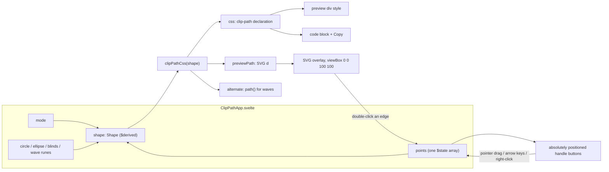

# Clip path

A CSS `clip-path` generator under Generators (0.6.0 Phase 5, decision 5): point shapes (25 presets plus free dragging), circle, ellipse, blinds and waves. A Svelte island over one pure module — the UI binds inputs and renders what the module returns. Stateless: nothing is read from or written to IndexedDB; the Playwright scenarios run inside a zero-write window.

_Describes the code as of v0.6.0 — verify against source when in doubt._

## File map

| Piece | File |
| --- | --- |
| Pure module | [clipPath.ts](../../../src/lib/gen/clipPath.ts) |
| Island | [ClipPathApp.svelte](../../../src/components/apps/ClipPathApp.svelte) |
| Page | [clip-path.astro](../../../src/pages/tools/clip-path.astro) (`/tools/clip-path/`) |
| Registry | `clip-path` in [registry.ts](../../../src/lib/registry.ts), icon `shapes` in [icons.ts](../../../src/lib/icons.ts), route in `SHELL` ([sw.js](../../../public/sw.js)) |
| Unit tests | [clipPath.test.ts](../../../src/lib/gen/clipPath.test.ts) |
| E2E | [clip-path.spec.ts](../../../tests/local/clip-path.spec.ts) |
| Copy | `copyText` from [exportFile.ts](../../../src/lib/exportFile.ts) |
| Preview image | `imageFromFiles` / `imageFromDrop` from [ingest.ts](../../../src/lib/img/ingest.ts) |

## How it fits together

One string, two consumers: the preview's inline `style` and the copyable line both come from `clipPathCss(shape).value`, so the preview can never disagree with the text — the E2E spec asserts the element's computed `clip-path` equals the shown declaration.

## The pure module — `clipPath.ts`

- `type Shape` — a discriminated union on `type`: `polygon { points }`, `circle { radius, cx, cy }`, `ellipse { rx, ry, cx, cy }`, `blinds { count, gap, direction }`, `wave { waves, amplitude, phase, edge, kind }`. Coordinates are `[x, y]` in percent, origin top-left, y down (the CSS `polygon()` convention and the overlay's viewBox).
- `polygonCss(points)`, `circleCss(radius, cx, cy)`, `ellipseCss(rx, ry, cx, cy)` — the three CSS functions, values rounded to two decimals.
- `blindsStrips(opts)` → `[start, end][]` along the stacking axis: `count` equal strips with `gap` between them filling exactly 100 %; a gap too large for the count is clamped so every strip keeps a width. `blindsPoints(opts)` traces them as **one polygon** (below); `blindsPath(opts)` is the same strips as `path()`, used only for the overlay outline.
- `waveform(kind, t)` → −1..1 over one period; every kind peaks at `t = 0.25` (sawtooth just before `t = 1`). `waveEdgePoints(opts)` samples the wavy edge from x = 0 to x = 100 at 16 samples per wave, adding exact corners for triangle, square and sawtooth so steps are vertical and drops are clean; `amplitude` is peak-to-trough in percent, `phase` in degrees shifts the wave along the edge, `edge` picks which side it hugs. `wavePoints(opts)` closes the polygon across the far side; `wavePath(opts)` spells the same vertices as `path()`.
- `clipPathCss(shape)` → `{ value, css, previewPath, points, alternate }` — the one entry point. `points` is the vertex list for point-based shapes (null for circle/ellipse); `alternate` carries the `path()` spelling for waves with a note about its units.
- `PRESETS`, `presetById`, `presetPoints(id)` (a deep copy, safe for `$state`).

### Why blinds and waves are `polygon()`, not `path()`

Decision 5 in the plan said blinds and waves would emit `path()`. Implementing it showed why that is the wrong primary output: CSS `path()` coordinates are **pixels of the element** with no viewBox, so a `path()` clip only fits one element size and the tool's promise of resolution-independent percent output would be broken for two of five modes. Both shapes are expressible as a percent polygon:

- **Blinds.** A polygon cannot hold disjoint subpaths, but it can trace several rectangles by walking back along a **zero-width seam**: each strip is four corners, the outline moves along the box edge (x = 0 for horizontal bars, y = 0 for vertical) to the next strip, and the implicit closing edge walks back over that same line. The seam encloses no area, so under either fill rule the gaps stay outside and only the strips are kept.
- **Waves.** A sampled polygon (16 points per wave plus exact corners) is a faithful wave at any size; a `path()` with Béziers would be smoother but pixel-bound. The `path()` spelling is still offered as a second copy button for a fixed 100 × 100 px box, with its note.

`shape()` (CSS Shapes 2) would express both natively in percent, but it is too new to rely on (plan: out of scope for 0.6.0).

## The island — `ClipPathApp.svelte`

- Five modes as toggle buttons (`cp-mode-<type>`, `aria-pressed`). Each mode keeps its own local rune; `shape` is `$derived` from the active one, `result = $derived(clipPathCss(shape))`.
- **Polygon**: a preset grid (`cp-preset-<id>`) whose thumbnails are inline SVGs drawn from the same point list; clicking copies the preset's points into the one `points` array. Handles are absolutely positioned `<button>`s at `left: x%; top: y%` (`cp-handle-<i>`, labelled "Point n: x% y%") so they are focusable and keyboard-nudgeable: pointer down captures the pointer, pointer move writes `points[i]` from the pointer's position as a percent of the stage box, arrow keys nudge by 1 % (Shift 5 %), Delete/Backspace or right-click removes (never below three points), and a **Remove point n** button appears for the selected handle. Double-click on an edge — a transparent 14 px stroke `<line>` per edge in the overlay — inserts a point after that edge's first vertex; double-click on empty stage appends one. **Reset to preset** restores the last preset.
- **Circle / ellipse / blinds / wave**: range inputs whose labels show the value (`cp-radius`, `cp-rx`, `cp-ry`, `cp-blinds-count`, `cp-blinds-gap`, `cp-waves`, `cp-amplitude`, `cp-phase`) plus selects for blinds direction, waveform and edge.
- **Preview** (`cp-preview`): a fixed-height stage with a gradient sample, or the user's image (file input `cp-image`, or a drop on the stage — decoded through the shared ingest helper and painted as `background-image`). The `clip-path` is applied inline. The SVG overlay (`viewBox="0 0 100 100"`, `preserveAspectRatio="none"`, `vector-effect: non-scaling-stroke`) draws `previewPath` as a dashed outline for every mode except circle — a percent circle radius is measured against the box's diagonal, so a viewBox circle would not match on a non-square stage; the clipped sample already shows the true shape.
- **CSS**: `cp-css` shows `result.css`; `cp-copy` copies it through `copyText` and flips to "Copied" for 1.5 s. Waves add `cp-path-css` / `cp-copy-path` for the alternate.

## Presets

Copied verbatim from the two reference generators on 2026-09-10 (Q3: all of them). The cssportal list is its `shapePresets` table (23 shapes); design.dev's page carries the same regular polygons and star under other names, so only its two distinctive shapes are added. cssportal's own "Message" is a tab-style bubble, so the design.dev one is `message-pointed`.

| id | Label | Source | Points (x y %) |
| --- | --- | --- | --- |
| `triangle` | Triangle | cssportal | 50 0, 0 100, 100 100 |
| `trapezoid` | Trapezoid | cssportal | 20 0, 80 0, 100 100, 0 100 |
| `parallelogram` | Parallelogram | cssportal | 25 0, 100 0, 75 100, 0 100 |
| `rhombus` | Rhombus | cssportal | 50 0, 100 50, 50 100, 0 50 |
| `pentagon` | Pentagon | cssportal | 50 0, 100 38, 82 100, 18 100, 0 38 |
| `hexagon` | Hexagon | cssportal | 50 0, 100 25, 100 75, 50 100, 0 75, 0 25 |
| `heptagon` | Heptagon | cssportal | 50 0, 90 20, 100 60, 75 100, 25 100, 0 60, 10 20 |
| `octagon` | Octagon | cssportal | 30 0, 70 0, 100 30, 100 70, 70 100, 30 100, 0 70, 0 30 |
| `nonagon` | Nonagon | cssportal | 50 0, 83 12, 100 43, 94 78, 68 100, 32 100, 6 78, 0 43, 17 12 |
| `decagon` | Decagon | cssportal | 50 0, 80 10, 100 35, 100 70, 80 90, 50 100, 20 90, 0 70, 0 35, 20 10 |
| `bevel` | Bevel | cssportal | 20 0, 80 0, 100 20, 100 80, 80 100, 20 100, 0 80, 0 20 |
| `rabbet` | Rabbet | cssportal | 0 15, 15 15, 15 0, 85 0, 85 15, 100 15, 100 85, 85 85, 85 100, 15 100, 15 85, 0 85 |
| `left-arrow` | Left arrow | cssportal | 40 0, 40 20, 100 20, 100 80, 40 80, 40 100, 0 50 |
| `right-arrow` | Right arrow | cssportal | 0 20, 60 20, 60 0, 100 50, 60 100, 60 80, 0 80 |
| `left-point` | Left point | cssportal | 25 0, 100 1, 100 100, 25 100, 0 50 |
| `right-point` | Right point | cssportal | 0 0, 75 0, 100 50, 75 100, 0 100 |
| `left-chevron` | Left chevron | cssportal | 100 0, 75 50, 100 100, 25 100, 0 50, 25 0 |
| `right-chevron` | Right chevron | cssportal | 75 0, 100 50, 75 100, 0 100, 25 50, 0 0 |
| `star` | Star | cssportal | 50 0, 61 35, 98 35, 68 57, 79 91, 50 70, 21 91, 32 57, 2 35, 39 35 |
| `cross` | Cross | cssportal | 10 25, 35 25, 35 0, 65 0, 65 25, 90 25, 90 50, 65 50, 65 100, 35 100, 35 50, 10 50 |
| `message` | Message | cssportal | 0 0, 100 0, 100 75, 75 75, 75 100, 50 75, 0 75 |
| `close` | Close | cssportal | 20 0, 0 20, 30 50, 0 80, 20 100, 50 70, 80 100, 100 80, 70 50, 100 20, 80 0, 50 30 |
| `frame` | Frame | cssportal | 0 0, 0 100, 25 100, 25 25, 75 25, 75 75, 25 75, 25 100, 100 100, 100 0 |
| `chevron` | Chevron | design.dev | 0 0, 75 0, 100 50, 75 100, 0 100, 25 50 |
| `message-pointed` | Message (pointed) | design.dev | 0 0, 100 0, 100 75, 50 100, 0 75 |

## Tests

- Unit ([clipPath.test.ts](../../../src/lib/gen/clipPath.test.ts)): preset count by source, unique ids, every preset ≥ 3 points inside 0–100, `presetPoints` copies; `polygonCss` / `circleCss` / `ellipseCss` format; blinds geometry (count × strip + (count − 1) × gap = 100 %, clamped gap, seam tracing, `blindsPath` rectangles); waveforms (peak at a quarter period, bounded), the edge running 0 → 100 with exactly `waves` crests for every kind, bottom-edge mirroring, vertical square steps and phase shift, `wavePath` ≡ `wavePoints`; `clipPathCss` per mode (blinds never `path()`, waves carry the alternate).
- E2E ([clip-path.spec.ts](../../../tests/local/clip-path.spec.ts)): preset → computed `clip-path` equals the shown declaration; a real mouse drag over `cp-handle-0` changes both; right-click removes a point; Reset restores; Copy lands on the clipboard. Second scenario: circle, ellipse (computed values match), blinds (16 points for 4 strips, direction flip), wave (square steps, `path()` alternate copy, bottom edge). Both inside a `dumpAll()` zero-write window.

## Known limits and decisions

- `path()` output is pixel-bound by the CSS spec; the tool says so beside the button and only offers it for waves.
- The circle overlay outline is not drawn (see above); ellipse, polygon, blinds and wave outlines map 1:1 onto the box through the non-uniform viewBox.
- Handles are clamped to the box: a point cannot be dragged outside 0–100 %, though the copied CSS would accept it. Points are kept to one decimal when dragged; presets stay integers.
- Points are never fewer than three; the remove actions disable at that floor.
- The preview image is painted as a PNG data URL from the ingest canvas (so SVG and TIFF work); large images cost memory for the session only — nothing is stored.
