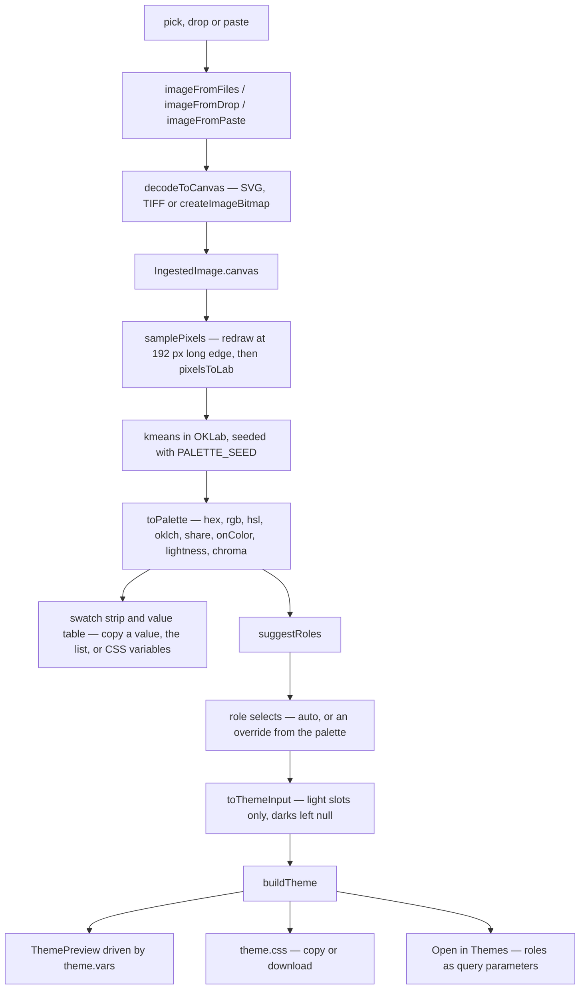
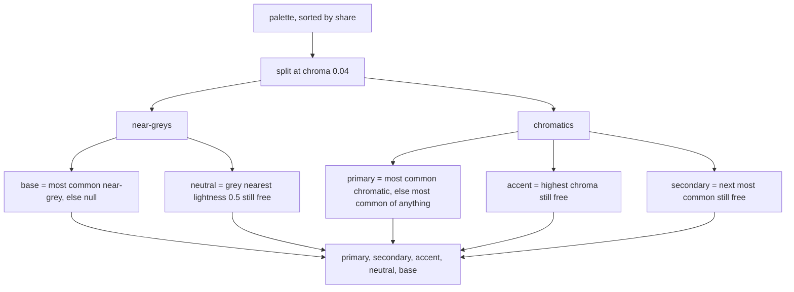

# Color extractor

`/tools/color-extractor/` reports the colours actually present in an image, then offers to turn them into a CSS theme. Extraction is k-means clustering in OKLab over a downsampled copy; the theme half maps that palette onto the five `THEME_ROLES` and calls the same `buildTheme` the Themes tool uses. Nothing is persisted.

_Describes the code as of v0.5.0 (unreleased; schema v16) — verify against source when in doubt._

## File map

| File | Role |
| --- | --- |
| [palette.ts](../../../src/lib/img/palette.ts) | The algorithm: `sampleSize`, `pixelsToLab`, `samplePixels`, `kmeans` / `seedCentroids`, `toPalette`, `clampCount`, `suggestRoles`, `toThemeInput`, and the constants `MAX_SAMPLE_SIDE`, `MIN_ALPHA`, `PALETTE_SEED`, `MIN_COLORS`, `MAX_COLORS`. |
| [ingest.ts](../../../src/lib/img/ingest.ts) | One way in for pick / drop / paste: `imageFromFiles`, `imageFromDrop`, `imageFromPaste`, plus pure `pickImage`, `refusalFor`, `pastedName`. New in 0.5.0; this is its first consumer. |
| [convert.ts](../../../src/lib/img/convert.ts) | `decodeToCanvas` and `detectKind`, which ingest wraps. Also `formatBytes`. |
| [theme.ts](../../../src/lib/gen/theme.ts) | `THEME_ROLES`, `buildTheme`, `contrastOn` — imported, never reimplemented. |
| [color.ts](../../../src/lib/gen/color.ts) | `rgbToOklab` / `oklabToRgb`, `rgbToHex`, `allFormats`. |
| [random.ts](../../../src/lib/random.ts) | `mulberry32`, the seedable PRNG behind k-means++. |
| [ColorExtractorApp.svelte](../../../src/components/apps/ColorExtractorApp.svelte) | The island. |
| [ThemePreview.svelte](../../../src/components/ThemePreview.svelte) | The preview window, lifted out of `ThemesApp` in 0.5.0 so both tools mount one component. |
| [exportFile.ts](../../../src/lib/exportFile.ts) | `copyText`, `downloadText`. |
| [color-extractor.astro](../../../src/pages/tools/color-extractor.astro) | The route, `client:only="svelte"`. |
| [registry.ts](../../../src/lib/registry.ts) | Entry `color-extractor`, category `Images`, icon `pipette`. |
| [sw.js](../../../public/sw.js) | `tools/color-extractor/` in `SHELL`; `CACHE_NAME` is `useful-cache-v39`. |
| [palette.test.ts](../../../src/lib/img/palette.test.ts), [ingest.test.ts](../../../src/lib/img/ingest.test.ts) | Unit tests. |
| [images.spec.ts](../../../tests/local/images.spec.ts) | The `color extractor` describe block at the end. |

See [generators.md](./generators.md) for `buildTheme` itself and [image-tools.md](./image-tools.md) for the decode core.

## The pipeline

The island splits this into two `$derived`s on purpose: `points` depends only on the image, `palette` on `points` and the count. Changing the count re-clusters without resampling, the expensive half.

## Ingest

Picker, drop target, and a `window` paste listener registered in `onMount` that claims the event only when `clipboardData` carries an item of kind `file`, so pasting text into the count input still behaves normally. Refusals are typed and carry their own sentence: the component renders `result.message` into `[data-testid="cx-error"]` and never phrases one itself. A multi-file drop takes the first decodable entry — `pickImage` is first-match by design.

## Why OKLab, and why k-means

This is the decision worth protecting from a future optimisation.

**OKLab** is perceptually uniform: Euclidean distance in it approximates how different two colours *look*. Cluster there and a gradient sky — hundreds of blues, all close in perceptual terms — collapses into one entry, while a small saturated logo mark, far from everything else, survives as its own despite covering a fraction of the pixels. That is what a person means by "the major colours". RGB distance gets both halves wrong because it does not track perceived difference.

**k-means**, not median-cut. Median-cut is faster and is the classic choice, but it splits the colour cube by axis: handed that same sky it cuts it into three near-identical blues and reports them as three of your six. k-means groups by proximity to a moving centre, so a dense blob stays one cluster however wide it is along any single axis.

The cost is iteration — up to `maxIterations = 24` assign/update passes, breaking early when no point changes hands. That is only affordable because of the sampler.

## The sampler

`samplePixels` redraws the decoded canvas at `sampleSize(...)` — long edge capped at `MAX_SAMPLE_SIDE = 192`, aspect preserved, never below 1 px — and reads *that* back with `getImageData`. Whatever came in, the clustering sees at most ~37 000 points, so a 50-megapixel photo and a 600 px screenshot cost the same.

At k = 16 that is a few million distance computations, a few tens of milliseconds, which is why it runs on the main thread. A worker would need the pixels transferred, a message protocol, and a cancellation story for a count changed mid-run — all for work that never blocks a frame long enough to notice. The cost: a colour covering less than roughly one part in 37 000 can be resampled away before clustering sees it, and the downscale interpolates, so band boundaries blend. The Playwright fixtures dodge that with images exactly 192 px wide made of flat bands, so the downscale is a 1:1 copy and the assertions can be equalities.

`pixelsToLab` skips pixels below `MIN_ALPHA` (0.5) rather than counting them as black — transparency is absence, not a colour. If every pixel is skipped, the UI says so (`[data-testid="cx-empty"]`).

## Determinism

`kmeans` takes a seed defaulting to `PALETTE_SEED = 0x9e3779b9` and draws through `mulberry32`. Nothing in the module calls `Math.random`.

Two things depend on that. The unit tests assert exact cluster counts, centroids and hexes, which is only possible when seeding is reproducible. And the count input: the spec walks 6 → 3 → 6 and requires the six hexes to come back **identical**. Under a random seed that round trip would land near where it started but not on it, and the control would feel broken.

`toPalette` formats each surviving cluster (`allFormats`, `contrastOn`, share of sampled pixels) and carries the centroid's `lightness` and `chroma` through untouched, because role assignment needs them.

### k-means++ seeding

`seedCentroids` picks the first centre at random, then each subsequent centre with probability proportional to its squared distance from the nearest centre already taken. Uniform seeding regularly drops two centres inside one dominant colour and leaves a genuinely distinct colour unrepresented; this is the standard fix, at one extra pass per centre.

The guard: when the running total of squared distances reaches zero, every remaining point already sits exactly on a centre, so the loop `break`s rather than duplicating one. A flat single-colour image yields exactly one cluster whatever k was asked for.

### Empty clusters are dropped

Clusters with a count of zero are filtered out before the sort by size — never padded. Asking a two-colour logo for eight colours should give you the two it has, not six entries of black. The result may therefore be shorter than k, and the UI names that: `[data-testid="cx-short"]` says the image "only has N distinct colors to give … the count is a request, not a promise".

## Role suggestion

`suggestRoles(palette)` returns five slots in `THEME_ROLES` order. `NEUTRAL_CHROMA = 0.04` splits the palette; a `taken` set stops one hex filling two roles.

Base is assigned first because it is the surface every contrast warning is measured against. Accent is taken before secondary so highlights get the loudest colour rather than the second most common one.

**Base is left `null` when the image has no near-grey, deliberately.** Handing the most common colour to the page background regardless was tried: on a flat three-colour graphic it produced a garish theme that arrived with three contrast warnings before the user touched anything. Left null, `buildTheme` derives base as a pale tint of the primary (hue kept, saturation ×0.4, lightness 0.96) — what a person would have picked. The unit tests pin it, and the spec asserts `cx-role-base` is `''` for a three-band image with no grey.

Every null slot works this way: `toThemeInput` fills the five `light` slots, leaves every `dark` null, and `buildTheme` derives the rest from the primary. One extracted colour is enough for a whole theme.

## Relationship to Themes

The extractor grows no second theme engine. It produces five hexes and calls `buildTheme`; `theme.vars` drives the preview and `theme.css` is what is copied and downloaded, so the two cannot disagree. Warnings come straight from `theme.warnings`.

`ThemePreview.svelte` is the same component `ThemesApp` mounts — extracted from it in this release for exactly that reason, markup and styles unchanged (the Themes spec still passes against it, which is the evidence the lift was faithful). Its `testid` prop is required rather than defaulted: two tools mount it, and a shared default would collide in one spec run.

**Open in Themes** (`cx-open-themes`) builds `?primary=…&accent=…` from the current roles. `ThemesApp`'s `onMount` reads those parameters, validates each with `parseCssColor`, seeds its light slots and sets the explorer input to the primary. Harmonies and dark-slot overrides live over there.

Overrides here latch: the first edit copies the whole current suggestion into `roleOverrides`, so changing one role does not blank the other four. "Reset to suggestion" clears the latch, and so does a new image.

## Stateless

Zero IndexedDB traffic — no preference is read or written, and every output leaves by clipboard or download. All four Playwright scenarios wrap the interaction in an `app.dumpAll()` equality window, including the one that follows the hand-off link into `/tools/colors/`.

## Tests

- Unit: `sampleSize` across aspect ratios; `pixelsToLab` at the alpha boundary (127 out, 128 in); `kmeans` centroids, sort order, seed stability, counts summing to `points.length` for every k, empty clusters dropped; `toPalette`; `clampCount`; `suggestRoles`, including an exhaustive triple loop over twelve hexes asserting no role is assigned twice.
- Browser: exact hexes and shares from a 3:2:1 band image; the count round trip; paste accepted and `notes.txt` refused by name; suggested roles, `theme.css`, override and reset, the hand-off seeding `ThemesApp`, and the download.

## Known limits

- **k is capped at 2..16** (`MIN_COLORS` / `MAX_COLORS`). The input enforces it and `clampCount` re-enforces it for typed values, rounding fractions and falling back to 6 for `NaN` or an infinity.
- **The count is a request, not a promise.** Fewer distinct colours than k means fewer entries, and the UI says why.
- **Pixels below 50% alpha are skipped entirely** — nothing is composited over white first, so a mostly-transparent PNG is judged on its opaque half and a fully transparent one yields nothing.
- **Nothing is saved.** Palette, role choices, padding, radius and preview scheme die with the page; copy, download, or follow the hand-off link.
- **192 px is a fixed trade.** A colour covering a tiny share of a large image may not survive the downscale, and there is no full-resolution escape hatch. Raising `MAX_SAMPLE_SIDE` much would also turn the main-thread run into a jank source.
- **No dark-slot control here.** `toThemeInput` always sends `dark: null`; overriding darks means going to Themes.
- Palette entries are keyed by hex in the `{#each}` blocks, so two clusters rounding to the same hex would collide. `suggestRoles` is tested against that case; the strip has no distinct key scheme.
