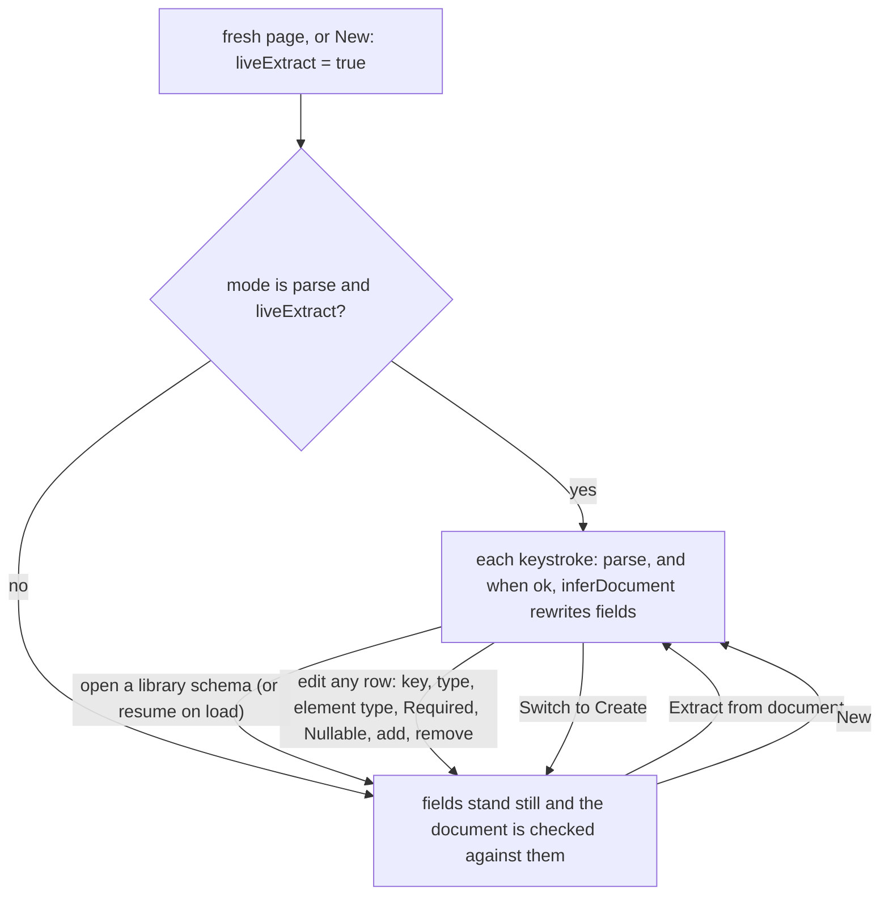
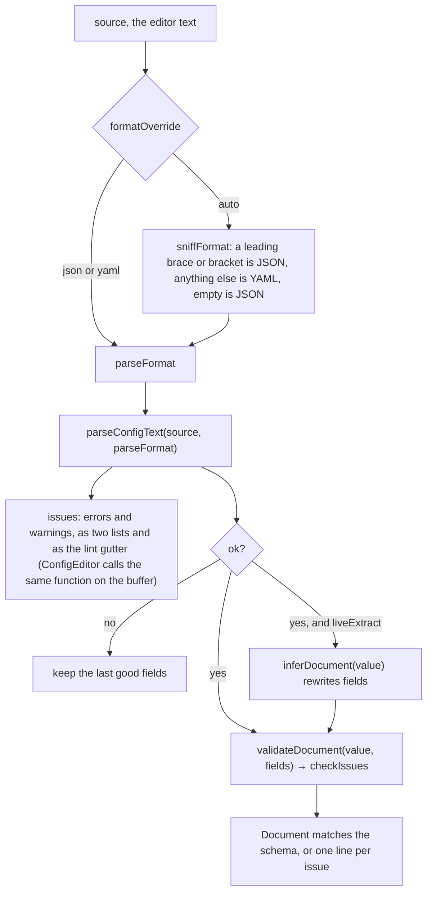

# Config playground

Understand, validate and generate JSON and YAML at `/tools/config-playground/` (category **Playgrounds**). Two modes behind one switch. **Parse** takes a real document in a CodeMirror editor: it is parsed on every keystroke, the YAML 1.1 traps are called out as positioned warnings, its schema is extracted into a Field/Type table, and the document is checked back against whatever schema is in hand. **Create** builds the same table by hand and generates seeded sample documents from it. Either way the schema can be saved to a library and turned into a parser or a generator in Python, JavaScript, Go, Rust or a dependency-free web component. The inference, the validator and the generator are hand-rolled over one fourteen-kind type system; on the parsing path JSON is `JSON.parse` and YAML is eemeli's `yaml`, the one library involved.

_Describes the code as of v0.2.0 (unreleased; schema v11) — verify against source when in doubt._

## File map

| Path | Role |
| --- | --- |
| [config-playground.astro](../../../src/pages/tools/config-playground.astro) | Page shell; mounts `ConfigPlaygroundApp` with `client:only="svelte"`. |
| [ConfigPlaygroundApp.svelte](../../../src/components/apps/ConfigPlaygroundApp.svelte) | The tool: mode switch, Document card, Schema card (the flattened table, in both modes), Examples card, Code generator card, library sidebar, two explainers. Holds `liveExtract`. |
| [ConfigEditor.svelte](../../../src/components/ConfigEditor.svelte) | `CodeEditor` with `@codemirror/lang-json` / `@codemirror/lang-yaml` plus a linter fed by the page's own parser, all loaded lazily as one bundle into the language compartment. |
| [CodeEditor.svelte](../../../src/components/CodeEditor.svelte) | The themed CodeMirror 6 chassis shared with the SQL playground: `basicSetup`, the `language` compartment, `updateListener` → `onDocChange`. |
| [CodeBlock.svelte](../../../src/components/CodeBlock.svelte) | Read-only Prism rendering for the generated code and the examples (`prism-yaml` is imported in [prism.ts](../../../src/lib/prism.ts)). |
| [config/tabulate.ts](../../../src/lib/config/tabulate.ts) | `tabulateDocument` — the Data card's rows: an array as records (nested objects flattened to dotted columns, arrays as JSON text), an object as `path` / `type` / `value` entries; `MAX_ROWS` 20,000 with a `truncated` flag. |
| [DataTable.svelte](../../../src/components/DataTable.svelte) | The SQL playground's grid, reused unchanged in its client-side mode for the Data card (`testid="config-data"`), with [sql/infer-schema.ts](../../../src/lib/sql/infer-schema.ts) sniffing the column types. |
| [config/model.ts](../../../src/lib/config/model.ts) | `MAX_DEPTH`, the dropdown option lists, `typeLabel`, `flattenFields` (the table rows, with collapse), `childListOf`, `normalizeFields` / `normalizeType` / `normalizeSchemaRow` (the read-side hardening), `cloneFields`. |
| [config/parse.ts](../../../src/lib/config/parse.ts) | `sniffFormat`, `parseConfigText` (JSON via `JSON.parse` with an unsafe-integer scan, YAML via `parseDocument` with the 1.1 / JSON-fidelity audits), `prettifyConfigText`. |
| [config/infer.ts](../../../src/lib/config/infer.ts) | `documentSamples`, `inferFields`, `inferType`, `inferDocument` — the schema extractor and its enum / format / union policy. |
| [config/formats.ts](../../../src/lib/config/formats.ts) | The five string-format heuristics (`email`, `uri`, `date-time`, `date`, `phone`) as portable pattern sources (`FORMAT_SOURCES`), plus `matchesFormat`, `detectFormat`. The one definition the page, the emitted Python/JavaScript/Go and the web component all share. |
| [config/validate.ts](../../../src/lib/config/validate.ts) | `validateDocument`: the recursive interpreting validator, errors for violations and warnings for unknown keys. |
| [config/generate.ts](../../../src/lib/config/generate.ts) | `mulberry32` and `generateDocuments`: seeded sample documents that always satisfy their schema. |
| [config/words.ts](../../../src/lib/config/words.ts) | The curated word, name and RFC 2606 domain lists the generator draws from. |
| [codegen/config.ts](../../../src/lib/codegen/config.ts) | `generateConfigFunction`: the eight emitters (parser and generator × four languages) that unroll a schema into a file, and `CONFIG_JS_RUNTIME`, the one hand-written JavaScript table the web component ships. |
| [codegen/configWebcomponent.ts](../../../src/lib/codegen/configWebcomponent.ts) | `generateConfigWebComponent` and `configTagName`: the parser and generator custom elements. |
| [codegen/identifiers.ts](../../../src/lib/codegen/identifiers.ts) `functionName` | The schema name → a legal, cased, non-reserved function name per language (Go exported). |
| [codegen/functions.ts](../../../src/lib/codegen/functions.ts) | `LANGUAGE_LABELS` and `EXTENSIONS` are reused for the Language dropdown and the download filename. |
| [exportFile.ts](../../../src/lib/exportFile.ts) | `copyText` / `downloadText` behind the Copy and Download buttons. |
| [types.ts (db)](../../../src/lib/db/types.ts) | `ConfigFieldKind`, `ConfigFieldType`, `ConfigField`, `ConfigSchema`; `Preferences.config_last_mode` / `config_last_schema_id`; `STORES.config_schemas`. |
| [db.ts](../../../src/lib/db/db.ts) | v11 migration: `createObjectStore('config_schemas', { keyPath: 'id' })`. |
| [registry.ts](../../../src/lib/registry.ts) | Tool entry `config-playground` (route, aliases `json` / `yaml` / `yml` / `schema` / `lint` / `prettify` / `faker` / `codegen` …, icon `braces`). |
| [sw.js](../../../public/sw.js) | `tools/config-playground/` is in the precached `SHELL`; `CACHE_NAME` is `useful-cache-v16`. |
| [helpers/schema.ts](../../../tests/local/helpers/schema.ts) | The `config_schemas` columns and the two preference fields, mirrored for the oracle. |
| [payload.spec.ts](../../../tests/local/payload.spec.ts) | `YAML parser` (`/yaml/i`) and `CodeMirror` are on the `HEAVY` list the home page and a light tool page must not pull. |
| [config-playground.spec.ts](../../../tests/local/config-playground.spec.ts) | The Playwright contract for the page. |

## Architecture

### Two modes, one schema in hand

`mode` is `'parse'` or `'create'`; the Schema card and the Code generator card are rendered in both, the Document card only in Parse, the Examples card only in Create. The fields table is the same `flattenFields(fields, collapsed)` in both modes — Parse renders `<code>` labels, Create renders inputs into the same live `$state` tree, which is why a row's `field` is a reference and not a copy.

The rule that makes the switch useful is `liveExtract`. While it is true the table is the extractor's own work and a valid document rewrites it on every keystroke. The moment a schema arrives from anywhere else, typing stops rewriting it and the table instead reports how well the document fits:

Switching to Create also copies `activeFormat` into `createFormat`, so a schema read from YAML generates YAML. Switching back to Parse leaves `liveExtract` alone — a hand-built schema stays held, which is the whole point: the document pasted next is checked against it and a `Showing the schema in hand` note says so. **Extract from document** is the only way back to live behaviour besides **New**, and it flashes `Schema extracted — the table follows the document again.`

The live effect has two guards worth knowing. Empty text clears `extractNote` and returns without touching `fields`; a document that does not parse returns too. Half-typed JSON therefore never blanks the table on a keystroke — the Playwright suite asserts it. A document that parses but cannot be a schema (a root scalar, an empty array, a mixed array) sets `extractNote` to `documentSamples`' sentence and again leaves the last good fields up.

### Parse mode data flow

Everything on the right-hand side is `$derived`: `sniffed`, `parseFormat`, `parsed`, `parseErrors`, `parseWarnings`, `checkIssues`. The one `$effect` is the live extraction, because it writes `fields`. The lists show at most 20 errors, 20 warnings and 30 check issues, each prefixed `Ln L, Col C` by `lineCol(offset)` — the gutter speaks lines, so the list should.

`parseConfigText` returns `{ ok, value, issues }`. `ok: false` means `value` is undefined and at least one issue is an error; `ok: true` can still carry warnings, because the fidelity audits are warnings by design — the document is valid 1.2 YAML, the point is that a 1.1 parser or a JSON round-trip will read it differently.

### The editor

`ConfigEditor` is the `CodeEditor` chassis with one `$effect`: when `format` changes it `import()`s `@codemirror/lint` together with `@codemirror/lang-json` or `@codemirror/lang-yaml`, builds `[support, linter(...), lintGutter()]`, and hands that array to `CodeEditor`'s `language` prop. Everything rides that one compartment as a single bundle because `CodeEditor`'s `extensions` prop is mount-time only and the diagnostics change with the format — support and linter have to swap together. Flipping the format reconfigures the running view, so the buffer and undo history survive. A `current` flag lets only the latest resolution win after a fast flip, and a rejected import falls back to no highlighting rather than blocking editing. Until the packages arrive the editor is usable, just unhighlighted and unlinted.

The linter calls the page's `lint` prop — `(text) => parseConfigText(text, parseFormat).issues` — and clamps every `from`/`to` into the document before handing it to CodeMirror, which throws on a diagnostic outside the buffer; the parser's offsets can trail a fast edit.

`@codemirror/lint` costs nothing extra here: `basicSetup` already imports `lintKeymap` from it, so the package is in the `CodeEditor` chunk the SQL playground shares.

### Inference

`documentSamples` decides what counts as evidence: a plain object is one sample, an array of plain objects is one sample per element, anything else is an error sentence. "Plain" means prototype `Object.prototype` or null — the YAML parser can hand back Dates, and typing one as `object` would infer an empty shape from its lack of enumerable keys.

`inferFields` considers at most **200** samples (`SAMPLE_CAP`), keys in first-seen order, in a `Map` because `__proto__` is a legal document key. `optional` = missing from at least one sample; `nullable` = held `null` in at least one sample where present. The two never blur: a null contributes nothing to the type, only to `nullable`. A key holding `undefined` counts as absent, since JSON could never round-trip it.

`inferType` groups non-null values by JS shape. One shape gets the per-shape rules; mixed shapes become a `union` of the per-group types. Integer and number share the `number` shape, so they collapse before a union can form — which is also why a union from this path never nests another union.

| shape | rule |
| --- | --- |
| boolean | `boolean`, never an enum — `{true, false}` *is* the type |
| number | enum first (a numeric enum keeps its numbers), then `integer` if every value passes `Number.isInteger`, else `number`. `.nan` / `.inf` fail the integer test |
| string | **format wins over enum**: if the first value detects as a format and every value detects as the *same* one, that format; otherwise enum-or-string |
| array | elements of every sample array pooled (cap **500**, `ELEMENT_CAP`), nulls dropped, one item type; an empty pool leaves the item `any`. Item nullability is not modelled — `ConfigFieldType` has nowhere to put it |
| object | `inferFieldList` on the group, one level deeper |
| other | `any` |

The enum test has three guards, each there to stop free text being called an enum off a handful of rows: total ≥ 4, distinct ≤ 6, and `distinct × 2 ≤ total` (real repetition). Distinct values keep first-seen order.

`detectFormat` tries `email`, `uri`, `date-time`, `date`, `phone` in that order. Phone goes last because its character class also matches dates and plenty of ids; `uri` requires `scheme://` (or `mailto:`) so `note: remember` stays prose. A false negative only costs a plain `string`, so every check trades corner cases for "no prose slips through" — `2024-02-31` is a date here, because there is no per-month day table.

Every walker in `model.ts`, `infer.ts`, `validate.ts` and `generate.ts` carries the same `MAX_DEPTH = 16` cap, because two things hand them untrusted trees: stored rows and pasted documents.

### Validation

`validateDocument(doc, fields)` accepts an object or an array of objects (each checked with an `[i]` prefix); anything else gets the one fixed error. Per object: a missing key is an error unless `optional`; a null is an error unless `nullable`; a present non-null value goes to `checkValue`; and every key the schema does not mention is a **warning**, because extra keys usually mean the schema is incomplete rather than the document wrong. Formats go through the same `matchesFormat` the inference used, so what was extracted validates. Unions probe each variant into a scratch list and keep the first one with no errors (its warnings included); if none match there is exactly one error naming the allowed variants. Past `MAX_DEPTH` the walker accepts silently — the cap protects it from junk, not the user from their data. `show()` renders a value at ≤ 40 characters and structures as `[array]` / `[object]`, so a hostile 10 MB string cannot become a 10 MB message.

### Examples

`generateDocuments(fields, count, seed)` clamps `count` to 1–1000 and drives everything from one `mulberry32` stream, so the same `(fields, count, seed)` is the same output. An optional field is present with p = 0.8; a nullable one (rolled after presence) is null 10 % of the time. Strings are 1–3 words from `WORDS`, integers 0–9999, numbers two decimals, emails `first.last@domain` lowercased, phones `+1 (555) 010-xxxx`, URIs `https://domain/path`, dates real calendar days in 2020–2029 (day ≤ 28, so no leap table), date-times the same with `T…Z`. Every domain is RFC 2606 (`example.com/org/net`, `.example`, `.invalid`), so nothing emitted can resolve. The property test generates 100 documents and validates all 100 with zero issues of any severity.

The UI clamps **Amount** to 1–100, draws a fresh seed per press (the button means "show me different ones"), renders JSON as one object or an array, YAML through `yaml`'s `stringify` joined with `---`, and downloads as `<name>-examples.json` / `.yaml`.

### The Data card

Parse mode's third card tabulates the parsed document into `DataTable` — the SQL playground's grid, in its client-side mode, reused without a change. `tabulateDocument` decides the shape from the root: an array is records (one row per element, nested objects flattened to dotted columns so `address.city` lines up with the schema table, arrays kept as JSON text so a cell is one value, a scalar list as one `value` column), an object is entries (`path` / `type` / `value`, one row per leaf — a 20-key config as one 20-column row would be neither readable nor filterable). Column types come from `inferSchema` with the union of keys passed as undeclared columns, so it sniffs every column rather than only the first fifty rows' keys.

It is the one thing on the page that does **not** follow the keystroke. `extractData` runs only from its button; `dataSource` remembers the text the rows came from, and `dataStale = dataSource !== null && dataSource !== source` is what shows the **Stale — the document changed** badge. Nothing re-runs on its own — a large document would freeze the page per keystroke, and a grid that silently rebuilt itself would be a grid you could not trust to be the one you were reading. `dataSchema` is derived from the rows, so it too recomputes on extraction only. Opening another schema or pressing New clears the rows; `MAX_ROWS` (20,000) bounds what the grid filters and sorts, and the count line says when it bit.

## What we measured

Several decisions on this page came from running the libraries rather than reading about them. The wrong version is the plausible one, so they are recorded.

### `maxAliasCount` is a `toJS()` option

In `yaml` 2.9 `parseDocument` never expands aliases, so an alias bomb parses instantly and harmlessly; it is `doc.toJS()` that materialises the tree, and that is where `maxAliasCount` belongs and is enforced (`{ maxAliasCount: 100 }`). A document whose expansion blows the cap throws there, and `parseYaml` converts the throw into an error issue at offset 0 — `ok: false`, so it never reaches inference. The unit suite pastes a billion-laughs document and asserts it is refused without hanging.

### The 1.1 audits fire on plain scalars, and the octal one on the source text

Under YAML 1.2 core, which is what `yaml` speaks, `NO` is a string, `12:30` is a string and `0123` is **the number 123**. So the boolean and sexagesimal audits only make sense on plain (unquoted) scalars whose value is still a string — `"NO"` was quoted on purpose and `true` is already a boolean — and the octal audit cannot look at the value at all: it keys on `node.source`, because the 1.1 misread (`0123` as octal 83) is about the spelling. Each warning lands on the node's own `range`, so the gutter underlines the offending scalar and the fix — quote it — is one keystroke away. The Playwright suite pastes `country: NO`, `start: 12:30`, `mode: 0755`, asserts three warnings, quotes them, and asserts zero.

The other audits: unsafe integers (either `bigint` or a number past ±2^53−1), `.nan` / `.inf` (no JSON spelling), anchors and aliases (shared structure is lost as JSON), and non-string mapping keys (stringified as JSON). JSON gets the unsafe-integer warning too, from a string-skipping scan over the source — the parsed numbers have already rounded, so only the text still knows.

### `visit()` takes specific keys, never the generic `Node`

`yaml`'s visitor falls through `Alias?.() ?? Node?.()` when the specific visitor returns undefined, so registering `Scalar`, `Collection`, `Alias`, `Pair` *and* `Node` would fire twice per node. The audit registers only the specific four.

### Prettify is `parseDocument(text).toString()`

That is the reason the page uses eemeli's `yaml` and not `js-yaml`: `js-yaml` discards comments entirely, so a prettify pass would silently delete every comment in the document — data loss dressed as tidying — and it throws on the first error with zero-indexed marks, where `yaml` collects every error with `pos: [from, to]` character offsets that drop straight into CodeMirror diagnostics. (`@codemirror/lang-yaml` ships no linter, so that mapping is ours to write either way.) The `js-yaml` in `node_modules` is a build-time transitive of Astro, not ours to use. JSON prettify is `JSON.stringify(JSON.parse(text), null, 2)`; JSON has no comments to keep. Broken input is refused with the first message rather than half-formatted.

### JSON error positions come out of the message

`JSON.parse` throws a `SyntaxError` with no position property. V8 says `at position N` (newer builds append `(line L column C)`), Firefox says `at line L column C of the JSON data`, and some V8 messages carry no position at all — so `jsonErrorOffset` regex-reads whichever form it gets, converts line/column to an offset by walking newlines, clamps, and falls back to 0.

### Two emit strategies, one runtime table

The four-language emitters **unroll** the schema: every field becomes explicit checks or assignments, so the generated file documents the format it handles and never interprets a schema at run time. The web component does the opposite — it embeds `const FIELDS = […]` and interprets it with `_validate` / `_generate` from `CONFIG_JS_RUNTIME`, the one exported table of hand-written JavaScript source strings (the `HELPER_SOURCE` pattern from the napkin generator, and for the same reason: a second hand-written copy is the bug). A YAML-format generator component adds `_toYaml`, a minimal emitter for plain JSON data that JSON-quotes any string a YAML reader could mistake for a boolean, number or null.

### The one dependency, and decoded input for YAML schemas

Every emitted file is standard library, with one documented exception: the Rust parser uses `serde_json`, Rust's de-facto JSON stdlib — and because that is the *only* crate allowed, Rust's format checks are hand-rolled byte walkers rather than `regex`, "lenient where a pattern would be strict, never the reverse". A schema whose format is YAML produces a parser that takes the **already-decoded** document: `dict` from `yaml.safe_load`, the decoded object in JavaScript, `map[string]any` from `gopkg.in/yaml.v3`, a `serde_json::Value` from `serde_yaml`. A dependency-free file cannot parse YAML, and pretending otherwise would be a parser that silently wasn't one. The web component says the same thing in its own header and on its face: it accepts JSON input only.

### The tag always has a hyphen

`configTagName(name, flavor)` slugs the schema name and appends `-parser` or `-generator`. The flavour suffix is what guarantees the hyphen a custom-element name must contain; a name that is empty or starts with a digit gets a `config` prefix so the tag starts with a letter. `deploy-settings` → `<deploy-settings-parser>`, class `DeploySettingsParser`.

## The code generator

`generate()` builds `{ name: name || 'config', format: activeFormat, fields }` and calls `generateConfigFunction(template, language, flavor)` or `generateConfigWebComponent(template, flavor)`. A throw is shown by message rather than as a silently wrong file; today nothing in the emitters refuses a schema — `any` is the catch-all — but the seam is kept. A `fingerprint` of `{ fields, name, activeFormat, flavor }` clears the generated source, the examples and both error strips the moment any of them moves on, because output describes one schema and a stale one on screen is a statement about something that no longer exists.

| | Parser | Generator |
| --- | --- | --- |
| Python | `parse_<name>(text) -> dict` (`json.loads`), or `(data)` for YAML; `re` only when a format is used; raises `ValueError` with every problem, one per line; NumPy docstring with a `Fields (path (type): flags)` block | `generate_<name>(count, seed)` |
| JavaScript | `export function parse<Name>(text)` / `(data)`; throws `Error` with every problem; JSDoc | `generate<Name>(count, seed)` |
| Go | `package config`; `Parse<Name>(data []byte) (map[string]any, error)` or `Validate<Name>(doc map[string]any) error`; imports sorted, `regexp` / `strconv` only when needed; problems joined into one `error` | `Generate<Name>(count int, seed uint32) []map[string]any` |
| Rust | `pub fn parse_<name>(text: &str) -> Result<serde_json::Value, Vec<String>>`, or `(doc: serde_json::Value)`; hand-rolled `is_email` … helpers | `generate_<name>(count: usize, seed: u32) -> Vec<String>` — each document as JSON text |

Shared rules: field keys are data, never identifiers, so they are always emitted as correctly-escaped string literals (Rust gets its own escaper because it rejects JSON's `\uXXXX`); the five format patterns are `formats.ts`'s own `FORMAT_SOURCES`, written once and valid verbatim in Python's `re`, JavaScript regex literals and Go's RE2 — no lookarounds, no backrefs, case by explicit classes, no `'`, backtick or unescaped `/` — so a generated parser and the inference that produced its schema agree on what a phone number is; Python's integer check excludes `bool` because `True` is an `int`; a union is checked *shallowly* in the generated code ("matches at least one variant" is a shape question); unknown keys are reported in every language; the generators carry a small embedded `WORD_BANK` that is deliberately not `words.ts`, so an emitted file stays self-contained; free text reaches comments only through `commentSafe`. The function name comes from `functionName` in `identifiers.ts` — snake for Python and Rust, camel for JavaScript, exported for Go, reserved words suffixed.

### The web component

One `.js` file, no imports, no network, no CSS opinions; every element carries a `part` and the header shows `::part()` examples. The **parser** is a textarea that re-validates on every `input`, a status line (`Valid` / `N problems`, `data-state`), an issues list (`part="issue"`, `data-severity`), and a Field / Type / Value table for the first object; it exposes a `value` property and fires `config-valid` with `{ value, issues }`. An array document is treated as a set of documents, each checked with an `[i]` prefix. The **generator** is a `How many` input (1–100, default 3), a plain button, and a `<pre part="output">`; a `seed` attribute makes it reproducible, otherwise every press draws a fresh seed; it fires `config-generated` with `{ documents, seed }`. A YAML-format parser component carries a visible note that it takes JSON only; a YAML-format generator emits YAML separated by `---`.

Two Playwright cases load each flavour **in a real page** — a `Blob` URL `import()` into the app's own document — feed a valid and an invalid document to the parser and press the generator's button, and assert on the shadow DOM text and on zero console errors. A golden-string test cannot catch a generated syntax error; this does.

## Data model — migration v11

| | |
| --- | --- |
| `config_schemas` | `name`, `format` (`'json'` / `'yaml'`), `fields` (json — the `ConfigField[]` tree), `source` (parse mode's document text, so switching modes loses nothing), plus `SyncFields` |
| Preferences | `config_last_mode` (`'parse'` / `'create'`) and `config_last_schema_id` — which side was open and which schema to reopen |

Everything is plain JSON, so rows ride backup export/import byte-identically and `STORES.config_schemas` needs no index.

**Nothing read from a row is trusted.** A backup is hand-editable, and the generic data suite writes an *array* into every json column — so `openSchema` runs the row through `normalizeSchemaRow`, whose `normalizeFields` drops junk entries and duplicate or empty keys, coerces `optional` / `nullable` to booleans, folds an unrecognisable type node to `any`, an empty enum to `any`, a one-variant union to its variant, and stops at `MAX_DEPTH`. The fields are then `cloneFields`-ed (a JSON round-trip) so edits never mutate the row object. The unit suites for the validator and the generator both run over schemas "normalized from garbage" and assert nothing throws.

**Nothing is written on load.** `onMount` reads the rows and the preferences singleton with `getSingleton`, applies `config_last_mode`, and resumes the remembered schema with `openSchema(row, { remember: false })` — the one path that skips the preference write. The Playwright suite dumps the database before and after a reload and asserts equality.

Writes, and exactly when:

| Action | Writes |
| --- | --- |
| **Save schema** | `patch` the current row, or `put` a new one (`withSyncFields`, name defaulting to `Untitled`, `format` = `activeFormat`) and then `config_last_schema_id` |
| Open a schema from the library | `config_last_schema_id` |
| **Switch to Create** / **Switch to Parse** | `config_last_mode` — one preference field, nothing else (asserted with `assertIsolatedDelta`) |
| Delete (after `confirm`) | `softDelete` — a tombstone, so the row count stays and `deleted_at` is set |
| Typing, editing the table, extracting, prettifying, generating | nothing — there is no autosave |

## Offline and payload

CodeMirror, the two language packages and `yaml` are all fingerprinted `_astro/` chunks, which the service worker's activate-time crawl finds on its own; so unlike the napkin fonts or the SQL engines this page registers **no** `OfflineBundle` and has no `offline.ts` entry. The route is in the precached `SHELL`.

Measured on a production build (`.tmp-build/_astro`, 2026-08-21): the `CodeEditor` chunk and the two CodeMirror core chunks it pulls are 391 KB (126 KB gzip), shared with the SQL playground; the page chunk, which carries `yaml` 2.9.0 statically alongside the app and the emitters, is 197 KB (59 KB gzip); the lazily loaded `lang-json` and `lang-yaml` chunks are 2 KB and 12 KB (1 KB and 5 KB gzip); the shared codegen `functions` chunk is 19 KB. Roughly 620 KB of script on a first visit, about 200 KB over the wire, then cached.

Note that `yaml` is **not** lazy: `parse.ts` and the app import it statically, so it lands in the page chunk, whose name is `ConfigPlaygroundApp.<hash>.js`. The `/yaml/i` entry on `payload.spec.ts`' `HEAVY` list is therefore name-blind in production — it would not catch `yaml` leaking into another page through a chunk whose name does not say so — exactly as the `CodeMirror` entry is, since `lang-yaml` builds to `dist.<hash>.js`. There is no config-playground-specific payload case.

## Tests

Unit (vitest, 205 cases across eight files — `npx vitest run src/lib/config src/lib/codegen/config.test.ts src/lib/codegen/configWebcomponent.test.ts`):

- [tabulate.test.ts](../../../src/lib/config/tabulate.test.ts) (8): records with dotted columns and JSON-text arrays, the union of keys in first-seen order, scalar and mixed lists as one `value` column, the flatten depth cap, the row cap with `truncated`, entries with every leaf type, refusals for an empty array and a scalar root.

- [formats.test.ts](../../../src/lib/config/formats.test.ts) (23): each of the five formats accepts and rejects; `detectFormat` order — phone cannot swallow a date, uri cannot swallow an email, an invalid date falls through to phone because the shape really does fit.
- [infer.test.ts](../../../src/lib/config/infer.test.ts) (46): `documentSamples` shapes; scalar typing; the three enum guards; format-over-enum; array pooling (cap 500, nulls dropped, unions of mixed elements); unions in first-seen order with integer/number collapsed first; `inferFields` optional vs nullable, the 200-sample cap, `__proto__` keys, the depth cap on a hostile document.
- [validate.test.ts](../../../src/lib/config/validate.test.ts) (30): root shapes; presence / null / unknown-key severities; every scalar kind; nested paths like `workplaces[2].name`; unions emit exactly one error; silent acceptance past the cap; hostile schemas and values.
- [generate.test.ts](../../../src/lib/config/generate.test.ts) (24): `mulberry32`; determinism; the count clamp; optional / nullable frequencies; every value shape; every emitted format value passes `matchesFormat`; depth cap and junk schemas; the 100-document round-trip property.
- [parse.test.ts](../../../src/lib/config/parse.test.ts) (42): `sniffFormat`; JSON errors positioned from V8- and Firefox-style messages; unsafe integers (every one, not inside strings, not floats); YAML multi-error reporting with positions, duplicate keys, tab indentation, the alias bomb; every 1.1 audit and its quoted non-firing; prettify keeps comments, anchors and aliases.

- [codegen/config.test.ts](../../../src/lib/codegen/config.test.ts) (22): every language × flavour on one schema that touches every kind plus a hostile key and a hostile name; per-language claims (Python stdlib-only and the YAML-format signature, Go's `encoding/json` vs the YAML caveat, Rust's `serde_json` parser and serde-free generator, Rust escaping without `\u` escapes); the emitted JavaScript parsed by `new Function`, then *run* — the parser accepts a valid document, reports every problem at once with unknown keys, and the generator is deterministic per seed with documents the parser and `validate.ts` both accept; drift guards holding `CONFIG_JS_RUNTIME.validate` / `.generate` / `._mulberry32` path-for-path against `validate.ts`, `generate.ts` and `mulberry32`; `_toYaml` round-trips through `yaml`, quoting `NO`.
- [codegen/configWebcomponent.test.ts](../../../src/lib/codegen/configWebcomponent.test.ts) (10): `configTagName` always has a hyphen and starts with a letter; each component defines and registers one element with its parts, carries only the runtime half it needs (no generator machinery in a parser and vice versa), parses as JavaScript with the hostile key present, keeps that key as data rather than markup, says JSON-only when the schema is YAML, and emits YAML output only for a YAML schema.

[config-playground.spec.ts](../../../tests/local/config-playground.spec.ts) (Playwright, production build): pasting a document extracts a schema with formats and nesting (`email`, `Array[string]`, `address.city`) and **writes nothing**; saving writes exactly one `config_schemas` row plus the preference singleton, and a reload restores it without writing; invalid JSON is flagged in place and the last good schema stays; the YAML 1.1 traps are called out and quoting cures them; prettify keeps a YAML comment; a hand-built schema survives the switch (the switch writes only `preferences`) and checks a real document both ways; examples generate to the schema and download as `Person-examples.json`; the Data card tabulates only on demand, goes stale honestly when the document changes, and re-extracts on the second press (records, then entries) while writing nothing; with no fields the generator says so; every language emits a parser that names the fields; the parser and generator web components run in a real page; deleting is a tombstone and the library empties.

## Known limits and decisions

- **Inference is capped**: 200 samples per field list, 500 pooled array elements, `MAX_DEPTH` 16. A 10k-row export infers like a 200-row one, which is the intent.
- **The enum thresholds are policy**: total ≥ 4, distinct ≤ 6, `distinct × 2 ≤ total`. Four one-offs are a string; four repeats of two values are an enum.
- **A root scalar cannot become a schema.** `documentSamples` wants an object or an array of objects; anything else is a sentence in the error strip, and the last good fields stay up.
- **Item nullability is not modelled.** `[1, null, 2]` infers `Array[integer]`; the validator would then flag the null. `ConfigFieldType` has no slot for it.
- **JSON duplicate keys are not detected** — `JSON.parse` keeps the last one silently. YAML's are errors, because `yaml` reports them with a position.
- **`enum` and `union` are inference-only.** The Create dropdown does not offer them, but a row that already has one keeps it as its first option, so an inferred enum survives a hand edit of its neighbours.
- **Rust's format checks are approximations.** Python, JavaScript, Go and the web component use `formats.ts`'s own patterns verbatim; Rust has no regex in its standard library and `serde_json` is the one dependency allowed, so it gets hand-rolled `is_email` / `is_phone` / … helpers that are lenient where the pattern is strict, never the reverse. The generated code is meant to be read and adjusted, not treated as the page's oracle.
- **Generated parsers refuse unknown keys.** In the four languages an unknown key is a problem like any other, and problems throw; the page and the web component only warn about them.
- **The web component parses JSON only.** See above; a YAML-format schema gets a note on the component's face.
- **Unions are shallow in the generated code.** "Matches at least one variant" is checked by shape, not recursively.
- **The editor's lint is the page's parser**, so the gutter can only know what `parseConfigText` knows: no schema validation in the gutter, only syntax and the fidelity audits.
- **Offline footprint**: no `OfflineBundle`; the SW crawl covers it. `yaml` rides the page chunk eagerly, and the `/yaml/i` payload matcher is name-blind (above).
- **Two count limits.** The Examples card clamps to 100 documents; `generateDocuments` allows 1000. Both are deliberate — the page renders into a `CodeBlock`, the function is for callers.
- **The page chunk carries the emitters** — some 2,200 lines of `config.ts` — whether or not Generate is ever pressed. It is a one-time 59 KB gzip cost with the rest of the page, and it keeps the Code card synchronous.
