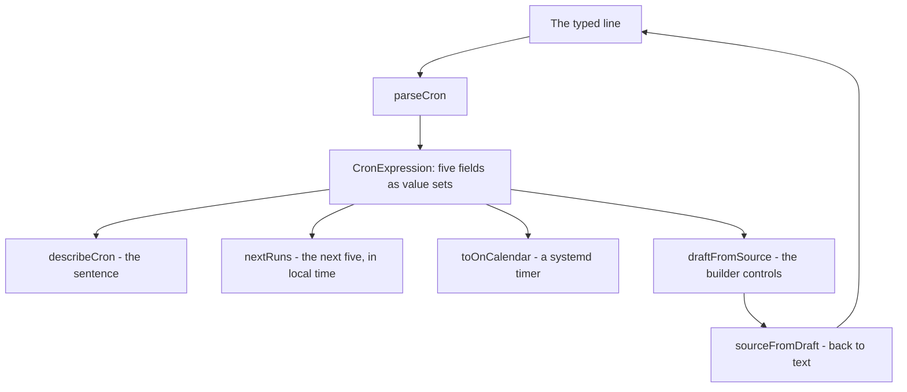

# Crontab

`/tools/crontab/` — read a cron expression, build one, see when it next runs, and find out where the line actually goes. A stateless Svelte island over five pure modules; nothing is written to IndexedDB.

_Describes the code as of v0.4.0 (unreleased; schema v14) — verify against source when in doubt._

## File map

| Path | Role |
| --- | --- |
| [parse.ts](../../../src/lib/cron/parse.ts) | The five fields, the macros, the presets, and the errors with offsets |
| [describe.ts](../../../src/lib/cron/describe.ts) | The plain-English sentence |
| [next.ts](../../../src/lib/cron/next.ts) | The next runs, and the day-of-month/day-of-week rule |
| [systemd.ts](../../../src/lib/cron/systemd.ts) | `OnCalendar=` and a whole `.timer` unit |
| [builder.ts](../../../src/lib/cron/builder.ts) | Field text ↔ the controls that can draw it |
| [CrontabApp.svelte](../../../src/components/apps/CrontabApp.svelte) | The page |
| [crontab.spec.ts](../../../tests/local/crontab.spec.ts), [cron.test.ts](../../../src/lib/cron/cron.test.ts) | Playwright and Vitest |

Everything on the page reads **one** `parseCron()` result — the sentence, the next runs, the timer translation and the builder controls all come from the same tree, so none of them can disagree with the others about what the expression means.

## Three details the parser gets right on purpose

1. **Sunday is 0 and 7, and the fold happens after ranges expand.** `dow`'s range really is 0–7. Normalising the 7 to 0 while reading a value would make `5-7` — Friday, Saturday, Sunday — look like a range that runs backwards, and it would be refused.
2. **"Restricted" means "does not begin with a star"**, which is the test Vixie cron itself makes (it sets `DOM_STAR`/`DOW_STAR` while reading the field). It is *not* "matches fewer than all values": `0-6` in day-of-week matches every day and still counts as restricted — and that is what switches the day rule from AND to OR. Getting this subtly wrong would hide the trap the tool exists to explain in the one case people hit.
3. **Six-field expressions are refused by name.** Quartz and Spring put seconds in front; a five-field parser handed one reads every field one place to the left and produces a schedule that looks plausible and is wrong. The check is narrow on purpose — six tokens where the last is a digit, a star or `?` — so `0 0 12 * * who` stays five fields and a command called `who`.

## The day-of-month / day-of-week rule

From crontab(5), and the single most misread sentence in it: when **both** day fields are restricted, cron runs the job when **either** matches.

`0 0 13 * 5` is not "Friday the 13th". It is *every 13th* **and** *every Friday* — four or five runs a month, not one a year. [next.ts](../../../src/lib/cron/next.ts)'s `dayMatches()` is where that lives; `parse.ts` exposes it as `domDowOr`, the page prints it in red beside the description, and `systemd.ts` refuses to translate it rather than quietly ANDing it.

## Next runs

`nextRuns()` walks in **local time**, because cron reads the machine's clock. The walk skips rather than ticks — a month that does not match advances a whole month — which is what lets it discover in a few dozen steps that `0 0 30 2 *` never runs. The horizon is ten years (`SEARCH_YEARS`); past it the page says the expression never runs rather than spinning.

Two DST facts fall out of local-time arithmetic and are stated on the page rather than hidden: a time that does not exist on the morning the clocks go forward is skipped, and a time that happens twice on the morning they go back is listed once.

## The builder

The controls are **derived** from the text rather than mirrored into their own state, so the two cannot drift. `draftFromSource()` recognises the four shapes it can draw (`*`, star-slash-n, `a-b`, a plain list) and reports anything else as `custom`, leaving the text untouched — a builder that flattens `1-5/2,30` into something it can draw has destroyed what someone typed.

One piece of state the text genuinely cannot carry: picking **Specific** before ticking anything writes `*` (an empty selection is not an expression), which would read straight back as **Every** and snap the control shut. The chosen mode is remembered per field until the expression is edited by hand.

Test hooks are prefixed `cron-`: `cron-input`, `cron-error`, `cron-description`, `cron-or-warning`, `cron-macro`, `cron-command`, `cron-copy`, `cron-presets`, `cron-preset-<expression>`, `cron-builder-card`, `cron-field-<name>`, `cron-mode-<name>`, `cron-step-<name>`, `cron-from-<name>`, `cron-to-<name>`, `cron-list-<name>`, `cron-pick-<name>-<value>`, `cron-runs-card`, `cron-runs`, `cron-runs-note`, `cron-zone`, `cron-systemd-card`, `cron-oncalendar`, `cron-unit`, `cron-copy-unit`, `cron-systemd-warning`, `cron-where-card`, `cron-user-column`, `cron-feedback`.
