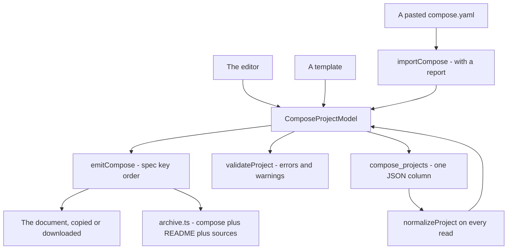

# Docker Compose

`/tools/docker-compose/` — build a `compose.yaml` through a UI that knows what each field does, start from a template, or read an existing file back in. The one tool in 0.3.0 that owns a store.

_Describes the code as of v0.3.0 (schema v13) — verify against source when in doubt._

## File map

| Path | Role |
| --- | --- |
| [model.ts](../../../src/lib/compose/model.ts) | The project structures, the constructors, and `normalizeProject` — the read boundary |
| [emit.ts](../../../src/lib/compose/emit.ts) | Model → document, in Compose-spec key order |
| [validate.ts](../../../src/lib/compose/validate.ts) | The errors and the warnings, each carrying its service and field |
| [import.ts](../../../src/lib/compose/import.ts) | Document → model, with a report of what could not be represented |
| [templates.ts](../../../src/lib/compose/templates.ts) | Nine stacks, ten snippets, and injection |
| [archive.ts](../../../src/lib/compose/archive.ts) | A template as a `.zip`, README generated from the model |
| [ComposeApp.svelte](../../../src/components/apps/ComposeApp.svelte) | The page |
| [docker-compose.spec.ts](../../../tests/local/docker-compose.spec.ts), [compose.test.ts](../../../src/lib/compose/compose.test.ts), [catalogue.test.ts](../../../src/lib/compose/catalogue.test.ts) | Playwright and Vitest |

## The model is the source of truth

**Nothing stores YAML.** A builder that keeps text has to re-parse on every keystroke, and the first time either side changes independently the two disagree. The model is what is stored and what is edited; the document is a `$derived` projection, and there is no code path that reads the textarea back.

Two consequences worth knowing:

- **`normalizeProject` is the read boundary.** A stored row is untrusted — the generic data suite writes an ARRAY into every json column on purpose, and a backup is hand-editable — so a model is re-shaped on every read, never cast. It is total by construction: every branch produces a valid project, because the caller is a `<script>` about to bind form fields to it.
- **Every field holds a value**, never `undefined`. An editor binding to `undefined` writes `undefined` into the database; emit decides what is worth putting in the file.

## Key order is a feature

`emit.ts` rebuilds each object with a fixed key list rather than emitting insertion order. The editor's field order changes whenever the UI is rearranged, and a document whose key order tracks that produces a diff on every unrelated edit. With the fixed order, re-emitting an unchanged project is byte-identical — which is what makes the output safe to keep in version control. A unit case asserts exactly that.

Only what was set is written: an empty field is absent, not `""`. Compose reads an empty `command` as "run nothing", which is not what a blank text box means.

## The warnings, and why each one exists

`validateProject` returns **errors** (the file is wrong or will not do what it looks like) and **warnings** (valid, and it surprises people). Each finding carries the service and a field hint, so the page shows it beside the control that caused it.

| Finding | Why it is not obvious |
| --- | --- |
| `network_mode: host` with published ports | Compose accepts it and the ports do nothing at all. The ports editor disables itself and says so |
| Duplicate host port | Ranges are expanded before comparing — `8000-8010` and `8005` collide and no string comparison notices |
| A bare word as a bind source | Compose reads `src:/app` as a NAMED VOLUME, not `./src`, and your edits appear to vanish |
| `service_healthy` on a service with no healthcheck | Compose waits forever |
| Two services with the same name | Services are a mapping: the second silently replaces the first, and Compose reports nothing |
| ipvlan / macvlan with no parent | Both attach to a real host interface and cannot work without one — and neither works inside Docker Desktop's VM |
| A dependency cycle | Reported as a path (`a → b → a`), because "there is a cycle" is not actionable |
| Inline config content | It ends up in the compose file, and therefore in this app's backup |

## The store

`compose_projects` (schema **v13**), one row per named project, the whole model in a single JSON column and no indexes — the library is listed whole and searched in memory, like the other document stores.

**A compose file can contain secrets.** Environment variables, database passwords and inline config content are all part of the model, and this store rides the plain-JSON backup like every other. The page says so where someone can act on it; [types.ts](../../../src/lib/db/types.ts) and the README Tables section say it too.

## Templates and snippets

Nine stacks and ten snippets, all table-tested: every entry must build a project that passes the validators with zero errors, emit a document that parses, pin a tag on every image it uses, and survive a JSON round trip. A template is content, content is where typos live, and a broken template is a compose file someone pastes into a terminal and watches fail.

**Injection is not a splice.** Adding a snippet to an open project renames the service when the name is taken, declares any volume it mounts, and **moves the host port when something already publishes it** — only the host side, since the container port is the image's contract. Each of the three is a stack that would not start otherwise, and the receipt says what happened.

**Sources are vendored only where the framework has no scaffolder worth deferring to** (Q10). Flask, FastAPI, Node, MERN and Go ship a hello-world; Astro, Next.js and Django ship README steps that run their own `create` command, because vendored scaffolding is stale within a release.

## Import

Best-effort, and loud about the effort. `importCompose` reads the short and long syntaxes for ports, mounts, `depends_on`, environment and healthchecks, and **lists every key it cannot represent** with its path. Dropping them silently and handing back something that looks complete is the one unacceptable behaviour, so the report is the product and the parsing is the easy half.

One detail found by the round-trip test rather than by reading: an argv list has to be **re-quoted** on the way in. `["sh", "-c", "a && b"]` joined with spaces and split again is five arguments, and the container runs something else entirely.

Test hooks are prefixed `dc-`: `dc-project-card`, `dc-name`, `dc-save`, `dc-new`, `dc-search`, `dc-library`, `dc-open-<name>`, `dc-delete-<name>`, `dc-export-json`, `dc-import-json`, `dc-secrets-note`, `dc-templates-card`, `dc-stacks`, `dc-stack-<id>`, `dc-zip-<id>`, `dc-snippets`, `dc-snippet-<id>`, `dc-import-card`, `dc-import-text`, `dc-import-file`, `dc-import-run`, `dc-import-error`, `dc-import-report`, `dc-import-accept`, `dc-services-card`, `dc-add-service`, `dc-service-<name>`, `dc-toggle-<name>`, `dc-badge-<name>`, `dc-findings-<name>`, `dc-remove-<name>`, `dc-sname-<i>`, `dc-image-<i>`, `dc-restart-<i>`, `dc-command-<i>`, `dc-env-<i>`, `dc-add-port-<i>`, `dc-port-published-<i>-<n>`, `dc-port-target-<i>-<n>`, `dc-ports-disabled-<i>`, `dc-add-mount-<i>`, `dc-mount-type/source/target-<i>-<n>`, `dc-netmode-<i>`, `dc-join-<i>-<network>`, `dc-advanced-<i>`, `dc-hc-<i>`, `dc-privileged-<i>`, `dc-depends-<i>`, `dc-depend-<i>-<name>`, `dc-condition-<i>-<name>`, `dc-resources-card`, `dc-add-network`, `dc-network-name/driver/parent-<n>`, `dc-add-volume`, `dc-volume-name-<n>`, `dc-add-secret`, `dc-secret-name-<n>`, `dc-add-config`, `dc-config-name-<n>`, `dc-output-card`, `dc-findings`, `dc-findings-clear`, `dc-yaml`, `dc-copy`, `dc-download`, `dc-error-count`, `dc-feedback`.
