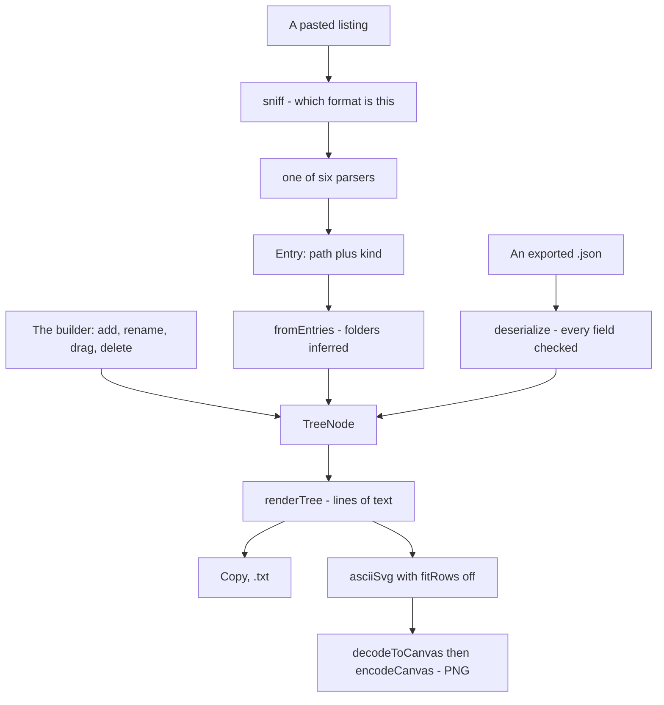

# File tree

`/tools/file-tree/` — build a directory tree by hand or read one back from a pasted listing, and get it out as text, SVG or PNG. A stateless Svelte island over three pure modules; nothing is written to IndexedDB, and a tree that is worth keeping leaves as a JSON file.

_Describes the code as of v0.4.0 (unreleased; schema v14) — verify against source when in doubt._

## File map

| Path | Role |
| --- | --- |
| [model.ts](../../../src/lib/tree/model.ts) | The node model and every edit, all pure and immutable |
| [parse.ts](../../../src/lib/tree/parse.ts) | Six listing formats in, `Entry[]` out, warnings by line |
| [render.ts](../../../src/lib/tree/render.ts) | The drawing: charsets, emoji, root modes, full paths |
| [FileTreeApp.svelte](../../../src/components/apps/FileTreeApp.svelte) | The page |
| [file-tree.spec.ts](../../../tests/local/file-tree.spec.ts), [model.test.ts](../../../src/lib/tree/model.test.ts), [parse.test.ts](../../../src/lib/tree/parse.test.ts), [render.test.ts](../../../src/lib/tree/render.test.ts) | Playwright and Vitest |

## Three ways in, one way out

Everything reduces to `Entry[]` — a path and a kind — which is the only contract a seventh format would have to meet.

## The model

Nested nodes with a name, a kind and children. Two decisions carry the rest:

- **Every operation is pure.** `insert`, `rename`, `remove`, `move`, `reorder` and `sortTree` all return a new root, built on one `replace(root, id, fn)` primitive. The page holds the whole tree in one piece of state and never has to wonder whether something mutated underneath it, and the operations are unit tested without a DOM.
- **Ids are session-only and are not serialized.** They exist so the builder can point at a node; an imported tree gets fresh ones. That is why the exported JSON is small and diffable.

`move()` is the one with teeth: it refuses a move into itself, into one of its own descendants, or onto the node's current parent. A drag-and-drop builder makes the descendant case easy to attempt and impossible to recover from — the subtree would simply leave the tree.

`insert()` turns a file into a folder rather than refusing, because someone who clicked "add file here" on a file meant to put one beside it, not to be told no.

## Reading a listing

The format is sniffed rather than picked from a dropdown, because nobody pasting a listing knows what this tool calls it. The page still offers an override for the cases that genuinely look like two things.

| Format | Recognised by | Notes |
| --- | --- | --- |
| Windows `dir` | a `Directory of …` header | Headers set the context; `<DIR>` gives the kind; the name is everything after the size column, so a name with spaces survives |
| Full paths (`dir /b /s`, `find`) | most lines are absolute | The common prefix becomes the root — stopping one segment short, so the project directory survives as the root rather than being eaten. A path that is a prefix of another is a folder by definition |
| `tree` output | any `├ └ │`, or `\|--` / `` `-- `` | Depth is read from the COLUMN the name starts at, not by counting connectors — which is what makes one parser read Unix `tree`, Windows `tree /f` (files indented with no connector) and this app's own ASCII output |
| `ls -R` | a line ending in `:` | Headers set the context; `ls`'s column layout is split on runs of two or more spaces, so a single space inside a name survives |
| An indented tree | any leading whitespace | Tabs count as one level; depth comes from a stack of columns rather than a fixed width, so a tree indented by two and one indented by four both read |
| A flat list (`ls`, `ls -1`) | nothing else matched | |

Two behaviours worth knowing:

- **A line that cannot be read is reported, not dropped.** Every parser returns `{line, text, reason}` and the page lists them. Noise every listing carries (`total 24`, `Volume in drive C…`, `2 directories, 3 files`, `.` and `..`) is recognised and skipped silently — the warnings are for things that genuinely failed.
- **The listing's own root name is kept.** `Directory of C:\myapp` gives a tree called `myapp`; a hand-typed tree headed `myapp` does the same. A first line that only says "here" (`.`, `C:.`) falls back to the given default. The root line is only treated as a root when it is the **only** line at the outer level — otherwise those are siblings and eating the first would silently reparent the rest.

## Drawing it

`renderTree()` walks the tree with a prefix string, appending a rail (`│   `) where the parent has later siblings and a gap where it does not. The pure-ASCII charset (`|--`, `` `-- ``) is not decoration: a README that renders as mojibake in one reader's terminal looks broken.

Options: trailing `/` on folders; emoji by kind (📂/📄) or by an editable extension table; the root shown, hidden, shown as `.` or renamed; full paths instead of names. `extensionOf()` deliberately gives a dotfile no extension — `.gitignore` is not a `gitignore` file.

The SVG goes through [ascii/render.ts](../../../src/lib/ascii/render.ts)'s `asciiSvg`, the same renderer the ASCII-art tool uses, with **`fitRows: false`**. That flag exists for this page: an emoji is two cells wide, and fitting a row that holds one to the single-width grid with `textLength` bends the branch columns out of alignment with the rows above. For the same reason the canvas is sized with `displayWidth()` — cells, not UTF-16 units — or every line with an emoji in it would be clipped.

Test hooks are prefixed `ft-`: `ft-tree-card`, `ft-rows`, `ft-row-<name>`, `ft-name-<name>`, `ft-delete-<name>`, `ft-add-file`, `ft-add-folder`, `ft-sort`, `ft-reset`, `ft-clear`, `ft-import`, `ft-paste-card`, `ft-listing`, `ft-format`, `ft-parse`, `ft-parse-note`, `ft-warnings`, `ft-output-card`, `ft-charset`, `ft-root`, `ft-root-label`, `ft-emoji`, `ft-slash`, `ft-full-paths`, `ft-rules`, `ft-rule-ext`, `ft-rule-emoji`, `ft-add-rule`, `ft-restore-rules`, `ft-clear-rules`, `ft-output`, `ft-summary`, `ft-copy`, `ft-copy-svg`, `ft-download-txt`, `ft-download-svg`, `ft-download-png`, `ft-download-json`, `ft-feedback`.
