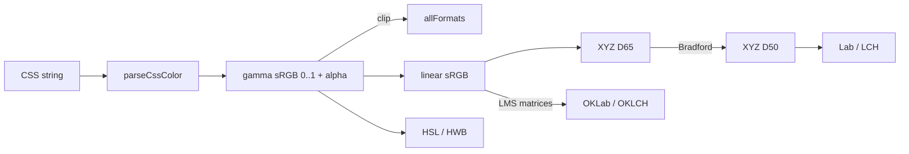
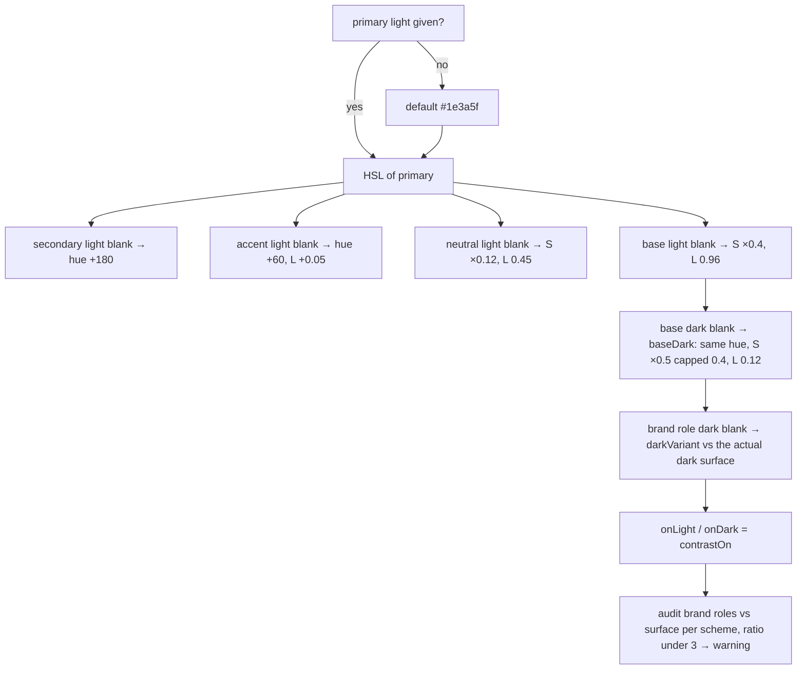
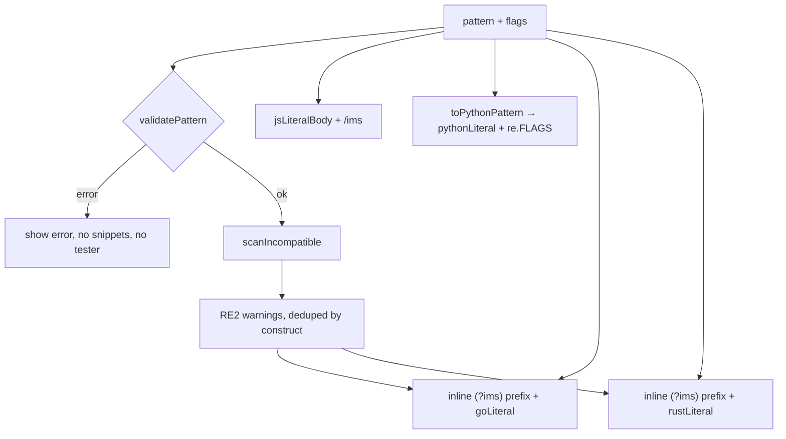
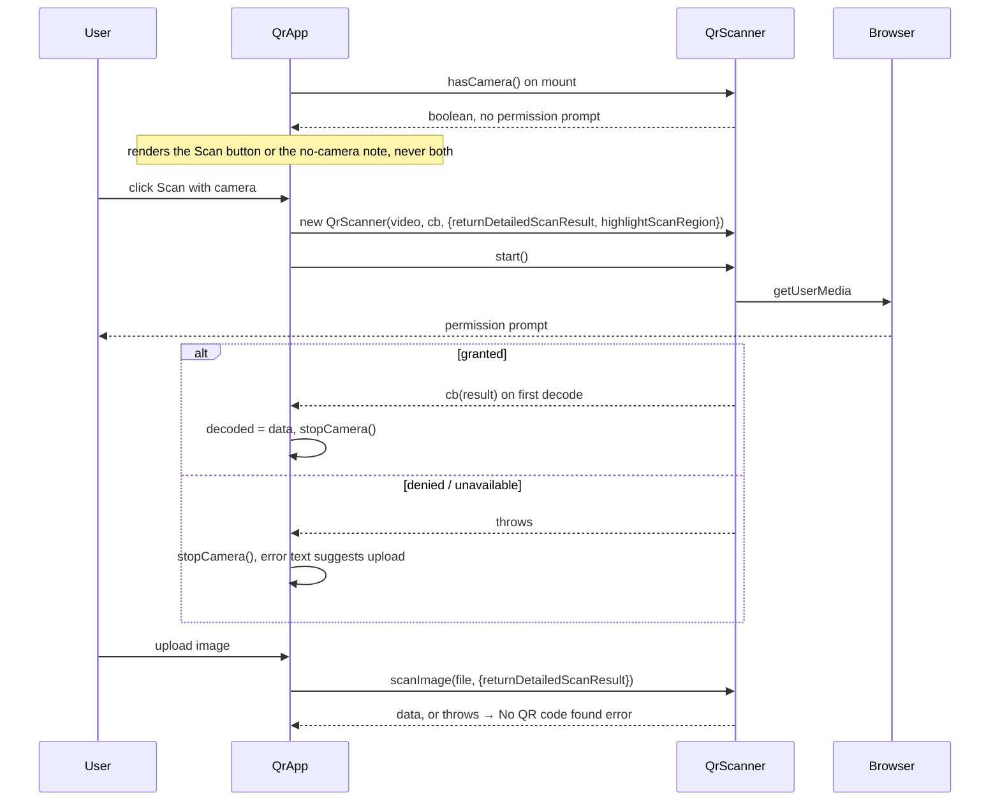

# Generators

Six stateless tools under the Generators category — Themes (color conversion, harmonies, CSS theme builder), Gradients, Glassmorphism, Regex snippets (plus live tester and symbol reference), QR code (create and read) and Clip path (documented on its own page: [clip-path.md](clip-path.md)). Each is a Svelte island over a pure TypeScript module in `src/lib/gen/`; the UI only binds inputs and renders what the module returns. None of them touch IndexedDB — each tool's main Playwright scenario wraps the whole interaction in a zero-write window.

_Describes the code as of v0.5.0 (schema v16) — verify against source when in doubt._

## File map

| Tool | Route | Island | Pure module(s) | Unit tests |
| --- | --- | --- | --- | --- |
| Themes | `/tools/colors/` | [ThemesApp.svelte](../../../src/components/apps/ThemesApp.svelte) | [color.ts](../../../src/lib/gen/color.ts), [harmony.ts](../../../src/lib/gen/harmony.ts), [theme.ts](../../../src/lib/gen/theme.ts) | `color.test.ts`, `harmony.test.ts`, `theme.test.ts` |
| Gradients | `/tools/gradients/` | [GradientsApp.svelte](../../../src/components/apps/GradientsApp.svelte) | [gradient.ts](../../../src/lib/gen/gradient.ts) | `gradient.test.ts` |
| Glassmorphism | `/tools/glassmorphism/` | [GlassApp.svelte](../../../src/components/apps/GlassApp.svelte) | [glass.ts](../../../src/lib/gen/glass.ts) | `glass.test.ts` |
| Regex snippets | `/tools/regex/` | [RegexApp.svelte](../../../src/components/apps/RegexApp.svelte) | [regexgen.ts](../../../src/lib/gen/regexgen.ts), [regexTester.ts](../../../src/lib/gen/regexTester.ts), [regexRef.ts](../../../src/lib/gen/regexRef.ts) | `regexgen.test.ts`, `regexTester.test.ts` |
| QR code | `/tools/qr/` | [QrApp.svelte](../../../src/components/apps/QrApp.svelte) | [qr.ts](../../../src/lib/gen/qr.ts) | `qr.test.ts` |
| Clip path | `/tools/clip-path/` | [ClipPathApp.svelte](../../../src/components/apps/ClipPathApp.svelte) | [clipPath.ts](../../../src/lib/gen/clipPath.ts) | `clipPath.test.ts` — see [clip-path.md](clip-path.md) |

Shared pieces:

- [ColorField.svelte](../../../src/components/ColorField.svelte) — free-form CSS color text + synced native picker. Used by theme role slots, gradient stops and the glass tint.
- [exportFile.ts](../../../src/lib/exportFile.ts) — the download / copy pipeline (`downloadBlob`, `downloadText`, `downloadDataUrl`, `dataUrlToBlob`, `copyText`, `copyPng`). Built for the QR tool; reused by the image tools.
- [prism.ts](../../../src/lib/prism.ts) — the single Prism entry point (core + grammars in guaranteed order). The regex island imports from here, never from `prismjs`.
- Registry entries live in [registry.ts](../../../src/lib/registry.ts) (`colors`, `gradients`, `glassmorphism`, `regex`, `qr`, `clip-path`; category `Generators`).
- E2E: [generators.spec.ts](../../../tests/local/generators.spec.ts); the clip path tool has its own [clip-path.spec.ts](../../../tests/local/clip-path.spec.ts).

Dependencies: `qrcode` (encode, imported by `qr.ts`) and `qr-scanner` (decode, imported by `QrApp.svelte` — it is DOM-bound, so it stays out of the pure module); `prismjs` is bundled through `prism.ts`. Both are static imports. Everything else is dependency-free TS.

## Conventions shared by all six

- **Stateless.** Component state is local runes; nothing reads or writes `preferences` or any store. The specs take `app.dumpAll()` before and after and require equality.
- **One string, two consumers.** Wherever a preview and a copyable output exist, both come from the same pure function output (`gradientCss` drives the preview `style` and `gradientDeclaration` wraps it; `glassProperties` feeds both `glassCss` and `glassInlineStyle`; `buildTheme().vars` drives the preview and `buildTheme().css` is what is copied). The preview can never disagree with the text.
- **Copy** goes through `copyText` (resolves `false` on failure, never throws); islands flip a "Copied" label for 1.5 s — the QR island instead flashes a 2 s status line ("PNG copied", "Copy failed — try downloading instead"). **Clipboard images are always PNG** via `copyPng` — the async clipboard API only reliably accepts `image/png`. Downloads carry an explicit filename.
- Islands copy module-level defaults before handing them to `$state`, so the constants are never mutated: `DEFAULT_GRADIENT` needs its `stops` array cloned too, `DEFAULT_GLASS` is flat and a spread is enough.

## Themes

### Color parsing and formatting — `color.ts`

Internal hub: gamma-encoded sRGB components in `0..1` plus alpha (`ParsedColor { rgb, alpha }`). Components may lie outside `0..1` before clipping.

- `parseCssColor(input) → ParsedColor | null` — hex (`#rgb`, `#rgba`, `#rrggbb`, `#rrggbbaa`), `rgb()/rgba()` (numbers or `%`), `hsl()/hsla()`, `hwb()`, `lab()`, `lch()`, `oklab()`, `oklch()` in space syntax or legacy commas, slash alpha or `%` alpha, hue units `deg|grad|rad|turn`, the 148 named colors (`NAMED_COLORS`) and `transparent`. Percent scaling follows CSS Color 4 (`lab` L 100 / a,b 125; `lch` C 150; `oklab` a,b 0.4; `oklch` C 0.4). Anything unrecognised returns `null`.
- `allFormats(color) → ColorFormats` — clips to sRGB, then emits `hex`, `rgb`, `hsl`, `hwb`, `lab`, `lch`, `oklab`, `oklch` strings, `named` (exact reverse lookup on the clipped opaque hex; `null` when alpha < 1) and `inGamut` (false when any pre-clip channel was outside `[0,1]` by more than 1e-6). Alpha < 1 appends ` / a` to every functional form and two hex digits to `hex`.
- Space converters are exported individually: `rgbToHsl`/`hslToRgb`, `rgbToHwb`/`hwbToRgb`, `rgbToLab`/`labToRgb`, `rgbToOklab`/`oklabToRgb`, `rgbToHex`.

Lab/LCH sit on the D50 white point (as CSS defines them), so that path is sRGB → linear → XYZ(D65) → Bradford → XYZ(D50) → Lab. OKLab goes straight from linear sRGB through the LMS matrices. `HEX_TO_NAME` is built first-writer-wins, so `gray` beats `grey`.

### Harmonies — `harmony.ts`

`harmonies(color) → Harmony[]` on the classic HSL wheel: rotate hue, keep S and L. Four entries, each containing the base color: complementary (base, +180°), monochromatic (base, then lightness 0.2/0.4/0.6/0.8 with base-duplicates filtered), analogous (−30°, base, +30° — the only one where the base is not first), tetradic (base, +60°, +180°, +240°). Swatches are `#rrggbb` from `rgbToHex`; the island copies a chip's hex on click.

### Theme builder — `theme.ts`

`buildTheme(input: ThemeInput) → BuiltTheme`. Input is up to five `RoleInput { light, dark }` in `THEME_ROLES` order (`primary`, `secondary`, `accent`, `neutral`, `base`), each slot a CSS color string or `null`, plus `paddingPx` and `radiusPx`. Output: `swatches` (per role: `light`, `dark`, `derivedLight`, `derivedDark`, `onLight`, `onDark`), `warnings`, `vars` (`[name, value][]`) and `css`.

Derivation rules (the WHY: one color must be enough for a complete theme):

- Base is resolved first so `darkVariant(rgb, surfaceDark)` lifts brand roles against the REAL dark surface: start at `L + 0.18` clamped to `[0.45, 0.82]`, then step `+0.03` until `contrastRatio ≥ 3.05` or `L ≥ 0.9`. Explicit dark overrides bypass this.
- `contrastOn(hex)` returns `#ffffff` or `#111111`, whichever contrasts harder (WCAG luminance). `contrastRatio(a, b)` is the WCAG ratio; unparseable inputs return 21 (never falsely warn).
- Junk in a slot parses to `null` and is treated as blank (falls back to derived).
- Emitted vars: `--<role>` and `--on-<role>` for each role, then `--surface`, `--surface-2`, `--text`, `--border` (tinted from the base/neutral hues, not gray), `--padding`, `--radius`. Every color var is `light-dark(<light>, <dark>)`. `css` is `:root {\n  color-scheme: light dark;\n\n  …\n}`.
- `warnings` audits the four brand roles (not base) against `base.light` / `base.dark`; ratio rounded to 0.1, threshold `< 3` (WCAG 1.4.11).

Island wiring: `themeColors` is five `{ light, dark }` strings (primary light defaults to `#1e3a5f`); blanks become `null` for `buildTheme`. `previewStyle` joins `vars` into an inline style and appends `color-scheme: light|dark` when the scheme radio is not `auto` — the preview window's CSS reads only the emitted variables. "Use color above as primary" copies the converter's clipped opaque hex into slot 0. `ColorField` shows `theme.swatches[i].light|dark` as its picker fallback, so a blank slot's picker displays the derived value.

Invariants:

- `vars` and `css` must agree (`theme.test.ts` checks every var appears in the css verbatim).
- The default input (one navy primary) must raise no warnings.
- Everything the preview renders must come from `vars` — no colors are hard-coded in the preview styles beyond the variables.

## Gradients — `gradient.ts`

`GradientDef { kind: 'linear'|'radial'|'conic', angle, shape: 'circle'|'ellipse', repeating, stops: GradientStop[] }`; `GradientStop { color, position: number|null }` (null = let the browser space it). `gradientCss(def)` builds the `<image>` value — `linear-gradient(<angle>deg, …)`, `conic-gradient(from <angle>deg, …)`, `radial-gradient(<shape>, …)`, with a `repeating-` prefix when set; numbers are rounded to 2 decimals. `gradientDeclaration(def)` wraps it as `background: …;`. The island keeps at least two stops (remove is disabled at two), adds a white unpositioned stop, and uses `ColorField` per stop.

## Glassmorphism — `glass.ts`

`GlassDef { blur, tint, tintOpacity 0..1, saturation %, borderOpacity 0..1, radius, shadow }`. `glassProperties(def)` returns `[property, value][]`: `background: rgb(R G B / tintOpacity)`, `backdrop-filter` and `-webkit-backdrop-filter: blur(Npx)[ saturate(N%)]` (`saturate()` omitted at exactly 100), `border: 1px solid rgb(R G B / borderOpacity)`, `border-radius`, and `box-shadow: 0 8px 32px rgb(0 0 0 / 0.2)` when `shadow`. The tint is any CSS color run through `parseCssColor`; its own alpha is ignored (`tintOpacity` rules) and an unparseable tint falls back to white. `glassCss` terminates every declaration with `;` and joins the lines with `\n` (copy); `glassInlineStyle` joins bare `prop: value` pairs with `; ` (preview `style`). `GLASS_PRESETS` are eight complete `GlassDef`s (`frosted-light|medium|strong`, `dark-frost`, `ios-clear`, `tint-blue|amber|rose`); applying one replaces the whole def. The island shows tint and border opacity in percent and converts on input.

## Regex snippets — `regexgen.ts`, `regexTester.ts`, `regexRef.ts`

### Snippet generation

`buildSnippets({ pattern, ignoreCase, multiline, dotAll }) → LangSnippet[]` for `js`, `python`, `go`, `rust` (each with `label`, `prism` grammar key, `code`, `warnings`). The island first runs `validatePattern` (compiles with JS `new RegExp`; returns the error message or `null`) and shows nothing when it fails.

Per-language escaping:

| Language | Literal | Flags | Notes |
| --- | --- | --- | --- |
| JavaScript | `/…/` via `jsLiteralBody` — escapes unescaped `/`; empty pattern becomes `(?:)` so it does not read as a comment | `/ims` suffix; find-all adds `g` | — |
| Python | `pythonLiteral`: `r"…"`, else `r'…'`, else `r"""…"""`; falls back to a normal string with `\\` and `\"` escapes when the pattern ends in an odd run of backslashes or uses all quote forms | `re.IGNORECASE \| re.MULTILINE \| re.DOTALL` | `toPythonPattern` rewrites `(?<name>` → `(?P<name>` and `\k<name>` → `(?P=name)` (skips character classes and lookbehind) |
| Go | `goLiteral`: backtick raw string, or an interpreted `"…"` with escapes when the pattern contains a backtick | inline `(?ims)` prefix | RE2 warnings |
| Rust | `rustLiteral`: `r"…"`, escalating `r#"…"#` fences until no `"#…` collision | inline `(?ims)` prefix | RE2 warnings |

`scanIncompatible(pattern) → Incompat[]` walks the pattern tracking backslash escapes and `[…]` classes so `\(?=` and `[(?=]` never false-positive; it reports `lookahead` (`(?=`, `(?!`), `lookbehind` (`(?<=`, `(?<!`) and `backreference` (`\1`–`\9`, `\k<name>`), and does NOT flag named groups `(?<name>`. `buildSnippets` groups findings by construct and attaches one warning per construct (with the offending texts) to the Go and Rust snippets only — the JS and Python snippets never warn.

Highlighting: the island calls `Prism.highlight(code, grammar, lang)` on its own generated snippet and renders with `{@html}`; Prism entity-escapes the code text and the input is never user HTML. Grammars for `python`, `go`, `rust` come from `prism.ts` — importing `prismjs` components elsewhere can reorder chunks and crash hydration (`Prism is not defined`), which is the documented reason `prism.ts` is the only entry point.

### Live tester

`findMatches(pattern, flags, text) → RegexTestResult | null` compiles with `dg` plus the chosen flags (always global; `d` for group indices) and iterates `matchAll`, stopping at `MAX_MATCHES` (500) with `truncated: true`. Named groups are merged into their numbered slot by comparing spans and values (in JS a named group IS a numbered group), so each group is listed once with `number` and optional `name`; non-participating groups carry `null` value and spans. `segmentText(text, matches) → TextSegment[]` splits the sample into plain / matched runs and each match into `parts` colored by innermost group (later groups paint over earlier ones; a lookahead capture beyond the match is clamped). The UI renders these segments as elements — never HTML strings — so highlighting cannot be an injection surface. The island shows the first 50 rows of the table and colors group N identically in the highlighted text and the chips (`GROUP_COLORS`, six fixed light backgrounds).

### Symbol reference

`REGEX_REFERENCE` is static data (six categories: Anchors, Character classes, Quantifiers, Groups & references, Lookaround, Escapes) and `filterReference(query)` is a case-insensitive substring filter over token + meaning. Meanings describe common JS/PCRE behaviour; Go/Rust caveats are noted inline on the affected rows and enforced by the snippet warnings, not here.

## QR code — `qr.ts`

Create: `qrSvg(text, opts)` and `qrPngDataUrl(text, opts)` are thin wrappers over `qrcode`'s `toString({ type: 'svg' })` and `toDataURL` with `margin: 2`, `errorCorrectionLevel`, `width: size` and `color: { dark, light }` (defaults black on white). `QrOptions { size, ecLevel, dark?, light? }`; `QR_SIZES` = 128/256/512/1024; `EC_LEVELS` = L/M/Q/H. `qrcode` rejects an empty payload (unit-tested), but the island never gets that far: it guards blank-or-whitespace text itself and shows "Enter text or a URL to encode." instead. `qrColorWarning(dark, light)` compares WCAG luminance: dark lighter than light → "Inverted colors…" ; otherwise ratio `< 3` → "Low contrast…"; else `null`.

The island regenerates the SVG in an `$effect` with a stale flag so a slower earlier render never overwrites a newer one. Exports: PNG download (`downloadDataUrl`), SVG download (`downloadText`, `image/svg+xml`), copy PNG (`qrPngDataUrl` → `dataUrlToBlob` → `copyPng`), copy SVG text (`copyText`). Filenames are fixed: `qr-code.png`, `qr-code.svg`.

Read (`qr-scanner`):

`stopCamera()` stops and destroys the scanner and runs from the decode callback, the Stop button, the error path and `onDestroy`. Decoded values render as text; only `http(s)://` values also get an "Open link" anchor (`target=_blank`, `rel=noopener noreferrer`) — nothing is auto-opened. The upload input is cleared after each read so the same file can be re-picked.

## Export / copy pipeline — `exportFile.ts`

- `downloadBlob(blob, filename)` creates an object URL, clicks a temporary anchor with `download` set, and revokes the URL after 1 s (revoking synchronously can abort the download).
- `downloadText`, `downloadDataUrl`, `dataUrlToBlob` (base64 or URI-encoded bodies; MIME from the header, `application/octet-stream` fallback).
- `copyText` / `copyPng` resolve `false` instead of throwing so callers can show a "couldn't copy" state; `copyPng` writes a single `ClipboardItem` under `image/png`.

Rule for every consumer: clipboard images are PNG and the button says so; downloads name their file.

## Tests

- Unit (Vitest, `npm run test:unit`): [color.test.ts](../../../src/lib/gen/color.test.ts) (all syntaxes, CSS Color 4 reference values, alpha carriage, gamut flag, round trip of every emitted spelling within 1.5/255, 148 named colors), [harmony.test.ts](../../../src/lib/gen/harmony.test.ts) (rotations, monochromatic, gray hue degeneracy), [theme.test.ts](../../../src/lib/gen/theme.test.ts) (css shape, derivation flags, dark overrides, warnings per scheme, junk input, vars↔css agreement), [gradient.test.ts](../../../src/lib/gen/gradient.test.ts), [glass.test.ts](../../../src/lib/gen/glass.test.ts) (defaults, tint parsing, `saturate()` omission, every preset complete), [regexgen.test.ts](../../../src/lib/gen/regexgen.test.ts) (scanner edge cases, each literal function, flag mapping, warnings on Go/Rust only), [regexTester.test.ts](../../../src/lib/gen/regexTester.test.ts) (spans, named-group merge, truncation, segment coloring, lookahead clamp, reference filter), [qr.test.ts](../../../src/lib/gen/qr.test.ts) (SVG shape, EC levels, empty payload rejection, colors, color warning).
- E2E ([generators.spec.ts](../../../tests/local/generators.spec.ts)): every tool inside a `dumpAll()` zero-write window; real async clipboard with granted permissions; theme builder derivation, dark overrides, per-scheme warnings, preview `color-scheme` flip; gradient and glass CSS vs live style; regex rewrites/flags/warnings, tester highlighting with matching chip colors, reference filter; QR create → PNG download → upload → decode round trip, custom colors and the inverted warning, SVG download, empty input, and camera feature detection asserting `navigator.permissions` stays `prompt` and that exactly one of the Scan button / no-camera note renders.

## Known limits and decisions

- Regex validation, the tester and the scanner all use the browser's JS engine; Go/Rust semantics are approximated by the RE2 construct warnings only. Other engine differences (Unicode classes, possessive quantifiers, etc.) are not detected.
- `pythonLiteral` picks the raw form by string inclusion; a pattern that contains `"`, `'` and `"""` all at once falls back to the escaped normal string.
- Themes: `light-dark()` output requires `color-scheme: light dark` on `:root` (emitted) and a browser that supports the function; no fallback CSS is generated. Out-of-gamut inputs are clipped before entering the theme.
- Harmonies work in HSL, so perceptual uniformity is not a goal (the OKLCH spellings are for conversion only).
- QR camera scanning stops after the first successful decode; there is no continuous mode. `qr-scanner` decides between the native barcode detector and its bundled worker itself.
- Nothing here is remembered across reloads — by design these pages are pure functions of their inputs.
