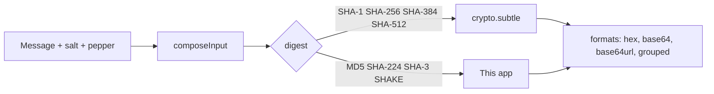

# Hashing

`/tools/hashing/` — twelve digests of the same message, HMAC over any of them, and salt/pepper composition. A stateless Svelte island over `src/lib/hash/`; it writes **nothing** to IndexedDB, and its spec asserts that across a whole session.

_Describes the code as of v0.4.0 (unreleased; schema v14) — verify against source when in doubt._

## File map

| Path | Role |
| --- | --- |
| [md5.ts](../../../src/lib/hash/md5.ts) | MD5 (RFC 1321) — WebCrypto does not have it, deliberately |
| [sha2.ts](../../../src/lib/hash/sha2.ts) | SHA-256 and SHA-224 — the core exists because **SHA-224 is in no browser** |
| [sha3.ts](../../../src/lib/hash/sha3.ts) | Keccak-f[1600], SHA3-224/256/384/512 and SHAKE128/256 |
| [index.ts](../../../src/lib/hash/index.ts) | The catalogue, `digest`, `hmac`, `composeInput`, `formats`, availability |
| [HashApp.svelte](../../../src/components/apps/HashApp.svelte) | The page |
| [hashing.astro](../../../src/pages/tools/hashing.astro) | Route shell |
| [hashing.spec.ts](../../../tests/local/hashing.spec.ts) | Playwright |
| [digest.test.ts](../../../src/lib/hash/digest.test.ts), [index.test.ts](../../../src/lib/hash/index.test.ts) | Vitest |

## Where each digest comes from

This split is not an implementation detail — it is what the page tells the user, because it decides what works where:

- **`crypto.subtle` needs a secure context.** On `https:` or `localhost` it is there; on plain `http:` to a LAN address, or a `dist/` folder opened as `file://`, it is `undefined`. `available(id)` answers per algorithm and the page greys out what it cannot do, with the reason, instead of throwing at the first click.
- **SHA-256 has both.** It is the one platform digest this app also implements, so it survives an insecure context.
- **The rest of the app's own** — MD5, SHA-224, SHA-3, SHAKE — work anywhere.

## The implementations, and how they are proved

Every one is checked twice in `digest.test.ts` and `index.test.ts`: against the **published vectors** (RFC 1321, FIPS 180-4, FIPS 202) and against **Node's OpenSSL** for a spread of inputs across the block boundaries. The published constants catch a mistyped implementation; the cross-check catches a mistyped constant.

- **MD5** — the classic four-round loop. The one bug it had in development was a transposed row of the shift table, which the RFC's own vectors caught immediately.
- **SHA-224** — the SHA-256 compression function with different initial values, truncated to seven words. The SHA-256 export exists so both can be checked against WebCrypto's answer.
- **SHA-3** — the state is twenty-five 64-bit lanes held as `bigint`, which is the slower and far more readable of the two ways. This app hashes typed text, not files, and a test measures a 10 KB input to keep that claim honest.
- **HMAC** — WebCrypto's for the SHA-1/2 family; the generic construction (`H((K ^ opad) || H((K ^ ipad) || m))`) over the local digests for MD5, SHA-224 and SHA-3, using each algorithm's own block size (144, 136, 104 and 72 bytes for the SHA-3 family — not 64, which is the mistake waiting to be made).

## Salt, pepper and the refusal

`composeInput` concatenates pepper, salt and message in a stated order and returns **the formula it used** (`H(pepper ‖ salt ‖ message)`) alongside the bytes. There is no standard for this, which is exactly why the page prints it: "salted SHA-256" tells nobody how to reproduce a digest.

The page carries a **Not password storage** card, and it is not decoration. These algorithms are built to be fast; a consumer GPU runs billions of SHA-256 guesses a second, and a salt does nothing about that — it only stops one precomputed table covering every account. The card names Argon2id, scrypt, bcrypt and PBKDF2 as the alternatives, and `hashing.spec.ts` asserts the wording is on the page.

Test hooks are prefixed `hash-`: `hash-input`, `hash-salt`, `hash-salt-random`, `hash-salt-position`, `hash-pepper`, `hash-formula`, `hash-format`, `hash-shake-bytes`, `hash-row` (with `data-algo`), `hash-value-<id>`, `hash-copy-<id>`, `hash-warning-<id>`, `hash-missing-<id>`, `hash-hmac-key`, `hash-hmac-algo`, `hash-hmac-value`, `hash-hmac-error`, `hash-hmac-empty`, `hash-password-note`, `hash-insecure`.
