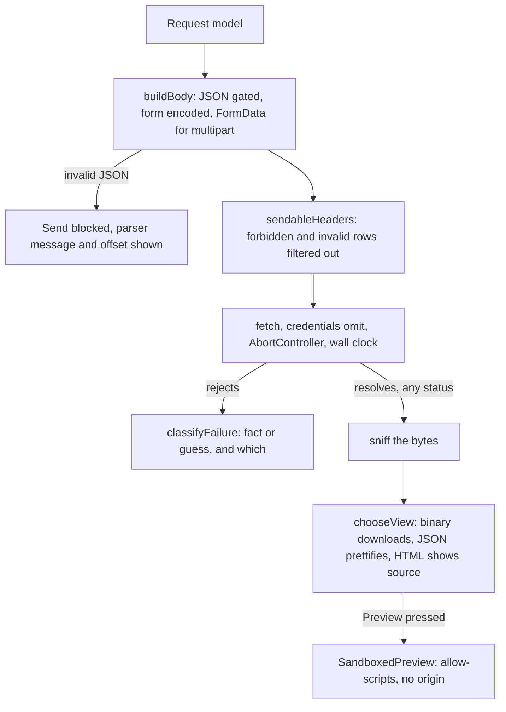

# HTTP playground

Craft a request, send it, and understand what came back — the httpie/Postman core, running in the page. Stateless by design this release: nothing here touches IndexedDB, so the send path is provably clean before Phase 4 adds saved requests to it.

_Describes the code as of v0.4.0 (unreleased; schema v14) — verify against source when in doubt._

The tool exists to say the things a browser will not. Two of them shape the whole page, and both are cases where every other browser-based HTTP client is silent:

- **About twenty request headers cannot be set by a page**, and the browser drops them without a word.
- **A failed `fetch` explains nothing**, on purpose, so a page cannot use it to map a network.

## File map

| Path | Role |
| --- | --- |
| [model.ts](../../../src/lib/http/model.ts) | The request shape, the method list, `carriesBody`, and `checkUrl` |
| [headers.ts](../../../src/lib/http/headers.ts) | RFC 9110 name/value syntax, the forbidden-header list, and `sendableHeaders` — what really goes over the wire |
| [body.ts](../../../src/lib/http/body.ts) | Building a body per kind: JSON gating, `URLSearchParams` encoding, `FormData` and the boundary rule |
| [classify.ts](../../../src/lib/http/classify.ts) | Why a `fetch` failed, and how confident that answer is; plus claimed-vs-sniffed content type |
| [send.ts](../../../src/lib/http/send.ts) | The one impure module: `fetch`, a clock and an `AbortController` |
| [view.ts](../../../src/lib/http/view.ts) | Picking a viewer from the BYTES, and the size/timing/status formatting |
| [HttpPlaygroundApp.svelte](../../../src/components/apps/HttpPlaygroundApp.svelte) | `/tools/http-playground/` |
| [SandboxedPreview.svelte](../../../src/components/SandboxedPreview.svelte) | The shared previewer, mounted for the HTML "Preview" toggle |
| [sniff.ts](../../../src/lib/encode/sniff.ts) | Magic numbers — the evidence a `Content-Type` is checked against |
| [registry.ts](../../../src/lib/registry.ts) | `http-playground` under **Playgrounds**, icon `arrow-up-down` |

## The forbidden request headers

The Fetch standard reserves about twenty header names — `Host`, `Origin`, `Cookie`, `Content-Length`, `Referer`, `Connection`, everything under `Proxy-` and `Sec-`, and the rest — because the browser owns them. It does not error on them. It **silently drops them**, so a request goes out without what was typed and the page has no reason to think otherwise.

`checkHeader` returns that as a `forbidden` **warning** rather than an error: the row is legal, and blocking Send over it would be a lie in the other direction. `sendableHeaders` then filters it out, so what the page calls "will be sent" is the truth rather than a hope. The spec proves both halves against the echo route: our `Host` is absent from what the server received, and the browser's own is there.

The prefix check is `sec-` and `proxy-`, not `sec` and `proxy` — `Section` is an ordinary header, and a test pins that.

## Why a failure has no explanation

`fetch` rejects with a bare `TypeError` for a CORS refusal, a name that will not resolve, a refused connection and a dropped cable alike. That vagueness is deliberate: distinguishing them would make `fetch` a port scanner for any page that wanted one.

`classifyFailure` therefore reasons from what the page **can** see, and every result carries a `guess` flag saying whether it is inference or fact:

| Kind | Certain? | How it is known |
| --- | --- | --- |
| `aborted` | fact | `AbortError`, so we cancelled it |
| `mixed-content` | fact | an `https:` page fetching `http:` — blocked before the network |
| `offline` | fact | `navigator.onLine` is false |
| `unreachable` | fact | the target is **same-origin**, so CORS cannot be the cause |
| `cors` | **guess** | cross-origin and no status, which is the shape of a refusal |
| `unknown` | guess | anything else, reported verbatim |

Mixed content is checked *before* CORS on purpose. The two look identical from inside a page — a failed request with no detail — and the fix is completely different: one needs a scheme change, the other needs the server's cooperation. Telling someone to chase CORS headers when the browser blocked their request before it left is a wasted afternoon.

The `cors` card says whose decision it is: the **target server** must answer with `Access-Control-Allow-Origin`. No client running in a browser opts out of that — not this one, not one you write, and not this app installed to a home screen, because an installed web app is still a browser page. The plan's Q3 asked whether to point people at a desktop build to escape it; there is no desktop build, so the honest answer ships instead (decision 6).

## The bytes decide what a body is

A `Content-Type` is a claim; the bytes are evidence. `chooseView` runs [sniff.ts](../../../src/lib/encode/sniff.ts) over the response and picks a viewer from what it finds, exactly as the base64 tool does:

- Decisive binary bytes → **a download and no viewer at all**, named with the sniffed extension. This is the TODO's rule, and it is why there is no image preview here: a tool for reading what a server sent should not also be a decoder surface for arbitrary bytes.
- Bytes that are neither a known format nor valid text → also a download, rather than a guess.
- Textual bytes → the *declared* type chooses between the textual viewers, never overruling binary. JSON that parses is pretty-printed; JSON that does not is shown as text with the parser's complaint; HTML is source first.

`compareContentType` reports a disagreement, but deliberately does not cry wolf: everything textual sniffs as `text/plain` when it is nothing more specific, so a server calling its text JSON, HTML, CSV or XML is agreeing with the bytes. Only a binary claim over textual bytes, or a mismatch between two decisive types, is worth raising.

## The response is not a failure

A non-2xx status is an **answer**. 404, 500 and 302 all come back through the normal path with the status, its family spelled out in words beside the number, timing, size and headers. Only a rejected `fetch` reaches the classifier. This matters more than it sounds: a client that shows 404 as an error teaches people that the server broke, when the server in fact answered exactly as it meant to.

Colour is never the only signal — `statusFamily` puts "client error" next to the 404.

## Sending

`send()` is the one impure module. It sets `credentials: 'omit'` unconditionally: this is a request builder, not a session, and attaching ambient cookies to whatever address someone types would be a way to hand them to it. There is no retry, no proxy, no telemetry — one press, one request, and [payload.spec.ts](../../../tests/local/payload.spec.ts) keeps proving every other page calls out not at all.

The body's implied `Content-Type` is set first and an explicit header overrides it, so `application/vnd.me+json` on a JSON body wins. Multipart is the exception in the other direction: it never sets one, because only the browser knows the boundary `FormData` picked, and a hand-written header names a boundary that is not in the body — which produces an empty form and no error anywhere. The page says so, and `contentTypeWarning` says it again if a `Content-Type` row is present.

## Tests

| File | Runner | Covers |
| --- | --- | --- |
| [http.test.ts](../../../src/lib/http/http.test.ts) | vitest | Header syntax with the offending character named, header-injection refused, every forbidden name in both cases plus the `sec-`/`proxy-` prefixes *and* that `Section` is not one; `sendableHeaders` proving a forbidden row never reaches the wire; URL schemes refused by name; form encoding for `&`, `=`, spaces, non-ASCII, repeats and unticked rows; JSON gating with its position; multipart never setting its own type; the classifier over every kind, with mixed content told apart from CORS and same-origin ruling CORS out; claimed-vs-sniffed including the textual cases it must NOT warn about; viewer choice for each body; and `send` proving a 404 is a result, cookies are omitted, a broken body never reaches the network, and an abort is a cancellation |
| [http-playground.spec.ts](../../../tests/local/http-playground.spec.ts) | Playwright | Real requests against the test server's `/__echo/*` routes: send and read a JSON answer; a forbidden header warned about, Send left enabled, and the header proved absent from what the server received while an invalid name does block; JSON gated before send and echoed after; form bytes shown and echoed; a PNG under a lying `text/plain` reported and offered as a download with no viewer; HTML as source then previewed in a frame with `allow-scripts` and no origin; 404 shown as an answer with no diagnosis card; a body that claims JSON and is not; Cancel aborting a slow request; and **zero DB writes in every case** |

The echo routes live in [preview-server.mjs](../../../tools/preview-server.mjs) because Playwright's `webServer` starts one process. They are same-origin, which is the only kind a browser lets the page reach without the target opting in — so the specs exercise the send path, and the CORS classifier is unit-tested where its inputs can actually be controlled.

## Known limits and decisions

- **No desktop wrapper to escape CORS** (plan Q3). There is none to point at, and installing the PWA changes nothing, so the page explains rather than deflects.
- **No cookies, ever.** `credentials: 'omit'` is not configurable. Cross-origin cookie behaviour is the browser's to decide and a toggle here would imply otherwise.
- **Response headers are a plain table, not `DataTable`.** The plan suggested the latter; it wants a schema per response and brings search, filter, paging and export chrome that a ten-row list does not need.
- **No response history.** Nothing is stored at all this phase. Recording is Phase 5's problem, and a recorded body is a backup-file liability worth designing for rather than falling into.
- **Redirects are followed**, and the final URL is shown when it differs. Seeing the hops would need `redirect: 'manual'` and a hand-rolled chain, which changes what is actually sent.
- **The `Content-Length` of a request is the browser's.** It is on the forbidden list for that reason, and the response's own is shown from the header the server sent.
