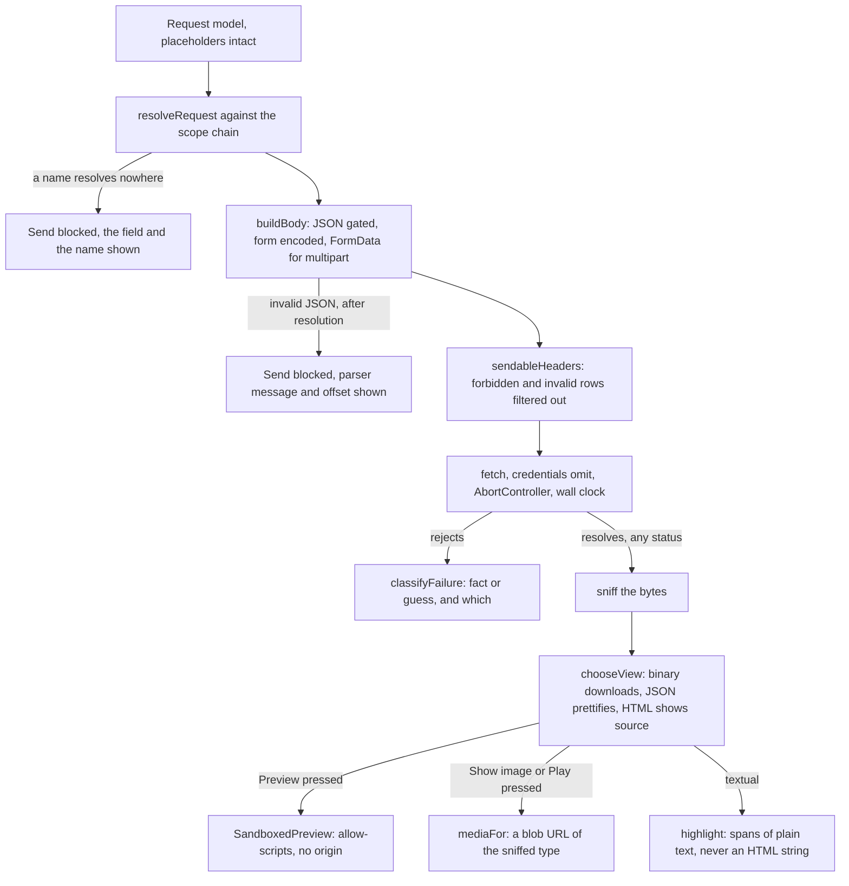
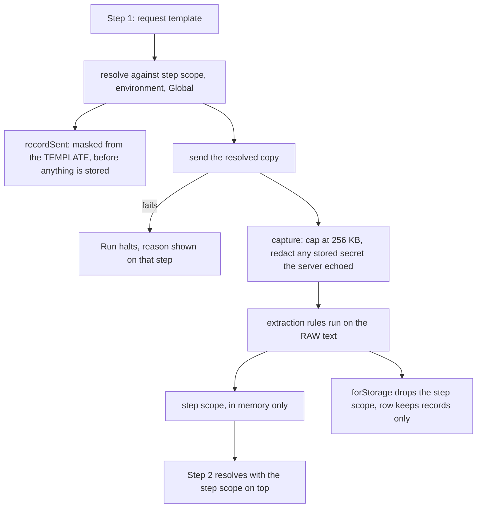

# HTTP playground

Craft a request, send it, and understand what came back — the httpie/Postman core, running in the page — then name the parts that change between environments, keep the secret ones out of every backup, and chain requests into a flow that carries a token from one step to the next.

_Describes the code as of v0.5.0 (schema v16) — verify against source when in doubt._

The tool exists to say the things a browser will not. Two of them shape the whole page, and both are cases where every other browser-based HTTP client is silent:

- **About twenty request headers cannot be set by a page**, and the browser drops them without a word.
- **A failed `fetch` explains nothing**, on purpose, so a page cannot use it to map a network.

Two more shape everything added after the core:

- **An unresolved `{{variable}}` is an error, never an empty string.** Sending `Authorization: Bearer` and getting a 401 back is the classic client bug, and it is silent at exactly the moment it matters.
- **A secret is kept out of storage by construction, not by care.** `http_secrets` is absent from `STORES`, so the backup exporter cannot reach it; recorded flow requests are masked when the record is *built*; anything a server reflects back is redacted before the record is written; and the step scope holding live credentials is never persisted at all.

## File map

| Path | Role |
| --- | --- |
| [model.ts](../../../src/lib/http/model.ts) | The request shape, the method list, `carriesBody`, `checkUrl`, and `normalizeRequest` for anything read back from a store |
| [headers.ts](../../../src/lib/http/headers.ts) | RFC 9110 name/value syntax, the forbidden-header list, and `sendableHeaders` — what really goes over the wire |
| [body.ts](../../../src/lib/http/body.ts) | Building a body per kind: JSON gating, `URLSearchParams` encoding, `FormData` and the boundary rule |
| [classify.ts](../../../src/lib/http/classify.ts) | Why a `fetch` failed, and how confident that answer is; plus claimed-vs-sniffed content type |
| [send.ts](../../../src/lib/http/send.ts) | The one impure module: `fetch`, a clock and an `AbortController` |
| [view.ts](../../../src/lib/http/view.ts) | Picking a viewer from the BYTES, and the size/timing/status formatting |
| [media.ts](../../../src/lib/http/media.ts) | Which binary bodies a browser will actually render, and which look renderable and are not |
| [highlight.ts](../../../src/lib/http/highlight.ts) | Choosing a grammar for a textual body, and tokenising it into **spans of plain text** rather than an HTML string |
| [env.ts](../../../src/lib/http/env.ts) | Environments, the scope chain, and the environment export that omits secret values |
| [secrets.ts](../../../src/lib/http/secrets.ts) | The local-only secret store — direct IndexedDB, deliberately not `repo.ts` |
| [resolve.ts](../../../src/lib/http/resolve.ts) | Rendering a whole request's placeholders, and the masked preview |
| [flow.ts](../../../src/lib/http/flow.ts) | The flow model, extraction rules, record shape, the storage cap and the redactor |
| [run.ts](../../../src/lib/http/run.ts) | Running a flow, in whole or one step at a time |
| [engine.ts](../../../src/lib/template/engine.ts) | The hand-rolled `{{placeholder}}` engine (0.4.0 decision 1) |
| [HttpPlaygroundApp.svelte](../../../src/components/apps/HttpPlaygroundApp.svelte) | `/tools/http-playground/` — owns state and every write |
| [VariablesPanel.svelte](../../../src/components/http/VariablesPanel.svelte) | The pre-send panel: what resolved, from where, and what will be sent |
| [EnvironmentsCard.svelte](../../../src/components/http/EnvironmentsCard.svelte) | Environments, variables and secrets, with the storage difference stated on the page |
| [FlowsCard.svelte](../../../src/components/http/FlowsCard.svelte) | Building, running and reading a flow |
| [SandboxedPreview.svelte](../../../src/components/SandboxedPreview.svelte) | The shared previewer, mounted for the HTML "Preview" toggle |
| [sniff.ts](../../../src/lib/encode/sniff.ts) | Magic numbers — the evidence a `Content-Type` is checked against |
| [registry.ts](../../../src/lib/registry.ts) | `http-playground` under **Playgrounds**, icon `arrow-up-down` |

## The forbidden request headers

The Fetch standard reserves about twenty header names — `Host`, `Origin`, `Cookie`, `Content-Length`, `Referer`, `Connection`, everything under `Proxy-` and `Sec-`, and the rest — because the browser owns them. It does not error on them. It **silently drops them**, so a request goes out without what was typed and the page has no reason to think otherwise.

`checkHeader` returns that as a `forbidden` **warning** rather than an error: the row is legal, and blocking Send over it would be a lie in the other direction. `sendableHeaders` then filters it out, so what the page calls "will be sent" is the truth rather than a hope. The spec proves both halves against the echo route: our `Host` is absent from what the server received, and the browser's own is there.

The prefix check is `sec-` and `proxy-`, not `sec` and `proxy` — `Section` is an ordinary header, and a test pins that.

## Why a failure has no explanation

`fetch` rejects with a bare `TypeError` for a CORS refusal, a name that will not resolve, a refused connection and a dropped cable alike. That vagueness is deliberate: distinguishing them would make `fetch` a port scanner for any page that wanted one.

`classifyFailure` therefore reasons from what the page **can** see, and every result carries a `guess` flag saying whether it is inference or fact:

| Kind | Certain? | How it is known |
| --- | --- | --- |
| `aborted` | fact | `AbortError`, so we cancelled it |
| `mixed-content` | fact | an `https:` page fetching `http:` — blocked before the network |
| `offline` | fact | `navigator.onLine` is false |
| `unreachable` | fact | the target is **same-origin**, so CORS cannot be the cause |
| `cors` | fact | cross-origin, no status, and **that origin already answered this page** |
| `cors` | **guess** | cross-origin and no status, which is the shape of a refusal |
| `unknown` | guess | anything else, reported verbatim |

### Origins that have already answered

`FailureContext.provenOrigins` is the most useful evidence this module has, and it was being thrown away for a while. A host that answered this page a minute ago is up, resolves, accepts connections, and demonstrably sends the headers that let this page read a response — so a bare `TypeError` against it now cannot be DNS, a refused connection or a dead network. What is left really is CORS, and the diagnosis says so instead of hedging.

**This came from a bug report that was not a bug.** Someone fetched `https://samplelib.com/csv/sample-bom.csv`, got "most likely CORS", then fetched a `.png` from the same host and watched it succeed — and reasonably concluded the tool was wrong. It was not: that server attaches `Access-Control-Allow-Origin: *` to images and media and to nothing else. The diagnosis was correct and useless, which for a tool whose whole premise is explaining browser behaviour better than curl does is a defect in the thing it exists to do.

So two changes. The classifier now says *"CORS — and only for this resource"* with `guess: false` once the origin is proven, and names what has been ruled out. And **the per-resource case is raised even on first contact**, in the failure card and the explainer, because it is the one that makes people go looking for a fault in the client.

The list lives in component state for the session only — it is evidence about right now, not a fact worth storing. `runFlow` keeps its own copy, seeded from the page's and extended as steps succeed, so a step three that fails against a host steps one and two just used gets the sharp answer too.

`localhost` and `127.0.0.1` are different origins to a browser and the same server to the OS, which is what lets [http-playground.spec.ts](../../../tests/local/http-playground.spec.ts) reproduce the whole thing — including the "one route shares, the next does not" shape — against the single-process test server.

Mixed content is checked *before* CORS on purpose. The two look identical from inside a page — a failed request with no detail — and the fix is completely different: one needs a scheme change, the other needs the server's cooperation. Telling someone to chase CORS headers when the browser blocked their request before it left is a wasted afternoon.

The `cors` card says whose decision it is: the **target server** must answer with `Access-Control-Allow-Origin`. No client running in a browser opts out of that — not this one, not one you write, and not this app installed to a home screen, because an installed web app is still a browser page. The plan's Q3 asked whether to point people at a desktop build to escape it; there is no desktop build, so the honest answer ships instead (decision 6).

## The bytes decide what a body is

A `Content-Type` is a claim; the bytes are evidence. `chooseView` runs [sniff.ts](../../../src/lib/encode/sniff.ts) over the response and picks a viewer from what it finds, exactly as the base64 tool does:

- Decisive binary bytes → **a download**, named with the sniffed extension, and — for the handful of formats a browser genuinely renders — an offer to show it, behind a button.
- Bytes that are neither a known format nor valid text → also a download, rather than a guess.
- Textual bytes → the *declared* type chooses between the textual viewers, never overruling binary. JSON that parses is pretty-printed; JSON that does not is shown as text with the parser's complaint; HTML is source first.

`compareContentType` reports a disagreement, but deliberately does not cry wolf: everything textual sniffs as `text/plain` when it is nothing more specific, so a server calling its text JSON, HTML, CSV or XML is agreeing with the bytes. Only a binary claim over textual bytes, or a mismatch between two decisive types, is worth raising.

## Media previews, and where the old rule moved

Phase 3 shipped binary bodies as a download and nothing else, reasoning that "a viewer that renders arbitrary bytes is a decoder surface nobody asked for". That was too broad, and [media.ts](../../../src/lib/http/media.ts) narrows it. The browser already contains decoders for images, PDF, video and audio — the same ones that run on every page you visit — and refusing to use them means a JPEG endpoint can only be checked by saving the file and opening it somewhere else.

The rules that keep it honest are narrower than "no viewer":

1. **The bytes decide, never the header.** `mediaFor` is fed the *sniffed* mime, so a server calling its executable `image/png` gets a download like any other unrecognised binary. The blob handed to the browser also carries the sniffed type, so the `Content-Type` claim never chooses a decoder.
2. **Only formats the browser really renders.** TIFF, HEIC and Matroska all sniff cleanly and none of them paint; they get a named reason instead of a button, because a preview that opens on a blank box reads as a bug in the tool rather than a gap in the browser.
3. **Nothing decodes until it is asked for**, and a large body says its size next to the button first.
4. **The object URL is revoked** on hide, on the next send, and on unmount. An un-revoked one pins the whole body in memory for the life of the document.

Sniffing grew WebM, FLAC, M4A and the remaining MP4 brands for this, because a response that is a WebM used to match nothing at all. WebM and Matroska share one magic number and differ only in a DocType string a little further in, so that one cannot be a signature row and is a special case in `sniff`.

### The PDF frame is the one without a sandbox

Every other frame in this app is `sandbox="allow-scripts"` with no `allow-same-origin`, which is what gives it an opaque origin and no reach into this app's data. The PDF frame has no `sandbox` attribute at all, and that is a deliberate, tested trade rather than an oversight:

**Chrome refuses to instantiate its PDF viewer inside a sandboxed frame — at any setting.** Verified against `allow-scripts`, `allow-same-origin`, both together, the full permissive set, and the empty string: in every case the frame stays an empty document. The choice was an unsandboxed frame or no PDF preview.

What is given up is smaller than it looks. The document in that frame is a plugin document, not markup: the PDF is rendered by the browser's own viewer in a separate process, and a PDF has no scripting bridge to the embedding page the way HTML does. `referrerpolicy="no-referrer"` and an empty `allow` stay, and the URL is a blob this app minted from bytes it already holds, so nothing is fetched. The page states all of this where the button is, and a spec asserts the HTML preview did **not** inherit the exception.

Playwright's Chromium ships no PDF viewer (it is a Chrome component), so the spec cannot assert that a PDF actually draws — it asserts everything else and names the gap. Rendering was verified by hand.

## Syntax highlighting without `{@html}`

[CodeBlock.svelte](../../../src/components/CodeBlock.svelte) injects Prism's HTML output, and is right to: the code it shows is this app's own generated source. A response body is the opposite — it is the single place in this app where bytes a stranger chose reach the DOM.

So [highlight.ts](../../../src/lib/http/highlight.ts) calls `Prism.tokenize`, not `Prism.highlight`, and returns **spans of plain text** that the component renders through `{#each}`. The text goes in as a text node and the class comes from the grammar, so injection is impossible by construction rather than by audit. Prism's own escaping is sound and injecting its output would very probably be fine — but "very probably fine" is not the standard for the one untrusted path in the app, and `prism-markup` already registers a hook that puts token content into a `title` attribute (safe only because that token's regex cannot match a quote).

Nesting is flattened into a combined class list, so `` becomes one span classed `token attr-value punctuation`; the theme in `global.css` keys off `.token.<name>`, so the inner name still wins the cascade. Neighbouring spans sharing a class are folded, which cuts the node count by an order of magnitude on a JSON body.

Two ceilings, and both **say so on the page** rather than quietly rendering something different: `HIGHLIGHT_LIMIT` (200,000 characters of input) and `MAX_SPANS` (20,000 spans of output). The second exists because the first alone would let a 200 KB minified bundle become a hundred thousand DOM elements.

The grammar is chosen from the declared type first — unlike everywhere else in this tool, and for a reason worth stating: choosing a *decoder* from a stranger's claim is how you get told a PNG is text, while choosing a *colour scheme* from it risks nothing. The bytes are consulted only when the header said nothing usable.

## What this page does and does not download

The default state is a `GET` with no body and no response, so the two biggest
things the tool can need are **both lazy** (0.4.0 Phase 7's payload pass):

| Chunk | Size | Arrives when |
| --- | --- | --- |
| CodeMirror (the JSON body editor) | 348 KB | a JSON body is chosen |
| Prism grammars (response highlighting) | 44 KB | a response wants colouring |

That took the page from 722 KB to **276 KB**. Both are still reached by the
service worker's crawl — it scans chunk text for `_astro/…` references, which
includes the ones a dynamic import leaves behind — so the tool is unchanged
offline, and [offline.spec.ts](../../../tests/local/offline.spec.ts) opens the
JSON editor with the network off to prove it.

Neither wait blocks anything. The editor's slot holds a plain `<textarea>`
bound to the same state until the real one lands, so the body is editable
immediately and nothing typed is lost. `highlight()` returns uncoloured spans
until the grammars arrive, so a body is on screen at once and gains colour a
moment later — which is strictly better than a body that waits for a download.

**Why no test caught this.** `payload.spec.ts` had a `CodeMirror` guard reading
`/codemirror|lezer/i`, and the bundler names that chunk `dist.<hash>.js` after
the package's own entry file. The pattern matched nothing, so the guard passed
on every page for several releases. It now resolves the real filenames out of
the build (`chunksContaining('@codemirror')`), which is the only precise
answer — a bare `/dist\./` would fire on unrelated chunks.

## Variables, environments and the scope chain

Lookup order is fixed: **step → active environment → Global**, first hit wins, secrets ahead of variables at each level. A secret wins its level because it is the more deliberate thing to have created.

Every level is a separate `Scope` with its own name rather than one merged map, and that is not tidiness. It is what lets the panel say *where* each value came from, and what lets masking work without the template engine knowing what a secret is: the engine reports which scope won, and `Chain.secretScopes` says which scopes are secret.

`resolveRequest` templates the URL, header values, the body and form field values — not header or field *names*, because the plan lists values and a templated header name is a thing nobody has wanted. It returns **every** problem rather than stopping at the first, so fixing a request is not one name per attempt.

**Scaffolding the table.** When a request names variables nothing supplies, a button under the URL creates them all in one write, empty, ready to fill in — `unknownNames` reports them by ROOT name, so `{{user.id}}` and `{{user.name}}` ask for one entry called `user` rather than two that cannot work, and a name a *secret* already covers is never offered (creating an empty variable to shadow a working secret would be actively harmful).

The empty value is worth being deliberate about, because it trades the send-blocking error for a request that goes out with blanks — the exact failure decision 2 exists to prevent. It is still right, for the reason a forbidden header is a warning here and not an error: **the row is legal and the user made it on purpose.** What the app owes them is that the emptiness cannot be missed, so the Variables panel names every blank above the table, the value cell reads `(empty)` rather than looking merely narrow, and a blank inside the URL adds *"`base_url` resolved to nothing, which is likely why"* to the URL blocker — otherwise that reads as "you typed a bad URL" and sends someone inspecting an address they never typed.

Two checks moved behind resolution as a result, and both would otherwise reject requests that are fine:

- **The URL** is validated after resolution. `{{base_url}}/things` is not a URL and is not meant to be one.
- **The JSON body** is parsed after resolution. `{"page": {{page}}}` is invalid as written and valid once `page` is 2. When the offsets then point into text nobody typed, the message says so.

## Secrets: kept out by construction

| | `http_environments` | `http_secrets` |
| --- | --- | --- |
| In `STORES` | yes | **no** |
| In a backup | yes | **never** |
| Written through | `repo.ts` | [secrets.ts](../../../src/lib/http/secrets.ts), direct IndexedDB |
| Delete means | a tombstone | **the row is gone** |

The exporter walks `STORES`. A store that is not in it cannot reach a backup file even by mistake, and `repo.ts` cannot write it because `StoreName` does not include it. That is the entire design: the promise is enforced by the type system and the exporter rather than by anyone remembering. `sync_outbox` set the precedent in v2; this is the first time it protects a user.

Deletion is a hard delete, not a tombstone, because **a tombstone keeps the value** — that is what a tombstone is — and "delete a secret" has to mean the bytes are gone. Deleting an environment deletes its secrets the same way.

They are still unencrypted rows in this browser's IndexedDB, and the page says so in those words. "Secret" is a word people reasonably read as "encrypted"; it does not mean that here.

## Flows

A flow is an ordered list of steps, each pointing at a saved request or carrying its own copy, run in order and stopping at the first failure. Between steps, everything earlier steps extracted sits at the top of the scope chain — so a token fetched by step one is simply a `{{token}}` in step two.

**Extraction is by explicit rule** (plan Q2). A rule names its source (`body`, `header` or `status`), its path and the name it produces. The alternative — letting a later step write `{{steps.auth.response.json.token}}` — reads well in a demo and means every step silently depends on the exact shape of an earlier response, with the dependency recorded nowhere but inside a string.

Body paths go through the **same engine the request templates use**, so there is one path syntax in the tool and one set of error messages. `token` reads a top-level field, `data.token` a nested one, and `body` is the whole document so a response that is a list is reachable as `body[0].id`.

A rule that finds nothing **reports it** and does not stop the run: the next step's unresolved `{{name}}` halts things with a better message, and the record above it says which rule came up dry.

### Four separate things keep a credential out of a flow row

Each covers a case the others do not, which is why there are four:

1. **`recordSent` masks from the template**, not from the resolved copy — there is no point in the runner where the real secret is in a variable that gets written to a record.
2. **`redactSecrets` scrubs what the server sent back.** Masking the request is not enough: plenty of endpoints reflect `Authorization` straight back, and an auth endpoint returns a credential in its body by definition. This is a literal search-and-replace, the technique `resolve.ts` argues against for the request preview — and the difference matters. There, the placeholders are known and re-rendering is strictly more precise; here the bytes came from somewhere else and there is nothing to re-render from. Its failure mode is over-redaction, which for this promise is the right direction to err in, and the record says when it happened rather than leaving the reader puzzling over bullets.
3. **`forStorage` drops the step scope — and scrubs it out of the records too.** `values` holds what each rule extracted verbatim, which for an auth flow is a live credential. Dropping the map is the easy half; the same token is *also* inside the records, in the `Authorization` header step two sent and in the body of the response that issued it. Storing the map would be careless, and storing three copies of it in a shape nobody thinks to look at would be worse, so `forStorage` redacts every extracted value out of the stored records as well. **The cost is real**: after a reload a recorded run reads `••••••••` where the token was, and "did step two carry the right one?" has to be answered from a live run. The live records — the run still on screen — keep everything, because nothing has been written down yet.
4. **Response headers get the same redaction as the body.** An endpoint that reflects a credential into a header is no less of a leak than one that puts it in the payload.

Only an explicit "save to the environment" click moves an extracted value into storage — the plan's "that write is visible, not implicit".

Bodies are capped at `STORED_BODY_LIMIT` (256 KB) **in storage only** (decision 7); the live view shows everything. Binary bodies are not recorded at all, only noted. A flow row keeps the latest run and nothing older.

## The response is not a failure

A non-2xx status is an **answer**. 404, 500 and 302 all come back through the normal path with the status, its family spelled out in words beside the number, timing, size and headers. Only a rejected `fetch` reaches the classifier. This matters more than it sounds: a client that shows 404 as an error teaches people that the server broke, when the server in fact answered exactly as it meant to.

Colour is never the only signal — `statusFamily` puts "client error" next to the 404.

## Sending

`send()` is the one impure module. It sets `credentials: 'omit'` unconditionally: this is a request builder, not a session, and attaching ambient cookies to whatever address someone types would be a way to hand them to it. There is no retry, no proxy, no telemetry — one press, one request, and [payload.spec.ts](../../../tests/local/payload.spec.ts) keeps proving every other page calls out not at all.

The body's implied `Content-Type` is set first and an explicit header overrides it, so `application/vnd.me+json` on a JSON body wins. Multipart is the exception in the other direction: it never sets one, because only the browser knows the boundary `FormData` picked, and a hand-written header names a boundary that is not in the body — which produces an empty form and no error anywhere. The page says so, and `contentTypeWarning` says it again if a `Content-Type` row is present.

## Tests

| File | Runner | Covers |
| --- | --- | --- |
| [http.test.ts](../../../src/lib/http/http.test.ts) | vitest | Header syntax with the offending character named, header-injection refused, every forbidden name in both cases plus the `sec-`/`proxy-` prefixes *and* that `Section` is not one; `sendableHeaders` proving a forbidden row never reaches the wire; URL schemes refused by name; form encoding for `&`, `=`, spaces, non-ASCII, repeats and unticked rows; JSON gating with its position; multipart never setting its own type; the classifier over every kind, with mixed content told apart from CORS and same-origin ruling CORS out; claimed-vs-sniffed including the textual cases it must NOT warn about; viewer choice for each body; `mediaFor` accepting only what really paints and `unrenderableReason` explaining the rest; grammar choice per content type; and highlighting proving **the spans put back together are the body byte for byte**, that hostile markup stays text, and that both ceilings report themselves |
| [vars.test.ts](../../../src/lib/http/vars.test.ts) | vitest | The scope chain in step → environment → Global order, a secret beating a variable of the same name at the same level, an environment shadowing Global; resolution across URL, headers, body and fields, every problem reported at once, disabled rows untouched, the original never mutated; masking that shows variables and hides secrets, masks the placeholder rather than every occurrence of the value, and leaves an unresolved one visible; the environment export listing secret names and no values; and `normalizeRequest` surviving whatever a json column holds |
| [flow.test.ts](../../../src/lib/http/flow.test.ts) | vitest | Extraction by path, nested path, index, header (case-insensitively) and status, with a miss **reported rather than turned into an empty string**; the auth-then-GET run carrying a fresh token past a stale environment one; halting on a failed send, a missing request and an unresolved variable *before anything is sent*; the storage cap; and the four separate protections — masked-on-build, redaction of what the server echoed back into body *and* headers, and `forStorage` refusing to persist the step scope |
| [http-playground.spec.ts](../../../tests/local/http-playground.spec.ts) | Playwright | Real requests against the test server's `/__echo/*` routes. Core: send and read a JSON answer; a forbidden header warned about, Send left enabled, and the header proved absent from what the server received while an invalid name does block; JSON gated before send and echoed after; form bytes shown and echoed; a PNG under a lying `text/plain` reported; HTML as source then previewed with `allow-scripts` and no origin; 404 as an answer; Cancel aborting a slow request. Media: an image decoded only after the button, a TIFF explained instead of offered, audio really playing, the PDF frame's exception asserted *and* proved not to have spread. Highlighting: three grammars, each with `toHaveText` proving the body survived exactly, and XML not called HTML. Phase 4: a variable reaching the wire, a missing one blocking with its name, switching environments changing what is transmitted, **a secret stored and absent from the backup envelope**, a secret masked on screen and real on the wire, a saved request keeping its placeholders, the environment export, and a deleted environment taking its secrets' bytes with it. Phase 5: the two-step auth scenario against a route that 401s without the exact token, one row written and nothing else, **no secret in the stored record or the backup**, a halt in place, walking a flow step by step, and an extracted value reaching an environment only when clicked |

The echo routes live in [preview-server.mjs](../../../tools/preview-server.mjs) because Playwright's `webServer` starts one process. They are same-origin, which is the only kind a browser lets the page reach without the target opting in — so the specs exercise the send path, and the CORS classifier is unit-tested where its inputs can actually be controlled.

`/__echo/auth` and `/__echo/me` are a real dependency, not a pair of stubs: `me` answers 401 unless the exact token from `auth` is on the request, so a flow that fails to carry it fails visibly rather than passing on a coincidence. The PDF is built with correct `xref` offsets for the same reason — browsers silently reconstruct a broken one, so a malformed fixture would still render and prove nothing.

**The redaction of echoed secrets exists because a test found it.** The Phase 5 backup assertion was written first, pointed at `/__echo/json` — which reflects request headers — and failed: the request was properly masked and the *response* carried the secret straight into the stored record. Masking the request had looked sufficient right up until the moment it was checked.

## Known limits and decisions

- **No desktop wrapper to escape CORS** (plan Q3). There is none to point at, and installing the PWA changes nothing, so the page explains rather than deflects.
- **No cookies, ever.** `credentials: 'omit'` is not configurable. Cross-origin cookie behaviour is the browser's to decide and a toggle here would imply otherwise.
- **Response headers are a plain table, not `DataTable`.** The plan suggested the latter; it wants a schema per response and brings search, filter, paging and export chrome that a ten-row list does not need.
- **No response history for single sends.** Only a flow records, and only its latest run. History beyond that is out of scope for 0.4.0.
- **Secrets are not encrypted**, only kept out of exports. Encrypting them would need a passphrase the user types every session, and a key sitting next to the ciphertext in the same IndexedDB is theatre. The page says which of the two this is.
- **Redaction can over-redact.** A response body that happens to contain a stored secret's characters for an unrelated reason loses them from the *record* — the live view is untouched. For "a declared secret is not written to disk", erring that way is the right direction, and the record says when it happened.
- **The PDF frame has no sandbox** (see above). It is the only one, a spec pins that it stays the only one, and Playwright's Chromium cannot verify the rendering half.
- **`Global` has a fixed row id** (`global`) rather than a generated one, so two devices that both create it converge on one row. It is written lazily — always in scope whether or not a row exists.
- **A flow's step scope is never stored**, so reopening a flow shows its records but cannot resume a half-finished walk-through. Walking restarts from the top.
- **Redirects are followed**, and the final URL is shown when it differs. Seeing the hops would need `redirect: 'manual'` and a hand-rolled chain, which changes what is actually sent.
- **The `Content-Length` of a request is the browser's.** It is on the forbidden list for that reason, and the response's own is shown from the header the server sent.
