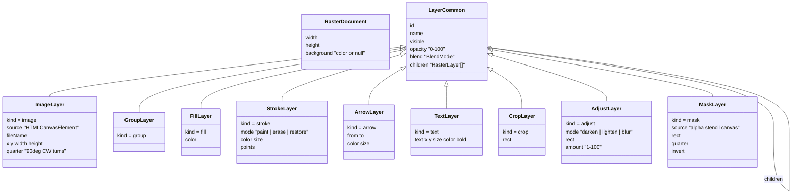
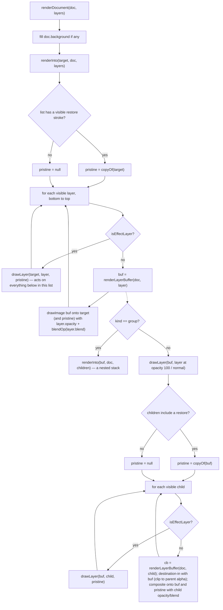
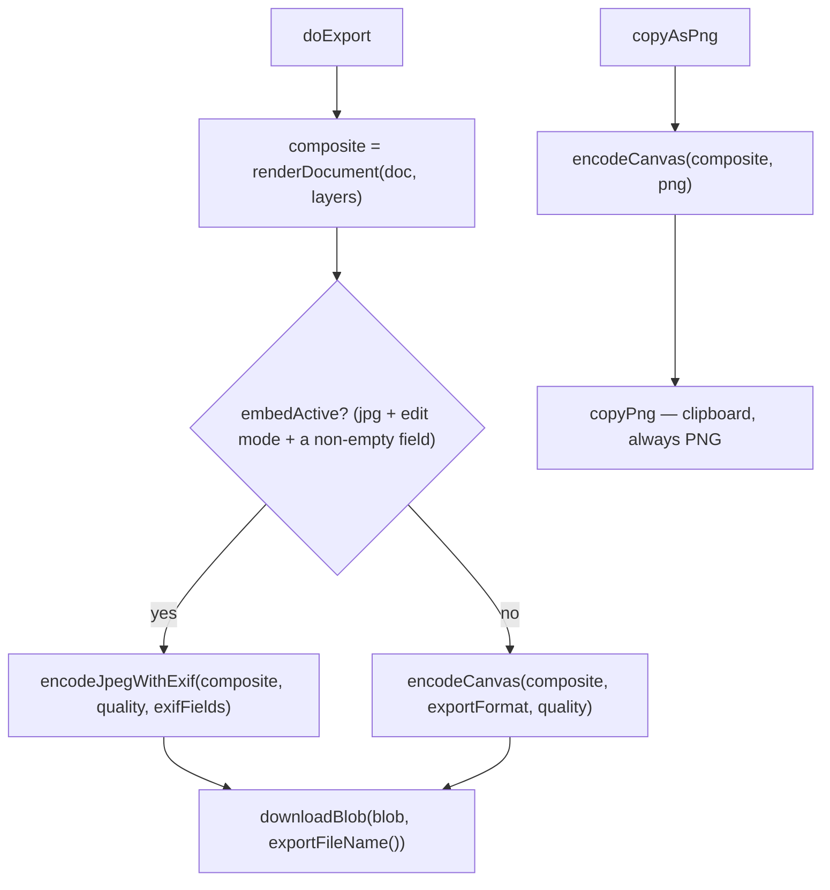
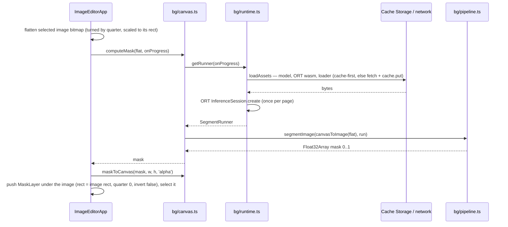

# Image editor (raster)

A session-only, layer-based raster editor at `/tools/image-editor/`. A document (canvas size + optional background) holds a tree of layers; nothing is ever baked — every frame is re-composited from the tree, so deleting a crop un-crops and deleting a mask brings the background back. Content layers (image, brush, arrow, text, fill, group) contribute pixels; effect layers (eraser, restore, crop, region adjust, mask) act on whatever sits below them: their parent's buffer when nested, the accumulated composite when at top level. The editor never touches IndexedDB.

_Describes the code as of v0.5.0 (schema v16) — verify against source when in doubt._

## Session-only, by decision

The data layer is JSON in IndexedDB, exported and restored as JSON backups. A decoded bitmap (`HTMLCanvasElement`) cannot round-trip that layer, and a document that saved its metadata but lost its pixels would be worse than one that saved nothing. So [ImageEditorApp.svelte](../../../src/components/apps/ImageEditorApp.svelte) imports nothing from `src/lib/db/`; the whole session is component state (`doc`, `layers`, `history`, …) and is gone on reload. The start screen says so, and the e2e suite pins it: every test in [image-editor.spec.ts](../../../tests/local/image-editor.spec.ts) snapshots the entire database with `app.dumpAll()` before the editor loads and asserts it is `toEqual` the snapshot after a full import → edit → export session (including a background-removal run).

Nothing about the editor lands in `preferences` either — export format, quality and metadata mode are plain `$state` and reset with the page.

## File map

| File | Role |
| --- | --- |
| [ImageEditorApp.svelte](../../../src/components/apps/ImageEditorApp.svelte) | The whole UI: session state, tools, pointer handling, layer list with drag/drop, undo wiring, EXIF panel, export. Rendered `client:only` from [image-editor.astro](../../../src/pages/tools/image-editor.astro). |
| [model.ts](../../../src/lib/raster/model.ts) | `RasterDocument`, the `RasterLayer` union, `BLEND_MODES`, nesting rules (`isEffectLayer`, `canHost`, `canNestUnder`), pure tree helpers (`locateLayer`, `findLayer`, `flattenLayers`, `removeLayer`, `moveLayer`), `MIN_CANVAS`/`MAX_CANVAS`, `layerLabel`, `layerDefaults`. |
| [render.ts](../../../src/lib/raster/render.ts) | Browser-only compositing: `renderDocument`, `renderInto`, `renderLayerBuffer`, `drawLayer`, `renderBase`, `blendOp`. |
| [transform.ts](../../../src/lib/raster/transform.ts) | Pure geometry: rotate/shift/scale remapping of layers (`rotateLayerCW`, `rotateImageLayerCW`, `shiftLayerTree`, `scaleLayerTree`), rect helpers (`normalizeRect`, `clampRect`), `layerBounds`, arrow geometry. |
| [history.ts](../../../src/lib/raster/history.ts) | Undo/redo stack whose snapshots deep-copy the tree but share bitmaps by reference; `signature`, `push`, `undo`, `redo`, `touchDeep`, `HISTORY_LIMIT`. |
| [exif.ts](../../../src/lib/raster/exif.ts) | EXIF field mapping (`exifFieldsToDict`, `formatExifDate`, `toDateInputValue`, `summarizeExif`, `utf8Binary`) and the browser-only `encodeJpegWithExif` (piexifjs). [piexifjs.d.ts](../../../src/lib/raster/piexifjs.d.ts) holds the minimal typings. |
| [dragdrop.ts](../../../src/lib/dragdrop.ts) | Pointer-based `draggable` / `dropzone` Svelte actions used by the layer list. |
| [bg/canvas.ts](../../../src/lib/bg/canvas.ts), [bg/runtime.ts](../../../src/lib/bg/runtime.ts), [bg/pipeline.ts](../../../src/lib/bg/pipeline.ts) | Background removal: `computeMask` + `maskToCanvas` glue, model/ORT asset delivery and inference, and the pure pre/post-processing math. Loaded lazily by the editor. |
| [img/convert.ts](../../../src/lib/img/convert.ts) | Shared `decodeToCanvas` (SVG/AVIF/WebP/TIFF/PNG/JPG in) and `encodeCanvas` (PNG/JPG out). |
| [exportFile.ts](../../../src/lib/exportFile.ts) | `downloadBlob`, `copyPng`, `dataUrlToBlob`. |

## Layer tree model

`model.ts` defines a document and a tree of layers. Every layer carries `LayerCommon` (`id`, `name`, `visible`, `opacity` 0–100, `blend`, `children`). The comment on `LayerCommon` still says children only appear on top-level layers; since the "round 2" changes the tree is any depth — `locateLayer` and friends recurse, and `canNestUnder` is the only rule.

Kinds, as the UI names them:

| UI name | Kind | Content or effect | Notes |
| --- | --- | --- | --- |
| image | `image` | content | Decoded bitmap drawn into `(x, y, width, height)`, turned `quarter` × 90° CW. `fileName` is the export-name source. |
| group | `group` | content (host) | No geometry of its own; renders its children as a stack. |
| fill / Background | `fill` | content | `fillRect` over the whole canvas, in any CSS colour the parser accepts — including `transparent`, a name, `#rrggbbaa` or `rgb(r g b / a)`. A blank canvas's background is one, named `Background`, transparent or not. |
| brush | `stroke` mode `paint` | content | Quadratic-smoothed polyline, round caps; a single point paints a dot. |
| eraser | `stroke` mode `erase` | effect | Same stroke drawn with `destination-out`. |
| restore | `stroke` mode `restore` | effect | Stamps the target's *pristine* pixels back under the stroke shape (see pipeline). |
| arrow | `arrow` | content | Shaft stops short of a filled triangular head (`arrowShaftEnd`, `arrowHeadPoints`). |
| text | `text` | content | Centered at `(x, y)`, `system-ui`, weight 700 when `bold`. |
| crop | `crop` | effect | `destination-in` with an opaque `rect`. |
| darken / lighten / blur | `adjust` | effect | Region adjust: `source-atop` tint at `amount/100` alpha, or a clipped `blur(px)` filter with `px = round(amount/100 * 24)`, min 1. |
| background mask | `mask` | effect | Alpha stencil from the segmentation model over `rect`; `invert` keeps the background instead. |

Nesting rules (all in `model.ts`):

- `isEffectLayer` is true for `crop`, `mask`, `adjust` and non-`paint` strokes. `canHost` is its negation: content layers and groups can hold children, effects cannot.
- `canNestUnder(child, parent)`: root accepts anything; a non-host parent accepts nothing; an `image` may only sit at root or inside a `group`; every other kind nests under any host.
- `moveLayer` refuses a move that violates `canNestUnder` or that would drop a layer inside its own subtree (`isWithin`).
- Lists are stored bottom-first (index 0 renders first). `flattenLayers` walks top-first, depth-first, with children listed right under their parent — the order the layer panel shows and the order `hitTest` walks.

Semantics of nesting: a child under a content layer is scoped to that layer — effect children modify only the parent's buffer, content children are clipped to the parent's alpha (a fill under a photo tints only the photo). The same kinds at top level act on the composite of everything below them. Inside a group the "everything below" is the group's own stack.

## Render pipeline

[render.ts](../../../src/lib/raster/render.ts) re-composites the whole tree on every change (`renderDocument`); nothing is cached or baked. `renderDocument` creates a `doc.width × doc.height` canvas, fills `doc.background` if set, and calls `renderInto` with the root list.

Points worth knowing:

- A layer's own `opacity`/`blend` are applied when its buffer composites, not while its content is painted (`renderLayerBuffer` draws with `opacity: 100, blend: 'normal'`). This is why a group's opacity applies to the whole stack inside it once.
- Effect layers use their own `opacity` as `globalAlpha` on the destructive operation, so a 50 % crop or mask is a partial keep rather than a faded layer — deliberate.
- Content children are clipped with `destination-in` against the parent buffer *as it is at that point* — an earlier eraser or crop child also clips a later brush child.
- `restore` needs the target's original pixels. `renderInto` copies the target once (`copyOf`) only when `needsPristine` finds a visible restore stroke in that list; content layers are composited into the pristine copy too, effects are not. `renderLayerBuffer` does the same for a content layer's children, copying `buf` after the layer's own content is drawn. `drawLayer` for a restore stroke paints the stroke shape into a patch, keeps only the pristine pixels under it (`source-in`), and draws the patch onto the target. Without a pristine copy (nothing rendered under it yet) it draws nothing.
- Blur snapshots the region with a margin of `3 × px` around the rect (edge falloff would otherwise let the sharp original bleed back in at the border), clips to the rect, applies `ctx.filter = blur(px)` and redraws at alpha 1. Darken/lighten use `source-atop` so transparent holes are not painted.
- A mask builds a full-canvas opaque stencil, clears its `rect`, draws the alpha bitmap there (or an inverted patch when `invert`), and applies `destination-in`. Pixels outside `rect` are untouched by design.
- Rotated bitmaps (`quarter % 4 !== 0`) go through `renderBase` on every render; there is no per-layer cache.
- The visible canvas is a separate `$effect` in the component: it calls `renderDocument`, blits into `displayEl`, then overlays the crop dim/marquee, the selection outline (`layerBounds`) and the scale handles.

## Component: state, tools, pointer handling

State lives in `ImageEditorApp.svelte`: `doc`, `layers`, `selectedId`, `tool` (`Tool` union, listed in `TOOLS`), the tool settings (`toolColor`, `toolSize`, `textSize`, `textDraft`, `adjustAmount`), `pendingCrop`/`marquee`/`cropForm`, view (`zoom`, `displayEl`, `scrollEl`, `cssWidth`, `canvasForm`), `history`, EXIF (`exifRows`, `metaMode`, `exifFields`) and export (`exportName`, `exportFormat`, `quality`).

Start and import:

- `startBlank`: `doc` = clamped size (`clampCanvas`, 1–8192), `background: null`; the colour becomes a real `fill` layer named `Background`. Checking "Transparent" makes that layer `color: 'transparent'` rather than skipping it, so the background of a transparent canvas is editable like any other layer (before v0.2.0 it produced no layers at all).
- `addImageFile` decodes with `decodeToCanvas`. The **first** image (no `doc` yet) sets the canvas size, `sourceName`, the export stem, and triggers `readExif`. Every image becomes an `ImageLayer` at `(0, 0)` with its decoded size, inserted by `addLayer`, then selected.
- `clearSession` (`New session`) confirms when layers exist, then nulls the document. It does not reset `history` (see undo).

Where a new layer goes — `addLayer`, described to the user by `targetLabel`:

1. nothing selected → end of the root list (top of the stack);
2. selected layer can host it (`canNestUnder(layer, sel)`) → last child of the selection;
3. otherwise, if it can live in the selection's list → inserted just above the selection there;
4. otherwise → root.

So marks made while an image is selected nest under it; made while an eraser is selected they land beside it; made after "Deselect" they act on the whole canvas.

Pointer handling on the display canvas (`onPointerDown` / `onPointerMove` / `onPointerUp`, `onpointercancel` routed to `onPointerUp`):

- The in-flight gesture is `drawing = { pointerId, mode, … }`. `onPointerDown` returns while `drawing` is set, and move/up ignore events whose `pointerId` differs — a second finger cannot hijack or interleave into a stroke. `setPointerCapture` is attempted, in a `try` (uncapturable pointers still work while over the canvas). The canvas has `touch-action: none`.
- `toDoc` maps client coordinates to document pixels through the canvas's CSS box, rounded — zoom is CSS width/height only, the backing store is always `doc.width × doc.height`.
- brush / eraser / restore: a `StrokeLayer` is created on pointerdown with one point; moves append a point only when ≥ 2 px from the last.
- arrow: an `ArrowLayer` with `from = to = p`; `to` follows the pointer; on release arrows shorter than 8 px (`arrowLongEnough`) are removed.
- text: a click places a bold `TextLayer` from `textDraft` (fallback `Text`) and selects it — no drag.
- crop / darken / lighten / blur: a `marquee` drag. On release the rect is `normalizeRect` + `clampRect` and ignored under 4 × 4 px. Crop sets `pendingCrop` (needs "Apply crop" → `applyCrop` adds a `CropLayer`); the adjust tools add an `AdjustLayer` immediately with `adjustAmount`. `stageNumericCrop` is the keyboard path: type a rect, "Set", then Apply.
- move: `handleAt` first (scale, below); otherwise `hitTest` selects the first visible layer in `flattenLayers` order whose `layerBounds` contain the point (fills have no bounds and are selectable only from the list). Dragging shifts the layer: a host, or anything at root, carries its subtree (`shiftLayerTree`); a nested effect moves alone (`shiftLayer`).

Scale handles (`scalable` = Move tool + selected image): eight `HANDLE_IDS` at corners and edge midpoints of `layerBounds`, hit within 8 display px (`handleAt`). `scaledRect` moves one axis for an edge and keeps the aspect ratio anchored on the opposite corner for a corner; the result goes through `scaleLayerTree`, so sub-layers (a crop, a background mask) scale with the image. The numeric X/Y/W/H fields in Layer settings bind directly to the image and do **not** carry children.

Rotate 90° (`rotateSelected`, image layers only) replaces the layer with `rotateImageLayerCW`: the image turns about its own center (width/height swap, `quarter + 1`), and every child is shifted into the image's frame, turned with `rotateLayerCW`, and shifted back — masks turn their stencil `quarter` too. The canvas size never changes.

Layer list drag/drop uses `draggable`/`dropzone` from [dragdrop.ts](../../../src/lib/dragdrop.ts) (pointer events, so it works for touch and pen; a drag starts after 5 px; touch drags only from the `.grip` handle; Escape cancels). `zoneFor` splits a row into thirds: top → above, bottom → below, middle → into when `canNestUnder(dragged, row)`; when it cannot nest, the row splits in half. `onRowDrop` translates that into a `moveLayer` call (top-first display means "above" is a higher index); the strip at the end (`dropBottom`) sends to root index 0. `nestLayer`/`unnestLayer` (⤵/⤴) and `nudgeLayer` (▲/▼) are the keyboard path.

## Undo / redo

[history.ts](../../../src/lib/raster/history.ts) is deliberately not the SVG editor's JSON snapshotter: JSON would turn every `HTMLCanvasElement` into `{}`. `cloneValue` deep-copies plain objects and arrays and passes anything else (canvases) through by reference. That is sound because bitmaps are immutable in this editor — every operation that changes pixels creates a new canvas (`renderBase`, `maskToCanvas`, decode) rather than drawing into an existing layer's `source`.

- `signature` produces a structural key with sorted object keys and each canvas as a stable `#canvas<n>` token (a `WeakMap`). `push` returns the same history when the signature matches `presentKey`, which is what coalesces a slider drag and makes re-recording an undone state a no-op.
- `HISTORY_LIMIT = 60` past steps; the oldest is dropped.
- In the component, one `$effect` calls `touchDeep(doc)` / `touchDeep(layers)` to subscribe to the whole tree, then computes `structureKey()` (canvas size + every layer id with its parent id). A structural change while no canvas gesture is in flight (`!drawing`) pushes immediately — two quick "add" clicks must be two steps. Everything else waits `HISTORY_DEBOUNCE_MS` (400 ms), so a brush stroke (whose layer is created on pointerdown, structural, but during `drawing`), a slider drag or a burst of typing is one step.
- `applyHistory` restores `doc` and `cloneLayers(present.layers)`, clears the pending crop/marquee, resets `canvasForm`, and drops the selection if that layer no longer exists.
- Shortcuts are a `window` `keydown` listener (ctrl/cmd+z undo, ctrl/cmd+y or ctrl/cmd+shift+z redo) that ignores events from inside `input, textarea, select, [contenteditable="true"]`. The ↶/↷ buttons sit beside the zoom controls.
- Snapshots are `{ doc, layers }` only. Tool choice, zoom, EXIF fields, metadata mode and export settings are outside history.
- `clearSession` does not reset history: "New session" is itself a step, and ctrl+z on the start screen brings the discarded document back (the listener is global; there is no button for it there).

## EXIF: read and write

Reading (`readExif`, only for the **first** imported image): `exifr.parse(f)` (dynamic import), errors swallowed — a PNG or SVG shows an empty viewer. `summarizeExif` flattens the result into sorted `tag`/`value` rows (scalars, dates as ISO, short numeric/string arrays; binary blobs, nested objects and empty values dropped; values over 120 chars truncated). The four editable fields are prefilled from `Artist`, `Copyright`, `ImageDescription` and `DateTimeOriginal ?? CreateDate ?? ModifyDate` (`toDateInputValue`). Images added later as extra layers are never read.

Writing is scoped to JPEG export via piexifjs, a v1 decision (PNG has an eXIf chunk; write support in libraries is thin). Rules, all in [exif.ts](../../../src/lib/raster/exif.ts):

- Canvas re-encoding strips everything. The only metadata an export can carry is what `exifFieldsToDict` builds: `Artist` (315), `Copyright` (33432), `ImageDescription` (270) in the 0th IFD, and `DateTime` (306) plus `DateTimeOriginal`/`DateTimeDigitized` (36867/36868) when `formatExifDate` accepts the `datetime-local` value. Empty or whitespace fields are omitted; unparseable dates are omitted.
- The `GPS` IFD is always `{}`. There is no code path that copies the source EXIF through — the tests import a JPEG that carries an `Artist` and a GPS position and assert neither survives a default export and GPS never survives an embed export.
- Strings are packed to UTF-8 bytes first (`utf8Binary`, `exifFieldsToBinaryDict`): piexifjs writes one byte per char code, and readers decode the ASCII-typed tags as UTF-8, so a raw `©` would round-trip as U+FFFD.
- `encodeJpegWithExif` flattens transparency onto white (same convention as `encodeCanvas`), `toDataURL('image/jpeg', q)` with `q` clamped to 0.01–1, `piexif.dump` + `piexif.insert`, then `dataUrlToBlob`.

In the component, `metaMode` is `'strip'` by default; `embedActive` = format is `jpg` **and** `metaMode === 'edit'` **and** `hasEditedFields(exifFields)`. The export card's note (`ie-meta-note`) states which case applies.

## Export

- `exportFileName` = `exportName` (default: the first image's stem, or `image`) with `\ / : * ? " < > |` replaced by `_`, plus `.png`/`.jpg`.
- Only PNG and JPG are offered (`TargetFormat`); JPG flattens transparency onto white and uses `quality` (1–100, default 85). Clipboard copies are always PNG (`copyPng`), labeled as such in the UI.
- Export size is always the document size (`doc.width × doc.height`), regardless of zoom or where image layers sit.

## Background removal as a layer

`removeBackgroundForSelected` (image layers only) lazily imports [bg/canvas.ts](../../../src/lib/bg/canvas.ts) — the model runtime must not ride along for someone who only draws an arrow.

- The bitmap segmented is the layer's own pixels drawn into its rect; its children (erasers, crops) are not applied — they keep acting on top of the mask like any other effect.
- Assets (`BG_ASSETS`: `u2netp.onnx` 4.57 MB, `ort-wasm-simd-threaded.wasm` 11.2 MB, the 20 KB loader) live in the `useful-models-v1` Cache Storage bucket, which the service worker also reads and never purges. The editor shows `Downloading the model… N%` from `DownloadProgress.ratio`. Removing the download is only offered on the background remover tool (`clearAssets`); the editor has no such control.
- `getRunner` memoizes one session per page; a failed load clears the memo so a retry can work.

## Invariants and conventions

- **Never** import from `src/lib/db/` in the editor or the raster modules. The e2e suite's zero-write window is the guard.
- **Never** draw into an existing layer's `source`; build a new canvas. History shares bitmaps by reference and depends on this.
- Layer lists are bottom-first in memory, top-first in the UI (`flattenLayers`, `[...list].reverse()` in the template).
- All geometry is document space; zoom is CSS-only. Rotation and crop are non-destructive remaps (`transform.ts`), never pixel bakes.
- Effects act on the composite below them; content children are clipped to their parent. `isEffectLayer` is the single source of truth for which is which.
- Images nest only at root or inside groups (`canNestUnder`).
- The GPS IFD is empty in every export; the only writable tags are the four in `ExifEditFields`.
- Canvas size is clamped to `MIN_CANVAS`–`MAX_CANVAS` (1–8192) everywhere it is set (`clampCanvas`).

## Tests

- Unit (vitest, `npm run test:unit`): [transform.test.ts](../../../src/lib/raster/transform.test.ts) — rotation/rect math, layer remapping, `rotateImageLayerCW` carrying children, `layerBounds`, arrow geometry, and the tree helpers (`locateLayer`, `flattenLayers`, `removeLayer`, `moveLayer`, group nesting, `isEffectLayer`, mask following its host); [history.test.ts](../../../src/lib/raster/history.test.ts) — bitmap sharing, signature key-order insensitivity, coalescing, limit, redo-branch discard, snapshot isolation, `touchDeep`; [exif.test.ts](../../../src/lib/raster/exif.test.ts) — date formats, tag mapping, empty-field omission, GPS always empty, UTF-8 packing, `summarizeExif`; [bg/pipeline.test.ts](../../../src/lib/bg/pipeline.test.ts) — the segmentation math.
- E2E (Playwright, `npm run test:data`, against a production build): [image-editor.spec.ts](../../../tests/local/image-editor.spec.ts) — first image sets the canvas and marks nest under it; blank canvas, resize, zoom; crop under an image vs at top level, un-crop by delete; eraser scoping and drag-to-nest; opacity and every blend mode; fill layers (background is a layer, nested fill tints only its parent); groups by drag/drop, group opacity, wrap; scale handles; strip-by-default metadata (JPG and PNG); embedded fields with GPS never surviving, PNG ignoring embed; arrows/text/adjust/rotate/delete; remove background → nested mask, invert, delete restores; undo/redo by button and keyboard; restore brush over an eraser and over a mask. Compositing is checked by decoding exported PNGs and probing pixels; EXIF by re-parsing exported bytes with exifr; every test asserts `dumpAll()` is unchanged.
- `render.ts` has no node unit test (it needs a real 2D context); the pixel probes above are its coverage.

## Known limits and decisions

- Session-only (above). Reload, navigation and "New session" discard the document; export is the only way out.
- The whole tree re-renders on every change with no per-layer caching; rotated bitmaps are re-rotated each frame. Fine at the sizes the tool targets; large documents with many effect layers will feel it.
- Blend modes are the six `BLEND_MODES` (canvas `globalCompositeOperation` values); nothing else is exposed.
- EXIF writing is JPEG-only and limited to four tags. PNG exports always carry no metadata.
- Only the first image's EXIF is read; the extra `Add image layer` files are decoded, not parsed.
- Numeric size fields on an image layer resize the image alone; only the on-canvas handles carry sub-layers.
- The background mask covers the image's rect at the moment it was computed; the model is not re-run when the image is later edited (its children keep applying on top).
- Zoom range is 0.05–16 (`zoomBy`); `fitZoom` never exceeds 100 %.
