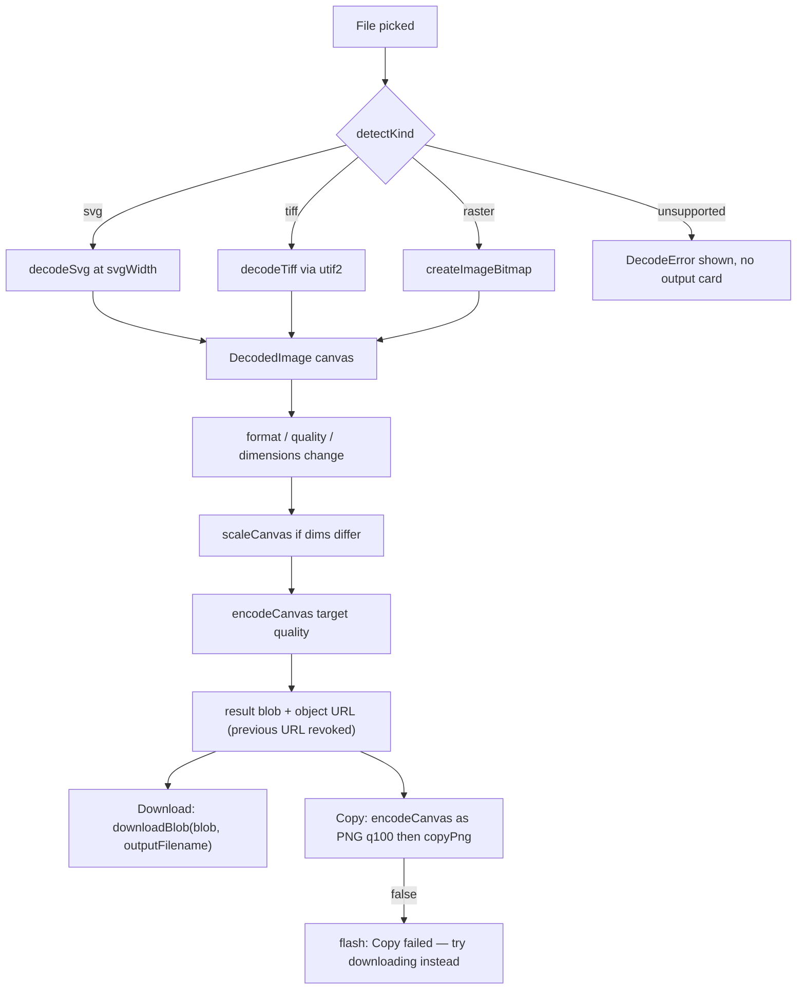
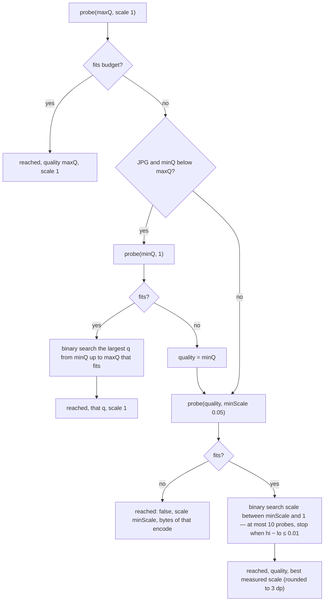

# Image tools (converter, resizer, compressor)

Three file-in/file-out tools built on one decode → canvas → encode core in `src/lib/img/`, one shared download/copy pipeline in `src/lib/exportFile.ts`, and a single sanctioned database write (the remembered JPG quality). Pixels never touch IndexedDB: everything is session-only, and every output is either PNG or JPG.

_Describes the code as of v0.3.0 (schema v13) — verify against source when in doubt._

## File map

| File | Role |
| --- | --- |
| [convert.ts](../../../src/lib/img/convert.ts) | Format policy (`detectKind`, `targetsFor`, `TARGETS`), dimension math (`fitDimensions`, `percentDimensions`, `capDimensions`), `formatBytes`, and the browser pipeline (`decodeToCanvas`, `scaleCanvas`, `encodeCanvas`, `DecodeError`). |
| [targetSize.ts](../../../src/lib/img/targetSize.ts) | The compressor's byte-budget search: `searchForTarget`, `percentTargetBytes`, `kbTargetBytes`, `StaleSearch`. Pure over an injected `Measure` function. |
| [utif2.d.ts](../../../src/lib/img/utif2.d.ts) | Minimal typings for the `utif2` TIFF decoder (no upstream types). |
| [exportFile.ts](../../../src/lib/exportFile.ts) | `downloadBlob`, `downloadText`, `downloadDataUrl`, `dataUrlToBlob`, `copyText`, `copyPng`. App-wide, not image-only; it is the only clipboard path in the app, and the one download that bypasses it is the database backup (`lib/db/export.ts`). |
| [ImageConverterApp.svelte](../../../src/components/apps/ImageConverterApp.svelte) | `/tools/image-converter/` |
| [ImageResizerApp.svelte](../../../src/components/apps/ImageResizerApp.svelte) | `/tools/image-resizer/` |
| [ImageCompressorApp.svelte](../../../src/components/apps/ImageCompressorApp.svelte) | `/tools/image-compressor/` |
| [types.ts](../../../src/lib/db/types.ts) | `Preferences.convert_jpg_quality` — the one persisted field. |
| [build-image-fixtures.mjs](../../../tools/build-image-fixtures.mjs) | Generates the TIFF fixtures the Playwright suite uploads. |

Routes, names and palette aliases come from [registry.ts](../../../src/lib/registry.ts) (`image-converter`, `image-resizer`, `image-compressor`, category `Images`).

## Format policy

Inputs are judged by **extension first, mime second** (`detectKind`) because TIFF and AVIF mime types are unreliable across OSes:

| Extension / mime | `InputKind` | Decode path |
| --- | --- | --- |
| `.svg`, `image/svg+xml` | `svg` | `decodeSvg` — `` from an object URL, drawn onto a canvas at the chosen width |
| `.tif`, `.tiff`, `image/tiff` | `tiff` | `decodeTiff` — dynamic `import('utif2')`, first page only, `toRGBA8` → `putImageData` |
| `.png`, `.jpg`, `.jpeg`, `.webp`, `.avif` (or those mimes when the extension is none of them) | `raster` | `createImageBitmap(file)` → canvas |
| anything else (GIF included) | `unsupported` | `DecodeError('Unsupported file type.')` |

Outputs are **PNG or JPG only** (`TARGETS`). There is deliberately no WebP or AVIF output: browsers decode both natively but canvas `toBlob` encoding for them is not broadly supported, so the tool only writes the two formats every browser encodes reliably. The converter's Explainer says the same thing to the user.

The conversion matrix is `targetsFor`:

| Input | Allowed outputs |
| --- | --- |
| PNG | JPG only |
| JPG / JPEG | PNG only |
| SVG, WebP, AVIF, TIFF | PNG and JPG |
| unsupported | none |

PNG↔JPG is constrained to the sensible direction; a PNG→PNG "conversion" would be a no-op and is not offered. The resizer and compressor do not use `targetsFor` — the resizer offers both formats regardless of input (defaulting to JPG for a `.jpg`/`.jpeg` input, PNG otherwise), and the compressor **follows the input** (`.png` → PNG, everything else → JPG) with no format selector.

Which files each tool's picker accepts (the `accept` attribute — a filter, not a gate; the same `decodeToCanvas` sits behind all three and decodes anything `detectKind` supports):

| Tool | Accepts |
| --- | --- |
| Converter | SVG, AVIF, WebP, TIFF, PNG, JPG |
| Resizer | PNG, JPG, WebP, AVIF |
| Compressor | PNG, JPG |

## Decode details

- **SVG rasterization.** `decodeToCanvas(file, svgWidth = 1024)`. Height derives from the image's intrinsic ratio (`naturalHeight / naturalWidth`); an SVG with no intrinsic size falls back to square. The converter shows a "Rasterize at width (px)" input (16–8192) only for SVG inputs and re-decodes on change. Failure → `DecodeError("This SVG couldn't be rendered.")`.
- **TIFF.** `utif2` is loaded lazily so it costs nothing until a TIFF arrives. Only the first page is used; anything that throws inside utif2 (exotic compression, truncated data, zero-size page) becomes `DecodeError("This TIFF couldn't be decoded — exotic compression variants aren't supported.")`.
- **Raster.** `createImageBitmap` handles PNG/JPG/WebP/AVIF; the bitmap is drawn to a canvas and closed. Failure → `"This image couldn't be decoded — is the file corrupted?"`.

`DecodedImage` is `{ canvas, width, height }`; each component keeps one in `$state` and re-encodes reactively from it.

## Encode and the export/copy pipeline

`encodeCanvas(canvas, target, quality1to100)`:

- **JPG flattens transparency onto white.** JPG has no alpha and canvas would otherwise paint transparent pixels black, so the source is first drawn over a white-filled canvas.
- Quality goes through `qualityFraction` — clamps to 1–100, divides by 100, never 0 (0 means "default" to canvas). PNG ignores quality (`undefined` is passed).

Every tool exposes the same two buttons. **Download** hands the current result blob to `downloadBlob` with `outputFilename(inputName, target)` (extension swapped, dotted stems preserved: `archive.v2.webp` → `archive.v2.png`). **Copy (always PNG)** re-encodes the current canvas as PNG at quality 100 and calls `copyPng` — the async clipboard API accepts nothing but PNG, so the chosen output format is ignored for copies and the button label says so. `copyPng` resolves `false` instead of throwing; the tools flash "Copy failed — try downloading instead".

Each component's `$effect` captures a `stale` flag in its cleanup so a slow encode from an earlier knob value never overwrites a newer result; `setResult` revokes the previous object URL, and `onDestroy` revokes the last one.

## Per-tool behaviour

**Converter.** Picking a file resets `target` to the first allowed format if the current one is not allowed. Only SVG inputs show the width field. The preview `` opts out of the flex stretch (`align-self: flex-start` + `object-fit: contain`) — the fix for the squashed-portrait bug noted in the CHANGELOG — and sits on a CSS checkerboard so transparency is visible.

**Resizer.** Two modes: `dimensions` (width/height inputs; "Lock aspect ratio" checked by default) and `percent` (1–1000 %). Under lock, the resizer's own `setWidth`/`setHeight` handlers derive the other edge from the decoded size — the last-edited edge wins. `fitDimensions` in `convert.ts` (where "width wins when both are given under lock") is exported and unit-tested but is not what the component calls; `percentDimensions` is. Output size is always ≥ 1×1.

**Compressor.** Manual mode: quality (JPG only) plus an optional "Cap longest edge" (`capDimensions`, min 16). Target mode (`targetMode` = `percent` or `size`) hides the cap and turns the quality field into "Max JPG quality"; the byte budget is `percentTargetBytes(file.size, percent)` (1–100 %) or `kbTargetBytes(kb)` (decimal KB, like `formatBytes`). Before/after sizes and a savings percentage are shown; the sign is flipped for display (`savings` positive = shrank, printed `−N%`; negative = grew, printed `+N%`). The "After" line is the real encoded blob's size.

## Compressor target-size search

`searchForTarget(measure, opts)` is pure over `measure(quality, scale) → Promise<bytes>`; the component supplies a `measure` that scales the decoded canvas by `scale` on both axes and runs `encodeCanvas`. The component passes `maxQuality` = the user's quality; the search's own defaults are `maxQuality` 100, `minQuality` 20, `minScale` 0.05. Both stages binary-search assuming size is monotone in the knob, but real encoders are only roughly monotone, so the search returns the best candidate it **actually measured**, never the midpoint math.

Rules the search follows:

- JPG lowers quality first, **never below 20** — past that the picture is mush and dimensions are the better lever. PNG is lossless, so dimensions are its only lever and `quality` in the result is meaningless (always `maxQuality`).
- `isStale()` is checked before every probe; when it returns true the search throws `StaleSearch`. The component sets `stale = true` in its effect cleanup, so a knob change mid-search abandons the old search silently (the catch ignores `StaleSearch`; anything else flashes "Compression search failed").
- An unreachable target is reported, not faked: `reached: false` carries the smallest allowed encode, and the UI prints "Target NOT reachable — this is the smallest allowed encode". A standing note under target mode says a target "may not be reachable" and explains which lever each format has.
- The result carries `encodes` (probe count), shown as "(N encodes tried)". After the search the component runs **one more** encode at the chosen `(quality, scale)` to produce the actual output blob, so the download is exactly what was measured.

## The only DB write

All three tools call `getSingleton<Preferences>('preferences')` on mount and, if `convert_jpg_quality` is a number, use it as the JPG quality. Changing the quality input (`onchange`, i.e. commit, not every keystroke) calls `putSingleton('preferences', { convert_jpg_quality })` — `rememberQuality` in each component. That is the **only** write any of the three tools makes; the pixels, the chosen format, dimensions, caps and targets are all session state. In-code defaults before the preference loads: converter 85, resizer 85, compressor 75. The Preferences page lists `convert_jpg_quality` read-only under "Remembered values" (it is not in that page's `KNOWN` set, so it falls into `otherFields`).

## Invariants

- Outputs are PNG or JPG. Never add WebP/AVIF output without an encoder that works in every supported browser.
- Clipboard copies are **always PNG** and the button must say so.
- JPG export composites over white first; never let canvas turn alpha into black.
- Every result object URL is revoked when replaced or on destroy.
- Zero IndexedDB writes except `convert_jpg_quality`, and that only on a quality commit — the Playwright suite asserts a byte-identical database around every other action.
- `searchForTarget` must return `reached: false` rather than a result over budget; the UI must show that state.

## Tests

- Unit (vitest, `npm run test:unit`, `src/**/*.test.ts`):
  - [convert.test.ts](../../../src/lib/img/convert.test.ts) — `detectKind`, `targetsFor` (the matrix), `outputFilename`, `qualityFraction`, `fitDimensions`, `percentDimensions`, `capDimensions`, `formatBytes`.
  - [targetSize.test.ts](../../../src/lib/img/targetSize.test.ts) — synthetic JPG-like and PNG-like `Measure` functions: plain encode fits, JPG lowers quality first, falls through to scale at the floor, respects `maxQuality`, PNG never touches quality, unreachable reported honestly, `StaleSearch` aborts between probes, `percentTargetBytes`/`kbTargetBytes` clamping.
- Browser (Playwright against a production build, `npm run test:data`): [images.spec.ts](../../../tests/local/images.spec.ts). Converter: PNG→JPG with the single-option matrix and zero DB writes; JPG→PNG; WebP (the native-decode branch AVIF shares); a real portrait AVIF fixture plus a tall canvas PNG for the preview-aspect regression; SVG at a chosen width; TIFF through utif2 and a broken TIFF failing gracefully; JPG quality remembered in `preferences` only (`assertIsolatedDelta` on the singleton) and restored on reload with no write. Resizer: aspect-locked dimensions and unlocked edges verified by output bytes; percent mode. Compressor: JPG recompression shrinks the file; the edge cap; percent target reached by quality with output ≤ budget and no writes; PNG size target that can only shrink dimensions and states its outcome. Downloads are checked by their **magic bytes** (`isPng` / `isJpeg`), not by MIME.
- Fixtures: PNG/JPG/WebP are generated **in-page** at test time (`makeImage`, canvas `toDataURL`, optional deterministic noise so JPEGs have something to compress); the SVG is an inline string; `tests/local/fixtures/sample.tiff` (20×10 solid red, encoded with utif2's `encodeImage`) and `broken.tiff` (a valid `II*\0` magic followed by garbage) come from `node tools/build-image-fixtures.mjs`; `photo-1780071611689-55d7b5ace40a.avif` is a checked-in real AVIF because there is no in-browser AVIF encoder. The other sample files in `tests/local/fixtures/` are not referenced by `images.spec.ts`.

## Known limits and decisions

- No WebP/AVIF output (see above); no GIF or HEIC input — `detectKind` classifies both as `unsupported` ("Unsupported file type."), even though `heic` appears among the converter's palette aliases in `registry.ts`.
- Multi-page TIFFs: first page only.
- SVGs are rasterized by the browser's own renderer; external references inside the SVG are subject to the browser's object-URL rules.
- The compressor's search re-encodes the full canvas per probe; on a very large image target mode can take a few seconds ("Searching…" is shown, and any knob change abandons the in-flight search).
- Copying can fail (no clipboard permission, insecure context, Firefox without `ClipboardItem`); the tools degrade to a flash message rather than an error.
