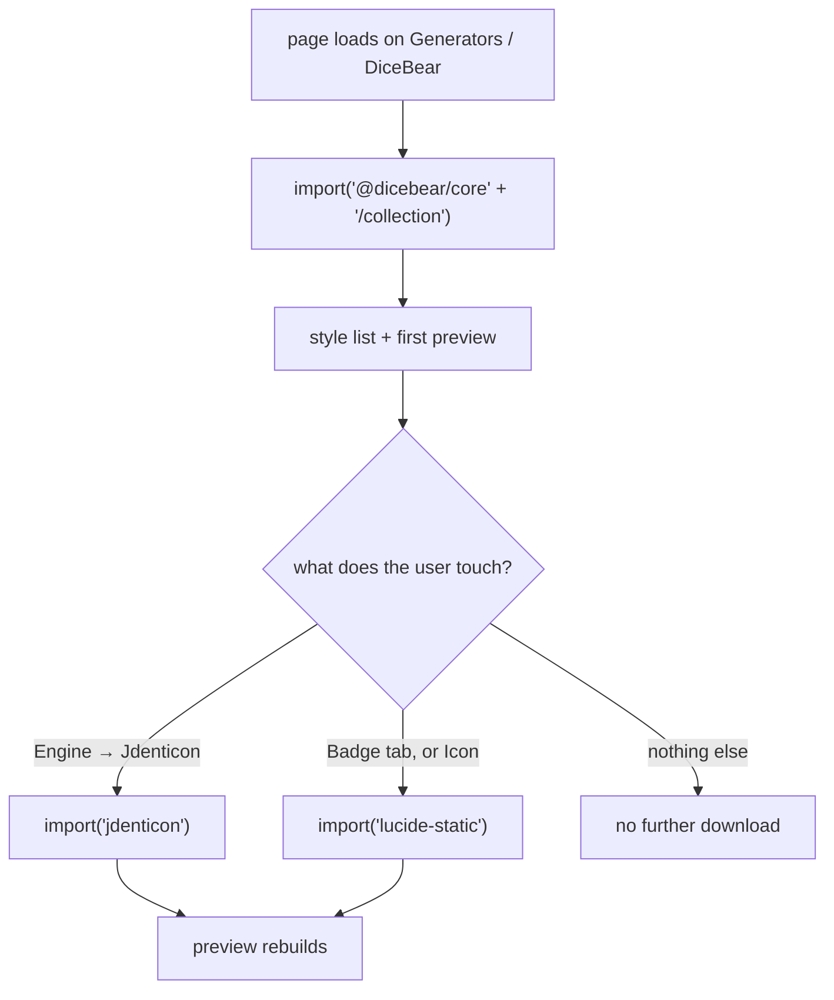

# Logo generator

A square-logo tool at `/tools/logo-generator/`: seeded **generators** (DiceBear avatars or Jdenticon identicons) and a composed **badge** (a Lucide icon or an emoji on a coloured tile). Ported from [retoken](https://github.com/Descent098/retoken)'s icon designer, cut down to the two modes worth keeping.

_Describes the code as of v0.3.0 (unreleased; schema v12) — verify against source when in doubt._

## File map

| Path | Role |
| --- | --- |
| [logo.ts](../../../src/lib/gen/logo.ts) | The whole model: state types, `defaultLogo`, the three lazy loaders, `composeBadge`, `jdenticonConfig`, the licence map, and the `buildLogo` dispatcher. |
| [LogoGeneratorApp.svelte](../../../src/components/apps/LogoGeneratorApp.svelte) | The tool: tabs, panels, preview, exports, the SVG-editor handoff. |
| [logo.test.ts](../../../src/lib/gen/logo.test.ts) | 19 unit tests — badge composition and escaping, config mapping, determinism, and the licence-drift check. |
| [logo-generator.spec.ts](../../../tests/local/logo-generator.spec.ts) | 8 specs — each tab renders, downloads are named right, engines stay lazy, the page writes nothing, the handoff row is well-formed. |

Retoken's **Upload** tab is gone (this app has image tools) and its **SVG editor** tab is gone — the editor here is a much better fork of the same lineage, so the tool hands off to it instead of carrying a second builder.

## What is ported and what is not

`escapeXml` and `svgDataUri` come from [svg/build.ts](../../../src/lib/svg/build.ts) rather than being duplicated, and `svgInner` unwraps a Lucide `<svg>` so its children can be re-parented into the badge. Downloads and the clipboard go through [exportFile.ts](../../../src/lib/exportFile.ts); PNG goes through `decodeToCanvas` → `encodeCanvas` from [img/convert.ts](../../../src/lib/img/convert.ts), the same pipeline every other tool uses.

## Data model

**None.** The output is a pure function of a few hundred bytes of config, so there is nothing to save — the page writes to IndexedDB exactly once, when "Open in SVG editor" is pressed, and that write is a document in someone else's store. If "remember my last logo" is ever wanted, it is one JSON preference field; the generated SVG never belongs in the database.

## The three engines are lazy, and stay lazy

| Engine | Chunk | Loaded when |
| --- | --- | --- |
| `@dicebear/core` + `@dicebear/collection` | 2.0 MB raw, 672 KB gzip, 31 styles | The page opens — Generators/DiceBear is the default view |
| `lucide-static` | 826 KB raw, 106 KB gzip, ~2,000 icons | The Badge tab is opened, or Icon is picked |
| `jdenticon` | 328 KB raw, 105 KB gzip | The Jdenticon engine button is pressed |

Each loader memoizes its promise and **clears the memo on failure**, so one flaky chunk fetch does not wedge the tab for the rest of the session — the next click retries. The payload suite ([payload.spec.ts](../../../tests/local/payload.spec.ts)) asserts all three: none of them appear on any other page, and neither Lucide nor Jdenticon appears on this one until asked for.

DiceBear arriving with the page is deliberate, not an oversight: its avatar *is* the default view, and refusing to draw anything until a button is pressed would trade 672 KB for an empty page. Everything the service worker's background crawl caches is fingerprinted and immutable, so this costs one download ever.

## Licences are committed data, not a lookup

`STYLE_LICENSES` maps all 31 DiceBear style keys to one of three kinds:

| Kind | Count | What it asks for |
| --- | --- | --- |
| `mit` | 14 | Nothing |
| `cc-by-4.0` | 13 | Credit the original artist wherever the logo appears |
| `personal-and-commercial` | 4 (`avataaars`, `avataaarsNeutral`, `bottts`, `botttsNeutral`) | A bespoke "free for personal and commercial use" notice — not an open-source licence |

The browser cannot read `package.json`, so this has to be committed data. That is a drift risk, so a unit test reads `node_modules/@dicebear/*/package.json` and fails when an upgrade relicenses a style — the alternative is silently dropping an attribution the user owed. The test also asserts the key set matches the installed collection exactly, so a new style cannot appear unlabelled.

Jdenticon is MIT and Lucide is ISC; neither asks for attribution. Lucide excludes trademarked brand logos by policy, which is why there is no company mark in the picker — a unit test spot-checks that Github/Twitter/Facebook/Google are absent, so an upgrade that changed the policy would be noticed.

## Safety

The preview is an ``, never `{@html}` — an `` never executes script whatever the markup contains, which is the same rule the SVG editor follows for pasted markup.

`composeBadge` is a string builder over user-controlled values (the emoji field and both colour fields are free text), so every interpolation goes through `escapeXml`. A unit test feeds it `">` in both the emoji and the background and asserts the output contains no `<script>`.

DiceBear and Jdenticon output is not escaped, because it is not user text — it is markup those libraries generated from a seed.

## Two details that are easy to get wrong

**Lucide icons are stroke-drawn.** Colouring one with `fill` produces a solid blob. The badge wrapper sets `fill="none"` and puts the colour on `stroke`, with `stroke-width="2"` and round caps, matching Lucide's own defaults. The 24-unit icon is scaled by 160/24 and translated to (48, 48), centring it on the 256 tile.

**Jdenticon reads an empty `hues` array as "no hues allowed"** and renders grey; `undefined` is what means "any hue". `jdenticonConfig` therefore omits the key entirely when nothing is picked. It also copies the lightness arrays rather than aliasing component state, since jdenticon is free to hold onto what it is handed.

## The SVG editor handoff

"Open in SVG editor" builds a layer through the editor's own `newLayer('svg', …)` factory — overriding only `svg`, position and size — writes one `svg_documents` row, points `preferences.svg_last_doc_id` at it, and navigates. The editor has **no `?doc=` route**: it resumes whatever that preference names, so the handoff has to set it. A spec asserts the round trip, including that the stored layer markup is byte-identical to what the preview showed.

## Known limits

- **256×256 only.** Everything is composed on a fixed square; the PNG export scales it to whatever size is asked for, and the SVG is resolution-independent anyway, but a non-square logo is not on offer.
- **Emoji badges are not portable.** The SVG stores the character, not a picture of it, so it renders in the viewer's own emoji font. Exporting PNG is the fix, and the tool says so.
- **No favicon bundle, no rounded-square iOS variants, no `.ico`** — one square SVG or PNG at a time.
- **The style grid is the whole collection**, unfiltered and unpaged. 31 buttons is fine; the icon picker, at ~2,000, is capped to 120 shown and relies on the filter box.
