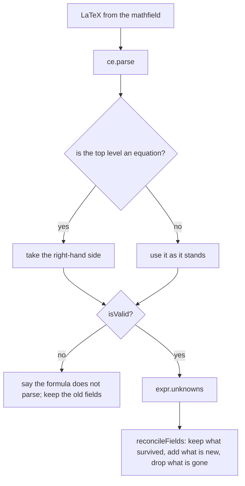

# Napkin math

Self-documenting back-of-the-envelope calculations at `/tools/napkin-math/`: type a formula, get typed input fields, run named calculations against it, keep a library of templates, and generate code from any of it in Python, JavaScript, Go, Rust or as a dependency-free web component.

_Describes the code as of v0.4.0 (unreleased; schema v13) — verify against source when in doubt._

## File map

| Path | Role |
| --- | --- |
| [NapkinMathApp.svelte](../../../src/components/apps/NapkinMathApp.svelte) | The tool: library sidebar, template editor, fields, calculations, code card, export/import. |
| [MathField.svelte](../../../src/components/MathField.svelte) | The `<math-field>` wrapper. Three settings here are load-bearing — see below. |
| [napkin/engine.ts](../../../src/lib/napkin/engine.ts) | The Compute Engine, wrapped: `parseFormula`, `evaluateFormula`, `boxJson`. |
| [napkin/model.ts](../../../src/lib/napkin/model.ts) | Fields, `reconcileFields`, `checkValue`. Pure, so it tests without loading 37 MB of maths library. |
| [napkin/transfer.ts](../../../src/lib/napkin/transfer.ts) | Import and export, with the validation an untrusted document needs. |
| [codegen/expression.ts](../../../src/lib/codegen/expression.ts) | MathJSON → an expression, per language, with precedence. |
| [codegen/functions.ts](../../../src/lib/codegen/functions.ts) | The whole file: docstring, typed parameters, guard clauses, helpers. |
| [codegen/identifiers.ts](../../../src/lib/codegen/identifiers.ts) | Symbol → a legal identifier, per language, with collision resolution. |
| [codegen/webcomponent.ts](../../../src/lib/codegen/webcomponent.ts) | The dependency-free custom element. |
| [codegen/latex.ts](../../../src/lib/codegen/latex.ts) | The mathfield's LaTeX reduced to readable Markdown maths for a comment. |
| [codegen/formulaMarkup.ts](../../../src/lib/codegen/formulaMarkup.ts) | The formula as self-contained typeset HTML + CSS + embedded faces, for the web component. |
| [MathField.svelte](../../../src/components/MathField.svelte) `insert()` | Puts a skeleton at the cursor, through the mathfield's own `insert` command. |
| [CodeBlock.svelte](../../../src/components/CodeBlock.svelte) | Read-only source, highlighted by Prism. |
| [CodeInput.svelte](../../../src/components/CodeInput.svelte) | A textarea with a highlighted underlay, for the import box. |
| [math/fonts.ts](../../../src/lib/math/fonts.ts) | The vendored KaTeX faces and their offline bundle. |
| [tools/build-math-assets.mjs](../../../tools/build-math-assets.mjs) | Vendors those faces into `public/math/` with provenance. |

Both libraries are `import()`ed inside [MathField.svelte](../../../src/components/MathField.svelte)'s
mount, so only this page pays for them: `mathlive` is 801 KB (217 KB gzip) and
`@cortex-js/compute-engine` is 2.53 MB (695 KB gzip) — the engine is a full computer-algebra
system and the larger half of the pair.

## What we measured

The plan for this phase was written from the libraries' type definitions. Several of its claims turned out to be wrong, and each correction below came from running the real thing rather than reading about it. They are recorded because the wrong version is the plausible one.

### `expr.compile()` does not exist

The open question for this phase was whether the code generator needed compiler-quality output or whether a hand-written emitter would do, on the grounds that `compile()` builds JavaScript at run time and so self-disables under a strict CSP. In `@cortex-js/compute-engine` 0.115 the method is not there at all. The hand-written emitter is not the better of two options; it is the only one. (There is a `ce.jit` setting, but nothing on the evaluation path used here builds code: the whole probe suite runs clean under `node --disallow-code-generation-from-strings`.)

### Evaluation substitutes; it must not assign

The plan said to evaluate "with a pushed scope per calculation". That leaks:

```
x/y at 7 and 2   -> 3.5
x/y at 10 and 5  -> 2
x/y with NO values at all -> 2      <- the previous answer
expr.unknowns afterwards  -> []     <- the formula's variables are gone
```

`ce.parse()` declares a formula's unknowns in the **global** scope, so `ce.assign()` inside a pushed scope mutates that global binding and `popScope()` does not undo it. A symbol that was never parsed before the push *is* scoped correctly, which is why an isolated test of the mechanism passes and the real sequence does not.

[engine.ts](../../../src/lib/napkin/engine.ts) uses `expr.subs()` instead. It leaves the parsed expression untouched, returns a symbolic result when a value is missing — which is exactly the "not ready to answer" signal the UI needs — and costs about 7 microseconds against 5.8 milliseconds to construct a fresh engine.

### A numeric-looking result can be complex or infinite

| expression | isNumberLiteral | re | im | isFinite | isReal | isNaN |
|---|---|---|---|---|---|---|
| `3.5` | true | 3.5 | 0 | true | true | false |
| `sqrt(-4)` | true | **0** | 2 | true | false | false |
| `1/0` | true | Infinity | Infinity | false | false | false |
| `0/0` | true | NaN | 0 | false | true | true |

Reading `.re` alone would display **0** for the square root of a negative. A result is accepted only when it is `isNumberLiteral && isReal && isFinite && !isNaN`.

### MathLive's built-in inline shortcuts corrupt variable names

This is the finding that shaped the editor. MathLive ships 259 text shortcuts, and any one whose trigger appears **inside** a variable name fires mid-word and desynchronises the replacement span:

| typed | default | `inlineShortcuts = {}` |
|---|---|---|
| `capital+x` | fine | fine |
| **`sqrtish+x`** | `\mathrm{\sqrt{ish+x}}` — does not parse | `\mathrm{sqrtish}+x` |
| **`count*rate`** | `\mathrm{count\cdot rate}` — does not parse | `\mathrm{count}*\mathrm{rate}` |

Dropping only the `*` entry fixes `count*rate` and not `sqrtish`; a short `inlineShortcutTimeout` fixes neither. So the wrapper clears the whole table. In a tool whose premise is multi-letter named variables, the built-ins are actively hostile — they turn a valid formula into one that does not parse, without saying so. LaTeX commands typed with a backslash still work (`count \times rate` parses correctly), and the virtual keyboard still offers symbols.

The assignment has to happen **after** the element is connected; before that MathLive throws "Mathfield not mounted".

### The hook is offered every suffix, longest first

Typing `count` offers `["co"]`, then `["cou","ou"]`, then `["coun","oun","un"]`, then `["count","ount","unt","nt"]`. The first non-empty return wins, and MathLive replaces the previous expansion with the longer one as typing continues — so a plain identifier rule yields `\mathrm{count}`, not `\mathrm{co}\mathrm{un}\mathrm{t}`. The plan's stated fear does not reproduce.

Single characters are never offered, which matters because **`\mathrm{}` on a single letter parses as a different symbol**: `\mathrm{x}` is `x_upright`, not `x`. The wrapper's rule requires two or more letters anyway, so a single letter is never renamed behind the user's back.

### The font stylesheet beats `fontsDirectory`

`public/math/mathlive-fonts.css` ends with `:root{--ML__static-fonts:true}`, which tells MathLive's own loader to stand down. Measured on a production build:

| | faces fetched | HEAD requests |
| --- | --- | --- |
| stylesheet + `fontsDirectory = null` | **2** | 0 |
| `fontsDirectory = '/math/fonts'` | 20 | 1 |

With the stylesheet the browser pulls faces on demand through `font-display: swap`. `soundsDirectory = null` suppresses all five keypress `.wav` files, including on the "plonk" path an invalid keystroke takes; a Playwright case asserts zero `.wav` requests.

## Data model — migration v10

| | |
| --- | --- |
| `napkin_templates` | `name`, `description`, `formula_latex`, `formula_json` (json), `fields` (json) |
| `napkin_calculations` | `template_id` (FK → `napkin_templates`, indexed), `name`, `values` (json), `result` (real, nullable) |
| Preference | `napkin_last_template_id` — the template to reopen |

Both stores are JSON-native, so they ride backup export/import unchanged. Deleting a template soft-deletes its calculations first: a calculation whose template is gone is unreachable, and the data-integrity oracle checks the foreign key.

**Nothing is written on load.** Opening the page reads the remembered template id and its row; typing a formula, editing fields and evaluating write nothing. The first write is the explicit Save.

## Where the fields come from



`expr.unknowns` is the whole trick. It already excludes bound indices and constants, so a sum from 1 to `n` asks for `n` and not `i`, and `\pi r^2` asks for `r` and not π. Walking the MathJSON tree reports both and asks the user to supply a value for pi.

A formula written as an equation — `total = qty × unit` — parses as `["Equal", "total", …]`, which would otherwise make `total` an input asking for the answer. The right-hand side is taken instead.

`reconcileFields` keeps the settings of every variable that survived an edit, so adding one term to a five-variable formula does not reset the other five. A variable the formula stopped mentioning loses its field, because it would be asked for and then ignored — the editor says which ones went.

## The code generator

The emitter is hand-written and deliberately incomplete: an operator outside its table raises `UnsupportedOperator`, which the UI shows **by name**. Emitting a plausible-looking function for a node nobody checked is the failure this design exists to avoid.

The languages disagree with the engine in ways that are easy to miss and impossible to see in the output:

| | CE | Python | JavaScript | Go | Rust |
|---|---|---|---|---|---|
| `Round(2.5)` | 3 | 2 (banker's) ✗ | 3 ✓ | 3 ✓ | 3 ✓ |
| `Round(-2.5)` | -3 | -2 ✗ | **-2** ✗ | -3 ✓ | -3 ✓ |
| `Mod(-7, 3)` | 2 | 2 ✓ | -1 ✗ | -1 ✗ | -1 ✗ |
| `x ** y` | — | `**` | `**` | `math.Pow` (no operator) | `.powf` |
| `Min(a,b,c)` | variadic | `min(…)` | `Math.min(…)` | folds to pairs | `.min().min()` |

So Python and JavaScript get a `_round` helper, and JavaScript, Go and Rust get a `_mod` helper. Each is emitted only when the expression calls it. `Divide` is always real division, so Python emits `/` and never `//`.

Two more shapes worth knowing: `e^x` and `\exp(x)` are the **same** MathJSON node (`["Power","ExponentialE","x"]`), so the emitter recognises that base and writes `exp`; and a bare `Log` means base 10, with the base as an optional second argument.

### One helper table, because two was a bug

`Sum` produced a call to `_sum` that was never defined, and the component threw `ReferenceError` on the first keystroke. The cause was duplication: [functions.ts](../../../src/lib/codegen/functions.ts) held `HELPER_SOURCE` for the four languages, and [webcomponent.ts](../../../src/lib/codegen/webcomponent.ts) kept its own hand-written copy of two of them. Adding a helper to the emitter updated one list and left the other alone, and nothing anywhere compared them.

`HELPER_SOURCE` is now exported and the web component reads its JavaScript column. A unit test also walks the generated source and asserts that **every `_name(` it calls has a matching `function _name(`** — a general guard rather than one case, so the next helper added is covered without anyone remembering to cover it.

### Sums, products and integrals become loops

`Sum`, `Product` and `Integrate` are the three heads that are not expressions — they need a loop, and an expression emitter has nowhere to put one. Each becomes a call to a small emitted helper taking the bounds and **a closure over the bound index**, which every one of the four languages can express:

| | closure |
| --- | --- |
| Python | `lambda x: …` |
| JavaScript | `(x) => …` |
| Go | `func(x float64) float64 { return … }` |
| Rust | `\|x: f64\| …` |

Closing over the index is what makes one helper per operation enough, rather than one generated function per occurrence with its free variables threaded through by hand — the closure captures the outer parameters itself.

The index is named through the same `identifierMap` as everything else, **with the outer names in play**, so a formula that binds `x` while a field is also called `x` gets `x_2` for the index rather than silently shadowing the parameter inside the loop. The engine would not produce that, but an imported file could.

An integral is **Simpson's rule with 1000 intervals, and the generated code says so** — exact for polynomials up to cubic, approximate for everything else. That is not a corner cut: the Compute Engine integrates numerically too (`\int_2^3 x^2` comes back as `6.33333333333333303727 ± 0.00000000000000000019`), so the generated function and the page agree to about the same tolerance. Claiming a closed form would be the dishonest option.

Two shapes to know:

- `["Sum", body, ["Limits", index, lower, upper]]`, and the same for `Product`. A `Limits` node is required — an unbounded sum has no range to walk, so it is refused rather than given an invented one.
- `Integrate` wraps its body **sometimes**: `\int x^2 dx` parses to `["Integrate", ["Function", ["Block", body], "x"], …]` while `\int x \, dx` gives the bare body. Both reach the emitter and both are unwrapped.

An **odd root** is refused rather than emitted. The engine says `(-8)^(1/3)` is `-2`; every target language's `pow` says `NaN`. There is no portable spelling, so the generator says so instead of producing something that is wrong for negative inputs only.

Each field's constraint becomes a **guard clause** — `ValueError` in Python, `RangeError` in JavaScript, an `error` return in Go, `Result::Err` in Rust — so a generated function refuses what the page refuses. Labels and descriptions are free text and reach four kinds of comment, so they go through `commentSafe`, which neutralises the sequences that would end a comment early and spill the rest into the file as code.

### Identifiers

A symbol is stripped to ASCII letters, digits and underscores; an empty or digit-leading result gets a `v` in front; the result is cased per language (snake for Python/Go/Rust, camel for JavaScript); a reserved word gets a trailing underscore; and a collision gets `_2`, `_3`, … in the symbols' own order, so the first symbol keeps the plain name and a regenerated file never renames a parameter.

### The web component

One `.js` file, no imports, no external URL, no build step. Every element carries a `part` attribute and the stylesheet is three rules, so the host page styles it with `::part()` and has nothing to override. It re-checks its inputs against the same rules before computing, and emits a `napkin-result` event.

A Playwright case **loads the generated file in a real page**, drives its inputs, and asserts it produces the same number the app showed. A golden-file test cannot catch a generated syntax error; this does.

### The formula is typeset, and travels with everything it needs

Showing `$\(costPerMonth*12\)*years$` met the letter of "self-contained" and not the spirit — the app shows a typeset formula, so the thing it hands you should too. Three parts have to travel together, and [formulaMarkup.ts](../../../src/lib/codegen/formulaMarkup.ts) assembles them:

1. **The markup.** `convertLatexToMarkup` is exported from MathLive's **main** entry, which this page has already loaded — so this costs nothing extra. (The `mathlive/ssr` entry would have been another 397 KB for the same function.)
2. **The layout rules.** `mathlive/static.css`, inlined as a string at build time and placed inside the component's shadow root, which scopes it both ways: a host page cannot break the formula, and the formula cannot leak rules into the host page.
3. **The faces.** KaTeX markup *positions* glyphs with CSS but *draws* them with the KaTeX fonts, which a host page has none of.

Only the faces the formula actually uses are embedded, as `data:` URIs. Which ones those are is **measured, not guessed**: the markup is rendered into a throwaway shadow root carrying the same layout CSS the component will carry, and every span's computed `font-family` is read back. A table mapping MathLive's class names onto faces would go stale the first time the library renamed one.

The shadow root in that probe is load-bearing. Measuring against the napkin page's ambient styles answers a different question and answers it wrongly: this page has the KaTeX faces registered document-wide, so every span resolves to a KaTeX family whether or not the rules would have travelled. That mistake produced a component that rendered perfectly here and fell back to a serif everywhere else.

MathLive's static CSS carries its own `@font-face` block pointing at `url(fonts/KaTeX_*.woff2)` — relative, so resolved against whatever page the component lands on. It is stripped, or every host would serve a row of 404s and sometimes prefer the broken rules over the embedded ones.

The faces are **opt-out**. `Include the maths fonts` is on by default, because one file that works anywhere is the right default; turning it off drops a typical component from 78 KB to 15 KB and moves the faces to a stylesheet the page links once. `@font-face` belongs to the document rather than to a shadow root, so a single `<link>` reaches inside every component on the page — that shared file carries **all twenty** faces rather than one formula's, because the point of sharing it is that it works for all of them. Without any faces a component still lays out correctly (the positioning is pure CSS); it just draws in the page's serif.

| formula | faces | file |
| --- | --- | --- |
| `(costPerMonth·12)·years` | 1 (`KaTeX_Main`) | 48 KB |
| `x/y + z` | 2 (`KaTeX_Main`, `KaTeX_Math`) | 71 KB |

A Playwright case generates a component, then loads it on `/tools/photography/` — a page that has never seen MathLive — and asserts the host had no KaTeX faces beforehand, that every family the markup resolves to is loaded afterwards, and that the component made **no network requests at all**.

The formula is shown as plain LaTeX text. `generateWebComponent` takes an optional `formulaMarkup` argument and MathLive's SSR entry (`mathlive/ssr`, 397 KB) exports `convertLatexToMarkup`, so pre-rendering it is one call away — but the seam is deliberately left unwired. That markup is KaTeX spans that need MathLive's static stylesheet **and** the twenty faces to look like anything; a host page has neither, so the pre-rendered version would render worse than the plain text it replaced, and shipping the CSS and fonts alongside would end the "one file, no dependencies" promise the component exists for. The argument is there for a caller that does have those assets.

## Offline

The twenty KaTeX faces (262,804 bytes with their stylesheet) live in their own cache bucket, `useful-fonts-v1`, deliberately **outside** the app-cache prefix so a `CACHE_NAME` bump does not evict them. They are stable, unfingerprinted `public/` files that the service worker's `_astro/` crawl can never find — it matches fingerprinted chunk URLs and does not parse CSS `url()` — so they register their own `OfflineBundle` and are fetched cache-first with no revalidation.

`MATH_FONT_BYTES` is checked by a unit test against `public/math/PROVENANCE.txt`, so a re-vendor that changes sizes fails the suite rather than quietly lying to the download dialog.

## Docstrings follow each language, not one house style

A generated function is read by whoever pastes it, in their own editor, with their own tooling. So each language gets the convention its tooling expects rather than one shape repeated four times:

| | Convention |
| --- | --- |
| Python | NumPy style — a summary line, `Parameters` / `Returns` / `Raises` sections, each underlined to exactly its own length |
| Go | The `speyl/algorithms` house form: a summary line, then `# Parameters` and `# Returns` blocks whose entries are indented one space so godoc renders them as a block |
| Rust | `///` lines, deliberately terse — the parameter name, its description, and the one constraint a type cannot express. The signature already says `f64`, so nothing repeats it |
| JavaScript | JSDoc, `@param` and `@returns` |

The formula goes into every one of them through [latex.ts](../../../src/lib/codegen/latex.ts), which strips the markup that only a renderer needs — `\mathrm{}` around each multi-letter name, `\left(` / `\right)` sizing — and wraps the result in `$…$`. It is a readability pass, not a converter: anything it has no rule for is left exactly as it was, because a half-understood rewrite is worse than the raw source.

Two identifier rules worth knowing, both learned from reading the output:

- **Go gets camelCase and an exported name.** `gofmt` will not fix a snake_case identifier and every Go linter flags one, so `total_cost` was not merely un-idiomatic.
- **`toCamel` goes through snake_case first.** Splitting a name on underscores alone leaves `costPerMonth` as one part, and lowercasing that part gives `costpermonth` — a name nobody typed. This affected JavaScript too.

And one that is a compile error rather than a style note: **Rust cannot compare an `f64` with an integer literal**, so its guard clauses use `0.0`.

## Syntax highlighting

Prism, not CodeMirror. The generated code and the live JSON are read-only output that nobody edits, so an editor would cost a couple of hundred kilobytes and a focus trap for nothing; Prism's grammars are already bundled once for the regex tool and the markdown renderer, and `global.css` already inks `.token.*` in the blueprint palette.

The import box is the awkward one, because it *is* edited. [CodeInput.svelte](../../../src/components/CodeInput.svelte) keeps a real `<textarea>` — native selection, undo, paste, and the accessibility a contenteditable throws away — makes its text transparent while leaving the caret opaque, and puts an identically laid-out `<pre>` underneath. Everything that affects where a glyph lands is declared once for both layers, and the scroll positions are synced.

One detail that is not obvious: the underlay's content ends with an extra newline. A textarea always reserves a line past its content, and without matching it the underlay is exactly one line shorter — which nothing shows until someone scrolls to the bottom and the highlight slides out of step with the text it sits behind.

## The Code card holds one formula's worth of state

Generated source, and especially a refusal like "this formula uses Factorial", describes **one** formula. Leaving either on screen after the formula has moved on is a statement about something that no longer exists — which is exactly what it did: an error raised for a sum stayed up while the reader typed a completely different formula, and again after they started a new template.

`resetGenerator()` clears the source, the error and the size note, and runs from `onFormulaChange` (before the `await`, so a slow parse cannot leave a stale error up), from `openTemplate`, and from `newTemplate`.

## Insert buttons

`\sum_{x=1}^{n}\left(x\right)` is not something anyone types from memory, and a half-finished one does not parse — so the formula card carries buttons for sum, product, integral, fraction and root. Each inserts a skeleton that **already parses and already has bounds**, so the field list appears immediately and the reader edits a working formula instead of fighting an incomplete one.

They go in through the mathfield's own `insert` command rather than by splicing the value string: only the field knows where the caret is, and rebuilding the value would move it to the end and drop the selection. The command mutates the field without firing `input`, so the wrapper pushes the new value out by hand afterwards.

The index is `x`, not `i` — a bare `i` is the imaginary unit to the Compute Engine.

## Known limits

- **Numbers only.** MathJSON has no string arithmetic, so a text field could never take part in the formula it is attached to. A field's *description* is free text, but it is documentation — it never reaches the maths.
- **A generated integral is approximate**, and a generated sum or product rounds its bounds to whole numbers. Both are stated in the emitted comments.
- **One formula per template**, and one result. No intermediate named steps.
- **Built-in text shortcuts are off**, which is a real loss: `pi` no longer becomes π as you type. Type `\pi` instead, or use the virtual keyboard. The alternative was letting a variable called `sqrtish` silently corrupt the formula.
- **`\mathrm{}` on a single letter renames it.** The editor's rule only fires on two or more letters, so this cannot happen by typing — but a formula pasted in through the import box can carry it, and `x_upright` is what the engine will call it.
- **The generated code is a starting point, not a library.** It has no tests, no packaging, and no float-precision story beyond what the language gives you.
- **An imported template's MathJSON is re-derived from its LaTeX**, never trusted, so a hand-edited file whose two halves disagree cannot mislead the generator. The consequence is that importing needs the engine loaded.
