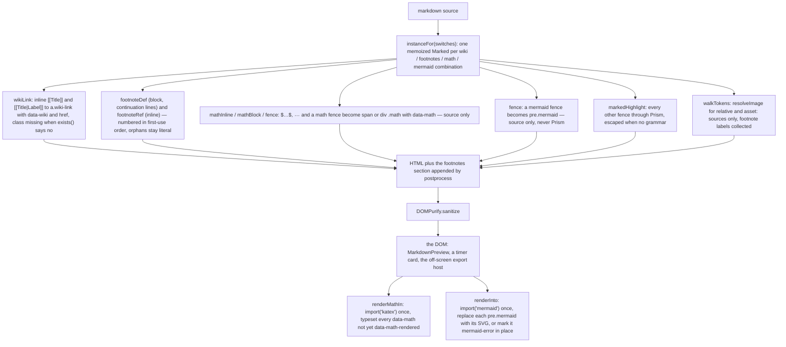
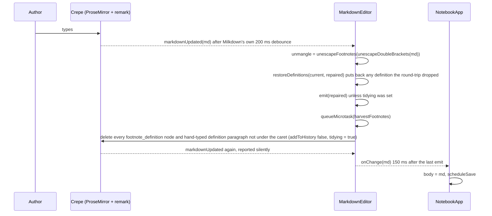
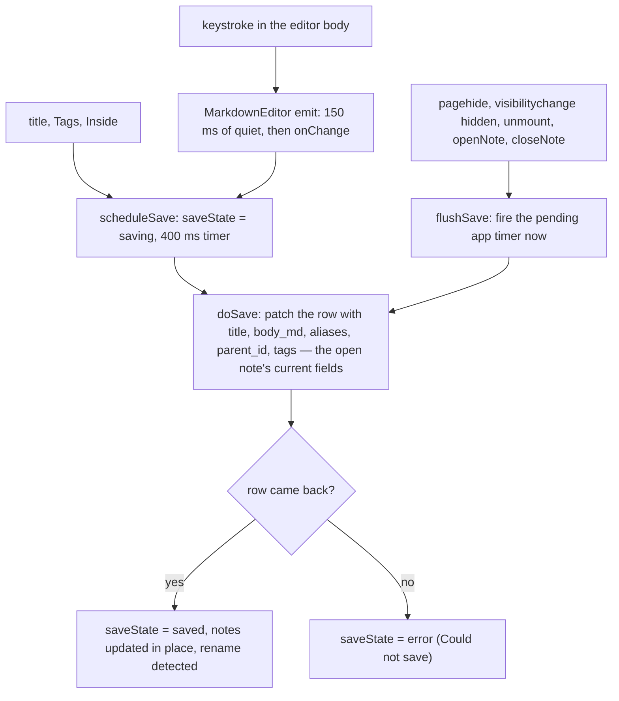

# Notebook

Linked markdown notes at `/tools/notebook/` (category **Notes**). One note is one markdown string; the page is a tree of them in a sidebar, an editor with three views over the open note (**Edit** — Milkdown Crepe, WYSIWYG; **Source** — CodeMirror over the same string; **Preview** — the app's own renderer), a footnote workbench behind **Alt+0**, a mermaid workbench behind **◇ Diagram**, an Excalidraw canvas behind **✏ Draw** whose drawings are PNG assets with the scene embedded, `$…$` maths through KaTeX, `[[Title]]` wiki links that resolve by title and create the note when it does not exist, pasted images in a child store, and three exports: Markdown, a self-contained HTML file, and Print / Save as PDF. The editor, the footnote system, the diagram dialog, the drawing dialog, the `AssetStore` contract and the mermaid helpers are ported from retoken; the renderer, the wiki links, the exports and the print stylesheet are this app's own.

_Describes the code as of v0.3.0 (unreleased; schema v13) — verify against source when in doubt._

## File map

| Path | Role |
| --- | --- |
| [notebook.astro](../../../src/pages/tools/notebook.astro) | Page shell; mounts `NotebookApp` with `client:only="svelte"`. |
| [NotebookApp.svelte](../../../src/components/apps/NotebookApp.svelte) | The tool: the tree sidebar (checkbox, `+` and `×` per row, bulk operations above the search box), the Note card (its header IS the editable title; **Inside**, **Tags**, aliases, the rename offer), the editor host, the Links card, the Export card, the `?note=` deep link, autosave. |
| [notebook/bulk.ts](../../../src/lib/notebook/bulk.ts) | The bulk operations' pure half: `flattenTree`, `subtreeIds`, `moveTargets`, `reparentForDelete`, `addTags` / `removeTags`, `exportFileName`. |
| [zip.ts](../../../src/lib/zip.ts) | A stored (method 0) ZIP writer with no dependencies — `zipBytes` / `zipBlob`, CRC-32, UTF-8 names — plus `zipEntries` to read one back. What the bulk export hands the browser. |
| [MarkdownEditor.svelte](../../../src/components/notebook/MarkdownEditor.svelte) | The ported editor chassis: Crepe / CodeMirror / preview over one string, the round-trip repair, the footnote gutter and completions, the image upload path, `flush()` / `getMarkdown()` / `setMode()`. |
| [MarkdownPreview.svelte](../../../src/components/notebook/MarkdownPreview.svelte) | `renderMarkdown` into a `div`, then `renderMathIn` and `renderInto`; intercepts clicks on `a.wiki-link` for `onWikiNavigate`. |
| [FootnoteDialog.svelte](../../../src/components/notebook/FootnoteDialog.svelte) | The footnote workbench (a working copy saved as one batch) and `isFootnoteKey` — **Alt+0** on the physical key. |
| [DiagramDialog.svelte](../../../src/components/notebook/DiagramDialog.svelte) | The mermaid workbench: `codemirror-lang-mermaid` highlighting, completions, eight templates, a live preview that keeps the last good picture. |
| [DrawingDialog.svelte](../../../src/components/notebook/DrawingDialog.svelte) | The Excalidraw canvas: a Svelte modal around a React root, one lazy import for React + Excalidraw + its CSS, `exportEmbedScene` on save. |
| [vendor/excalidraw.ts](../../../src/lib/vendor/excalidraw.ts) | `export * from '@excalidraw/excalidraw'` — the package's one import, so its dynamic chunk is called `excalidraw.*.js` rather than `prod.*.js` and the payload matcher can see it. |
| [notebook/drawing.ts](../../../src/lib/notebook/drawing.ts) | `loadExcalidraw` (sets `window.EXCALIDRAW_ASSET_PATH` to `public/excalidraw/` first), `isDrawingRef` / `drawingFilename` (the `.excalidraw.png` convention), `sceneToBlob` / `blobToScene`, and the vendored-font list the `drawing-fonts` offline bundle fetches. |
| [markdown.ts](../../../src/lib/markdown.ts) | The one markdown path, now a factory: wiki links, GFM footnotes, maths and mermaid placeholders, `resolveImage`, Prism, DOMPurify. |
| [notebook/model.ts](../../../src/lib/notebook/model.ts) | `normalizeNote`, `displayTitle`, `buildTree`, `descendantsOf`, `ancestorsOf`, `parseTags` — the pure helpers over rows. |
| [notebook/wiki.ts](../../../src/lib/notebook/wiki.ts) | `WIKI_LINK_RE`, `findWikiLinks`, `normalizeTitle`, `resolveNote`, `rewriteWikiLinks`, `backlinks`, `makeBacklinkIndex`. |
| [notebook/footnotes.ts](../../../src/lib/notebook/footnotes.ts) | retoken's footnote model, verbatim: `maskCode`, find / insert / rename / remove, `footnoteMarkers`, `restoreDefinitions`, `unescapeFootnotes`. |
| [notebook/assets.ts](../../../src/lib/notebook/assets.ts) | The `AssetStore` contract, `MAX_ASSET_BYTES`, `AssetTooLarge`, base64 helpers, `noteAssetStore` over `note_assets`. |
| [notebook/export.ts](../../../src/lib/notebook/export.ts) | `markdownExport`, `NOTE_CSS`, `htmlExport`, `externalReferences`, `printDocument`. |
| [notebook/mermaid.ts](../../../src/lib/notebook/mermaid.ts) | Lazy `getMermaid` themed by `isDarkScheme`, `validateDiagram`, `renderDiagram`, `renderInto`, the templates and the completion source. |
| [notebook/math.ts](../../../src/lib/notebook/math.ts) | `renderMathIn`: lazy KaTeX over every `[data-math]`, once. |
| [notebook/mathFonts.ts](../../../src/lib/notebook/mathFonts.ts) | `collectMathFonts`: the faces a rendered note uses, measured from computed styles, as data URLs. |
| [notebook/code-languages.ts](../../../src/lib/notebook/code-languages.ts) | Crepe's code-block language list: CodeMirror's standard set plus mermaid with completions. |
| [math/fonts.ts](../../../src/lib/math/fonts.ts) | `ensureKatexCss`, `MATH_ASSETS` (22 now), `MATH_FONT_BYTES`, `FONT_CACHE`. |
| [tools/build-math-assets.mjs](../../../tools/build-math-assets.mjs) | Vendors the faces and now `public/math/katex.css` — `katex.min.css` with its 20 `@font-face` blocks stripped. |
| [tools/build-excalidraw-assets.mjs](../../../tools/build-excalidraw-assets.mjs) | Vendors Excalidraw's faces (eight families, 25 files, 430 KB — the 13 MB CJK family left to the CDN fallback) into `public/excalidraw/fonts/`, writes its `PROVENANCE.txt`. |
| [katex.css](../../../public/math/katex.css) · [PROVENANCE.txt](../../../public/math/PROVENANCE.txt) | The stripped stylesheet (19,644 bytes) and the manifest: 22 files, 282,448 bytes. |
| [types.ts (db)](../../../src/lib/db/types.ts) | `Note`, `NoteAsset`, `STORES.notes` / `note_assets`, `Preferences.notebook_last_note_id` / `notebook_mode`. |
| [db.ts](../../../src/lib/db/db.ts) | v12 migration: `notes` (+ `parent_id`, `tags` multiEntry) and `note_assets` (+ `note_id`). |
| [persistence.ts](../../../src/lib/db/persistence.ts) | `storageEstimate` — `navigator.storage.estimate()` for the Settings readout. |
| [SettingsApp.svelte](../../../src/components/apps/SettingsApp.svelte) | **Storage** card: `Using X of the Y this browser allows`. |
| [helpers/schema.ts](../../../tests/local/helpers/schema.ts) | The `notes` / `note_assets` columns and the two preference fields, mirrored for the oracle; `parent_id → notes` self-referencing. |
| [registry.ts](../../../src/lib/registry.ts) · [icons.ts](../../../src/lib/icons.ts) | Category `Notes` (after Scheduler), tool entry `notebook` (aliases `notes` / `markdown` / `wiki` / `backlinks` / `footnotes` / `pdf` …), the Lucide `notebook` glyph. |
| [sw.js](../../../public/sw.js) | `tools/notebook/` is in the precached `SHELL`; `CACHE_NAME` moved to `useful-cache-v17` with the page (and to `v18` at the 0.2.0 release); `math/` is served cache-first from `useful-fonts-v1`. |
| [offline.ts](../../../src/lib/offline.ts) | The `math-fonts` bundle's label now names the notebook too. |
| [global.css](../../../src/styles/global.css) | The app's first `@media print` block, at the end of the file. |
| [astro.config.mjs](../../../astro.config.mjs) | `vite.define` of the three `__VUE_*__` flags Crepe's Vue runtime reads. |
| [payload.spec.ts](../../../tests/local/payload.spec.ts) | Four new `HEAVY` matchers: Milkdown / ProseMirror, mermaid, KaTeX, Excalidraw. |
| [exportFile.ts](../../../src/lib/exportFile.ts) | `downloadText` behind the two Download buttons. |

## Architecture

### The port, and what is net-new

The plan called the port **hybrid** and the code is. From retoken, on this app's tokens: the editor chassis (`MarkdownEditor.svelte` — three views, the Crepe configuration, the round-trip repair, the footnote gutter and completions), the footnote system (`footnotes.ts`, "taken as-is" with its 95-case test file), `DiagramDialog`, `FootnoteDialog`, the `AssetStore` interface ("the contract is retoken's, verbatim") and the mermaid helpers (`mermaid.ts`, where the one local piece is `isDarkScheme`). Not ported: retoken's `render.ts` and Shiki — `MarkdownPreview` says so in its header ("Decision 7") and renders through this app's `marked` + DOMPurify + Prism path instead, which grew the hooks the notebook needs. Net-new, because retoken has none of them: wiki links (`wiki.ts` and the `wikiLink` extension), the three exports (`export.ts`), and the print stylesheet. Excalidraw drawings were deferred at first (the `/excalidraw/i` payload matcher stood guard for them) and ported afterwards: `DrawingDialog` and `drawing.ts` are retoken's `DrawingDialog` and `excalidraw.ts` on this app's tokens, with one addition to the `AssetStore` contract (`nameOf`, below) that the notebook's `asset:<id>` refs made necessary.

### Three views over one string

`MarkdownEditor` holds `current`, the live markdown, and rebuilds whichever editor is showing from it on every mode switch: `setMode` calls `destroyEditor()` (which `flush()`es first), then `mountCrepe()` or `mountCodeMirror()`; Preview mounts nothing and renders `previewSource`. Undo history therefore does not cross a mode switch — each editor is a fresh instance over the string.

**Edit** is `new Crepe({ root, defaultValue, featureConfigs })` with three features configured: `Placeholder`, `ImageBlock` (`onUpload` → the asset store, `proxyDomURL` → `assets.resolve`), and `CodeMirror` with `languages: codeBlockLanguages` — Crepe ships *no* languages, so without it code blocks have neither highlighting nor a language picker — and a `renderPreview` that draws a `mermaid` block's picture inside the canvas. Crepe's theme is imported part by part (`prosemirror`, `reset`, `block-edit`, `code-mirror`, `cursor`, `image-block`, `link-tooltip`, `list-item`, `placeholder`, `toolbar`, `table`, then `frame.css`) and **not** `theme/common/style.css`: that hub `@import`s `latex.css`, and `latex.css` `@import`s `katex/dist/katex.min.css`, which would drag KaTeX's sixty hashed font files into the build next to the twenty faces already vendored under `public/math/`. `latex`, `ai`, `diff` and `top-bar` are skipped on purpose; the in-canvas maths is styled by a few rules in the component instead. Crepe's `--crepe-color-*` tokens are mapped onto the blueprint palette at `.milkdown`, because `frame.css` ships fixed light values.

**Source** is CodeMirror 6 with `@codemirror/lang-markdown`, `history`, the completion keymap ahead of the default one, a `HighlightStyle` that inks structure lightly, `autocompletion({ override: [footnoteCompletions] })` (so the popup offers footnote labels and nothing else), the footnote gutter, line wrapping, and an `updateListener` that `emit`s on every document change.

`emit(md)` sets `current` and `previewSource` and, unless `silent`, arms a 400 ms timer that records `lastSaved` and calls `onChange`. `flush()` reports anything still owed — a debounce counting down, or in Edit a keystroke Milkdown is still holding — and is called from `destroyEditor`. An external `value` change (the parent switched notes without remounting) is applied through one `$effect` that skips echoes of what the component itself reported.

### The markdown pipeline

`renderMarkdown` is still the ONE sanctioned path, and every caller — timer descriptions, TODO bodies and comments, the scheduler's modals and grids, the notebook preview and the exports — gets the same extensions, all on by default:

The per-call functions (`href`, `exists`, `resolveImage`) are not closed over: `renderMarkdownUnsafe` sets a module-level `ctx` for the duration of one synchronous `parse` and restores the previous one after, so a single memoized `Marked` instance per switch combination serves every caller. `renderMarkdownUnsafe` is exported only for the unit tests, which run in Node where DOMPurify has no DOM; nothing else may call it.

Three rules worth knowing. The maths tokenizers follow remark-math: the content may not start or end with a space and a closing `$` may not be followed by a digit, so `$5 and $10` is prose. A `$$…$$` inside a paragraph is display maths rendered as a *span*, because a `div` cannot sit in a `p`. The footnote definition tokenizer accepts a definition interrupting a paragraph and joins continuation lines by the same rule `footnotes.ts` scans by — indented lines, and blank lines followed by one — so what the editor counts and what the renderer shows agree. `footnoteId` runs a label through `encodeURIComponent` plus the five characters it leaves alone, so `fn-…` / `fnref-…` ids are anchorable and recoverable.

### The Crepe round-trip repair loop

Milkdown parses GFM footnotes but has no schema node for a definition, so a WYSIWYG round-trip would silently drop every `[^label]: …` line; and remark-stringify escapes leading brackets, turning `[[Title]]` into `\[\[Title]]`. Every update from Crepe is repaired before it becomes the string:

`harvestFootnotes` is the other half of the repair: definitions are taken out of the canvas, because a note is not prose and Crepe would drop it anyway, and live in the markdown and the dialog instead. It runs after `create()`, after every `markdownUpdated`, on every `selectionUpdated` (a note typed by hand is filed away only once the caret leaves it) and after `replaceAll`. The `tidying` flag is cleared by the update it belongs to rather than after the dispatch, because Milkdown debounces `markdownUpdated` by 200 ms; an author keystroke inside that window is coalesced and goes unreported, which is what `flush` is for. `syncFromCanvas` reads the canvas back *now* (silently) when the component has just edited it on purpose — the dialog opening on a note would otherwise be told nothing cites it.

Two more Crepe facts the code works around: a `[^label]` typed by hand stays literal text until something reparses the document (GFM only reads a reference as one when its definition is in the same parse, and the definitions no longer live in the canvas), so `footnoteReferenceRule` builds the `footnote_reference` node as it is typed, skipping code marks; and `citeFootnote` inserts that node directly rather than the text. Milkdown's `insert` writes at the current selection and a freshly mounted editor has none, so `replaceOrInsert` focuses the view first or the work is silently lost.

### Footnotes

`footnotes.ts` is retoken's model unchanged — everything pure and offset-preserving. `maskCode` blanks fenced blocks and inline spans with *spaces* rather than removing them, so a scan of the masked text yields positions that apply straight to the original string; that one property is what lets a rename (footnote or wiki) splice into the author's document without touching a byte it did not mean to. Four-space indented code is deliberately not masked: telling it from a continuation line needs a real parser, and guessing wrong would swallow the second line of every multi-line note.

In Source, the gutter puts one marker beside every line carrying a footnote (`footnoteMarkers`, memoized per `state.doc`): a reference jumps to its definition, a definition jumps back to where it is first cited, a line carrying several shows a count and cycles through them, and an orphan gets the warning colour and nowhere to go. Completions offer every defined label after `[^`, with the note text as the detail, and not on a definition line. **Alt+0** (`isFootnoteKey`: `Digit0` / `Numpad0` by physical key, so a layout that puts `º` there still works) is one key for "the other half of this": on a citation it opens the dialog on that note; anywhere else it appends a definition under `nextLabel` and opens the dialog on it. The dialog is a working copy — nothing reaches the document until **Save footnotes** — and saving runs removals and renames first (each keeps definition and citations in step), then `setFootnoteText` / `appendDefinition`, then cites any row marked to cite. A status line under the toolbar names references with no definition, definitions nothing references, and labels defined twice, while there is time.

### Diagrams

`◇ Diagram` opens `DiagramDialog`. In Source it edits the fence the cursor is standing in (`mermaidFenceAt`) instead of inserting a second one; otherwise it inserts a new `mermaid` fence as a block. The dialog is CodeMirror with `codemirror-lang-mermaid` highlighting mapped onto the `--syntax-*` inks, `mermaidCompletionSource` (fourteen diagram types on line 1, then the keyword set for whichever kind `diagramKindOf` reads off that line — ten kinds known), eight `DIAGRAM_TEMPLATES`, a 350 ms-debounced preview that validates with `mermaid.parse` first and keeps the last good picture while showing the parse error, `Mod-Enter` to save and Escape to cancel.

`getMermaid` imports `mermaid` on first use and initializes it with `startOnLoad: false`, `suppressErrorRendering: true` (otherwise a broken diagram appends mermaid's own "Syntax error" bomb to `<body>`, far from the diagram), and a theme from `isDarkScheme` — which reads the inline `colorScheme` pin Settings writes on `<html>`, falling back to the media query, the same two inputs `light-dark()` uses — re-initializing when the scheme flipped, because mermaid's theme is global. `renderInto` renders each `pre.mermaid` *per node* so a failure reports where it is: the source is stashed on `data-mermaid-source` on first sight (idempotent — a second pass must not parse the SVG's own CSS), success adds `mermaid-rendered`, failure keeps the text and puts the first line of the message on `data-error` for CSS to show. Inside Crepe, the same `renderDiagram` backs `renderPreview`, and `code-languages.ts` attaches the completion source to the mermaid `LanguageDescription` as a `languageData` *provider* rather than through `language.data.of(...)`: `codemirror-lang-mermaid` dispatches to a per-diagram grammar after the first line, and per-language data only answers for the grammar under the cursor — attaching at the top yields completions on line 1 and silence everywhere else.

### Drawings

`✏ Draw` opens `DrawingDialog`: a Svelte modal whose body is a React root, because Excalidraw ships only as a React component. `loadExcalidraw` imports `@excalidraw/excalidraw`, `react`, `react-dom/client` and the library's CSS in one `Promise.all` — the only place any of them is imported, so the notebook page carries none of it until the button is pressed (the `/excalidraw/i` and `/react/` requests are asserted absent before the click and present after). Before the import, it sets `window.EXCALIDRAW_ASSET_PATH` to `href('/excalidraw/')`: Excalidraw fetches its fonts at run time and, left unset, from unpkg. `tools/build-excalidraw-assets.mjs` vendors the faces under `public/excalidraw/fonts/`, the service worker's `FONT_PREFIXES` keeps them in `FONT_CACHE` once fetched, and the `drawing-fonts` bundle fetches all 25 up front. Excalidraw still appends its CDN as a last resort after the local path, so the one family not vendored (Xiaolai, 13 MB of CJK) degrades to a download rather than a blank.

A drawing is a PNG with the scene JSON embedded (`exportEmbedScene: true` in `sceneToBlob`), exported light-on-opaque at 2× whatever theme the author drew in — the image ships to exports and readers whose theme is unknown. So it needs no storage of its own and no markdown syntax: `saveDrawing` puts the blob through `assets.save(blob, 'drawing.excalidraw.png')` and inserts `` like any image. Reopening reads the bytes back through `assets.load` and `blobToScene` (`loadFromBlob`), which throws for a PNG that carries no scene — the dialog says so and starts blank. Updating goes through `assets.replace`, which keeps the row id and so every ref; the editor then re-points any `` in Crepe's DOM that still shows the stale data URL, and bumps `previewNonce`.

What says an image is a drawing is its **filename** ending `.excalidraw.png` (`isDrawingRef`) — and the notebook's refs are `asset:<id>`, which carry no name. Hence `nameOf?(src)` on `AssetStore`: synchronous like `resolve`, answered from the primed cache, and the editor's `isDrawing(ref)` asks it first. The memory store's refs are paths that carry the name, so it needs no `nameOf`. Crepe's DOM carries the display URL, not the ref; `proxyImage` records display → ref in a `displayed` map so the selected-node check and the ✏ affordance can map back. That affordance is `decorateDrawings`: a `MutationObserver` on the editor root adds an `.operation-item.drawing-edit` beside Crepe's caption button on every image block whose ref is a drawing, listening on `mousedown` with `preventDefault` so ProseMirror does not move the selection out from under it. In Source, `drawingRefAt` finds the `` the caret sits in, the same way `mermaidFenceAt` finds a fence.

### Maths, and the one copy of the faces

`markdown.ts` imports nothing heavy; it emits source in `data-math`. `renderMathIn` is the other half: `ensureKatexCss()`, `import('katex')` once, then `renderToString` with `throwOnError: false` and `displayMode` from the class, marking each node `data-math-rendered` so a partial re-render touches only new formulas; a formula KaTeX still throws on keeps its source with the `math-error` class and the message as its title. `MarkdownEditor` also calls `ensureKatexCss()` on mount, for Crepe's in-canvas `$math$`.

The stylesheet is the mechanism. KaTeX's twenty woff2 faces are the twenty MathLive vendored in Phase 8 — byte-identical — so `build-math-assets.mjs` now also writes `public/math/katex.css`: `katex.min.css` with its twenty `@font-face` blocks removed (the count is asserted, and a stylesheet that still mentions `@font-face` or `url(` is refused), 19,644 bytes of pure layout rules that borrow the families `mathlive-fonts.css` already declares. `ensureKatexCss` appends `mathlive-fonts.css` and then `katex.css` as `<link>`s, once each. Both live under `public/math/`, so the service worker serves them cache-first from `useful-fonts-v1` and the `math-fonts` `OfflineBundle` downloads them with the faces — `MATH_ASSETS` is 22 entries and `MATH_FONT_BYTES` is 282,448, checked against `PROVENANCE.txt` by the unit suite. There is one copy of the faces on this origin; the notebook added a stylesheet, not a font.

### Wiki links, aliases and backlinks

`WIKI_LINK_RE` is shared by the tokenizer and the model. `findWikiLinks` scans `maskCode`'d text, skips an escaped opening bracket, and reads the title back out of the *original* string. Titles compare through `normalizeTitle` — NFC, whitespace collapsed, lower-cased — so `[[ada  lovelace]]` finds "Ada Lovelace". `resolveNote` tries titles before aliases; `wikiLinkHref` points every link at `/tools/notebook/?note=<title>`, by title and never by id, so a link written in a timer description lands on the right note after a backup restore. On the notebook page the preview intercepts the click and `navigateWiki` opens the note, or — the click *is* the request — creates it under the current note; the **Links to** list does the same. A `?note=` that resolves to nothing on load shows `No note called “…”` with a **Create it** button (created at the root) rather than creating behind the reader's back.

Renaming is detected in `doSave`: a non-empty title that differs from `savedTitle`. The old title is pushed onto `aliases` (minus any that now equal the new title, case-insensitively), so `[[Old title]]` keeps resolving, and `backlinks` is run against a copy of the note carrying the *old* name to count who still links by it. If anyone does, `renameOffer` shows `N notes still link to “Old”` with one button, **Update them to “New”**, and nothing is rewritten unless it is pressed. `rewriteLinks` then patches each linking note's `body_md` through `rewriteWikiLinks`, which replaces only the title span of each matching link and keeps labels — one `patch` per note, not the plan's single `bulkPut`.

**Backlinks are computed, never stored.** The Links card's **Linked from** is `$derived(backlinks(notes, current))` — a scan of every body, re-run as the notes change; a stored index would go stale the moment a backup is restored, and rebuilding it on load would be a write on load. `makeBacklinkIndex`, the per-note memo keyed on `updated_at` the plan asked for, exists and is tested but the page does not use it yet. **Links to** is `findWikiLinks(body)`, deduplicated by normalized title, each resolved or marked `not yet a note; click to create`.

### Folders are notes

A note's `parent_id` points at another note, so the sidebar is one tree and **+** ("New note inside") is the only folder operation. `buildTree` counts a parent only when it exists in the set, is not the note itself, and following parents from it never comes back — so every member of a cycle surfaces at the root, where it can be seen and re-parented, rather than vanishing under a parent that is also its child; `reaches` is bounded by the note count so a cycle that does not include the target still terminates. `normalizeNote` already folds `parent_id === id` to null on read, along with non-string titles and bodies and junk in the json columns, because the generic data suite writes an *array* into every json column and seeds a row's parent with its own id. Roots and each child list sort by `displayTitle` (an unnamed note is `Untitled`). The **Inside** dropdown offers anything but the note and its descendants (`descendantsOf`); the breadcrumb is `ancestorsOf`, which stops at a cycle. Delete asks first, names how many nested notes "move up a level", then re-parents each child to the deleted note's own parent — **never cascades** — soft-deletes the note's assets (unreachable once the note is gone) and tombstones the note.

### Autosave

`SAVE_DEBOUNCE_MS` is 400; the app passes the editor `debounce={150}`, so a body edit reaches IndexedDB about 550 ms after the last keystroke (plus Milkdown's 200 ms in Edit), while a title or tag edit reaches it in 400. `doSave` patches from the component's live state — `title`, `body`, `aliases`, `parentId`, `parseTags(tagsText)` — and `patch` is a field merge, so the five editable fields are what a save touches. A save whose row has vanished (`patch` returns undefined for a missing or tombstoned row) shows `Could not save`. After the `await`, the saved row always replaces its entry in `notes` (backlinks and the tree read that list, and a switch mid-save must not leave them stale); only the open-note state — `saveState`, `aliases`, `savedTitle`, the rename offer — is skipped when `currentId !== id`. The editor's `onChange` carries the id of the note it was mounted on: the old editor's unmount flush arrives *after* a switch has repointed `currentId`, so a change that names a different note is patched straight into that note rather than into the one that just opened.

**Page load writes nothing.** `onMount` reads the rows and the preferences singleton, applies `notebook_mode`, and reopens `notebook_last_note_id` with `openNote(row, { remember: false })` — the one path that skips the preference write. The exception is deliberate: a `?note=` deep link that resolves calls `openNote` normally, so following a link remembers the note it opened.

### Bulk operations, in the library

There is no bulk *mode*. Every row of the sidebar tree carries a checkbox (`notebook-bulk-check`, with the note's title on `data-title`), and a `<section class="bulk">` appears above the search box the moment `selectedCount > 0`. The open note stays open and editable throughout — which is the point: the thing this replaced was a tab strip that hid the editor to show a second copy of the tree.

One `{#snippet noteRow(note, depth, kids, withTags)}` renders both the nested tree and the flat search results, so the two lists cannot drift; `kids` is empty for a search result, which drops the collapse arrow but keeps its spacer. The checkbox is **not** wrapped in a `<label>` — the row's title is itself a `<button>`, and a label may not contain interactive content — so its name is carried on `aria-label`, and `notebook-note` stays on the button that OPENS the note. A row also carries `+` (new note inside) and `×` (delete this note, `notebook-delete-<id>`, through the same `deleteNote` that the open note's Delete button calls, `confirm` included).

Selection is a `Set` of ids in `selected`. `selectedNotes` re-derives from `flattenTree(tree)`, so a note that disappears is silently unselected and the export order is tree order. Three commands live in the panel rather than on the rows: **All** takes `selectableNotes` (`filtered ?? notes` — the sidebar's own search is what the old checklist's private filter used to be), **+ Nested** grows the selection through `subtreeIds` and disables itself when `hasUnselectedNested` is false, and **Clear** empties it. Ticking a note never takes its children: a folder is a note, and "delete this" must not quietly mean "delete the twelve under it".

Three details are load-bearing:

- **The result line is mounted outside the panel it reports on.** `bulkDelete` empties `selected`, which unmounts the panel — a receipt rendered inside it would be destroyed in the same tick it was written, exactly after the one destructive action that most needs one. It is a permanently-mounted `role="status"` (`notebook-bulk-note`), hidden by `:empty` when there is nothing to say.
- **Folding the library clears the selection** (`toggleSidebar`). The checkboxes, the count and the actions all live inside `{#if sidebarOpen}`; a tick that survives the fold is invisible state waiting for whoever opens the column back up.
- **The sticky column has a scroll cap.** `.sidebar` is `position: sticky`, so anything past the fold cannot be scrolled to; with ~14rem of bulk chrome above the tree it needs `max-height: calc(100vh - ...)` and `overflow-y: auto` — reset to static in the `max-width: 52rem` layout, where the column becomes a band above the page and the page's own scrollbar reaches all of it.

Every action follows four rules, all in [bulk.ts](../../../src/lib/notebook/bulk.ts) or the component: one `patch` per row that actually changes, nothing for a row that would not; `await flushSave()` first, so the open note's row is current before it is patched; when the open note is among the selection, its editable snapshot (`tagsText`, `parentId`) is updated too, or the next autosave would write the old value straight back; and the panel reports what happened in that `role="status"` line (`Added 2 tags on 2 notes.`).

- **Export** builds one `.zip` (`zipBlob`, stored entries — the payloads are markdown and HTML already carrying base64 images, so deflate would buy little and a stored archive opens everywhere) with one file per note named by `exportFileName` (the single export's `[^a-z0-9._-]` rule, `-2` / `-3` on a case-insensitive clash). Markdown is `markdownExport` with assets inlined; HTML is the same `renderForExport` → `htmlExport` path as the single export, run per note — `renderForExport` grew `md` / `assets` parameters for it. Each note's `noteAssetStore` is primed on the way; the open note's snapshot (`title`, `body`, `assetStore`) is used in place of its row.
- **Tags** adds (`addTags`: order kept, exact duplicates dropped) or removes (`removeTags`: case-insensitive) `parseTags(bulkTagsText)`.
- **Move** patches `parent_id` to one target; the `<select>` is `moveTargets(notes, selected)` — every note that is neither selected nor under a selected note, so a cycle cannot be chosen — and a stale choice is refused rather than obeyed.
- **Delete** `confirm`s, then `reparentForDelete` computes where surviving children go (nearest surviving ancestor, else top level — the single delete's "children move up a level", applied once for the set; a cycle among the deleted notes resolves to top level), patches those, tombstones each note's assets and `softDeleteMany`s the notes. If the open note is among them the editor is closed first, exactly as `deleteNote` does.

### The switch lock

`title`, `tagsText` and `parentId` are one snapshot shared by whichever note is open, and `doSave` writes it to `currentId`. Creating a note has to write a row and re-read the store before that snapshot can be swapped, and for those few milliseconds the fields on screen still describe the note on its way out — so a keystroke landing in them renames THAT note. `switching` is true across the gap and disables the three fields; `openNote` clears it the moment the new snapshot is assigned, and a `finally` covers the path where the row cannot be found and `openNote` never runs.

The body needs no lock: `MarkdownEditor` reports its changes against the note id it was mounted with (`onChange={(md) => void onBodyChange(md, editingId)}` inside the `{#key currentId}` block), and `onBodyChange` patches that note directly when it is no longer the open one. The fields have no such id, which is exactly why they need the gap closed instead.

Swapping the snapshot optimistically and writing the row afterwards would close the window without a lock, at the cost of putting a note on screen that does not exist yet; a lock that lasts a frame is the cheaper honesty. The same gap is why `newNote()` in the spec waits for the new note's `Untitled` value rather than for the title field to exist — a fill that lands early renames the previous note and the failure surfaces two assertions later.

After creating a note that is born `Untitled`, the caret goes to the title with the placeholder selected: pressing **New note** and typing is what someone was trying to do, and it removes the reason to type into the gap at all. A note created from a `[[link]]` already carries the name the link gave it, so its title is left alone.

### Images: the AssetStore

The editor never talks to IndexedDB; it talks to an `AssetStore` — `save(blob, filename) → src`, optional `replace`, `load`, `resolve`, `nameOf` (the filename behind an `asset:` ref, which is what marks a drawing — see Drawings). The markdown keeps the ref the store hands back: `asset:<row id>` for `noteAssetStore`, which is what the Markdown export writes out. `resolve()` is **synchronous** in the contract (Crepe calls it while rendering an image node) but the bytes live in IndexedDB, so a note's store is `prime()`d once — every asset of the note loaded into a Map — before the editor mounts (`openNote` awaits it), and `resolve` answers from that cache only. The default store, `memoryAssets()`, is a page-lifetime Map handing out object URLs; the notebook passes the real one.

Every asset is capped at `MAX_ASSET_BYTES` (2 MiB): backup export builds one pretty-printed JSON string of the whole database before making the Blob, base64 inflates by a third, and a few dozen uncapped screenshots is the first thing in this app able to fail that export on memory. `save` throws `AssetTooLarge` past the cap — its message, `2.3 MB is over the 2 MB limit for one image`, is shown as-is in the editor's notice line, and an empty `src` is returned so Crepe keeps its own upload placeholder rather than a broken picture. A `NoteAsset` row carries `bytes` (the decoded size) so totals never need a decode; the Export card shows `N images, X KB`, and the Settings **Storage** card now shows `navigator.storage.estimate()`'s usage and quota (`storageEstimate`, read on mount, never written), with a line saying pasted images are the first thing that grows it.

### Exports

**Markdown** is `markdownExport`: the body with every `asset:<id>` in a link destination or an attribute value replaced by its data URL (refs the map does not know are left as written, and prose that merely mentions `asset:` is untouched), a `# Title` line added unless the body already opens with that heading, a trailing newline guaranteed.

**HTML** is one file. `renderForExport` renders the note the way the preview does — `renderMarkdown` with the wiki resolver and the asset map, then `renderMathIn`, then `getMermaid` + `renderInto` — into an off-screen `div.prose` that is *attached* to the document, because the next step needs computed styles: `collectMathFonts` reads `font-family` / `font-weight` / `font-style` off every element under `.katex`, maps `KaTeX_Main` + bold + italic onto `KaTeX_Main-BoldItalic.woff2`, keeps only names in `MATH_FONT_FILES`, and fetches each once from `/math/fonts/` as a `data:font/woff2` URL. That is measured, not mapped from class names, for the reason the napkin component learned: a class-to-face table goes stale with the next KaTeX release, the browser's answer cannot. If any face was used, `/math/katex.css` is fetched and passed as `extraCss`. `htmlExport` then writes `<!doctype html>`, one `` in CSS unable to break out, `NOTE_CSS` compact and self-contained; `externalReferences` for `http` / `https` / `//` in attributes and `url()`, ignoring `data:` / fragments / relative paths, deduplicated.
- [assets.test.ts](../../../src/lib/notebook/assets.test.ts) (10): the `asset:` scheme and id extraction tolerating `?` / `#`; base64 round-trips past the chunk size and matches `btoa`; `dataUrlOf` with a fallback mime; the cap is two megabytes and its message names size and limit, with a decimal when needed; `assetBytesOf` ignores junk.
- [mermaid.test.ts](../../../src/lib/notebook/mermaid.test.ts) (8): `diagramKindOf` from the first meaningful line, skipping comments, case-insensitive, null for unknown; completions offer types on line 1 and the kind's keywords below, nothing for an unknown kind; eight templates with unique ids that the completer recognises.
- [model.test.ts](../../../src/lib/notebook/model.test.ts) (8): `normalizeNote` over the generic suite's junk and duplicates; `buildTree` nesting and sorting, a missing / self / cyclic parent as root, an unnamed note as `Untitled`; `descendantsOf` and `ancestorsOf` stopping at a cycle; `parseTags`.
- [bulk.test.ts](../../../src/lib/notebook/bulk.test.ts) (12): `flattenTree` order, and that a cyclic parent surfaces rather than vanishing; `subtreeIds`; `moveTargets` excluding the selection and its subtrees, empty when everything is selected; `reparentForDelete` to the parent, past deleted ancestors to a survivor or the top, untouched rows, a cycle among the deleted; `addTags` / `removeTags`; `exportFileName` sanitising and case-insensitive `-2` suffixes.
- [zip.test.ts](../../../src/lib/zip.test.ts) (7): the CRC-32 check value; names and bytes round-trip in order; the local-header and end-of-directory signatures, stored method and the UTF-8 flag; a non-ASCII name; backslashes normalised; a flipped payload byte is refused by checksum; a non-archive is refused.

[fonts.test.ts](../../../src/lib/math/fonts.test.ts) (5) grew with the bundle: 22 assets, stylesheets first, `katex.css` on disk with no `@font-face` and no `url(`, and `MATH_FONT_BYTES` against `PROVENANCE.txt`.

`notebook.spec.ts` (Playwright, production build, eleven cases): create, rename, link and backlink through the real editor; autosave writes exactly one `notes` row and a reload restores it without writing; a footnote survives the WYSIWYG → Source → WYSIWYG round trip; clicking an unresolved `[[link]]` creates the note; nesting and the delete-reparents rule; a deep link to a missing note offers to create it without writing on load; the HTML export is self-contained (`externalReferences` empty, fonts and images inlined); the print stylesheet applies (Chromium's PDF path as verification, not as the shipping mechanism); the sidebar's bulk operations — ticking a row reveals the panel without remounting the editor, **+ Nested** grows the selection to a subtree, tags add and remove (case-insensitively) as one patch per note and nothing else, Markdown and HTML `.zip` exports are read back with `zipEntries` and the HTML files pass the same self-containment checks, a move offers no selected note or descendant as a destination and the open note's **Inside** field follows, delete reparents survivors to the top level, leaves the open note open and leaves its receipt behind after the panel goes; the row's × deletes the note that row names while another is open, and folding the library drops the selection; and nothing heavy loads on other routes. `payload.spec.ts`'s existing home-page and light-page cases already assert the last of these through the four new matchers.

## Known limits and decisions

- **Excalidraw is deferred (Q12).** retoken's `DrawingDialog` and `excalidraw.ts` were not ported; the `/excalidraw/i` matcher is in the payload guard so the day it arrives it arrives lazily.
- **A mode switch rebuilds the editor**, so undo history does not cross Edit / Source / Preview. The string does; the history is each editor's own.
- **Two debounces in series.** The editor waits 150 ms and then the app waits 400 ms, so a body edit is on disk about 550 ms after the last keystroke (200 ms more in Edit, where Milkdown holds its own). Title, Tags and Inside take one 400 ms. A switch inside that window is handled rather than hoped away: the dying editor's unmount flush names the note it was mounted on and is written to that note (see Autosave above). The rename Playwright case exercises exactly this — it switches notes right after typing a link.
- **The WYSIWYG canvas deliberately drops footnote definitions** (`harvestFootnotes`); they live in the markdown and the dialog. A definition typed by hand is filed away when the caret leaves it.
- **`maskCode` does not mask indented code.** A `[^x]` or `[[x]]` inside a four-space indented block is seen by the scanners; the alternative would swallow the second line of every multi-line note.
- **Folders are notes; a missing, self or cyclic parent reads as root.** The generic suite's self-parent row is tolerated on read and never written back; a cycle surfaces at the root on purpose so it can be re-parented.
- **Delete re-parents, never cascades.** Children move up a level; the note's assets are tombstoned with it.
- **Backlinks are computed on every change** from every body. `makeBacklinkIndex` is written and tested for a view that needs the memo; this page does not use it yet.
- **Rename rewriting is one `patch` per linking note**, not the single `bulkPut` the plan named, and only when the button is pressed.
- **A resolving `?note=` deep link writes `notebook_last_note_id` on load.** A plain load writes nothing.
- **Assets are capped at 2 MiB each** (`MAX_ASSET_BYTES`), because backup export is one JSON string of the whole database. The Settings Storage card shows the browser's estimate, not the app's own count.
- **The HTML export bakes in the mermaid theme active at export time** — `getMermaid` themes for the current scheme and the SVG is what is inlined. Wiki links in the file keep their app-relative `/tools/notebook/?note=…` href (not an external URL, so not reported), and `NOTE_CSS`'s `a.wiki-link.unresolved` / `[data-unresolved]` rules do not match the renderer's `missing` class, so an unresolved link has no distinct style in the export.
- **The PDF goes through the browser's dialog.** The filename is seeded through `document.title` and nothing more can be promised; the print stylesheet forces the light sheet.
- **KaTeX rides the editor chunk**, not a lazy one — Crepe imports it statically — and mermaid brings its own 0.16 copy for diagram labels. Two KaTeX builds are on the origin, one of them only ever reached from inside a diagram.
- **The payload matchers are name-blind for the editor in production** (`NotebookApp.<hash>.js`), like the CodeMirror one. They still catch `mermaid.core`, the diagram chunks and mermaid's `katex` chunk by name.
- **Vue's runtime is the cost of Crepe.** It is in the 1.32 MB, configured by the three `vite.define` flags; nothing else in the app is Vue.
- **Crepe's `latex`, `ai`, `diff` and `top-bar` theme parts are not imported**; the in-canvas maths gets a handful of local rules instead. Importing the hub would vendor the faces a second time.
- **Mermaid's theme is global** — one `initialize` per scheme flip — and a diagram that does not parse is reported in place with its source kept, never with mermaid's own error graphic.
- **Offline footprint**: no `OfflineBundle` of its own; the chunks ride the SW crawl and the stylesheet rides `math-fonts`.
