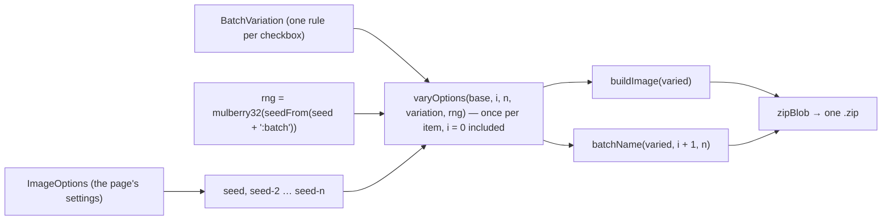

# Placeholders

`/tools/placeholders/` — filler text and filler images, both seeded, both drawn here. A stateless Svelte island over four pure modules; nothing is written to IndexedDB and nothing is fetched.

_Describes the code as of v0.6.0 (schema v17) — verify against source when in doubt._

## File map

| Path | Role |
| --- | --- |
| [random.ts](../../../src/lib/random.ts) | The app's one seeded PRNG, plus `seedFrom`, `randomInt`, `pick`, `shuffled` |
| [text.ts](../../../src/lib/placeholder/text.ts) | Both corpora and the text generator |
| [images.ts](../../../src/lib/placeholder/images.ts) | The eleven image generators, batches and `varyOptions` |
| [scenes.ts](../../../src/lib/placeholder/scenes.ts) | The fifteen hand-drawn scenes |
| [thumbnails.json](../../../src/lib/placeholder/thumbnails.json) | The picker's eleven example pictures (160×90 data URIs), rendered from the defaults by [tools/build-placeholder-thumbs.mjs](../../../tools/build-placeholder-thumbs.mjs) and committed; they do not follow the controls |
| [size.ts](../../../src/lib/placeholder/size.ts) | Ratios, presets and the aspect lock |
| [PlaceholdersApp.svelte](../../../src/components/apps/PlaceholdersApp.svelte) | The page |
| [placeholders.spec.ts](../../../tests/local/placeholders.spec.ts), [placeholder.test.ts](../../../src/lib/placeholder/placeholder.test.ts) | Playwright and Vitest |

## One PRNG, lifted

`mulberry32` was written for the config playground's example-data generator. It has a second caller now, so it lives in [random.ts](../../../src/lib/random.ts) and `config/generate.ts` re-exports it — two copies would be two answers to "what does seed 42 produce", and a seed exists precisely so there is one.

`seedFrom()` turns arbitrary text into a 32-bit seed (FNV-1a), except for a typed integer, which is used as itself: someone typing `42` means 42.

## Text

Two corpora, and the licence question is why there are exactly two:

- **Lorem ipsum** — the standard scrambled-Cicero word list, public domain, so text generated here matches text generated anywhere else.
- **Office speak** — written in this repository as a small **grammar** (opener, subject, verb phrase, adjective, noun, closer) rather than a bag of buzzwords. Meeting-speak is recognisable by its shape, and a shuffled word list just reads as noise. Nothing in the output is a phrase lifted from an existing site.

The traditional opening is only offered for the corpus it belongs to: the generator ignores `startWithLorem` for office speak and the page hides the checkbox there.

### There is no third, AI-generated corpus

Asked for twice — 0.3.0's Q11 and 0.4.0's Phase 6 — and rejected twice, the second time **after building it**. A distilgpt2-class ONNX model (81 MB) was run through the `onnxruntime-web` this repo already ships, with a hand-written GPT-2 BPE tokenizer and a KV-cached sampling loop.

It cannot follow a prompt: it is a base LM, so "write a product description for a coffee mug" yields either sixty newlines or `" a coffee mug for a coffee mug for a coffee mug…"`. The smallest instruction-tuned model that *can* is ~115 MB (SmolLM2-135M-Instruct) — five times this entire application, and the purpose-built on-device family starts at 206 MB (LFM2.5-230M q4) — and generation runs at about five seconds a paragraph against instant for the corpora, while losing the seeded reproducibility that makes a re-generate a no-op diff.

Full transcripts, the measured size table, and the conditions that would flip the answer are in [far-fetched.md](../plans/far-fetched.md).

## Images

Eleven generators, all SVG-first, all seeded. SVG because a placeholder is mostly flat colour and geometry — it stays a few kilobytes at any size, where a 4000-pixel PNG of a grey rectangle is megabytes of nothing — and because the PNG/JPG exports then rasterize the same document through [convert.ts](../../../src/lib/img/convert.ts) rather than having a second drawing path.

| Generator | How it is drawn |
| --- | --- |
| Plain colour | One `<rect>` |
| Colour with a caption | `fitFontSize()` sizes the heading from the width and the character count, so a caption never overflows the frame |
| Gradient | A [GradientDef](../../../src/lib/gen/gradient.ts) mapped onto SVG gradient elements, with the same 90° offset the gradient tool's preview uses |
| Noise | `feTurbulence` → desaturate → `feFlood` + `feComposite` (arithmetic `k1=1`) to tint, optional blur. The filter carries the page's seed so the grain is reproducible |
| Flow field | Streamlines through three sine terms with seeded phases — smooth everywhere, a dozen lines of arithmetic, and indistinguishable from real Perlin noise at this scale. `density` is the line count, clamped to 10–400: past that the lines stop reading as lines and the file stops being small |
| Layered geometry | 5–9 translucent seeded polygons. `opacity` is the CENTRE of the range each shape draws from, not a flat value — shapes all at one opacity stop looking layered and start looking like a single stencil |
| Cut planes | 4–6 quadrilateral slabs on one jittered angle, each long enough to run off both edges, under a shared drop shadow. Its palette comes from `harmonise(background)` — two neighbouring hues plus a dark and a light — because a few big slabs in unrelated colours look like a mistake where a dozen small ones look playful, and because it gives the Background picker something to do beyond filling the gaps |
| An icon | Any Lucide icon at `iconScale` (0.1–0.95 of the shorter side), loaded through the logo generator's own loader so there is one copy of the 2 MB set in the bundle, and only on this generator |
| A drawn scene | One of fifteen, below |
| Mosaic | A grid of `blockSize` squares (percent of the shorter side), each painted from `palette` or, with probability `cutRatio`, cut out to the background. Below |
| Swirl | One logarithmic spiral drawn as a filled band between itself and a copy turned by `armWidth` of a revolution, in the first two palette colours. Below |

**SVG has no conic gradient.** The generator offers linear and radial and says why the third is missing rather than quietly drawing something else.

### Mosaic and swirl

Both (0.6.0 phase 7) draw from `palette: string[]`, one to four colours, read through `paletteOf()` in [images.ts](../../../src/lib/placeholder/images.ts): blanks dropped, capped at `MAX_PALETTE`, and `DEFAULT_PALETTE` when nothing is left. Every `fill` either generator emits is a palette entry or the background — the unit test parses the fills and checks. The page's palette editor for the **mosaic** is up to four [ColorField](../../../src/components/ColorField.svelte)s (`ph-palette-<i>`) with `ph-palette-add` / `ph-palette-remove-<i>`; the page copies the default palette into its state because `$state` writes through to the array it is given.

The **swirl** (feedback round 1) has no numbered editor: two named fields, **Swirl colour** (`ph-swirl-color`) and **Background colour** (`ph-swirl-background`), nothing to add or remove. They are page state of their own (`swirl` in [PlaceholdersApp.svelte](../../../src/components/apps/PlaceholdersApp.svelte)), kept apart from the mosaic's palette so switching generators never loses colours three and four, and a derived `options` hands the swirl `[color, background]` as its palette — `swirlLayer` is unchanged and still reads `palette[0]` / `palette[1]`, so an existing seed draws the same swirl; the default pair is `DEFAULT_PALETTE[0..1]`. Everything that builds an image on the page (`svg`, `downloadBatch`) reads `options`, not `image`.

`mosaicLayer(options, w, h, rng)` lays a grid of `blockSize`-percent squares, centred so any partial block is split between both edges. Cut-outs (Q5: painted the background, no transparency) are decided per block by `rng() < odds`, where `odds` is `cutRatio` nudged by a smooth seeded sine field — so the holes gather into patches rather than salt-and-pepper — except that 0 and 1 are exact: 0 paints every block and 1 paints none, and the test counts them (17 × 13 at 400×300 and 8%). Each painted block is inset by a seeded 0–10% of its side, which is what makes it read as tiles with pieces missing rather than a checkerboard. Every block makes the same three rng calls whether or not it is cut, so one block's outcome never shifts its neighbours'.

`swirlLayer(options, w, h, rng)` paints the frame in the second colour (the background when the palette has one colour) and one `<path>` in the first: the band between r = r₀·e^(kθ) and the same spiral turned by `armWidth × 2π`. `k` is chosen so the spiral reaches the far corner after `turns` revolutions; the path carries on `armWidth` of a turn past that and closes along a rim at a radius that is already off-frame, so there is no chord across the picture. A rotated log spiral never crosses itself, so the band is one simple path and `armWidth` is the first colour's share of every turn at every radius. The seed sets the start angle, the winding direction and a small nudge off centre.

## The scenes

Fifteen hand-written SVG scenes — five Nature, five Sport, five City — in [scenes.ts](../../../src/lib/placeholder/scenes.ts). Authored here for the reason the plan gives: provenance for art we drew is one sentence, and provenance for art scraped off the web is a research project.

Each is drawn in a 160×90 box and placed as a nested `<svg>` with `preserveAspectRatio="xMidYMid slice"`, which is what lets one drawing fill any frame — the proportions hold and the frame crops, exactly like `object-fit: cover`. A background rect is painted behind it so a crop never shows through.

## Sizes

The aspect lock reads the ratio from the size **before** the edit and recomputes the side that was *not* just typed in — a lock that recomputes the field someone is holding fights the person using it.

## Batches

A batch is the same settings with the seed varied per item (`seed`, `seed-2`, `seed-3`…), so item *n* of a batch is exactly what typing that seed produces on its own — a batch is not a separate code path. Files are named `<generator>-<w>x<h>-<index>.<ext>`, zero-padded to the batch size so a file listing sorts the way the batch was made, and zipped through [zip.ts](../../../src/lib/zip.ts). Rasterizing runs one at a time: fifty canvases at once is how a tab runs out of memory.

Since 0.6.0 a batch can also differ per item. `buildBatch(options, count, variation?)` in [images.ts](../../../src/lib/placeholder/images.ts) takes a `BatchVariation` — `DEFAULT_BATCH_VARIATION` is everything off, and with it omitted the output is byte-for-byte what it was before (the unit test pins that). Every item, **item 0 included**, goes through the pure `varyOptions(base, i, n, variation, rng)`, so `sizes[0]` applies to the first image; then the same `buildImage` draws it and `batchName` is taken from the *varied* options, so a varied size shows in the file name. The rng is `mulberry32(seedFrom(seed + ':batch'))`, made once per batch, and only a rule that is on pulls from it — a varied batch is as reproducible as a plain one, and turning one rule on does not reshuffle another's picks.

The rules, one per line of the TODO. "Item *i*" counts from 0; deltas are multiplied by *i*, so the first image is always the base.

| Rule | Shown for | Parameter | Item *i* gets | Bound |
| --- | --- | --- | --- | --- |
| `sizes` | all | one `{ width, height }` per item (`ph-vary-size-<i>-w` / `-h`), each row with an include tick (`ph-vary-size-<i>-on`) — an unticked row is sent as the base size | `sizes[i]`, clamped like any size; a shorter list leaves the rest at the base | 16–4096 |
| `background` | all | — | `randomColor(rng)` — any hue, middling saturation and lightness | — |
| `ink` | heading, noise, flow, icon | — | `randomColor(rng)` as `foreground` | — |
| `angleOffset` | gradient | degrees | `angle + i × offset`, wrapped into 0–359 | wrap 360 |
| `stop1` / `stop2` | gradient | — | a random colour, re-rolled until it differs from the other stop | — |
| `cycleKind` | gradient | — | `SVG_GRADIENT_KINDS[(base + i) % 2]` — linear → radial → linear. SVG has no conic gradient, so two kinds, not three | — |
| `grainDelta` | noise | per item | `frequency + i × delta` | clamp 0.002–0.08 |
| `blurDelta` | noise | per item | `blur + i × delta` | clamp 0–8 |
| `randomSeed` | noise, flow, material, planes | — | `randomSeedText(rng)`: 12 alphanumerics, replacing the `-n` suffix | — |
| `lineDelta` | flow | lines | `density + i × delta`; past 400 back to `0 + remainder` | wrap 400 |
| `opacityDelta` | material, planes | per item | `opacity + i × delta` | clamp 0.05–1 |
| `sizeDelta` | icon | of the shorter side | `iconScale + i × delta`; past 0.95 back to `0 + remainder`, then floored | wrap 0.95, floor 0.1 |
| `randomIcon` | icon | — | `randomIcon[i % length]` — the **page** picks names from the fetched Lucide list with `mulberry32(seedFrom(seed + ':icons'))` and resolves them to markup in `batchIcons()`; `varyOptions` never fetches | — |
| `scenes` | scene | allowed `SceneId[]`, by group (`ph-vary-scenes-group-<Group>`) or one at a time (`ph-vary-scene-<id>`) | `pick(rng, scenes)`; an empty list leaves the chosen scene | — |
| `blockSizeDelta` | mosaic | percent per item (`ph-vary-block-size`, `-value`) | `blockSize + i × delta` | clamp 2–25 |
| `cutRatioDelta` | mosaic | per item (`ph-vary-cut-ratio`, `-value`) | `cutRatio + i × delta` | clamp 0–1 |
| `palette` | mosaic, swirl | `'off' \| 'shuffle' \| 'random'` (`ph-vary-palette-value`), plus `shufflePool: string[]` (`ph-vary-palette-<i>`) | `shuffle`: `shufflePalette(pool, k, rng)` — the pool is `shufflePool` with blanks dropped, or `paletteOf(base)` when that leaves nothing; `k` is what the generator uses (mosaic: `paletteOf(base).length`; swirl: 2, or 1 for a one-colour pool so its ground stays the background). A pool bigger than `k` deals a different subset per item, one smaller cycles (`[a, b, a, b]`); `random`: `randomColor(rng)` for each entry, so as many colours as the base | pool ≤ `MAX_SHUFFLE_POOL` (8) on the page; the library takes any length |

The bounds live in `VARIATION_BOUNDS` and match the page's sliders. The page keeps each rule as a checkbox plus a remembered parameter (`vary` in [PlaceholdersApp.svelte](../../../src/components/apps/PlaceholdersApp.svelte)) and folds them into the library type in `batchVariation()`; the sizes table follows the batch count through an effect that adds rows at the current size and drops surplus ones without touching the rest. `buildBatch` returns each item's `options` alongside its SVG so a PNG/JPG batch rasterizes and names every item at its own size.

**Randomized sizes** (feedback round 1) are not a rule of their own: `buildBatch` only ever reads the sizes table, so randomizing is filling it. With **Randomize sizes** (`ph-vary-sizes-random`) on, an effect fills every row from the pure `randomSizes(base, n, keepRatio, rng)` in [images.ts](../../../src/lib/placeholder/images.ts) with `rng = mulberry32(seedFrom(seed + ':sizes'))`, and refills whenever what it was rolled from moves (the seed, the count, the base size, or the ratio choice); the include ticks survive a refill and the numbers stay editable until the next one. The long side is rolled in `RANDOM_SIZE_RANGE` (200–2000); with **Keep the aspect ratio** (`ph-vary-sizes-ratio` = `keep`, the default) the short side follows the base's proportions, clamped like any side, and with **Change it too** both sides are rolled on their own. **all** / **none** (`ph-vary-sizes-all`, `-none`) flip every row's include tick. The unit test pins determinism, the range, and that a kept ratio is within 0.02 of the base.

**The shuffle pool** (feedback round 2). With the palette rule on and set to `shuffle`, a pool editor sits right under the select (`ph-vary-palette-colours`): [ColorField](../../../src/components/ColorField.svelte)s `ph-vary-palette-<i>` with `ph-vary-palette-remove-<i>` beside each (the last one cannot be removed) and `ph-vary-palette-add`, which is *absent*, not disabled, at `MAX_SHUFFLE_POOL` (8). Round 1 showed the generator's own colours there, bound to the panel above, and that is exactly what the complaint was: two fields for the swirl and four for the mosaic, with no way to add more, so "shuffle" could only reorder. The pool is its own page state (`shufflePool`), seeded from `options.palette` by an effect the first time the rule is set to shuffled or whenever the pool is empty, and after that it is the user's — it survives the rule being toggled and the generator being switched, so a pool built for the mosaic is still there for the swirl. A sentence above the fields says what each image takes from it (the swirl: its swirl colour and its background colour; the mosaic: as many as its palette holds). `batchVariation()` passes `[...shufflePool]` always; the library only reads it under `shuffle`, and an empty pool means the generator's own palette, which is why the round-1 unit test (a four-colour base is a permutation per item) still holds. The pure `shufflePalette(pool, k, rng)` is `shuffled(rng, pool)` (Fisher–Yates, one rng call per swap) cut to `k`, cycling when the pool is shorter; an empty pool or `k ≤ 0` returns `[]` without touching the rng. `random` shows nothing under the select — there is no set to show. The Playwright case adds a fifth, distinctive colour to a mosaic's pool, downloads a batch of eight and parses the fills: only pool colours and the background appear, no image holds more than four, and the fifth shows up in some but not all — seeded, so the same answer every run.

Test hooks are prefixed `ph-`: `ph-mode`, `ph-corpus`, `ph-count`, `ph-unit`, `ph-text-seed`, `ph-lorem-start`, `ph-html`, `ph-text`, `ph-text-counts`, `ph-copy-text`, `ph-download-text`, `ph-generators`, `ph-gen-<id>`, `ph-bg`, `ph-fg`, `ph-seed`, `ph-frequency`, `ph-blur`, `ph-density`, `ph-opacity`, `ph-icon-scale`, `ph-heading`, `ph-subheading`, `ph-grad-kind`, `ph-grad-angle`, `ph-grad-stop-<i>`, `ph-icon-search`, `ph-icon-name`, `ph-icons`, `ph-icon-<Name>`, `ph-scene-<id>`, `ph-palette-<i>` (plus `-pick`), `ph-palette-add`, `ph-palette-remove-<i>`, `ph-swirl-color`, `ph-swirl-background`, `ph-block-size`, `ph-cut-ratio`, `ph-turns`, `ph-arm-width`, `ph-width`, `ph-height`, `ph-lock`, `ph-size-note`, `ph-ratios`, `ph-ratio-<id>`, `ph-sizes`, `ph-output-card`, `ph-preview`, `ph-format`, `ph-batch`, `ph-download`, `ph-download-batch`, `ph-copy-svg`, `ph-links-card`, `ph-feedback`. Batch variation: `ph-vary-card`, `ph-vary-<rule>` for each checkbox (`sizes`, `background`, `ink`, `randomSeed`, `angleOffset`, `stop1`, `stop2`, `cycleKind`, `grainDelta`, `blurDelta`, `lineDelta`, `opacityDelta`, `sizeDelta`, `randomIcon`, `scenes`, `palette`, and the mosaic's `block-size` / `cut-ratio`), `ph-vary-<rule>-value` for its parameter, `ph-vary-size-<i>-on` / `-w` / `-h` for the sizes rows with `ph-vary-sizes-random`, `ph-vary-sizes-ratio`, `ph-vary-sizes-all` and `ph-vary-sizes-none` above them, `ph-vary-scenes-group-<Group>` and `ph-vary-scene-<id>` inside the scene picker, and `ph-vary-palette-colours` holding the shuffle pool — `ph-vary-palette-<i>` (plus `-pick`), `ph-vary-palette-remove-<i>` and `ph-vary-palette-add` — when the palette rule is set to shuffled. `ph-palette-add` and `ph-vary-palette-add` are absent, not disabled, when their editor is full.
