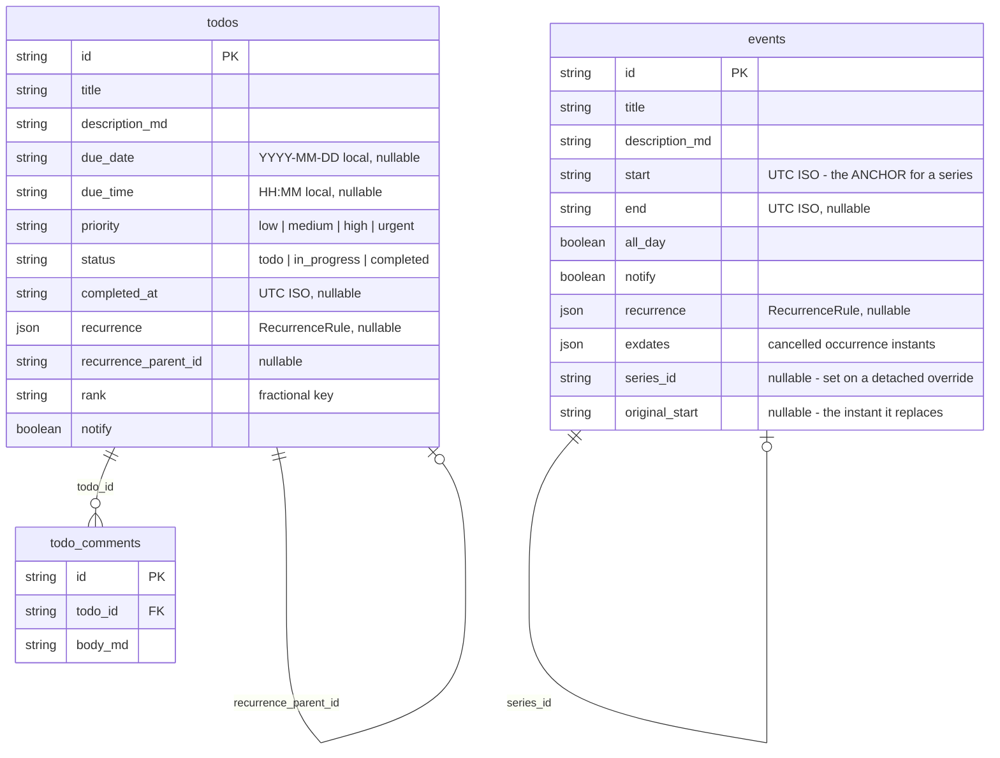
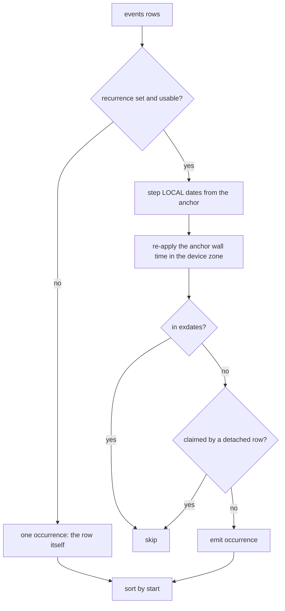
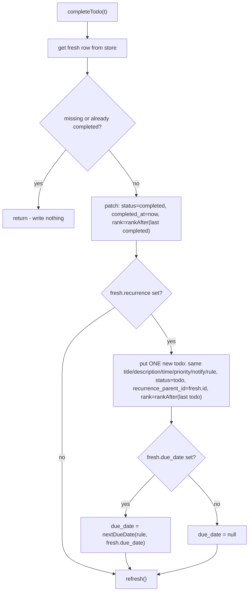
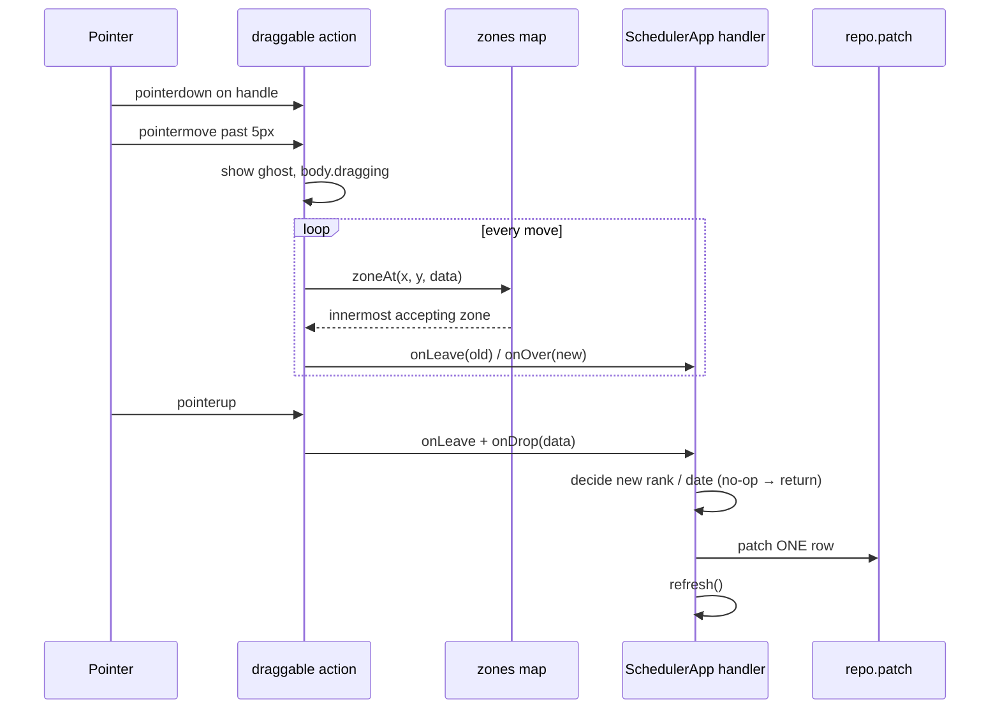

# Scheduler

Events and TODOs in one island at `/tools/scheduler/`, shown as a list, a three-column kanban board, or a month calendar. Everything lives in three IndexedDB stores (`events`, `todos`, `todo_comments`); every write goes through `repo.ts`; ordering is a fractional `rank` string shared by the list and the board; recurrence is a rule stored on the todo whose successor is created exactly once inside the complete action; drag-and-drop is pointer-event based so it works with mouse, touch and pen; due-time notifications ride the always-mounted timer engine.

_Describes the code as of v0.2.1 (unreleased; schema v12) — verify against source when in doubt._

## File map

| File | Role |
|---|---|
| [scheduler.astro](../../../src/pages/tools/scheduler.astro) | Route; mounts `SchedulerApp` with `client:only="svelte"`. |
| [SchedulerApp.svelte](../../../src/components/apps/SchedulerApp.svelte) | The island: state (`todos`, `events`, `comments`), the `<dialog>` modal, both forms, list + board views, every write. |
| [CalendarView.svelte](../../../src/components/apps/CalendarView.svelte) | Pure display: month grid from props, hover previews, drop targets. Every mutation goes back up through callbacks (`ondropitem`, `oneventclick`, `ontodoclick`, `ondayclick`). |
| [recurrence.ts](../../../src/lib/scheduler/recurrence.ts) | Pure date math: `nextDueDate`, `weekdayOf`, `describeRule`. |
| [rank.ts](../../../src/lib/scheduler/rank.ts) | Fractional ordering keys: `rankBetween`, `initialRank`, `rankAfter`. |
| [dragdrop.ts](../../../src/lib/dragdrop.ts) | The `draggable` / `dropzone` Svelte actions (pointer events). Ghost + body styles in [global.css](../../../src/styles/global.css) (`.drag-ghost`, `body.dragging`). |
| [types.ts](../../../src/lib/db/types.ts) | `Event`, `Todo`, `TodoComment`, `RecurrenceRule`, `TodoStatus`, `TodoPriority`, the `STORES` entries. |
| [db.ts](../../../src/lib/db/db.ts) | Migration v4 creates the three stores and their indexes. |
| [engine.svelte.ts](../../../src/lib/time/engine.svelte.ts) | `scanDue` — due-time notices for todos and events. Rendered by [NotificationEngine.svelte](../../../src/components/chrome/NotificationEngine.svelte). |
| [markdown.ts](../../../src/lib/markdown.ts) | `renderMarkdown` — descriptions, comments and previews all go through it (sanitized). |
| [TimeGridView.svelte](../../../src/components/apps/TimeGridView.svelte) | The week and day grids (one component: a day view is a week view with one column). |
| [occurrences.ts](../../../src/lib/scheduler/occurrences.ts) | Virtual expansion of recurring events. |
| [timegrid.ts](../../../src/lib/scheduler/timegrid.ts) | Time-grid geometry: overlap packing, drop snapping, week-start ordering. |
| [recurDraft.ts](../../../src/lib/scheduler/recurDraft.ts), [RecurrenceFields.svelte](../../../src/components/apps/RecurrenceFields.svelte) | The repeat editor shared by TODOs and events, and its rule/draft conversion. |

## Data model

Every row also carries the `SyncFields` (`id`, `updated_at`, `deleted_at`, `server_seq`, and `field_updated_at` on `todos`, which is `fieldMerge`). Migration v4 in [db.ts](../../../src/lib/db/db.ts) creates the stores with indexes `events.start`, `todos.status`, `todos.due_date`, `todo_comments.todo_id`; migration **v8** adds `events.series_id` and the four recurrence fields (defaulted at read time — a backfill on load would be a write on load). The test oracle mirrors the shape in [schema.ts](../../../tests/local/helpers/schema.ts), including the three foreign keys (`todo_comments.todo_id → todos`, `todos.recurrence_parent_id → todos`, `events.series_id → events`).

Points worth knowing:

- `Event.start`/`end` are UTC instants; the form builds them from a local date + time (`00:00` when all-day or no time) and calls `toISOString()`. Todos instead store a local calendar date and a separate `HH:MM` — `due_time` is only kept when a `due_date` is set (`saveTodo` nulls it otherwise).
- Events have no workflow, but they DO recur — see [Recurring events](#recurring-events) below. Todos and events share the `RecurrenceRule` shape and the [RecurrenceFields.svelte](../../../src/components/apps/RecurrenceFields.svelte) editor, but not the mechanism: a todo spawns its successor when completed, an event is expanded on the fly.
- Comments are child rows, not an array on the todo, so a comment write touches one small row and the FK invariants apply.
- The scheduler reads with `all()` on mount and after every action (`refresh()`); the indexes exist but nothing in the island queries by them.

## Recurring events

A recurring todo spawns its successor when it is **completed** — a user action, and therefore a legitimate moment to write a row. Events are never completed, so that trick has no trigger, and the only other candidate is page load, which must not write. Events therefore expand **virtually**: [occurrences.ts](../../../src/lib/scheduler/occurrences.ts) computes them on every render and every notification scan, and nothing is ever stored.

The model is iCal's, mapped onto the store that already exists:

| Piece | Where it lives | What it means |
| --- | --- | --- |
| the rule | `events.recurrence` (shared `RecurrenceRule`, with an optional inclusive `until`) | the series repeats; `start` is the anchor AND its first occurrence |
| a cancelled occurrence | `events.exdates` — an array of occurrence-start instants | that instant is skipped. **Not** a tombstone: `all()` hides tombstoned rows, so a skipped occurrence would be a hole nobody could see or undo |
| an occurrence edited alone | an ordinary event row with `series_id` + `original_start` ("detached") | it renders as itself and suppresses the series' copy of that instant |

`occurrencesBetween(events, fromMs, toMs, zone?)` takes the WHOLE list, because a detached row has to shadow its parent and that cannot be decided one row at a time. `nextOccurrenceOnOrAfter(ev, ms, zone?, overridden?)` is its single-answer sibling, used by the 1-second notification tick — it jumps arithmetically to the right index instead of expanding a range.

Details that are decisions, not accidents:

- **Wall-time stepping.** Dates step in the local calendar and the anchor's wall time is re-applied through `wallTimeToInstant`, so a 09:00 weekly meeting stays 09:00 across a DST change even though its UTC instant moves. The zone is the **device's current** one, not a stored one (plan Q1): a traveller sees the series at their new local wall time. Sub-minute precision is preserved by re-adding the anchor's own residue past the whole minute.
- **Month stepping counts from the anchor**, never from the previous occurrence, so "every month" from the 31st gives Feb 28, Mar 31, Apr 30 — not Feb 28, Mar 28, Apr 28.
- **A weekdays rule always keeps its anchor**, even when the anchor's weekday is not in the list: it is the event the user actually created.
- **`MAX_OCCURRENCES` (1000)** caps one series' contribution to one range, so a corrupt rule cannot hang a render.
- **A malformed rule expands to nothing** rather than throwing — the generic round-trip suite writes an array into every `json` column, and a parser that threw would take unrelated suites down with it (`isUsableRule`).

### What each action costs

The scope chooser ("This event / This and following / All events") appears on the read and edit modals whenever the row is a series or a detached override.

| Action | Rows written |
| --- | --- |
| drag one occurrence to another day | **1** — a new detached row; the series is not touched |
| delete this occurrence | 1 — the series' `exdates` |
| delete a detached occurrence | 2 — tombstone the override, and add its `original_start` to the parent's `exdates` (otherwise the series would put its original back) |
| edit this occurrence | 1 — a new detached row |
| edit/delete this and following | 2 — the parent's `until` moves to the day before, and a new series starts here |
| edit all | 1 — the series row. Occurrences already detached keep their own values (Google semantics, plan Q3) |
| delete the series | 1 + one per detached child, in the same action — an override whose parent is a tombstone would be an orphan the FK check rejects |

### Notifications

`scanDue` asks `nextOccurrenceOnOrAfter(ev, now - 60s)` instead of parsing a single `start`, and dedupes on `event:<id>:<occurrenceStart>` so next week's meeting is a separate notice. Instants claimed by a detached row are skipped on the parent — the override is scanned in its own right, so the meeting is not announced twice. As everywhere else in the app, this fires only while a tab is open.

## Calendar views

The calendar has three grids, chosen with a segmented control and remembered in `scheduler_calendar_view` — a **separate** preference from `scheduler_view`, because writing `'week'` into the latter would make a 0.1.0 build silently fall back to the list.

| Grid | Component | Range shown |
| --- | --- | --- |
| Month | [CalendarView.svelte](../../../src/components/apps/CalendarView.svelte) | 42 cells from the week containing the 1st |
| Week | [TimeGridView.svelte](../../../src/components/apps/TimeGridView.svelte) with `days={7}` | the week containing the anchor |
| Day | the same component with `days={1}` | one day |

All three share one **anchor date** (`calAnchor` in `SchedulerApp.svelte`, bound into each grid), so switching from month to week lands on what you were already looking at rather than jumping back to today. Each grid expands its own visible range through `occurrencesBetween` — the work is proportional to what is on screen, and expansion is pure, so drawing still writes nothing.

**Week start** is a preference (`scheduler_week_start`, 0 = Sunday, 1 = Monday) read by both the month grid and the week grid. The month grid's leading-blank count and the weekday header order both come from `leadingBlanks()` / `weekdayOrder()` in [timegrid.ts](../../../src/lib/scheduler/timegrid.ts).

### The time grid

[timegrid.ts](../../../src/lib/scheduler/timegrid.ts) holds everything that decides WHERE something goes, so it can be tested without a browser; the component only turns minutes into percentages.

- **Lanes.** An entry goes in the all-day lane if it is `all_day`, if it covers the whole of that column's day (a multi-day event appears in the lane of every day it touches — the month grid only ever showed it on its start day), or — for a TODO — if it has a `due_date` but no `due_time`. A TODO WITH a time is positioned at that time like anything else; it has no duration, so it takes the minimum height. The lane means "no time of day", not "not an event".
- **Overlaps.** Events and timed TODOs are packed in ONE pass, so a 09:00 todo and a 09:00 meeting sit side by side instead of on top of each other. `packOverlaps` clusters entries that overlap transitively — A-B and B-C put all three in one cluster — and assigns each the first column free at its start. A cluster is always split into the same number of columns, so nothing is drawn over anything else; two entries that do not overlap may still share a column. `MIN_SPAN_MINUTES` (15) keeps a zero-length entry clickable.
- **Dropping.** One dropzone per day column plus one per all-day lane, through the same pointer-event [dragdrop.ts](../../../src/lib/dragdrop.ts) the other views use, so mouse, touch and pen share one path. The drop minute comes from `minuteFromOffset(clientY - zoneTop, zoneHeight)`, snapped to 15 minutes, and a snap line follows the pointer. `ondropitem` carries a `time` with three meanings: `'HH:MM'` sets that time (preserving an event's duration), `''` means *no* time — what the all-day lane passes, which is how a TODO's `due_time` is cleared by dragging — and `null` means "leave the time alone", which is what the month grid passes because it has no hours to drop on. A drop that changes neither date nor time writes nothing.
- **Zone geometry.** `dropzone`'s callbacks receive the zone's own element as a third argument. The pointer event they also receive is the window-level move, so its `currentTarget` is not the zone and cannot be measured — that argument is what makes a time-from-position drop possible at all.
- **Slots.** Each hour is a real `<button>` labelled "Add event on YYYY-MM-DD at HH:MM", so creating at a time is a keyboard path and not only a drag. The grid opens scrolled to about 07:00.

## Status workflow

`TodoStatus` is fixed: `todo → in_progress → completed` (`STATUSES` in `SchedulerApp.svelte`). Status changes come from the list's per-row `<select>`, the board's `←`/`→` buttons, or a board drag onto another column/card. All of them call `setStatus(t, status)`:

- Any status other than `completed`: one `patch` setting `status`, `completed_at: null`, and `rank: rankAfter(lastRank(status))` — the todo lands at the **bottom** of the destination column.
- `completed`: delegates to `completeTodo`, below.

Moving a completed todo back clears `completed_at`; nothing else is undone (a successor already spawned stays).

## Recurrence

`RecurrenceRule` (in [types.ts](../../../src/lib/db/types.ts)) is either `{ kind: 'every', interval, unit: 'days' | 'weeks' | 'months' }` or `{ kind: 'weekdays', days: number[] }` (0 = Sunday). No RRULE. The rule lives on the todo; the form's `draftRule()` clamps `interval` to `>= 1` and stores **no rule** when "weekly on…" is chosen with zero weekdays ticked.

`nextDueDate(rule, from)` in [recurrence.ts](../../../src/lib/scheduler/recurrence.ts) returns a date strictly after `from`:

- `every` — anchored on the completed occurrence's **due date**, not on when it was completed. Months are clamped to the target month's end (Jan 31 + 1 month = Feb 28/29).
- `weekdays` — the next listed weekday within the following 7 days; an empty/invalid list falls back to +1 day.

The successor is created inside `completeTodo` and nowhere else:

Consequences of the code as written:

- Rendering, reloading, or switching views never materializes occurrences — the successor exists only because the user completed something (`tests/local/scheduler.spec.ts` reloads after a recurring complete and asserts a byte-identical dump).
- The fresh re-read makes a double complete of the same row a no-op. It does **not** dedup across un-complete/re-complete: moving a completed recurring todo back to `todo` and completing it again spawns another successor.
- An undated recurring todo spawns an undated successor.
- Dropping a card on the Completed column runs the same `completeTodo` path, so drag completes spawn too.

## Ordering: fractional rank

[rank.ts](../../../src/lib/scheduler/rank.ts) generates lexicographic keys over `'a'..'z'`. `rankBetween(a, b)` returns a string strictly between its bounds (`null` = open end; both `null` yields the midpoint `'m'`), walking digit by digit and going one position deeper when two digits are adjacent. It never returns a key ending in `'a'` (nothing sorts between `''` and `'a'`, so such a key would be a dead end for later insert-before operations). `initialRank()` = `rankBetween(null, null)`; `rankAfter(last)` = `rankBetween(last, null)`. Callers must pass `a < b` when both are given — it throws otherwise.

Where keys come from in `SchedulerApp.svelte`:

| Action | Key |
|---|---|
| New todo | `rankAfter(lastRank('todo'))` — bottom of the TODO column |
| Status change (any path) | `rankAfter(lastRank(destination))` — bottom of the destination |
| Board `↑`/`↓` (`moveInColumn`) | `rankBetween(before, after)` around the new slot |
| Board drop on a column (`dropOnColumn`), same status | `rankAfter(last other card)`; nothing if already last |
| Board drop on a card (`dropOnCard`), same status | `rankBetween(prev, target.rank)` — inserted **above** the target; nothing if already directly above |
| Board drop on a card, different status | `setStatus` — appends; the target's position is ignored |
| List drop on a row (`dropOnRow`) | `rankBetween(prev, target.rank)`; if `prev >= target.rank` (crossing the completed divider) `rankBetween(null, target.rank)`; nothing if already directly above |
| List drop on the end strip (`dropAtListEnd`) | `rankAfter(last other row)`; nothing if already last |

The list and the board read the **same** `rank`. `column(status)` sorts one status by rank; `listTodos` sorts every todo with completed ones last, then by rank, then by `id` as a tiebreak. So the manual list order is the board column order (a spec asserts exactly this). There is no due-date sort in the list — dragging is the only way to reorder it.

Every reorder writes exactly one row (the moved one), and a drop that would not change the order writes nothing. `assertIsolatedDelta` in the specs depends on this.

## Calendar month grid

`CalendarView.svelte` keeps `year`/`month` state (initialised from `today`, captured once per mount — and the view switch remounts it). `cells` is `$derived.by`: it buckets events by the **local date of `start`** and todos by `due_date` (undated todos are skipped), then emits 42 cells (6 rows × 7) starting from the Sunday on or before the 1st. Each `Cell` is `{ date, day, inMonth, events (sorted by start), todos }`. `monthLabel` is `toLocaleDateString(undefined, { month: 'long', year: 'numeric' })`. `shift(±1)` and `goToday` change month; none of it writes.

Notes:

- Only the month view exists. Below `44rem` the entries are `display: none` (the cell shows only the day number — the source comment calls a dot day view future work).
- A multi-day event appears only on its start day; nothing spans cells.
- The day number is a button: `ondayclick(date)` → `openEventCreate(date)` opens the event form pre-filled with that date.
- Entries are `<button>`s: click → `oneventclick`/`ontodoclick` → the read modal.

## Drag and drop

[dragdrop.ts](../../../src/lib/dragdrop.ts) replaces the HTML5 drag API (which never fires on touch or pen) with two Svelte actions:

- `use:draggable={{ data: { kind, id }, label, handle, onStart, onEnd, disabled }}` — on `pointerdown` (mouse button 0 only) it records the start point and attaches `pointermove`/`pointerup`/`pointercancel`/`keydown` listeners on `window`. A drag begins only after `DRAG_THRESHOLD` (5 px); until then a press is a click. Presses on a control inside the node (`button, select, input, textarea, a[href], [contenteditable="true"]`) never drag unless they land on the handle — but a node that *is itself* a button (a calendar entry) still drags. **Touch drags start only from `handle`**; a touch on the body of a row stays a scroll. While dragging: `body.dragging`, a `.drag-ghost` following the pointer with `label`, `preventDefault` on moves, and `Escape` cancels.
- `use:dropzone={{ accepts, onOver, onLeave, onDrop }}` — sets `data-droptarget` and registers in a module-level `Map`. On every move `zoneAt` runs `document.elementFromPoint` and walks `closest('[data-droptarget]')` outward until a zone whose `accepts` passes: **innermost accepting zone wins**, so a card inside a column, or a row inside the table wrap, gets the drop.
- On release: `onLeave` then `onDrop` on the hovered zone, and exactly one following `click` is swallowed (otherwise dropping a calendar entry would also open it).

How the three views wire it (all payloads are `{ kind: 'todo' | 'event', id }`):

| View | Sources | Targets | Handler |
|---|---|---|---|
| List | each `<tr>` (`handle: '.drag-handle'`, the `⠿` cell) | each `<tr>` (insert above; `drop-above` highlight) and the `.table-wrap` (append; `drop-end` highlight on the end strip) | `dropOnRow`, `dropAtListEnd` |
| Board | each `.card-item` (`handle: '.card-grip'`) | each `.col` (`.dropping` outline) and each card | `dropOnColumn`, `dropOnCard` |
| Calendar | each `.entry` button (`handle: '.entry'` — the entry is its own handle; `onStart: hidePreview`) | each `.cell` (accepts todo and event; `.dropping` outline) | `CalendarView.onDrop` → `ondropitem` → `dropOnDate` |

`dropOnDate(type, id, date)`: a todo gets `patch({ due_date })` unless the date is unchanged; an event keeps its time of day — the new start is the old start with the year/month/day replaced via `setFullYear` on a local `Date`, and `end` (if any) shifts by the same millisecond delta. Same-day drops write nothing. Handles carry `touch-action: none` so the browser does not pan instead of dragging.

Keyboard: the board's `←`/`↑`/`↓`/`→` buttons cover status and in-column moves; the list has no keyboard reorder.

## Detail modal

One native `<dialog>` (`data-testid="scheduler-modal"`) serves create, read and edit for both types. `modal` is `{ type: 'todo' | 'event', id: string | null, mode: 'read' | 'edit' }`; an `$effect` calls `showModal()`/`close()` to match it, another sets `document.body.style.overflow = 'hidden'` while open. `onclose` (Escape) resets `modal`; a click on the backdrop (`e.target === dialogEl`) closes it.

- **Create** (`openTodoCreate`, `openEventCreate(date?)`): edit mode with a blank draft; save is `put(withSyncFields(...))`.
- **Read** (`openTodoRead`, `openEventRead`): the `<dl class="attrs">` (status, due, priority, repeats via `describeRule`, notify — or when/all-day/notify for events), the description through `renderMarkdown`, the comment thread for todos, an `✎ Edit` button and a `Delete` button. `modalTodo`/`modalEvent` are `$derived` lookups by id, so the read view re-renders after `refresh()`.
- **Edit** (`editTodoFromModal`, `editEventFromModal`): copies the row into the draft; save is `patch`. If `patch` returns `undefined` (row deleted elsewhere) the form shows an error and nothing is written.

Validation is in `saveTodo`/`saveEvent`: a todo needs a title; an event needs a title and a date, and its end may not precede its start.

## Hover previews

`CalendarView.showPreview` runs on `mouseenter`/`focus` of an entry and, after a 250 ms timeout, sets `preview = { x, y, title, meta, html }` from the entry's bounding rect (`x` clamped to `innerWidth - 320`, `y` = bottom + 6). `meta` is status · priority · due · rule for todos, "all day" or the start time for events; `html` is `renderMarkdown(description_md)` or empty. `hidePreview` runs on `mouseleave`, `blur`, click, and `draggable.onStart`. The card is `position: fixed`, `role="tooltip"`, `pointer-events: none`.

## Comments

`commentsFor(todoId)` filters `comments` by `todo_id` and sorts by `updated_at` ascending. `addComment` is one `put` of `{ todo_id, body_md }`; `deleteComment` is `softDelete`. Comments render through `renderMarkdown`. There is no edit path for a comment — delete and re-add is what the code offers. `deleteTodo` (after `confirm`) soft-deletes the todo and then `softDeleteMany` on its comment ids, so the FK invariant holds over live rows.

## Notifications

`scanDue(now)` in [engine.svelte.ts](../../../src/lib/time/engine.svelte.ts) runs on every 1 s engine tick, reading `all('todos')` and `all('events')`:

- Todo fires when `notify && status !== 'completed' && due_date && due_time`, the local instant `${due_date}T${due_time}` is in the past by at most `DUE_FIRE_WINDOW_MS` (60 s), and its key `todo:<id>:<date>T<time>` is not in the in-memory `firedDue` set. Notice: `{ kind: 'todo', missed: false, alarming: false }` + `showNotification('Due now: ' + title, ..., 'useful-todo-' + id)`.
- Event fires when `notify` and `Date.parse(start)` is within the same window; key `event:<id>:<start>`. Notice `kind: 'event'`; title `'Starting now: ' + title`.

`NotificationEngine.svelte` tags them `DUE` / `NOW`. Facts that follow from the code:

- Nothing is written when a due moment passes — `firedDue` is memory only, so a reload inside the 60 s window re-notifies, and the spec `a todo due just now raises a DUE banner (no writes)` asserts a byte-identical dump.
- No sound or vibration: `alarming` is always `false` for scheduler notices; `beep()` is timer-only.
- Date-only todos never notify. An all-day event with `notify` has `start` at local midnight and fires then, if the app is open.
- Anything that falls due while the app is closed is simply missed — there is no `missed` handling for todos/events (`missed` is hard-coded `false`), unlike timers.
- The system notification (`registration.showNotification`, falling back to `new Notification`) only shows when `Notification.permission === 'granted'`. The scheduler never calls `requestPermission`; only [TimersApp.svelte](../../../src/components/apps/TimersApp.svelte) does. The in-app banner shows regardless.

## Preferences

`setView` writes `scheduler_view` through `putSingleton`; `onMount` restores it (`'board'`/`'calendar'`, else `'list'`). The Preferences page lists it read-only under "Remembered values". This is the only preference the scheduler touches.

## Invariants

- All writes go through [repo.ts](../../../src/lib/db/repo.ts): `put`/`withSyncFields` for new rows, `patch` for edits, `softDelete`/`softDeleteMany` for deletes, `putSingleton` for the view. Never `getDB().put`.
- Page load, view switching, calendar browsing, opening the modal, hover previews and the due scan **never write**. The only render-time-adjacent write is the view preference on an explicit click.
- Completing a recurring todo creates **exactly one** successor, inside `completeTodo`, guarded by a fresh re-read. Successors are never created on render.
- Every reorder or reschedule writes **one** row; drops that would not change anything write nothing.
- The list and the board sort by the same `rank`; `rankBetween` must be called with `a < b`, and keys never end in `'a'`.
- `due_time` is stored only alongside a `due_date`. `Event.end`, when present, is `>= start`.
- Deleting a todo tombstones its comments in the same action.
- Rows stay JSON-native (`recurrence` is plain JSON; instants are ISO strings).
- Events do not recur.

## Tests

- [scheduler.spec.ts](../../../tests/local/scheduler.spec.ts) — drives the real UI with a hand-rolled `pointerDrag` (mouse press/move/release) and `touchDrag` (CDP touch events, from the handles), auditing every write with `assertIsolatedDelta`/`assertInvariants` from [oracle.ts](../../../tests/local/helpers/oracle.ts): list reorder (row and end strip, no-op drop writes nothing, list order equals board order), one-row creates and status changes, board arrow reorder and cross-column drag, recurring complete spawns exactly one successor and a reload writes nothing, delete cascades to comments (tombstones, FK green), comment add writes one row, modal read/edit/centering/highlighted code, calendar previews, event and todo calendar drags (one row, time kept), drag while a preview is showing, touch drags in all three views, the DUE banner with no writes, event create renders on the calendar, view switching writes only the preference.
- [rank.test.ts](../../../src/lib/scheduler/rank.test.ts) and [recurrence.test.ts](../../../src/lib/scheduler/recurrence.test.ts) — Vitest (`npm run test:unit`, `src/**/*.test.ts`): between-ness and ordering of keys including a thousand inserts at the front; every-N maths, month-end clamping, year crossings, weekday search, labels.
- [schema.ts](../../../tests/local/helpers/schema.ts) — the `TABLES` mirror that gives the generic data-integrity suite (backup round-trip, patch isolation, tombstones, FK checks) coverage of the three stores.

## Known limits and decisions

- **Events do not recur** — a v1 product decision (plan §2.1). Recurrence math is date-only and lives on todos.
- **Month view only**; entries hidden below `44rem`; multi-day events show on their start day only.
- **Cross-column card drops append** rather than inserting at the target card's position — the code path is `setStatus`, which always ranks at the bottom.
- **Comments are delete-only**; the plan's "individually editable" is not built.
- **Notifications** need permission granted elsewhere (Timers), never fire for date-only todos, carry no sound, and are not back-filled for due moments that passed while the app was closed. The 60 s window is the whole story.
- **Recurrence** anchors on the previous due date, so overdue completions can spawn a successor that is already in the past; un-completing and re-completing spawns again.
- **The list has no keyboard reorder**; the board's arrows are the keyboard path.
- `today`, `year` and `month` live in `CalendarView`, which the view switch destroys and recreates: leaving the calendar and coming back resets the browsed month to the current one, and that remount is the only thing short of a reload that re-reads `today` (an open calendar keeps marking yesterday past midnight).
