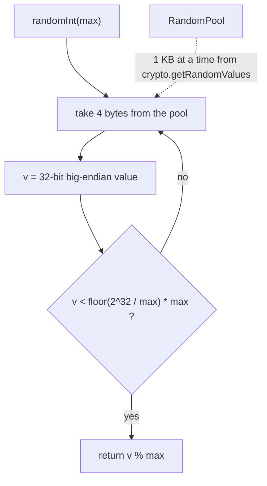

# Secrets

A generator for passwords, keys, tokens and identifiers at `/tools/secrets/`. Twenty-seven cards, each producing one kind of value from the browser's cryptographic random source. The page writes nothing — to IndexedDB, to the URL, or to the console — so a value exists only until it is replaced or the tab is closed.

_Describes the code as of v0.2.0 (unreleased; schema v7) — verify against source when in doubt._

## File map

| Path | Role |
| --- | --- |
| [secrets.ts](../../../src/lib/gen/secrets.ts) | Alphabets, the random source, encodings, the identifier builders, and `SECRETS` — the catalogue as data. |
| [wordlist.json](../../../src/lib/gen/wordlist.json) | The vendored EFF Long Wordlist (7,776 words) with its provenance. Lazily imported. |
| [build-wordlist.mjs](../../../tools/build-wordlist.mjs) | Regenerates that file from eff.org, with size and duplicate checks. |
| [SecretsApp.svelte](../../../src/components/apps/SecretsApp.svelte) | The page: one card per catalogue entry, plus four explainers. |
| [secrets.test.ts](../../../src/lib/gen/secrets.test.ts) | 34 unit tests — alphabets, uniformity, encodings, UUID bit layouts, shapes. |
| [secrets.spec.ts](../../../tests/local/secrets.spec.ts) | The page's promises: shapes, regeneration, options, copy, zero writes. |

## The catalogue is data

`SECRETS` is an array of `SecretDef`, and both the UI and the tests read it:

```ts
interface SecretDef {
  id: string;
  group: SecretGroup;       // one of GROUPS — the card it appears under
  name: string;
  purpose: string;          // one plain-word line: what this is for
  option?: SecretOption;    // at most one knob: a number range or a choice
  generate(opt?): string;
  bits(opt?): number | null; // null = an identifier, not a secret
}
```

Adding a generator is one entry. The page renders whatever is there, the "every generator produces something, twice differently" test covers it automatically, and the shape test names it explicitly.

`bits()` returning **null** is load-bearing: it is how identifiers (UUIDs, ObjectIds) are marked as *unique but not unguessable*. Printing "122 bits" beside a UUID is an invitation to use one as a session token. `bits()` must also be **total** — it is called while rendering, so it returns `0` rather than throwing when the passphrase's word list has not arrived yet.

## Randomness



Two decisions worth keeping:

- **Rejection sampling, not modulo.** `getRandomValues(new Uint8Array(1))[0] % 88` is biased: 256 is not a multiple of 88, so the first 80 characters of an 88-character alphabet come up about 1.5× as often as the last 8. Rejecting draws at or above the largest multiple of `max` below 2³² removes it completely; the retry probability is negligible. The unit test compares the two halves of an 88-way histogram over 88,000 draws, which the biased version could not pass.
- **A batched pool.** Bytes come from one 1 KB buffer refilled as it empties, rather than a fresh `getRandomValues` call per character. `randomBytes` **copies** out of it — returning a subarray would let a later draw silently rewrite a value someone was still holding, and there is a test for exactly that.

`entropyBits(len, setSize)` is `floor(len × log2(setSize))`, computed from the alphabet actually used. (randomkeygen's own Wi-Fi label computes against 72 characters for a 74-character set; ours does not.)

## Identifiers

- **UUID v4** comes from `crypto.randomUUID()` where it exists, with a hand-rolled fallback that sets the same version (`4`) and variant (`10xx`) bits.
- **UUID v7** (RFC 9562) is hand-rolled because there is no native API and none is coming: bytes 0–5 are a 48-bit big-endian millisecond timestamp, so ids sort by creation time and do not fragment a B-tree index the way v4 does. Inside a single millisecond the 12-bit `rand_a` field is used as a counter, so successive ids still increase — tested by minting twenty at one fixed `now`.
- **UUID v1 is deliberately absent**: it embeds the host's MAC address by design.

## Not offered, on purpose

**WEP.** RC4 keystream reuse has made WEP breakable in minutes since 2007, at any key length, so a generator for it would only help someone finish configuring something already broken. The TODO asked for it (and for 160/504-bit WPA and CodeIgniter keys) because randomkeygen.com used to offer them; that site has since been rebuilt and no longer does. The page carries an explainer saying so rather than staying quiet, and a test asserts the string "WEP key" never appears.

## The word list

The passphrase card needs a list whose size is known, or the entropy it reports would be a guess. [build-wordlist.mjs](../../../tools/build-wordlist.mjs) vendors the **EFF Long Wordlist** (7,776 words — exactly five dice rolls, so 12.92 bits per word, CC BY 3.0 US) into `wordlist.json`, refusing to write unless it parses exactly 7,776 unique words. The file is committed: the script exists for reproducible provenance, never so the app fetches at runtime.

At 78 KB it is bigger than everything else on the page combined, and only one card uses it, so `SecretsApp` imports it with a dynamic `import()` on mount and hands it to `setWordList()`. Until then the passphrase card says it is loading rather than quietly producing something weaker. Because the list lives in a plain module variable rather than reactive state, the component passes its own `wordsReady` flag into `bitsLabel()` — that argument is what makes the entropy figure appear when the list lands.

## Invariants

- **Nothing is persisted.** No store, no preference, no URL parameter. Both Playwright tests that touch the page compare `dumpAll()` before and after.
- **No `Math.random`, anywhere.** Every value traces back to `crypto.getRandomValues`.
- **Alphabets contain no duplicate characters** — a repeat would silently bias the draw. Tested for every set.
- **An option is clamped, not obeyed**: typing `999` into a length field gives the field's maximum.
