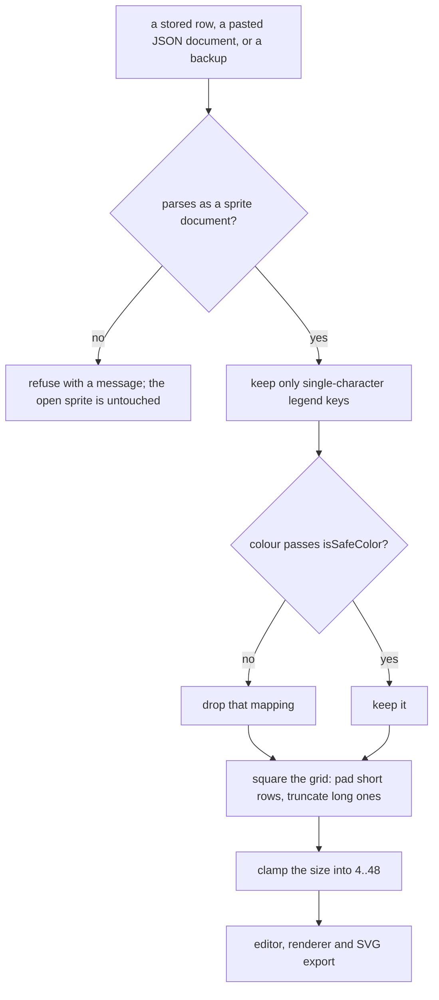

# Sprite editor

A pixel-art editor at `/tools/sprite-editor/`: a square character grid, a legend mapping each character to a CSS colour, and named documents in IndexedDB. Ported from [retoken](https://github.com/Descent098/retoken)'s `SpriteEditor` — the drawing surface and the sprite format are its; the documents, autosave, undo/redo and exports are this app's.

_Describes the code as of v0.3.0 (unreleased; schema v12) — verify against source when in doubt._

## File map

| Path | Role |
| --- | --- |
| [types.ts](../../../src/lib/sprite/types.ts) | `Sprite`, `ColorMap`, the reserved transparent characters, `isSafeColor`, `resolveColor`, `spritePixels`, `resizeSprite`, `blankSprite`. Ported verbatim. |
| [export.ts](../../../src/lib/sprite/export.ts) | Text and JSON round-trips, the SVG builder, and `normalizeSprite` for reading a stored row. Retoken's DOM helpers were **dropped** — see below. |
| [animations.ts](../../../src/lib/sprite/animations.ts) | The eight CSS animation presets the preview offers. |
| [pets.ts](../../../src/lib/sprite/pets.ts) | 15 bundled examples (14 creatures × 4 growth stages, plus an egg), 31 KB. Lazily imported. |
| [PixelSprite.svelte](../../../src/components/PixelSprite.svelte) | The renderer: one `<rect>` per painted pixel, `crispEdges`, pixel-aligned motion. |
| [SpriteEditorApp.svelte](../../../src/components/apps/SpriteEditorApp.svelte) | The tool: document browser, grid, legend, examples, export/import. |
| [export.test.ts](../../../src/lib/sprite/export.test.ts) | 21 unit tests — the parsers, the safety allowlist, and an invariant sweep over every bundled example. |
| [sprite-editor.spec.ts](../../../tests/local/sprite-editor.spec.ts) | Documents, autosave isolation, one-stroke-one-undo, exports, deletion. |

## The format

A sprite is text all the way down:

```json
{ "format": "useful-sprite", "version": 1, "size": 16,
  "rows": ["....kk....", "...kWWk..."], "colors": { "k": "#1d1d24", "W": "#ffffff" } }
```

`.`, a space and the empty string are permanently transparent; every other character paints whatever the legend says, and an unmapped character paints nothing. That is why a sprite reads as a diff, round-trips a backup byte-identically, and can live in the JSON data layer at all — the same reason the SVG editor stores layers rather than a rendered image.

Files from retoken (`"format": "retoken-sprite"`) are **read** as well, so sprites move between the two projects; this app writes its own string.

## Storage

| | |
| --- | --- |
| Store | `sprites` (migration **v9**), one row per document |
| Columns | `name`, `size`, `rows` (json), `colors` (json) |
| Preference | `sprite_last_doc_id` — the document to resume |

The autosave contract is the SVG editor's, deliberately: a 400 ms debounce; a flush on `pagehide`, on `visibilitychange` to hidden, on `onDestroy`, and before opening or closing a document; a `destroyed` flag set synchronously at teardown so an async mount continuation cannot resurrect state into a dead island; and a stale-write guard (`current?.id !== id`) so a save landing after the document was swapped does not overwrite the new one. What is persisted is `history.present` — the last **committed** snapshot — never the live bound values, so a size typed halfway to `48` is not written.

**Nothing is written on load.** Resuming reads the preference and the row; the "loading, resuming and looking around write nothing at all" spec compares whole-database dumps across two reloads and a mode switch.

## Reading a stored row is not trusted



`normalizeSprite(size, rows, colors)` squares the grid and filters the legend to single-character keys mapping to colours `isSafeColor` accepts. It has to: a backup is a hand-editable file, and the generic data-integrity suite writes an **array** into every `json` column — including `colors`. A ragged or negative-sized grid would otherwise reach the renderer and the SVG export directly. Anything unusable becomes an empty legend and a blank grid rather than an exception on load.

## Safety

`isSafeColor` is the load-bearing check, and it is deliberately strict: hex, `rgb()`/`rgba()`/`hsl()`/`hsla()` with only numeric characters inside, or a bare keyword. It gates three paths:

1. the cell tint, which is interpolated into an inline `style` the browser re-parses as CSS;
2. the legend swatch;
3. `toSvgString`, whose output is a file someone may open outside this app.

`toSvgString` **also** XML-escapes, because it is a reusable function that cannot assume its `ColorMap` came from the editor. A unit test feeds it `"><script>` and asserts the export contains no `<script>`.

## Undo/redo

The generic snapshot stack from [svg/history.ts](../../../src/lib/svg/history.ts) — the same module the SVG editor uses, unchanged; sprite content is JSON-native so it clones and compares the same way. `commit()` records one step and schedules a save; identical consecutive snapshots coalesce, so a gesture that changed nothing is not a step.

**A stroke is one step.** Painting mutates cells on `pointerover` but only `stopPainting` (on window `pointerup`) commits, so dragging across forty pixels is one undo, not forty. Typing into a cell commits on `change`, so each typed cell is its own step. `ctrl+z` / `ctrl+shift+z` / `ctrl+y` are bound on the window.

## Exports

Everything goes through the app's shared pipeline rather than retoken's own helpers — one download path, one clipboard path, one encoder:

| Output | How |
| --- | --- |
| TXT / JSON | `downloadText` / `copyText` from [exportFile.ts](../../../src/lib/exportFile.ts) |
| SVG | `toSvgString` → `downloadText` |
| PNG | `toSvgString` → `decodeToCanvas(file, exportPx)` → `encodeCanvas(canvas, 'png', 100)` |
| PNG to clipboard | the same, then `copyPng` |

The PNG is rasterized **at** its final size rather than drawn small and scaled up, which keeps the pixels hard-edged without having to fight image smoothing afterwards.

## Known limits

- **Square grids only**, 4–48 a side. A size outside that range is clamped, not obeyed; importing a smaller sprite (retoken allows 2×2) grows it to 4×4.
- **One frame.** No animation timeline, no sprite sheets, no GIF — the preview's animations are CSS effects on a single grid.
- **Closing a document does not forget it**: a reload resumes the last-open sprite rather than showing the list. Shared with the SVG editor, from which this behaviour was copied.
- The grid renders one `<input>` per cell — 2,304 of them at 48×48. Acceptable, and the reason the maximum is 48.
