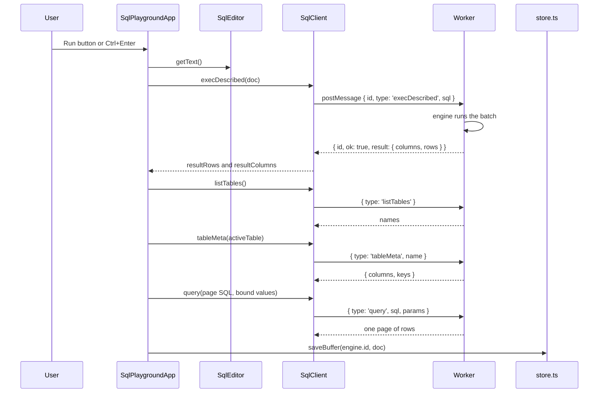
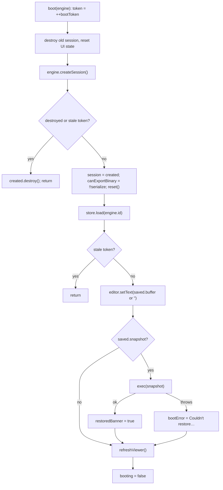
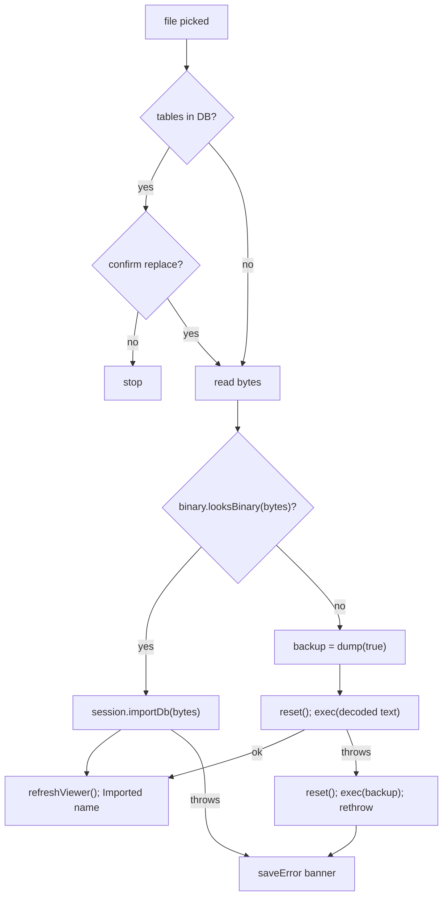
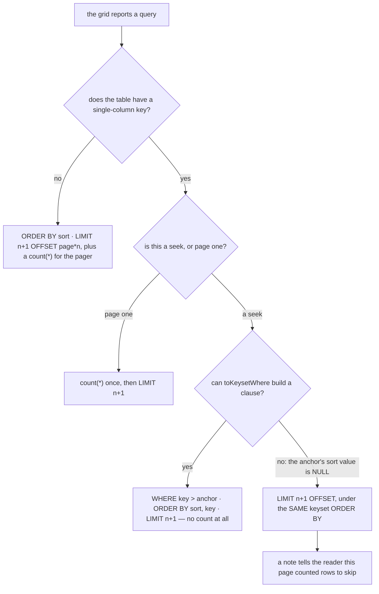

# SQL playground

A real database engine running in a Web Worker inside the tab: SQLite (sqlite-wasm) or Postgres (PGlite), behind one message protocol so the UI never knows which one it is driving. The page (`/tools/sql-playground/`, category **Playgrounds**) is a CodeMirror editor, two data grids — a results grid and a table browser, both retoken's `DataTable`, with search, an AND/OR filter tree, sortable headers, paging and CSV export — plus snapshot save/restore and import/export in SQL, binary and JSON forms. Ported from [retoken](https://github.com/Descent098/retoken) with the exercise-checking half removed; persistence was rebuilt on this app's data layer (`sql_playgrounds`, one row per engine) so a workspace rides backups and the data-integrity oracle audits every write. The live database is memory-only — only the SQL needed to rebuild it is stored.

_Describes the code as of v0.5.0 (unreleased; schema v16) — verify against source when in doubt._

## File map

| File | Role |
| --- | --- |
| [sql-playground.astro](../../../src/pages/tools/sql-playground.astro) | Page shell; mounts `SqlPlaygroundApp` with `client:only="svelte"`. |
| [SqlPlaygroundApp.svelte](../../../src/components/apps/SqlPlaygroundApp.svelte) | Engine picker, editor toolbar (`run`, `save`, `forgetSnapshot`, `clearDb`), transfer card (`onImportFile`, `exportAs`), boot/teardown — and `fetchPage`, which compiles the browser's query state into SQL. Both grids are delegated to `DataTable`. |
| [DataTable.svelte](../../../src/components/DataTable.svelte) | The grid, ported from retoken. Client-side by default; `manual` inverts it so an owner answers every query. |
| [table/FilterBuilder.svelte](../../../src/components/table/FilterBuilder.svelte) | The AND/OR tree editor — recursive, so `A AND (B OR C)` is expressible. |
| [table/FilterCondition.svelte](../../../src/components/table/FilterCondition.svelte) | One condition row: column, operator, and the value inputs that operator needs. |
| [table/types.ts](../../../src/lib/table/types.ts) | `TableSchema` → `Column[]`: type aliases, kinds, alignment, `normalizeSchema`, `columnMap`. |
| [table/format.ts](../../../src/lib/table/format.ts) | Coercion (`toNumber`/`toTime`/`toBool`/`toText`), `compareValues`, `formatValue`, `safeHref`. |
| [table/filter.ts](../../../src/lib/table/filter.ts) | The filter model and the client-side engine: operators per kind, three-valued `testCondition`, `filterRows`, `searchRows`. |
| [table/csv.ts](../../../src/lib/table/csv.ts) | `toCsv`, `csvField` (formula-injection guard before quoting), `csvFilename`, `UTF8_BOM`. |
| [table/to-sql.ts](../../../src/lib/table/to-sql.ts) | The filter tree → a parameterized `WHERE`; `toSqlOrderBy`, `toSqlSearch`, `toKeysetOrderBy`, `toKeysetWhere`. |
| [sql/table-schema.ts](../../../src/lib/sql/table-schema.ts) | A declared SQL type → a DataTable column type, for the browser. |
| [sql/infer-schema.ts](../../../src/lib/sql/infer-schema.ts) | A schema for an arbitrary result set: engine-declared type first, sniffed values second. |
| [SqlEditor.svelte](../../../src/components/SqlEditor.svelte) | `CodeEditor` wired to the active adapter's dialect via `adapter.editorLanguage()`. |
| [CodeEditor.svelte](../../../src/components/CodeEditor.svelte) | Themed CodeMirror 6 chassis: `basicSetup`, `Mod-Enter` keymap → `onRun`, `languageSlot` compartment, `updateListener` → `onDocChange`. |
| [types.ts](../../../src/lib/sql/types.ts) | The contract: `RuntimeAdapter`, `DatabaseSession`, `BinaryFormat`, `Row`, `TableData`, `TableMeta`, `ResultColumn`, `ExecResult`. |
| [protocol.ts](../../../src/lib/sql/protocol.ts) | `SqlRequest` / `SqlResponse` unions shared by every worker and the client. |
| [client.ts](../../../src/lib/sql/client.ts) | `SqlClient` — promise-per-message over a `Worker`; dead-worker handling. |
| [adapter.ts](../../../src/lib/sql/adapter.ts) | `sqliteAdapter` (`id: 'sqlite'`), its `BinaryFormat`, and the `new Worker(new URL('./worker.ts', …))` literal. |
| [worker.ts](../../../src/lib/sql/worker.ts) | SQLite worker: `:memory:` DB, `registerRegexp`, `exec`/`query`/`validate`, own `dump`, `serialize`, `importDb`, `exportJson`, `listTables`, `tableData`. |
| [pglite-adapter.ts](../../../src/lib/sql/pglite-adapter.ts) | `pgliteAdapter` (`id: 'pglite'`), its `BinaryFormat`, worker literal for `pglite-worker.ts`. |
| [pglite-worker.ts](../../../src/lib/sql/pglite-worker.ts) | Protocol shim over `PgliteEngine`; `describe()` folds Postgres `detail`/`hint`/`position` into the error string. |
| [pglite-engine.ts](../../../src/lib/sql/pglite-engine.ts) | `PgliteEngine`: `memory://` PGlite, schema-drop `reset`, catalog-driven `dump`, `dumpDataDir` serialize, `loadDataDir` import. |
| [pg-sql.ts](../../../src/lib/sql/pg-sql.ts) | Pure helpers: `quotePgId`, `quotePgString`, `quotePgValue`, `splitPgStatements`. |
| [engines.ts](../../../src/lib/sql/engines.ts) | `engines = [sqliteAdapter, pgliteAdapter]` and `engineById`. |
| [store.ts](../../../src/lib/sql/store.ts) | `PlaygroundStore` + `indexedDbPlayground()` over the `sql_playgrounds` store. |
| [types.ts (db)](../../../src/lib/db/types.ts) | `SqlPlayground` row, `Preferences.sql_last_engine`, `STORES.sql_playgrounds`. |
| [db.ts](../../../src/lib/db/db.ts) | v7 migration: `createObjectStore('sql_playgrounds', { keyPath: 'id' })`. |
| [offline.ts](../../../src/lib/offline.ts) | `engineBundle('sqlite' | 'pglite', …)` — the "download for offline" entries. |
| [registry.ts](../../../src/lib/registry.ts) | Tool entry `sql-playground` (route, aliases, icon `database`). |
| [sw.js](../../../public/sw.js) | `tools/sql-playground/` is in the precached shell; engine assets go through the generic stale-while-revalidate path. |

## Architecture

### The contract: adapters and sessions

Everything engine-specific is data on a `RuntimeAdapter` or a method on the `DatabaseSession` it creates. `SqlPlaygroundApp` and `SqlEditor` never branch on an engine id.

`RuntimeAdapter`: `id`, `label`, `kind: 'database'`, `dialect`, `blurb`, `editorLanguage()` (lazy CodeMirror `LanguageSupport`), `createSession()`, optional `binaryFormat`.

`DatabaseSession`: required `reset`, `exec`, `validate`, `listTables`, `tableData`, `dump`, `destroy`; optional `query`, `execDescribed`, `tableMeta`, `serialize`, `exportJson`, `importDb`. The playground mirrors `!!created.serialize` into `canExportBinary` and hides the binary export option when it is false. (`SqlClient` implements every optional method, so with the two shipped engines nothing is hidden.)

| | `sqliteAdapter` | `pgliteAdapter` |
| --- | --- | --- |
| `id` / `label` / `dialect` | `sqlite` / SQLite / SQLite | `pglite` / Postgres / PostgreSQL |
| Worker | `worker.ts` | `pglite-worker.ts` → `PgliteEngine` |
| Storage | `new sqlite3.oo1.DB(':memory:')` | `PGlite.create('memory://')` |
| `reset` | close and reopen a fresh `:memory:` DB (re-registers `regexp`) | `DROP SCHEMA … CASCADE` for every non-system schema, then `CREATE SCHEMA public` — milliseconds vs. seconds for a second `initdb` |
| `exec` | `db.exec({ sql, rowMode: 'object', callback })` | `db.exec(sql)`, rows of every result `flatMap`ped |
| `execDescribed` | the same, plus `columnNames: []` — filled from `sqlite3_column_name` **before** stepping, so it is populated at zero rows. No declared type (SQLite types values, not columns), so `type` is `''` and the caller sniffs | the last result with `fields`; each `dataTypeID` turned into a name by `format_type`, memoised per session |
| `listTables` | `sqlite_master` tables, `NOT LIKE 'sqlite_%'`, alphabetical | relkinds `r p f v m`; bare name in `public`, `schema.name` elsewhere; `localeCompare` sort |
| `tableMeta` | `PRAGMA table_info` alone | `pg_attribute` + `pg_constraint` (PK order via `unnest WITH ORDINALITY`) |
| `tableData` | `tableMeta` + `SELECT * … LIMIT 50` | `tableMeta` + `LIMIT 50` |
| `dump` | own `.dump`: `PRAGMA foreign_keys=OFF; BEGIN TRANSACTION;`, each table's `sql` + `INSERT`s (`pragma_table_xinfo` `hidden = 0` skips generated columns), then indexes/triggers/views, `COMMIT;` | own `pg_dump` from the catalogs — see below |
| `serialize` | `sqlite3_js_db_export` | `dumpDataDir('gzip')` |
| `importDb` | `sqlite3_deserialize` into a fresh DB, then `SELECT count(*) FROM sqlite_master` to force the header read | `PGlite.create({ loadDataDir })`, then `SELECT 1` |
| `binaryFormat.extension` / MIME | `.sqlite` / `application/x-sqlite3` | `.tar.gz` / `application/gzip` |
| `binaryFormat.accept` | `.sqlite .sqlite3 .db application/x-sqlite3` | `.tar.gz .tgz .tar application/gzip application/x-tar` |
| `looksBinary` | first 16 bytes `SQLite format 3\0` | gzip magic `1f 8b`, or `ustar` at offset 257 |
| `editorLanguage` | `sql({ dialect: SQLite })` | `sql({ dialect: PostgreSQL })` |
| Extra | `registerRegexp` — a case-insensitive `regexp(pattern, value)` user function so `X REGEXP Y` works | `describe()` appends `detail`, `Hint:`, `(at character N)` to error strings |

Schema-only `serialize` is the same trick on both engines: `dump(false)` replayed into a throwaway instance, which is then exported and closed.

`PgliteEngine.dump` order (it matters for replay): `BEGIN;` → non-`public` schemas → standalone sequences (identity-owned ones are skipped) → tables with columns, `DEFAULT`/`GENERATED … AS IDENTITY`/`GENERATED … STORED`, `NOT NULL`, and PK/UNIQUE/CHECK constraints inline (FKs are collected into `deferred`) → `ALTER SEQUENCE … OWNED BY` → data as `INSERT … OVERRIDING SYSTEM VALUE` (generated columns omitted) → `setval` for every sequence with a `last_value` → indexes not backing a constraint → the deferred FKs → views and materialized views by oid → `COMMIT;`. Nothing else is dumped: functions, triggers, enums/domains, extensions and policies have no section.

### Worker protocol

Both workers speak the same shape: request `{ id, type, …payload }`, reply `{ id, ok: true, result }` or `{ id, ok: false, error }`. Types: `reset`, `exec`, `execDescribed`, `query`, `validate`, `listTables`, `tableData`, `tableMeta`, `dump`, `serialize`, `exportJson`, `importDb`.

`execDescribed` and `tableMeta` are optional on `DatabaseSession` and the app mirrors each into a boolean at boot, so an engine without them degrades to `exec` and `tableData`. Both shipped engines have them. A request arm added without a `case` in **both** worker dispatchers is a silent no-reply that hangs the promise forever, so the two always land together.

`SqlClient` keeps `#nextId`, a `#pending` map of `{ resolve, reject }` per id, and `#dead`. `onerror`/`onmessageerror` call `#fail`, which rejects every pending call and every future one — a boot failure surfaces as an error instead of hanging. `destroy()` terminates the worker and rejects pending calls with `Database worker terminated`; this is also how a runaway query is killed.

The `new Worker(new URL('./worker.ts', import.meta.url), { type: 'module' })` expression lives in each adapter, not in `SqlClient`, because Vite only rewrites that form when the path is a literal in the calling module.

### Running a query

`run()` reads the buffer, runs it through `execDescribed` (falling back to `exec`), refreshes the table browser (keeping the active table if it still exists) and flushes the buffer to the store in `finally` — success or failure. The refresh fetches **metadata only**; the browser's first page comes from its own `query`, so no sample rows are fetched and discarded.

On an engine error the reply is `{ ok: false, error }`, `SqlClient` rejects, `run()` sets `sqlError` and leaves the viewer alone. The buffer is still saved.

What lands in `resultRows` differs by engine: sqlite-wasm's `exec` callback fires only for the first statement in the batch that has result columns, while `PgliteEngine.exec` concatenates the rows of every statement. The **columns** come from the engine rather than from the first row's keys, which is what gives a result set with no rows its headers — `select id, name from t where 1 = 0` renders an empty grid with two columns instead of the "that ran without returning any rows" line, and that line is now shown only when the statement had no result set at all.

### Boot, engine switch, restore

`boot(engine)` is guarded by two flags: `bootToken` (bumped per boot; a boot that finds a newer token lost a race and destroys what it created) and `destroyed` (set in `onDestroy`). Both exist so a worker that finishes booting after an unmount or a fast engine switch is terminated, not leaked.

A failed restore does not reset the database: whatever the partial replay produced is what the viewer shows, alongside the error banner.

`onMount` reads `preferences.sql_last_engine` with `getSingleton` (a read, never a write), picks that engine if `engines` contains it, and boots. `pickEngine(id)` flushes the current buffer to its own row, sets `activeId`, writes `sql_last_engine` with `putSingleton`, and boots the new engine. It is a no-op while `booting`.

### Lazy engine assets and caching

[engines.ts](../../../src/lib/sql/engines.ts) imports both adapter modules, but each is a few lines: the WASM engine, its worker and the `@codemirror/lang-sql` dialect are all behind `import()` / worker URLs, so picking an engine is what downloads it. [payload.spec.ts](../../../tests/local/payload.spec.ts) proves the default page load fetches sqlite-* and no pglite-* asset.

Engine assets are hashed build files under `_astro/` (`sqlite3-*.wasm`, `pglite-*.wasm`, `pglite-*.data`, `initdb-*.wasm`). The service worker handles them on its generic path — stale-while-revalidate into `CACHE_NAME` — so after the first boot they serve from cache and refresh in the background. Unlike the background remover's model bucket, they are not exempt from the activate-time purge, so a cache-name bump re-downloads them.

[offline.ts](../../../src/lib/offline.ts)' `engineBundle` boots the engine and runs `select 1;` — the only way to both fetch and verify a wasm engine — then destroys the session. `ready()` returns `null` because a hashed URL cannot be checked without booting. Sizes shown in the dialog are the rough constants `1_200_000` (SQLite) and `12_000_000` (Postgres).

## What is persisted

| Where | What | When written |
| --- | --- | --- |
| `sql_playgrounds` row, `id === engine id` | `engine`, `buffer`, `snapshot` (SQL text or null), `snapshot_at` (ISO or null), plus `SyncFields` | first write creates it (`upsert` in `store.ts` — `get`, then `patch` or `put` with `withSyncFields`) |
| `preferences.sql_last_engine` | `'sqlite'` / `'pglite'` | `pickEngine` only |
| Worker memory | the live database | never — gone on unmount, engine switch, reload, tab close |

- **Buffer**: `scheduleSave` debounces `store.saveBuffer` by 600 ms after each doc change (`onDocChange`); `run()` and `pickEngine` flush it immediately.
- **Snapshot**: `save()` calls `session.dump(true)` (schema + data, always) and stores it. If the text is over `ONE_MB` (measured as `new Blob([sql]).size`) it is parked in `pendingLarge` and shown as a warning banner with **Save anyway** (`saveAnyway`) or Cancel; nothing is written until confirmed. `forgetSnapshot` writes `snapshot: null, snapshot_at: null` — the row stays.
- The snapshot is replayed with `exec` on every boot of that engine. It is not refreshed automatically: `clearDb`, imports and later queries leave it untouched until **Save snapshot** is pressed again.
- Because the store is `Object.keys(STORES)`-driven, the row rides backup export/import in [export.ts](../../../src/lib/db/export.ts) with no extra code; every field is text, so it round-trips byte-identically.

## Import

`onImportFile` (file input `accept` = `.sql, application/sql` + `binary.accept`): if the DB has tables, `confirm()` first. Then the bytes are sniffed with `binary.looksBinary` — the engine's own header decides, so a wrong extension does not matter.

Both `importDb` implementations keep the old database until the new one has answered a query, so a bad binary file leaves the session usable. For a `.sql` script the app itself takes a full `dump(true)` before resetting, and replays it if the script throws part-way. The saved snapshot is never touched by an import.

## Export

The **Transfer** card has a `Schema + data` / `Schema only` toggle (`includeData`) and an `Export…` select (`onExportPick` resets the select to `''` after each pick).

| Option | `dest` | Call | Result |
| --- | --- | --- | --- |
| Copy SQL to clipboard | `clipboard` | `dump(includeData)` → `copyText` | banner `Copied SQL to clipboard (…)`, or `Copy failed — try downloading instead` |
| SQL file (.sql) | `sql` | `dump(includeData)` → `downloadText` | `playground.sql`, `application/sql` |
| `binary.label` (only when `canExportBinary && binary`) | `db` | `serialize(includeData)` → `downloadBlob` | `playground` + `binary.extension`, `binary.mimeType` — `playground.sqlite` or `playground.tar.gz` |
| JSON (.json) | `json` | `exportJson(includeData)` → `downloadText` | `playground.json` |

`exportJson` shape: with data `{ table: rowObjects[] }`; schema only `{ table: [{ name, type, notnull, pk }] }`. BigInts within ±2^53 become numbers, larger ones strings; `Uint8Array` values become byte arrays. Both engines skip system tables; SQLite also skips virtual-table shadow tables.

## Editor

- `CodeEditor` builds one `EditorView` with `basicSetup` (bracket matching, history, autocomplete UI, …), a `Mod-Enter` keymap that calls `onRun`, the app-palette theme, `syntaxHighlighting(highlight)`, `languageSlot.of(language ?? [])`, and an `updateListener` that calls `onDocChange` on `docChanged`. `getText`/`setText`/`focus` are exported.
- The language lives in a `Compartment`, so changing the `language` prop reconfigures the running view instead of rebuilding it — buffer, cursor and undo history survive an engine switch.
- `SqlEditor` runs an `$effect` that awaits `adapter.editorLanguage()`; a `current` flag ensures only the latest resolution wins after a fast switch, and a rejection falls back to no highlighting rather than blocking editing. `sql({ dialect })` from `@codemirror/lang-sql` supplies the dialect's highlighting and keyword completion — that package is only fetched once an editor mounts.
- Ctrl+Enter (Cmd+Enter on macOS) is `Mod-Enter` → `onRun` → `run()`. The toolbar hint says `Ctrl+Enter runs`.

## Invariants and conventions

- Opening the page **must write nothing**: `store.load` never creates a row, `onMount` only `getSingleton`s preferences. The first write is a run, an autosave, a snapshot or an engine switch.
- One workspace row per engine, `id === engine`. A snapshot is only ever replayed into the engine whose id it is keyed by.
- All writes go through [repo.ts](../../../src/lib/db/repo.ts) (`get`, `put`, `patch`, `withSyncFields`, `getSingleton`, `putSingleton`) so the oracle can audit them.
- `session` is **not** `$state` — `SqlClient` has private fields and a reactive proxy would break it. Anything the template needs is mirrored into plain state (`canExportBinary`, `booting`, `tables`, …).
- Every session created after `destroyed` or with a stale `bootToken` must be `destroy()`ed. Never leave a worker running that nothing references.
- The `new Worker(new URL(…, import.meta.url))` literal must stay in the adapter module.
- Every code path that opens a new SQLite connection must call `registerRegexp` (currently `ensureDb` and `importDb`).
- Components must not branch on engine id; add engine differences as adapter data or optional session methods.
- Heavy dependencies stay lazy; the payload suite watches the network for regressions.
- `engines` lists SQLite first because it is the default and boots far faster.

## Tests

- [sql-playground.spec.ts](../../../tests/local/sql-playground.spec.ts) (Playwright, real engines from the production build): opening writes nothing and running SQL fills the browser and creates exactly one `sql_playgrounds` row (`assertIsolatedDelta`, `assertInvariants`); a saved snapshot rebuilds the DB after reload and **Clear saved snapshot** nulls the field; wiping clears tables but not the snapshot; `.sql` export downloads `playground.sql`; Postgres is a second engine with its own row and the choice is remembered in `preferences`; a syntax error is reported without losing the database.
- [payload.spec.ts](../../../tests/local/payload.spec.ts): the playground loads one engine, not both; the install precache holds the shell only (asserted against `/models/` and `/ort/`).
- [offline.spec.ts](../../../tests/local/offline.spec.ts): the offline dialog lists `sqlite` / `pglite` bundles (the SQLite one is downloaded, Postgres is unchecked to keep the run light).
- [a11y.spec.ts](../../../tests/local/a11y.spec.ts): the route is in the page sweep.
- [helpers/schema.ts](../../../tests/local/helpers/schema.ts): mirrors the `sql_playgrounds` columns for the oracle.
- [pg-sql.test.ts](../../../src/lib/sql/pg-sql.test.ts) (vitest): identifier/literal quoting, `quotePgValue` per JS type, `splitPgStatements` across strings, dollar quotes and nested comments.
- There is no unit test for `PgliteEngine.dump` in this repo; the comment in `pglite-engine.ts` mentioning `pglite-engine.test.ts` refers to retoken's file, which was not ported. The table layer's own suites **did** come across: [format.test.ts](../../../src/lib/table/format.test.ts) (46), [filter.test.ts](../../../src/lib/table/filter.test.ts) (44), [csv.test.ts](../../../src/lib/table/csv.test.ts) (25), [to-sql.test.ts](../../../src/lib/table/to-sql.test.ts) (78), [table-schema.test.ts](../../../src/lib/sql/table-schema.test.ts) (8), plus [infer-schema.test.ts](../../../src/lib/sql/infer-schema.test.ts) (12) written here.

## The two grids

Both are `DataTable`. They run in opposite modes, and the reason is simply where the rows already are.

| | Results grid | Table browser |
| --- | --- | --- |
| `testid` | `sql-results` | `sql-table-rows` |
| Mode | client-side | `manual` |
| Schema from | `inferSchema(rows, columns)` | `tableSchemaFrom(tableView.columns)` |
| Filter / sort / page | in the browser, over rows `exec` already returned | compiled to SQL, answered by the engine |
| CSV export | every filtered row | the rows on the current page |
| Page sizes | 10 / 25 / 50 / 100 / All | 10 / 25 / 50 / 100 |

The browser's "All" is deliberately absent. retoken silently clamped it to `LIMIT 1000`; an option that quietly means something else is worse than no option.

### Paging

Two things retoken got wrong are fixed here rather than inherited:

1. **`SELECT count(*)` no longer runs on a seek.** It is the one full scan left in the path, it is exactly what cursor paging exists to avoid, and its result was dead in that mode — `hasMore` comes from fetching one row past the page, and the range readout short-circuits before it reads a total. The footer's "N rows in table" is a separate, unfiltered count run **once per table selection**, never per page, which is also what makes it truthful: it used to report the size of the 50-row sample.

2. **A NULL in the sort column no longer re-serves page one.** `toKeysetWhere` returned an empty clause for three unrelated situations — page one, no key value in the cursor, and a NULL sort value — and only the first is benign. The other two produced a query byte-identical to page one while the pager believed it had advanced, so **Next** served the same rows forever. It now returns `seekable: false`, and the caller falls back to `LIMIT/OFFSET` **under the keyset `ORDER BY`**, not `toSqlOrderBy`'s — using the plain order there would drop the key tiebreaker and the fallback page would overlap or skip against the pages either side of it. A Playwright case pages a table whose page-one boundary lands inside a run of NULLs and asserts page two is different rows; sabotaging `seekable` back to `true` fails it.

### Postgres needs `::text` before a text operator

`lower()`, `trim()`, `ILIKE` and `~*` all take `text`. Handed a `uuid`, an enum or `json`/`jsonb`, Postgres raises at run time rather than coercing — and since `id` resolves to `uuid`, every table with a non-integer primary key hit this on the first filter anyone built. SQLite has no such types and applies its own conversions, so the cast is Postgres-only.

`castText(id, column, dialect)` is applied to the **identifier** at five sites (`eq`, `ne`, the `LIKE` family, `matches`, `isEmpty`/`isNotEmpty`, `anyOf`/`noneOf`) and nowhere else. Never to the bound placeholder — `$1::text` is redundant and confuses Postgres' parameter type inference. Never in `toKeysetWhere` — a bare `"id" > $1` compares natively and index-seeks, which is the whole point of keyset paging. Never on `gt`/`gte`/`lt`/`lte`/`between`, where a cast would change collation order.

`nodeSql` also now skips a condition whose operator its column's kind does not offer. The UI would never build one, but a tree that arrived from somewhere else could pair `gt` with a `json` column, and that emits SQL which errors rather than SQL which merely matches nothing.

### Blanks sort last in both directions

`compareValues` already sorts blanks last, but retoken applied the sort direction as `sign * compareValues(...)`, which dragged them to the front on a descending sort — disagreeing with the `NULLS LAST` that `toSqlOrderBy` emits either way. Since this page reads the same table client-side (results) and in SQL (browser), the two have to agree, so the blank rule is applied outside the sign in `DataTable`'s `ordered`. `compareValues` itself is untouched, so its own tests stand.

## Known limits and decisions

- **Memory only, no OPFS.** OPFS needs `SharedArrayBuffer` and therefore COOP/COEP headers many static hosts cannot set. Persistence is the SQL snapshot instead.
- **Duplicate result column names still collapse.** `select 1 as a, 2 as a` produces one key, because both engines build row *objects* before the component sees anything. `execDescribed` fixes the *headers* — the grid shows both `a` columns — but not the values. Positional rows (`rowMode: 'array'`) and a second render path would be a phase of their own.
- **`json` filter parity is approximate.** Client-side `contains` does `JSON.stringify(cell).includes(needle)`; in Postgres it becomes `"col"::text ILIKE …`, which is the engine's own normalised serialisation — different key order, no whitespace. The same filter can therefore match client-side and not in SQL.
- **`toNumber('100 EUR')` is `NaN`.** A trailing `E` is a legal exponent marker and cannot be told from a currency code. `'100 USD'` and `'100 kg'` do work.
- **`.mono` cells are not monospaced.** `--font-mono` is aliased to `--font-body` in this app's theme, so `json` and `uuid` cells keep `tabular-nums` and `nowrap` but not a distinct face.
- **`validate` is unused by the app.** It is in the protocol, both workers and `SqlClient` (retoken's exercise evaluator used it). `validate` compiles without running, so a statement depending on an earlier one in the same batch fails; `splitPgStatements` exists for it. `client.ts`' comment still mentions `checkSolution`, which does not exist here.
- **Snapshot coverage = `dump` coverage.** SQLite: tables, data, indexes, triggers, views (`sqlite_%` and shadow tables excluded). Postgres: see the dump order above; functions, triggers, custom types, extensions are dropped silently.
- **Large snapshots** are allowed after confirmation but replayed on every boot, which is what the >1 MB warning is about.
- **Errors** are strings across the worker boundary; Postgres detail/hint/position are folded into the message by `describe()`.
- **Engine cache lifetime** follows the versioned app cache (see above), not a dedicated bucket.
