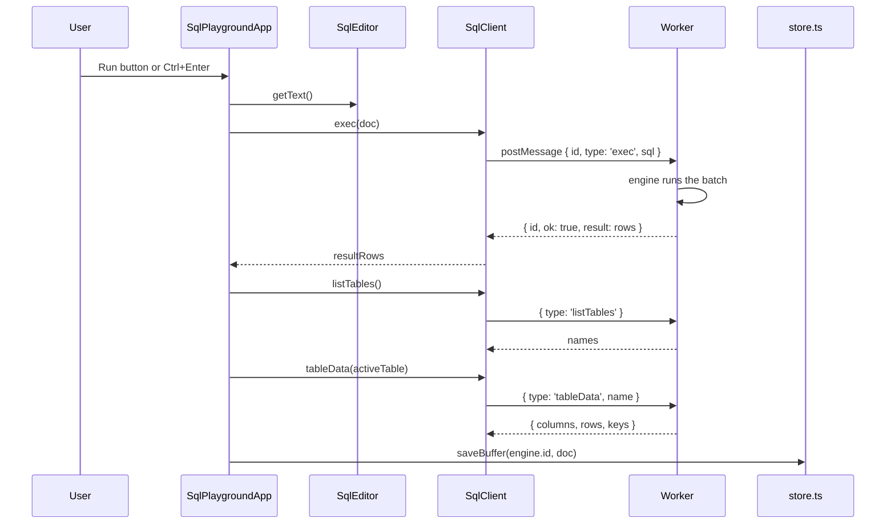
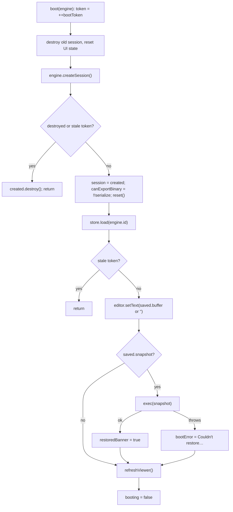
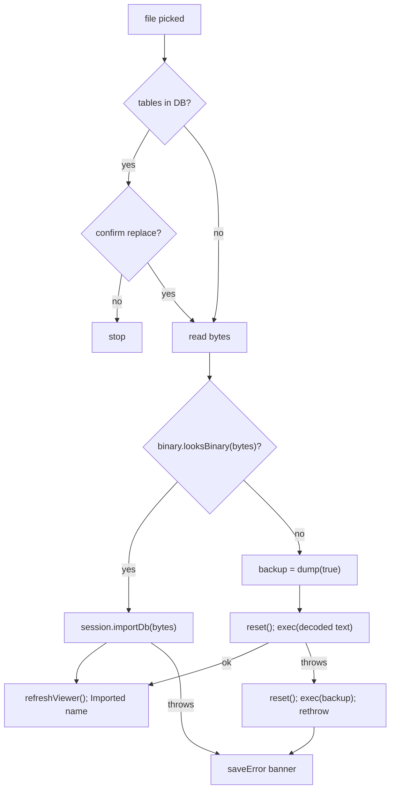

# SQL playground

A real database engine running in a Web Worker inside the tab: SQLite (sqlite-wasm) or Postgres (PGlite), behind one message protocol so the UI never knows which one it is driving. The page (`/tools/sql-playground/`, category **Playgrounds**) is a CodeMirror editor, a results grid, a table browser, snapshot save/restore, and import/export in SQL, binary and JSON forms. Ported from [retoken](https://github.com/Descent098/retoken) with the exercise-checking half removed; persistence was rebuilt on this app's data layer (`sql_playgrounds`, one row per engine) so a workspace rides backups and the data-integrity oracle audits every write. The live database is memory-only — only the SQL needed to rebuild it is stored.

_Describes the code as of v0.2.0 (unreleased; schema v7) — verify against source when in doubt._

## File map

| File | Role |
| --- | --- |
| [sql-playground.astro](../../../src/pages/tools/sql-playground.astro) | Page shell; mounts `SqlPlaygroundApp` with `client:only="svelte"`. |
| [SqlPlaygroundApp.svelte](../../../src/components/apps/SqlPlaygroundApp.svelte) | The whole UI: engine picker, editor toolbar (`run`, `save`, `forgetSnapshot`, `clearDb`), transfer card (`onImportFile`, `exportAs`), results grid, table browser, boot/teardown. |
| [SqlEditor.svelte](../../../src/components/SqlEditor.svelte) | `CodeEditor` wired to the active adapter's dialect via `adapter.editorLanguage()`. |
| [CodeEditor.svelte](../../../src/components/CodeEditor.svelte) | Themed CodeMirror 6 chassis: `basicSetup`, `Mod-Enter` keymap → `onRun`, `languageSlot` compartment, `updateListener` → `onDocChange`. |
| [types.ts](../../../src/lib/sql/types.ts) | The contract: `RuntimeAdapter`, `DatabaseSession`, `BinaryFormat`, `Row`, `TableData`. |
| [protocol.ts](../../../src/lib/sql/protocol.ts) | `SqlRequest` / `SqlResponse` unions shared by every worker and the client. |
| [client.ts](../../../src/lib/sql/client.ts) | `SqlClient` — promise-per-message over a `Worker`; dead-worker handling. |
| [adapter.ts](../../../src/lib/sql/adapter.ts) | `sqliteAdapter` (`id: 'sqlite'`), its `BinaryFormat`, and the `new Worker(new URL('./worker.ts', …))` literal. |
| [worker.ts](../../../src/lib/sql/worker.ts) | SQLite worker: `:memory:` DB, `registerRegexp`, `exec`/`query`/`validate`, own `dump`, `serialize`, `importDb`, `exportJson`, `listTables`, `tableData`. |
| [pglite-adapter.ts](../../../src/lib/sql/pglite-adapter.ts) | `pgliteAdapter` (`id: 'pglite'`), its `BinaryFormat`, worker literal for `pglite-worker.ts`. |
| [pglite-worker.ts](../../../src/lib/sql/pglite-worker.ts) | Protocol shim over `PgliteEngine`; `describe()` folds Postgres `detail`/`hint`/`position` into the error string. |
| [pglite-engine.ts](../../../src/lib/sql/pglite-engine.ts) | `PgliteEngine`: `memory://` PGlite, schema-drop `reset`, catalog-driven `dump`, `dumpDataDir` serialize, `loadDataDir` import. |
| [pg-sql.ts](../../../src/lib/sql/pg-sql.ts) | Pure helpers: `quotePgId`, `quotePgString`, `quotePgValue`, `splitPgStatements`. |
| [engines.ts](../../../src/lib/sql/engines.ts) | `engines = [sqliteAdapter, pgliteAdapter]` and `engineById`. |
| [store.ts](../../../src/lib/sql/store.ts) | `PlaygroundStore` + `indexedDbPlayground()` over the `sql_playgrounds` store. |
| [types.ts (db)](../../../src/lib/db/types.ts) | `SqlPlayground` row, `Preferences.sql_last_engine`, `STORES.sql_playgrounds`. |
| [db.ts](../../../src/lib/db/db.ts) | v7 migration: `createObjectStore('sql_playgrounds', { keyPath: 'id' })`. |
| [offline.ts](../../../src/lib/offline.ts) | `engineBundle('sqlite' | 'pglite', …)` — the "download for offline" entries. |
| [registry.ts](../../../src/lib/registry.ts) | Tool entry `sql-playground` (route, aliases, icon `database`). |
| [sw.js](../../../public/sw.js) | `tools/sql-playground/` is in the precached shell; engine assets go through the generic stale-while-revalidate path. |

## Architecture

### The contract: adapters and sessions

Everything engine-specific is data on a `RuntimeAdapter` or a method on the `DatabaseSession` it creates. `SqlPlaygroundApp` and `SqlEditor` never branch on an engine id.

`RuntimeAdapter`: `id`, `label`, `kind: 'database'`, `dialect`, `blurb`, `editorLanguage()` (lazy CodeMirror `LanguageSupport`), `createSession()`, optional `binaryFormat`.

`DatabaseSession`: required `reset`, `exec`, `validate`, `listTables`, `tableData`, `dump`, `destroy`; optional `query`, `serialize`, `exportJson`, `importDb`. The playground mirrors `!!created.serialize` into `canExportBinary` and hides the binary export option when it is false. (`SqlClient` implements every optional method, so with the two shipped engines nothing is hidden.)

| | `sqliteAdapter` | `pgliteAdapter` |
| --- | --- | --- |
| `id` / `label` / `dialect` | `sqlite` / SQLite / SQLite | `pglite` / Postgres / PostgreSQL |
| Worker | `worker.ts` | `pglite-worker.ts` → `PgliteEngine` |
| Storage | `new sqlite3.oo1.DB(':memory:')` | `PGlite.create('memory://')` |
| `reset` | close and reopen a fresh `:memory:` DB (re-registers `regexp`) | `DROP SCHEMA … CASCADE` for every non-system schema, then `CREATE SCHEMA public` — milliseconds vs. seconds for a second `initdb` |
| `exec` | `db.exec({ sql, rowMode: 'object', callback })` | `db.exec(sql)`, rows of every result `flatMap`ped |
| `listTables` | `sqlite_master` tables, `NOT LIKE 'sqlite_%'`, alphabetical | relkinds `r p f v m`; bare name in `public`, `schema.name` elsewhere; `localeCompare` sort |
| `tableData` | `PRAGMA table_info` + `SELECT * … LIMIT 50` | `pg_attribute` + `pg_constraint` (PK order via `unnest WITH ORDINALITY`) + `LIMIT 50` |
| `dump` | own `.dump`: `PRAGMA foreign_keys=OFF; BEGIN TRANSACTION;`, each table's `sql` + `INSERT`s (`pragma_table_xinfo` `hidden = 0` skips generated columns), then indexes/triggers/views, `COMMIT;` | own `pg_dump` from the catalogs — see below |
| `serialize` | `sqlite3_js_db_export` | `dumpDataDir('gzip')` |
| `importDb` | `sqlite3_deserialize` into a fresh DB, then `SELECT count(*) FROM sqlite_master` to force the header read | `PGlite.create({ loadDataDir })`, then `SELECT 1` |
| `binaryFormat.extension` / MIME | `.sqlite` / `application/x-sqlite3` | `.tar.gz` / `application/gzip` |
| `binaryFormat.accept` | `.sqlite .sqlite3 .db application/x-sqlite3` | `.tar.gz .tgz .tar application/gzip application/x-tar` |
| `looksBinary` | first 16 bytes `SQLite format 3\0` | gzip magic `1f 8b`, or `ustar` at offset 257 |
| `editorLanguage` | `sql({ dialect: SQLite })` | `sql({ dialect: PostgreSQL })` |
| Extra | `registerRegexp` — a case-insensitive `regexp(pattern, value)` user function so `X REGEXP Y` works | `describe()` appends `detail`, `Hint:`, `(at character N)` to error strings |

Schema-only `serialize` is the same trick on both engines: `dump(false)` replayed into a throwaway instance, which is then exported and closed.

`PgliteEngine.dump` order (it matters for replay): `BEGIN;` → non-`public` schemas → standalone sequences (identity-owned ones are skipped) → tables with columns, `DEFAULT`/`GENERATED … AS IDENTITY`/`GENERATED … STORED`, `NOT NULL`, and PK/UNIQUE/CHECK constraints inline (FKs are collected into `deferred`) → `ALTER SEQUENCE … OWNED BY` → data as `INSERT … OVERRIDING SYSTEM VALUE` (generated columns omitted) → `setval` for every sequence with a `last_value` → indexes not backing a constraint → the deferred FKs → views and materialized views by oid → `COMMIT;`. Nothing else is dumped: functions, triggers, enums/domains, extensions and policies have no section.

### Worker protocol

Both workers speak the same shape: request `{ id, type, …payload }`, reply `{ id, ok: true, result }` or `{ id, ok: false, error }`. Types: `reset`, `exec`, `query`, `validate`, `listTables`, `tableData`, `dump`, `serialize`, `exportJson`, `importDb`.

`SqlClient` keeps `#nextId`, a `#pending` map of `{ resolve, reject }` per id, and `#dead`. `onerror`/`onmessageerror` call `#fail`, which rejects every pending call and every future one — a boot failure surfaces as an error instead of hanging. `destroy()` terminates the worker and rejects pending calls with `Database worker terminated`; this is also how a runaway query is killed.

The `new Worker(new URL('./worker.ts', import.meta.url), { type: 'module' })` expression lives in each adapter, not in `SqlClient`, because Vite only rewrites that form when the path is a literal in the calling module.

### Running a query

`run()` reads the buffer, `exec`s it, refreshes the table browser (keeping the active table if it still exists) and flushes the buffer to the store in `finally` — success or failure.

On an engine error the reply is `{ ok: false, error }`, `SqlClient` rejects, `run()` sets `sqlError` and leaves the viewer alone. The buffer is still saved.

What lands in `resultRows` differs by engine: sqlite-wasm's `exec` callback fires only for the first statement in the batch that has result columns, while `PgliteEngine.exec` concatenates the rows of every statement. `resultCols` is derived from the keys of the first row.

### Boot, engine switch, restore

`boot(engine)` is guarded by two flags: `bootToken` (bumped per boot; a boot that finds a newer token lost a race and destroys what it created) and `destroyed` (set in `onDestroy`). Both exist so a worker that finishes booting after an unmount or a fast engine switch is terminated, not leaked.

A failed restore does not reset the database: whatever the partial replay produced is what the viewer shows, alongside the error banner.

`onMount` reads `preferences.sql_last_engine` with `getSingleton` (a read, never a write), picks that engine if `engines` contains it, and boots. `pickEngine(id)` flushes the current buffer to its own row, sets `activeId`, writes `sql_last_engine` with `putSingleton`, and boots the new engine. It is a no-op while `booting`.

### Lazy engine assets and caching

[engines.ts](../../../src/lib/sql/engines.ts) imports both adapter modules, but each is a few lines: the WASM engine, its worker and the `@codemirror/lang-sql` dialect are all behind `import()` / worker URLs, so picking an engine is what downloads it. [payload.spec.ts](../../../tests/local/payload.spec.ts) proves the default page load fetches sqlite-* and no pglite-* asset.

Engine assets are hashed build files under `_astro/` (`sqlite3-*.wasm`, `pglite-*.wasm`, `pglite-*.data`, `initdb-*.wasm`). The service worker handles them on its generic path — stale-while-revalidate into `CACHE_NAME` — so after the first boot they serve from cache and refresh in the background. Unlike the background remover's model bucket, they are not exempt from the activate-time purge, so a cache-name bump re-downloads them.

[offline.ts](../../../src/lib/offline.ts)' `engineBundle` boots the engine and runs `select 1;` — the only way to both fetch and verify a wasm engine — then destroys the session. `ready()` returns `null` because a hashed URL cannot be checked without booting. Sizes shown in the dialog are the rough constants `1_200_000` (SQLite) and `12_000_000` (Postgres).

## What is persisted

| Where | What | When written |
| --- | --- | --- |
| `sql_playgrounds` row, `id === engine id` | `engine`, `buffer`, `snapshot` (SQL text or null), `snapshot_at` (ISO or null), plus `SyncFields` | first write creates it (`upsert` in `store.ts` — `get`, then `patch` or `put` with `withSyncFields`) |
| `preferences.sql_last_engine` | `'sqlite'` / `'pglite'` | `pickEngine` only |
| Worker memory | the live database | never — gone on unmount, engine switch, reload, tab close |

- **Buffer**: `scheduleSave` debounces `store.saveBuffer` by 600 ms after each doc change (`onDocChange`); `run()` and `pickEngine` flush it immediately.
- **Snapshot**: `save()` calls `session.dump(true)` (schema + data, always) and stores it. If the text is over `ONE_MB` (measured as `new Blob([sql]).size`) it is parked in `pendingLarge` and shown as a warning banner with **Save anyway** (`saveAnyway`) or Cancel; nothing is written until confirmed. `forgetSnapshot` writes `snapshot: null, snapshot_at: null` — the row stays.
- The snapshot is replayed with `exec` on every boot of that engine. It is not refreshed automatically: `clearDb`, imports and later queries leave it untouched until **Save snapshot** is pressed again.
- Because the store is `Object.keys(STORES)`-driven, the row rides backup export/import in [export.ts](../../../src/lib/db/export.ts) with no extra code; every field is text, so it round-trips byte-identically.

## Import

`onImportFile` (file input `accept` = `.sql, application/sql` + `binary.accept`): if the DB has tables, `confirm()` first. Then the bytes are sniffed with `binary.looksBinary` — the engine's own header decides, so a wrong extension does not matter.

Both `importDb` implementations keep the old database until the new one has answered a query, so a bad binary file leaves the session usable. For a `.sql` script the app itself takes a full `dump(true)` before resetting, and replays it if the script throws part-way. The saved snapshot is never touched by an import.

## Export

The **Transfer** card has a `Schema + data` / `Schema only` toggle (`includeData`) and an `Export…` select (`onExportPick` resets the select to `''` after each pick).

| Option | `dest` | Call | Result |
| --- | --- | --- | --- |
| Copy SQL to clipboard | `clipboard` | `dump(includeData)` → `copyText` | banner `Copied SQL to clipboard (…)`, or `Copy failed — try downloading instead` |
| SQL file (.sql) | `sql` | `dump(includeData)` → `downloadText` | `playground.sql`, `application/sql` |
| `binary.label` (only when `canExportBinary && binary`) | `db` | `serialize(includeData)` → `downloadBlob` | `playground` + `binary.extension`, `binary.mimeType` — `playground.sqlite` or `playground.tar.gz` |
| JSON (.json) | `json` | `exportJson(includeData)` → `downloadText` | `playground.json` |

`exportJson` shape: with data `{ table: rowObjects[] }`; schema only `{ table: [{ name, type, notnull, pk }] }`. BigInts within ±2^53 become numbers, larger ones strings; `Uint8Array` values become byte arrays. Both engines skip system tables; SQLite also skips virtual-table shadow tables.

## Editor

- `CodeEditor` builds one `EditorView` with `basicSetup` (bracket matching, history, autocomplete UI, …), a `Mod-Enter` keymap that calls `onRun`, the app-palette theme, `syntaxHighlighting(highlight)`, `languageSlot.of(language ?? [])`, and an `updateListener` that calls `onDocChange` on `docChanged`. `getText`/`setText`/`focus` are exported.
- The language lives in a `Compartment`, so changing the `language` prop reconfigures the running view instead of rebuilding it — buffer, cursor and undo history survive an engine switch.
- `SqlEditor` runs an `$effect` that awaits `adapter.editorLanguage()`; a `current` flag ensures only the latest resolution wins after a fast switch, and a rejection falls back to no highlighting rather than blocking editing. `sql({ dialect })` from `@codemirror/lang-sql` supplies the dialect's highlighting and keyword completion — that package is only fetched once an editor mounts.
- Ctrl+Enter (Cmd+Enter on macOS) is `Mod-Enter` → `onRun` → `run()`. The toolbar hint says `Ctrl+Enter runs`.

## Invariants and conventions

- Opening the page **must write nothing**: `store.load` never creates a row, `onMount` only `getSingleton`s preferences. The first write is a run, an autosave, a snapshot or an engine switch.
- One workspace row per engine, `id === engine`. A snapshot is only ever replayed into the engine whose id it is keyed by.
- All writes go through [repo.ts](../../../src/lib/db/repo.ts) (`get`, `put`, `patch`, `withSyncFields`, `getSingleton`, `putSingleton`) so the oracle can audit them.
- `session` is **not** `$state` — `SqlClient` has private fields and a reactive proxy would break it. Anything the template needs is mirrored into plain state (`canExportBinary`, `booting`, `tables`, …).
- Every session created after `destroyed` or with a stale `bootToken` must be `destroy()`ed. Never leave a worker running that nothing references.
- The `new Worker(new URL(…, import.meta.url))` literal must stay in the adapter module.
- Every code path that opens a new SQLite connection must call `registerRegexp` (currently `ensureDb` and `importDb`).
- Components must not branch on engine id; add engine differences as adapter data or optional session methods.
- Heavy dependencies stay lazy; the payload suite watches the network for regressions.
- `engines` lists SQLite first because it is the default and boots far faster.

## Tests

- [sql-playground.spec.ts](../../../tests/local/sql-playground.spec.ts) (Playwright, real engines from the production build): opening writes nothing and running SQL fills the browser and creates exactly one `sql_playgrounds` row (`assertIsolatedDelta`, `assertInvariants`); a saved snapshot rebuilds the DB after reload and **Clear saved snapshot** nulls the field; wiping clears tables but not the snapshot; `.sql` export downloads `playground.sql`; Postgres is a second engine with its own row and the choice is remembered in `preferences`; a syntax error is reported without losing the database.
- [payload.spec.ts](../../../tests/local/payload.spec.ts): the playground loads one engine, not both; the install precache holds the shell only (asserted against `/models/` and `/ort/`).
- [offline.spec.ts](../../../tests/local/offline.spec.ts): the offline dialog lists `sqlite` / `pglite` bundles (the SQLite one is downloaded, Postgres is unchecked to keep the run light).
- [a11y.spec.ts](../../../tests/local/a11y.spec.ts): the route is in the page sweep.
- [helpers/schema.ts](../../../tests/local/helpers/schema.ts): mirrors the `sql_playgrounds` columns for the oracle.
- [pg-sql.test.ts](../../../src/lib/sql/pg-sql.test.ts) (vitest): identifier/literal quoting, `quotePgValue` per JS type, `splitPgStatements` across strings, dollar quotes and nested comments.
- There is no unit test for `PgliteEngine.dump` in this repo; the comment in `pglite-engine.ts` mentioning `pglite-engine.test.ts` refers to retoken's file, which was not ported.

## Known limits and decisions

- **Memory only, no OPFS.** OPFS needs `SharedArrayBuffer` and therefore COOP/COEP headers many static hosts cannot set. Persistence is the SQL snapshot instead.
- **Table browser shows a sample.** `tableData` is `LIMIT 50` in both workers; the `BROWSE_CAP` (200) slice and the "showing the first 200" note in the browser can never trigger. `tableView.rows.length` in the "N rows in table" note is the sample size, not the table's row count. Results are capped at 200 rendered rows with a "add a LIMIT" hint.
- **`validate` and `query` are unused by the app.** They are in the protocol, both workers and `SqlClient` (retoken's exercise evaluator and paged DataTable used them). `validate` compiles without running, so a statement depending on an earlier one in the same batch fails; `splitPgStatements` exists for it. `client.ts`' comment still mentions `checkSolution`, which does not exist here.
- **Snapshot coverage = `dump` coverage.** SQLite: tables, data, indexes, triggers, views (`sqlite_%` and shadow tables excluded). Postgres: see the dump order above; functions, triggers, custom types, extensions are dropped silently.
- **Large snapshots** are allowed after confirmation but replayed on every boot, which is what the >1 MB warning is about.
- **Errors** are strings across the worker boundary; Postgres detail/hint/position are folded into the message by `describe()`.
- **Engine cache lifetime** follows the versioned app cache (see above), not a dedicated bucket.
- The DB browser has no filters, CSV or paging — retoken's DataTable was not ported; the editor answers anything more specific.
