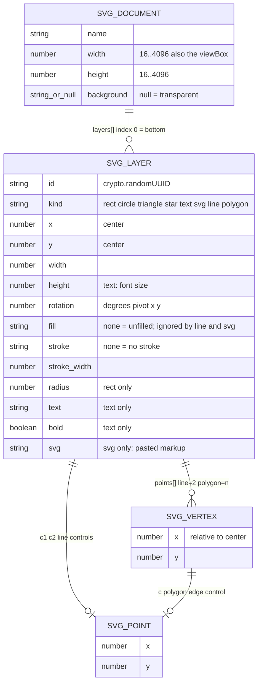
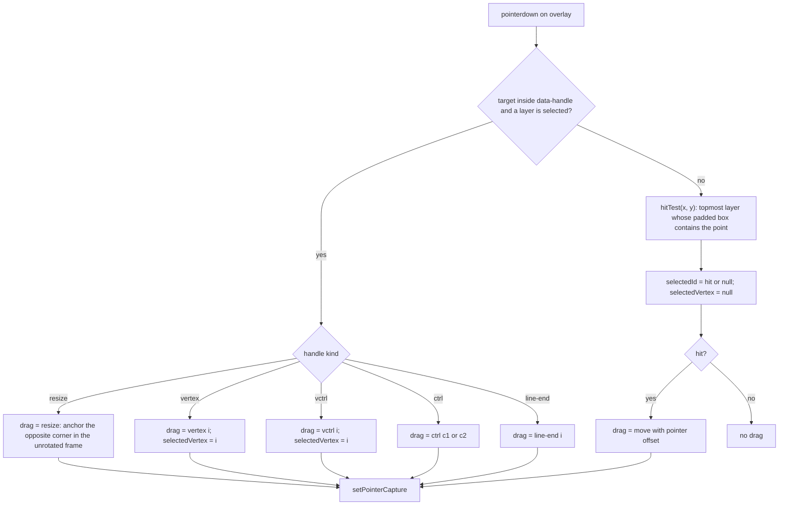
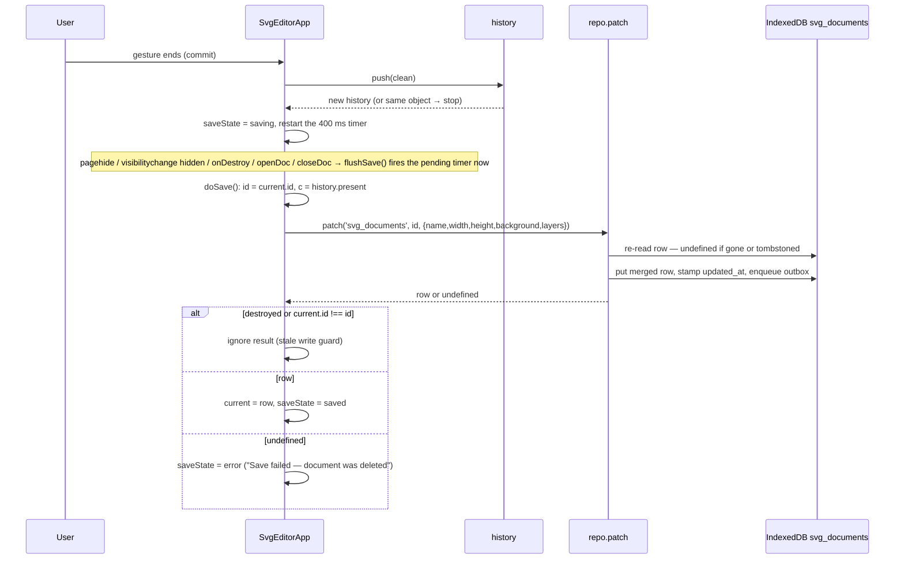
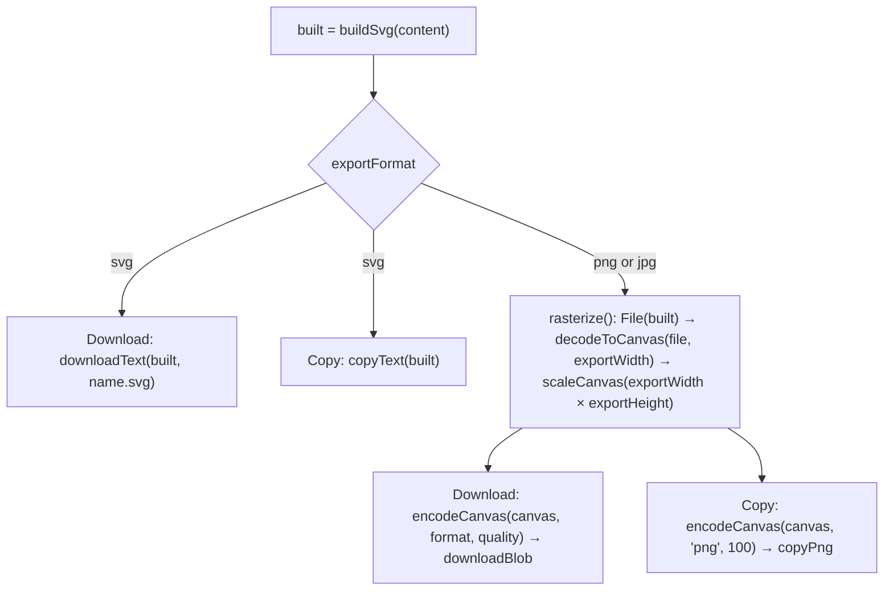

# SVG editor

A layer-based vector editor at `/tools/svg-editor/`. A document is a name, a canvas size, an optional background, and an ordered array of flat JSON layers stored in the `svg_documents` store; a pure builder turns that array into a standalone SVG string that is used verbatim for the live preview, the SVG export, and the PNG/JPG rasterization. Editing runs through an undo/redo snapshot stack; the last committed snapshot is autosaved with a debounce.

_Describes the code as of v0.6.0 (schema v17) — verify against source when in doubt._

## File map

| File | Role |
| --- | --- |
| [SvgEditorApp.svelte](../../../src/components/apps/SvgEditorApp.svelte) | The whole UI: document browser, canvas + overlay, layer list, layer fields, history wiring, autosave, export. Mounted `client:only` by [svg-editor.astro](../../../src/pages/tools/svg-editor.astro). |
| [model.ts](../../../src/lib/svg/model.ts) | `SvgLayer` / `SvgDocumentContent` types, `newLayer`, `defaultDocumentContent`, `regularPolygonPoints`, `normalizeLayer`, `normalizeDocumentContent`, `clampCanvas`, `MIN_CANVAS` / `MAX_CANVAS`. Dependency-free on purpose — [types.ts](../../../src/lib/db/types.ts) imports `SvgLayer` from it. |
| [build.ts](../../../src/lib/svg/build.ts) | Pure document → SVG string: `renderLayer`, `buildSvg`, the geometry builders, paste hardening (`svgViewBox`, `svgInner`, `svgRootAttrs`, `namespaceIds`, `ensureSvgNamespace`), `paintValue` / `paintAttrs` / `escapeXml`, `layerBounds`, `subtractLayers`, `svgDataUri`, `looksLikeSvg`. |
| [history.ts](../../../src/lib/svg/history.ts) | Generic `History<T>` snapshot stack: `createHistory`, `push`, `undo`, `redo`, `canUndo`, `canRedo`, `HISTORY_LIMIT`. |
| [types.ts](../../../src/lib/db/types.ts) | `SvgDocument` row (`SyncFields` + content fields), `svg_documents` in `STORES` (no indexes), `Preferences.svg_last_doc_id`. |
| [db.ts](../../../src/lib/db/db.ts) | Migration v5 creates `svg_documents`; v6's tombstone sweep covers it. |
| [exportFile.ts](../../../src/lib/exportFile.ts) | `downloadText`, `downloadBlob`, `copyText`, `copyPng`. |
| [convert.ts](../../../src/lib/img/convert.ts) | `decodeToCanvas`, `scaleCanvas`, `encodeCanvas` — the raster export path, shared with the image tools. |
| [build.test.ts](../../../src/lib/svg/build.test.ts), [history.test.ts](../../../src/lib/svg/history.test.ts) | Unit tests (vitest, node). |
| [svg-editor.spec.ts](../../../tests/local/svg-editor.spec.ts) | End-to-end spec (Playwright) with the write oracle. |

## Layer model

Every layer carries every field regardless of `kind` (flat shape, like the icon-editor seed it grew from), so normalization and JSON round-trips stay trivial. `(x, y)` is the layer's **center** in canvas units; `points`, `c1`, `c2` and each vertex's `c` are **relative to that center, in the layer's unrotated frame**. `rotation` is degrees around `(x, y)`.



`SvgDocument` (the row) is `SvgDocumentContent` plus `SyncFields` (`id`, `updated_at`, `deleted_at`, `server_seq`). The store has no indexes and is not field-merged.

### Kinds

`newLayer(kind, canvasWidth, canvasHeight)` centers the layer, sizes it to half the shorter canvas edge, and sets `fill '#f59e0b'` / `stroke 'none'` (a line inverts these), `stroke_width 4`, `text 'Aa'`, `bold true`. Text layers get `height = max(12, size/2)`, `width = 2 * height`, `fill '#ffffff'`. Lines get two endpoints at `±size/2` on the x axis; polygons start as a regular pentagon from `regularPolygonPoints(5, size, size)`.

| kind | `renderLayer` output | Fields that matter beyond position/paint/rotation |
| --- | --- | --- |
| `rect` | `<rect x y width height rx>` | `radius` → `rx` |
| `circle` | `<ellipse rx=w/2 ry=h/2>` | independent `width` / `height` (it is an ellipse) |
| `triangle` | `<polygon>` apex up filling the w×h box (`trianglePoints`) | — |
| `star` | `<polygon>` with 10 alternating vertices, inner radius 42% (`starPoints`) | — |
| `polygon` | `<polygon points>` when every edge is straight, else a closed `<path d="M … Q/L … Z">` (`polygonPath`) | `points`; a vertex's `c` bends the edge from it to the next vertex (wrapping). `width`/`height` are not rendered — they drive "Reset as regular", the selection rectangle, and where a new curve control is placed |
| `line` | `<path d>` — `M L` (straight), `M Q` (`c1` only), `M C` (`c1` + `c2`); `fill="none"`, `stroke-linecap="round"`, `stroke-width = max(1, stroke_width)`; a stroke of `none` falls back to `#f59e0b` so a line is never invisible | `points[0..1]`, `c1`, `c2` |
| `text` | `<text font-size=height font-family="system-ui, -apple-system, sans-serif" font-weight=700/400 text-anchor="middle" dominant-baseline="central">` with `escapeXml(text)` | `height` is the font size; `width` is only a selection-box hint; `bold` |
| `svg` | `<g [root paint attrs] transform="translate(tx ty) scale(s)">` + the pasted markup's inner content with ids re-homed; empty string when `!looksLikeSvg(svg)` or the inner markup is empty | `svg`; `fill`/`stroke` are ignored — the pasted markup keeps its own colors |

Any non-zero `rotation` wraps the element in `<g transform="rotate(r x y)">`.

### Normalization

`normalizeLayer(layer, fallback?)` merges a stored/partial layer over `fallback` (the last committed layer with the same id) or over `newLayer(kind)` defaults, then:

- heals non-finite numerics in `x y width height rotation stroke_width radius` (an emptied number input binds `null`) to the fallback's value;
- keeps `width`/`height` ≥ 1, `stroke_width` ≥ 0, `radius` ≥ 0;
- rebuilds `points` with numeric `x`/`y`, carrying the `c` key **only when a control exists** — a straight-edged document must stay byte-identical to one saved before curves shipped;
- drops `c2` when `c1` is null (build.ts only has straight/quadratic/cubic to render).

`normalizeDocumentContent(content, fallback?)` does the same for the document: `clampCanvas` on width/height (`MIN_CANVAS` 16 … `MAX_CANVAS` 4096, rounded), `background === null` preserved as transparent (only a missing/non-string field falls back to the default `#ffffff`), and layers matched to fallback layers by id. It runs on **open** (`openDoc`) and on **every commit** (see below), so history and the database only ever hold well-formed documents.

## Document → SVG (pure)

`buildSvg(content)` in [build.ts](../../../src/lib/svg/build.ts):

- root `<svg xmlns=…>` with `xmlns:xlink` added only if any rendered layer uses `xlink:`, and both `width`/`height` **and** `viewBox="0 0 w h"` — the intrinsic size is what `` and the rasterizer derive the aspect ratio from;
- one background `<rect>` unless `background` is `null` **or** `paintValue(background)` is `none` (an emptied text field would otherwise emit `fill=""`, which renderers ignore and paint black);
- layers rendered bottom-to-top in array order, each indented two spaces on its own line; layers that render to `''` are dropped;
- trailing newline.

Numbers pass through `round` (2 decimals); the pasted-SVG scale factor uses `round4` (0.12 vs 0.1172 is visible).

Paint: `paintValue(color)` trims, maps empty to `none`, and `escapeXml`s the value — colors come from a free-form text field, so a stray quote is data, not markup. `paintAttrs` always emits `fill`, and `stroke`/`stroke-width` only when the stroke is not `none` and `stroke_width > 0`.

Pasted SVG (`kind === 'svg'`): `svgViewBox` reads the pasted `viewBox`, else `width`/`height`, else 24×24 (lucide's default); the content is scaled with `min(w/box.w, h/box.h)` and centered on `(x, y)`; `svgInner` drops the root tag; `svgRootAttrs` re-emits the root's *presentation* attributes (`fill="currentColor"` on an icon set's root must survive, or the artwork turns black) while dropping structural ones (`STRUCTURAL_ROOT_ATTR`); `namespaceIds` prefixes every `id`, `url(#…)` and `href="#…"` with `layerPrefix(layer.id)` so two pastes from the same source cannot collide. Everything else in the pasted markup is embedded verbatim. `ensureSvgNamespace` is exported and unit-tested but not called by the editor — its own output always carries `xmlns`.

The preview is ``; scripts never execute inside ``, so a pasted layer cannot run code in the app.

## Canvas interaction

The canvas is the preview `` with a transparent `<svg class="overlay">` on top, same `viewBox`, `preserveAspectRatio="none"`. `toCanvas(e)` maps pointer client coordinates to viewBox units through the overlay's bounding rect. `handleR = max(3, max(w, h) / 56)` keeps handles grabbable at any zoom (canvas units, not pixels).

While a layer is selected the overlay draws, inside `<g transform="rotate(...)">`:

- **line** — one `ctrl:c1` / `ctrl:c2` circle per existing control (with dashed guides) and `line-end:i` circles on both endpoints (drawn only when `points.length === 2`);
- **polygon** — the dashed w×h selection rect, a `vctrl:i` circle per curved vertex (guides to both edge ends), and a `vertex:i` circle per vertex (`active` when `selectedVertex === i`);
- **everything else** — the selection rect and four `resize:nw|ne|sw|se` squares.



`hitTest` walks `content.layers` from the top down, rotates the point into each layer's unrotated frame (`rotatePt(x, y, l.x, l.y, -l.rotation)`), and tests a box: `±width/2 × ±height/2` for shapes, the true bounding box of `points` + controls for lines and polygons (points go one-sided after vertex drags). The box is padded by `max(handleR, stroke_width/2 if stroked)`. It is a box test — clicking inside a hollow shape still hits it.

`onPointerMove` mutates the selected layer live (the preview re-renders because `built` is `$derived` from `content`):

- `move` — center follows the pointer minus the grab offset, clamped to `[0, width] × [0, height]`, `round1` (0.1 units);
- `resize` — pointer rotated into the frame; new size = `|pointer − anchored corner|` (min 4) per axis; new center = midpoint rotated back;
- `vertex` / `vctrl` / `ctrl` / `line-end` — pointer rotated into the frame and made relative to the center; a vertex drag preserves its `c`.

`onPointerUp` (and `pointercancel`) clears the drag and calls `commit()` only if the pointer actually moved (`dragged`), so a plain click never pushes a history entry.

Vertex tools (polygon only): `addVertex` inserts the midpoint after the selected (or last) vertex; `removeVertex` is a no-op at 3 points or fewer; `toggleVertexCurve` sets/deletes `points[i].c`, seeding it at the edge midpoint pushed outward from the center by `max(12, min(width, height) * 0.25)`; `resetPolygon(n)` replaces `points` with `regularPolygonPoints(n, width, height)`. Line curve mode (`setCurve`) clears both controls for straight, seeds `c1 = {0, -span/2}` for quadratic and `c1/c2 = {∓span/4, ∓span/2}` for cubic (`span = max(24, |p1.x − p0.x|)`), keeping any control that already exists.

Keyboard (`onKeydown` on `window`, ignored while focus is in `input, textarea, select, [contenteditable]`, and only while a document is open): `ctrl/cmd+z` undo, `ctrl/cmd+shift+z` or `ctrl/cmd+y` redo, `Delete`/`Backspace` removes the selected layer, arrows nudge by 1 (10 with shift) and commit, `Escape` deselects.

## Undo/redo and commit

[history.ts](../../../src/lib/svg/history.ts) is a pure `{ past, present, future }` stack:

- `push` **coalesces**: if `JSON.stringify(present) === JSON.stringify(state)` it returns the same history object; otherwise it deep-clones the state (JSON), appends the old present to `past` (capped at `HISTORY_LIMIT = 100`, oldest dropped) and empties `future` (branch discard);
- `undo`/`redo` return the same object at the ends; snapshots are JSON clones, so later mutation of live state cannot corrupt the past — and a snapshot is exactly what would be persisted.

`commit()` in the component is the single entry point after every finished gesture (add/remove/shift layer, pointer-up after a drag, `onchange` of a field, `ColorField`'s `oncommit`, arrow nudge, vertex ops, subtract):

1. `clean = normalizeDocumentContent(content, history.present)` — invalid numerics revert to the last committed values;
2. if `clean` differs from `content`, the healed `width`/`height` and each layer's fields are written back into the bound state so inputs show them;
3. `history = push(history, clean)`; if `push` returned the same object nothing changed and commit returns **without scheduling a save**;
4. a `selectedVertex` past the end of the selected layer's points is cleared;
5. `scheduleSave()`.

`applyHistory(h)` (undo/redo) replaces `content` with a clone of `h.present`, clears `selectedVertex` (indices are meaningless across snapshots) and schedules a save. Field edits mid-typing (`bind:value`) update the preview but touch neither history nor storage until the field's `change` fires.

## Autosave



Facts worth holding onto:

- **Only `history.present` is persisted, never the live bound values** — a field typed halfway (`2` on the way to `2048`) cannot be flushed by a tab switch.
- `scheduleSave` debounces at 400 ms and restarts on every commit; `saveState` shows `Saving…` meanwhile.
- `flushSave` runs only when a timer is pending; it is wired to `pagehide`, `visibilitychange` (hidden), `onDestroy`, and is called at the top of `openDoc`/`closeDoc` so switching documents cannot lose the previous one's pending write. Listeners are attached **before** the mount's first `await` so `onDestroy` always has something to remove; a `destroyed` flag stops the async mount continuation from resurrecting state into a torn-down island (with ClientRouter the window outlives every page).
- `deleteDoc` on the open document clears the pending timer instead of flushing (a save after the tombstone would return `undefined` anyway — `patch` never resurrects).
- Exactly one row is written per save (`patch` on the document); opening a document additionally writes `preferences.svg_last_doc_id` via `putSingleton` — except on the resume path (`openDoc(doc, { remember: false })`), so a reload writes nothing.
- Loading: `refreshDocs` (`all('svg_documents')` sorted by `updated_at` desc), then `getSingleton('preferences').svg_last_doc_id` → `get(...)` → `openDoc`. Reads only.
- `createDoc` does `put(withSyncFields(defaultDocumentContent(name || 'Untitled')))` — 256×256, `#ffffff` background, no layers — then opens it.
- The `saveState` text is `aria-live="polite"` and has `data-testid="svg-save-state"`; the spec waits on `Saved` before snapshotting.

## Boolean subtract

`subtractLayers(base, cutter)` in [build.ts](../../../src/lib/svg/build.ts) uses SVG's own compositing rather than polygon clipping, so **any** kind cuts any other (a stroked line slices a rect in two, text punches letters, a pasted icon stamps its silhouette). `layerBounds(base)` (rotation-aware axis-aligned box, padded by the stroke; text gets extra horizontal room since its width is a hint) becomes the region:

```
<svg xmlns viewBox="bx by bw bh">
  <defs>
    <filter id="blk" filterUnits="userSpaceOnUse" region>
      <feFlood flood-color="#000"/><feComposite in2="SourceAlpha" operator="in"/>
    </filter>
    <mask id="cut" maskUnits="userSpaceOnUse" region>
      <rect region fill="#fff"/>
      <g filter="url(#blk)">renderLayer(cutter)</g>
    </mask>
  </defs>
  <g mask="url(#cut)">renderLayer(base)</g>
</svg>
```

The filter turns every opaque pixel of the cutter solid black regardless of its own colors; under a luminance mask that is "cut here". The result is a new layer of `kind: 'svg'` with a fresh id, centered on the bounds, `width`/`height` = bounds, `rotation 0`, `fill`/`stroke` `none`. Rendered through the ordinary pasted-SVG path, its `blk`/`cut` ids are namespaced per layer, so several subtractions in one document do not collide.

In the component, `subtractWith(cutterId)` (the "Subtract another layer from this one" select, shown only when the document has more than one layer) splices the baked layer in at the base's index, removes the cutter, selects the baked layer, and commits once — both originals are consumed, one undo restores them. The result is no longer parametric: no vertices, no fill control, just markup.

## Export



- `built` is one `$derived` string — preview, download, copy and rasterization all see the same markup. Exports never write to the database (the spec asserts `dumpAll()` is unchanged).
- `exportName(ext)` uses the document name with `\ / : * ? " < > |` replaced by `_`, falling back to `drawing`.
- `exportWidth` defaults to the canvas width on open; `rasterize` heals a non-finite or `< 16` value back to the canvas width and caps at 8192; `exportHeight = max(1, round(exportWidth * height / width))`.
- `decodeToCanvas` (SVG branch) loads the file into an `Image` via object URL and rasterizes at the requested width using the intrinsic ratio — which exists because `buildSvg` emits `width`/`height`. `scaleCanvas` then pins the exact height (no-op when equal).
- `encodeCanvas` composites onto white for JPG (canvas would paint alpha black) and applies `qualityFraction(exportQuality)` only for JPG; PNG ignores quality.
- The clipboard image is **always PNG** (`copyPng`) — the async clipboard API limitation; the button label says so. `copyText`/`copyPng` resolve `false` instead of throwing, surfaced by `flash(...)` for 2 s in `data-testid="svg-feedback"`.
- `downloadBlob` revokes the object URL one second after the click.

## Invariants and conventions

- `model.ts` must stay dependency-free and JSON-native (no Dates, Maps, class instances): `types.ts` imports it, and rows must round-trip IndexedDB, backups and history snapshots byte-identically.
- Every layer carries every field; kind-specific behaviour lives in `renderLayer` and the UI, never in the shape of the data.
- `(x, y)` is the center; `points`/`c1`/`c2`/`c` are relative to it in the unrotated frame. Moving a layer changes only `(x, y)`.
- `layers[0]` is drawn first (bottom); the layer list renders `[...layers].reverse()` so the top layer is listed first. `shiftLayer(id, +1)` brings forward.
- Never persist live state: `doSave` writes `history.present`. Never persist an unnormalized document: `commit` heals before `push`.
- User-typed text is attribute-escaped at build time — `paintValue` for every color (fill, stroke, line stroke, background), `escapeXml` for text content. Pasted SVG markup is trusted **as markup**: only ids are rewritten.
- Canvas size is clamped to `[16, 4096]`; layer `width`/`height` ≥ 1; `stroke_width` ≥ 0; `radius` ≥ 0; `c2` never exists without `c1`; a vertex carries the `c` key only when curved.
- A line's stroke never renders as `none` (falls back to `#f59e0b`) and its width never below 1.
- History cap is 100 steps; identical snapshots coalesce; redo is discarded on push.
- Writes go through repo (`put`, `patch`, `putSingleton`, `softDelete`) — `patch` re-reads the row so a stale UI snapshot cannot revert a concurrent change, and returns `undefined` for a tombstoned row instead of resurrecting it. Deleting a document is a soft delete (tombstone), payload cleared by repo.

## Tests

- [build.test.ts](../../../src/lib/svg/build.test.ts) — geometry builders (`linePath` variants, `polygonPoints`, `regularPolygonPoints`, `polygonPath`/`polygonIsCurved`, `starPoints`, `trianglePoints`), `paintValue` escaping incl. an injection string and the empty-background-is-transparent case, `paintAttrs`, `renderLayer` per kind (ellipse, text escaping, line stroke fallback, rotation wrapper, pasted-SVG scale/id namespacing/root paint), `buildSvg` (namespace, intrinsic size, background rect, z-order, `xmlns:xlink`, non-square canvas), `layerBounds`, `subtractLayers` (structure + namespaced ids through `renderLayer`), paste hardening (`ensureSvgNamespace`, `svgViewBox`, `svgRootAttrs`, `namespaceIds` with regex metachars, `svgInner`/`looksLikeSvg`/`escapeXml`), normalization (back-fill, null/NaN healing with and without fallback, dangling `c2`, canvas clamp, `newLayer` defaults).
- [history.test.ts](../../../src/lib/svg/history.test.ts) — empty start, push/undo/redo round trip, no-ops at the ends, coalescing, branch discard, deep-copy isolation, `HISTORY_LIMIT` cap.
- [svg-editor.spec.ts](../../../tests/local/svg-editor.spec.ts) (Playwright, `tests/local/helpers/app` + `oracle`): create → edit → reload writes exactly the document row plus the preferences singleton and resumes byte-identically with zero writes (`assertIsolatedDelta`, `assertSameDb`); a real pointer drag moves a layer and persists only that document; undo/redo walk the stack and save the reverted state; color edits commit, undo, and are escaped in the downloaded SVG; clearing a numeric field reverts to the last committed value; polygon vertex curve toggle + control-handle drag + straighten (key removed); subtract bakes a pasted-SVG layer, proven by pixel probes on the exported PNG, one undo restores both; SVG and PNG export at a chosen size with zero writes; deleting tombstones (no hard delete, checked via `rawDump`).

## Known limits and decisions

- **Hit testing is box-based** — the topmost padded box wins; the layer list is the way to reach a layer hidden under a larger one. Chosen for simplicity over per-shape geometry.
- **Text width is a hint.** `<text>` is not measured; `layerBounds` widens the box by `height` on each side plus 20% padding for subtract, which is a guess.
- **Pasted markup is embedded verbatim** except ids. Class names inside `<style>` blocks are not namespaced (documented in `namespaceIds`) and can bleed between pasted layers; anything else in the paste ends up in the exported file. The in-app preview is an ``, so nothing executes there.
- **Subtract is destructive by design**: the plan called for a baked result rather than parametric boolean geometry; undo is the escape hatch. Compositing (mask + filter) was chosen so every kind — strokes, text, pasted icons — can cut, which polygon clipping could not do.
- **Undo history is per open document and in memory** — `openDoc` calls `createHistory`; closing or reloading starts fresh (the persisted document is the last committed state, so nothing is lost, only the ability to step back).
- **Clipboard images are PNG only**, and export width is capped at 8192.
- `Preferences.svg_last_doc_id` is only ever written by `openDoc` — deleting the remembered document leaves a dangling id; the resume path just finds no row and shows the browser.
- Layer `width`/`height` for lines and polygons are not rendered; they exist so the fields, "Reset as regular", the selection rectangle and the curve seed have something to work from.
