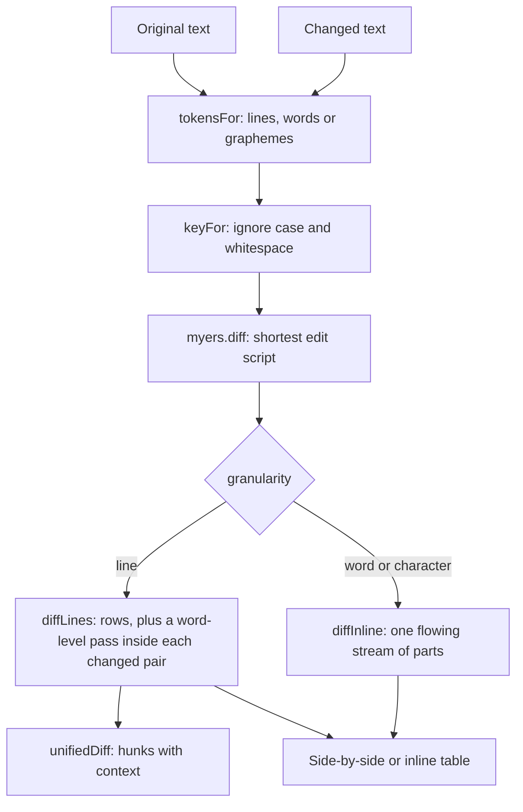

# Text tools

The 0.3.0 text tools: **Diff** (`/tools/diff/`), and — as their phases land — Similarity and Text analysis. All of them are stateless Svelte islands over pure modules in `src/lib/`, registered under **Calculators**, and none of them writes to IndexedDB at any point.

They share one thing that is worth stating before anything else: **every count and every split comes from [tokenize.ts](../../../src/lib/text/tokenize.ts)**. A tool that counted words its own way would eventually disagree with the tool next to it about what a word is, and the disagreement would be invisible until someone compared two numbers that should have matched.

_Describes the code as of v0.3.0 (unreleased; schema v12) — verify against source when in doubt._

## File map

| Path | Role |
| --- | --- |
| [tokenize.ts](../../../src/lib/text/tokenize.ts) | Shared segmentation: `graphemes`, `words`, `sentences`, `paragraphs`, `lines`, `sizes`, `syllables` |
| [myers.ts](../../../src/lib/diff/myers.ts) | The diff algorithm itself, over any token array |
| [text.ts](../../../src/lib/diff/text.ts) | Lines, words and characters on top of it: rows, inline parts, stats, line endings, `unifiedDiff` |
| [DiffApp.svelte](../../../src/components/apps/DiffApp.svelte) | `/tools/diff/` |
| [diff.astro](../../../src/pages/tools/diff.astro) | Route shell, mounts the app with `client:only="svelte"` |
| [registry.ts](../../../src/lib/registry.ts) | Sidebar/palette entry (`diff`, category `Calculators`, icon `diff`) |
| [text-tools.spec.ts](../../../tests/local/text-tools.spec.ts) | Playwright: the wiring, and the zero-write assertion |
| [myers.test.ts](../../../src/lib/diff/myers.test.ts), [text.test.ts](../../../src/lib/diff/text.test.ts) | Vitest: the algorithms |

## Diff

### The pipeline

### `myers.ts`

`diff(a, b, { key, maxCost })` returns `{ changes, cost, truncated }`, where `changes` is a list of `{ type: 'equal' | 'insert' | 'delete', tokens }` runs. It is Myers' 1986 O(ND) algorithm — the one `git diff` uses — so the work is proportional to the **size of the difference**, not the size of the inputs.

Three things about the implementation are load-bearing:

- **The common head and tail are trimmed before the algorithm runs.** This is not a micro-optimization: it is what keeps D small for the ordinary case of one edit in a long file, and D is the exponent that matters.
- **Comparison goes through `key`.** The tokens that come back are always the caller's original tokens; only the keys are normalized. That is how "ignore case" avoids ever displaying a text nobody wrote.
- **`maxCost` (default 4000) is a real limit with a real answer.** Past it the diff stops and reports one wholesale replacement with `truncated: true`, and the page says so. Two large unrelated inputs would otherwise cost quadratic time in a tab that cannot be interrupted.

`similarity(result)` is `2 × equal / (a + b)` — the Sørensen-Dice shape, which reads as a percentage: identical is 1, nothing shared is 0.

### `text.ts`

| Export | In → out | Notes |
| --- | --- | --- |
| `contentLines(text)` | → `{ list, endsWithNewline }` | A trailing newline is reported, not turned into a phantom final empty line |
| `wordTokens(text)` | → `string[]` | Words **and** the whitespace between them, so a stream can be reassembled exactly |
| `keyFor(token, options)` | → `string` | The one place `ignoreCase` and `whitespace` mean anything |
| `detectLineEnding(text)` | → `'none' \| 'lf' \| 'crlf' \| 'cr' \| 'mixed'` | |
| `differsOnlyByLineEnding(a, b)` | → `boolean` | The file that came back from Windows |
| `diffLines(left, right, options)` | → `{ rows, stats, truncated }` | Rows are `equal` / `insert` / `delete` / `replace`, each side numbered independently |
| `diffInline(left, right, options)` | → `{ parts, stats, truncated }` | Word or character granularity over the whole text |
| `unifiedDiff(left, right, options)` | → `string` | `diff -u` output: `---`/`+++`, `@@` hunks, `\ No newline at end of file` |

**Pairing is what makes a diff readable.** A delete run immediately followed by an insert run is a rewrite, not a removal plus an unrelated addition, so `diffLines` pairs them into `replace` rows and runs a second word-level diff inside each pair. Without that, changing one word in a line shows as a red line and a green line and leaves the reader to spot the difference.

**Hunks** are built by taking every changed line, extending `context` lines either side, and merging ranges that touch. `range(start, count)` writes `12,4` — or bare `12` for a single line, and `n,0` for an empty side — which is what GNU diff and git both emit.

### The page

`DiffApp.svelte` holds view state only. Two things in it are deliberate:

- **The diff runs on debounced copies of the textareas** (120 ms). Every keystroke re-running a diff of two large pastes is the one way this page could feel slow.
- **A loaded file keeps its own line endings.** `readFile` assigns to the state, and Svelte writes that into the `<textarea>`; the element normalises its displayed value to LF but never writes back, so `differsOnlyByLineEnding` still sees the CRLF that came off disk. Typing in the box afterwards replaces the state through the `input` event and the distinction is gone — which is why `text-tools.spec.ts` exercises that note through `setInputFiles` rather than `fill`.
- **Two caps, both stated on screen when they bite.** Character granularity is refused above 40 000 characters across both texts (`diff-too-big`), and the table draws at most 2000 rows (`diff-row-limit`) — the patch card still carries the whole diff.

Meaning never rides on colour alone: added text is `<ins>`, removed text is `<del>`, and the inline layout puts `+` / `−` markers in the row.

Test hooks are prefixed `diff-`: `diff-left`, `diff-right`, `diff-granularity`, `diff-layout`, `diff-whitespace`, `diff-ignore-case`, `diff-summary`, `diff-insertions`, `diff-deletions`, `diff-changed`, `diff-similarity`, `diff-row` (with `data-kind`), `diff-flow`, `diff-patch`, `diff-context`, `diff-copy`, `diff-download`, `diff-swap`, `diff-clear`, `diff-ending-note`, `diff-truncated`, `diff-too-big`, `diff-empty`.

### Why not the `diff` npm package

The same reason 0.2.0 hand-rolled schema inference: the algorithm is a hundred lines, the tests are the valuable part, and owning it is what allows the `key` indirection, the `maxCost` escape hatch and the truncation report — none of which a general-purpose package would have exposed in the shape this page needs.
