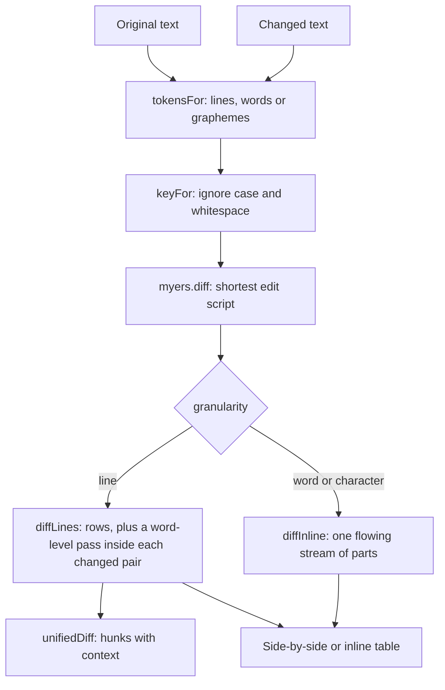

# Text tools

The 0.3.0 text tools: **Diff** (`/tools/diff/`), **Similarity** (`/tools/similarity/`) and **Text analysis** (`/tools/text-analysis/`). All of them are stateless Svelte islands over pure modules in `src/lib/`, registered under **Calculators**, and none of them writes to IndexedDB at any point.

They share one thing that is worth stating before anything else: **every count and every split comes from [tokenize.ts](../../../src/lib/text/tokenize.ts)**. A tool that counted words its own way would eventually disagree with the tool next to it about what a word is, and the disagreement would be invisible until someone compared two numbers that should have matched.

_Describes the code as of v0.5.0 (schema v16) — verify against source when in doubt._

## File map

| Path | Role |
| --- | --- |
| [tokenize.ts](../../../src/lib/text/tokenize.ts) | Shared segmentation: `graphemes`, `words`, `sentences`, `paragraphs`, `lines`, `sizes`, `syllables` |
| [edit.ts](../../../src/lib/text/edit.ts) | The five similarity measures, the DP table and traceback, and the Jaro pairing |
| [analysis.ts](../../../src/lib/text/analysis.ts) | Counts, the three readability formulas, reading time, word and n-gram frequency |
| [transform.ts](../../../src/lib/text/transform.ts) | The case and decoration transformations |
| [myers.ts](../../../src/lib/diff/myers.ts) | The diff algorithm itself, over any token array |
| [text.ts](../../../src/lib/diff/text.ts) | Lines, words and characters on top of it: rows, inline parts, stats, line endings, `unifiedDiff` |
| [DiffApp.svelte](../../../src/components/apps/DiffApp.svelte) | `/tools/diff/` |
| [SimilarityApp.svelte](../../../src/components/apps/SimilarityApp.svelte) | `/tools/similarity/` |
| [TextAnalysisApp.svelte](../../../src/components/apps/TextAnalysisApp.svelte) | `/tools/text-analysis/` |
| [diff.astro](../../../src/pages/tools/diff.astro), [similarity.astro](../../../src/pages/tools/similarity.astro), [text-analysis.astro](../../../src/pages/tools/text-analysis.astro) | Route shells, each mounting its app with `client:only="svelte"` |
| [registry.ts](../../../src/lib/registry.ts) | Sidebar/palette entries (`diff`, `similarity`, `text-analysis`, category `Calculators`) |
| [text-tools.spec.ts](../../../tests/local/text-tools.spec.ts) | Playwright: the wiring, and the zero-write assertion |
| [myers.test.ts](../../../src/lib/diff/myers.test.ts), [text.test.ts](../../../src/lib/diff/text.test.ts), [edit.test.ts](../../../src/lib/text/edit.test.ts), [analysis.test.ts](../../../src/lib/text/analysis.test.ts), [transform.test.ts](../../../src/lib/text/transform.test.ts) | Vitest: the algorithms |

## Diff

### The pipeline

### `myers.ts`

`diff(a, b, { key, maxCost })` returns `{ changes, cost, truncated }`, where `changes` is a list of `{ type: 'equal' | 'insert' | 'delete', tokens }` runs. It is Myers' 1986 O(ND) algorithm — the one `git diff` uses — so the work is proportional to the **size of the difference**, not the size of the inputs.

Three things about the implementation are load-bearing:

- **The common head and tail are trimmed before the algorithm runs.** This is not a micro-optimization: it is what keeps D small for the ordinary case of one edit in a long file, and D is the exponent that matters.
- **Comparison goes through `key`.** The tokens that come back are always the caller's original tokens; only the keys are normalized. That is how "ignore case" avoids ever displaying a text nobody wrote.
- **`maxCost` (default 4000) is a real limit with a real answer.** Past it the diff stops and reports one wholesale replacement with `truncated: true`, and the page says so. Two large unrelated inputs would otherwise cost quadratic time in a tab that cannot be interrupted.

`similarity(result)` is `2 × equal / (a + b)` — the Sørensen-Dice shape, which reads as a percentage: identical is 1, nothing shared is 0.

### `text.ts`

| Export | In → out | Notes |
| --- | --- | --- |
| `contentLines(text)` | → `{ list, endsWithNewline }` | A trailing newline is reported, not turned into a phantom final empty line |
| `wordTokens(text)` | → `string[]` | Words **and** the whitespace between them, so a stream can be reassembled exactly |
| `keyFor(token, options)` | → `string` | The one place `ignoreCase` and `whitespace` mean anything |
| `detectLineEnding(text)` | → `'none' \| 'lf' \| 'crlf' \| 'cr' \| 'mixed'` | |
| `differsOnlyByLineEnding(a, b)` | → `boolean` | The file that came back from Windows |
| `diffLines(left, right, options)` | → `{ rows, stats, truncated }` | Rows are `equal` / `insert` / `delete` / `replace`, each side numbered independently |
| `diffInline(left, right, options)` | → `{ parts, stats, truncated }` | Word or character granularity over the whole text |
| `unifiedDiff(left, right, options)` | → `string` | `diff -u` output: `---`/`+++`, `@@` hunks, `\ No newline at end of file` |

**Pairing is what makes a diff readable.** A delete run immediately followed by an insert run is a rewrite, not a removal plus an unrelated addition, so `diffLines` pairs them into `replace` rows and runs a second word-level diff inside each pair. Without that, changing one word in a line shows as a red line and a green line and leaves the reader to spot the difference.

**Hunks** are built by taking every changed line, extending `context` lines either side, and merging ranges that touch. `range(start, count)` writes `12,4` — or bare `12` for a single line, and `n,0` for an empty side — which is what GNU diff and git both emit.

### The page

`DiffApp.svelte` holds view state only. Two things in it are deliberate:

- **The diff runs on debounced copies of the textareas** (120 ms). Every keystroke re-running a diff of two large pastes is the one way this page could feel slow.
- **A loaded file keeps its own line endings.** `readFile` assigns to the state, and Svelte writes that into the `<textarea>`; the element normalises its displayed value to LF but never writes back, so `differsOnlyByLineEnding` still sees the CRLF that came off disk. Typing in the box afterwards replaces the state through the `input` event and the distinction is gone — which is why `text-tools.spec.ts` exercises that note through `setInputFiles` rather than `fill`.
- **Two caps, both stated on screen when they bite.** Character granularity is refused above 40 000 characters across both texts (`diff-too-big`), and the table draws at most 2000 rows (`diff-row-limit`) — the patch card still carries the whole diff.

Meaning never rides on colour alone: added text is `<ins>`, removed text is `<del>`, and the inline layout puts `+` / `−` markers in the row.

Test hooks are prefixed `diff-`: `diff-left`, `diff-right`, `diff-granularity`, `diff-layout`, `diff-whitespace`, `diff-ignore-case`, `diff-summary`, `diff-insertions`, `diff-deletions`, `diff-changed`, `diff-similarity`, `diff-row` (with `data-kind`), `diff-flow`, `diff-patch`, `diff-context`, `diff-copy`, `diff-download`, `diff-swap`, `diff-clear`, `diff-ending-note`, `diff-truncated`, `diff-too-big`, `diff-empty`.

### Why not the `diff` npm package

The same reason 0.2.0 hand-rolled schema inference: the algorithm is a hundred lines, the tests are the valuable part, and owning it is what allows the `key` indirection, the `maxCost` escape hatch and the truncation report — none of which a general-purpose package would have exposed in the shape this page needs.

## Similarity

A port of [speyl](https://github.com/Descent098/speyl) (MIT, the same author's Go library), with the working-out each algorithm needs in order to be explained rather than just reported.

### `edit.ts`

| Export | In → out | Notes |
| --- | --- | --- |
| `ALGORITHMS` | `AlgorithmDef[]` | The catalogue as data — id, name, one-line summary, and whether the raw reading is a distance or a score. The table's columns come from here |
| `matrix(a, b, { transpose, indel })` | → `{ a, b, rows, path, distance }` | One DP table for all three distance metrics. `rows[i][j]` is the distance between the first *i* of `a` and the first *j* of `b` |
| `levenshtein` / `damerau` / `indel` | → `number` | Thin wrappers over `matrix` |
| `lcsLength(a, b)` | → `number` | `(|a| + |b| − indel) / 2` |
| `jaroDetail(a, b, p?, maxPrefix?)` | → `JaroDetail` | Window, per-character match flags, the pairing, transpositions, prefix, and both scores |
| `jaro` / `jaroWinkler` | → `number` | 0-1 |
| `normalize(algorithm, distance, a, b)` | → `number` | Levenshtein and Damerau over `max(|a|,|b|)`, Indel over `|a| + |b|` |
| `score` / `compare` / `suggest` | | One pair, a whole table, and speyl's `SuggestWord` |

Three decisions worth keeping:

- **One table, three metrics.** Levenshtein, Damerau and Indel differ only in which moves are legal — Damerau adds the adjacent swap, Indel prices substitution at 2 so it is never worth taking. Writing them as three functions would have hidden the only interesting thing about them.
- **Damerau here is optimal string alignment (OSA)**, the variant that never edits a substring twice, which is what nearly every library means by "Damerau". It answers 3 for `CA` → `ABC` where unrestricted Damerau-Levenshtein answers 2. `edit.test.ts` pins that case, because "which Damerau" is exactly the sort of thing that gets silently changed.
- **Everything runs on graphemes**, so `levenshtein('a👍🏽b', 'ab')` is 1 rather than 4.

### Two limits, both stated on screen

Scoring runs on debounced copies of the two inputs (120 ms), and refuses pairs
over **200 characters** (`sim-over-limit`) — the three distance metrics fill an
n x m table, so a pasted paragraph in the word box is a million cells per
candidate, and this is the one input on the page that could hang the tab. The
candidate list is capped at 200 words, with `sim-dropped` naming how many were
left out.

### The visualizer

For the distance metrics the page draws the whole cost table with the traceback highlighted, and a **Back / Next** stepper that walks the route one move at a time with a sentence for each ("Substitute \"k\" with \"s\" — costs 1"). Cells past 40 characters a side are not drawn — a grid nobody can read is not a visualization — and the scores stay exact regardless.

For Jaro and Jaro-Winkler the page draws both words as chips with the matched characters marked, then the window, match count, transpositions and prefix as figures, and finally the formula **with this pair's numbers substituted into it**.

Test hooks are prefixed `sim-`: `sim-word`, `sim-candidates`, `sim-row` (with `data-word`), `sim-<algorithm>` per cell, `sim-sort-<algorithm>`, `sim-pick-<word>`, `sim-best`, `sim-algorithm`, `sim-matrix`, `sim-distance`, `sim-step-back`, `sim-step-next`, `sim-step-text`, `sim-window`, `sim-matches`, `sim-transpositions`, `sim-prefix`, `sim-formula`, `sim-too-long`, `sim-dropped`, `sim-empty`.

## Text analysis

### `analysis.ts`

| Export | In → out | Notes |
| --- | --- | --- |
| `counts(text)` | → `Counts` | Words, unique words, sentences, paragraphs, lines, syllables, polysyllables, and the four lengths. `charactersInWords` exists because ARI divides by it |
| `readability(text, precounted?)` | → `Readability` | Flesch ease + band, Flesch-Kincaid, ARI, SMOG. Takes the counts it was already given rather than recomputing them |
| `SMOG_MINIMUM_SENTENCES` | `30` | |
| `fleschBand(score)` | → `string` | The seven published bands |
| `readingSeconds(words, wpm?)` / `formatDuration(seconds)` | | 238 wpm reading, 150 speaking (Brysbaert 2019) |
| `frequency(text, { size, dropStopWords, limit })` | → `Frequency[]` | Words or n-grams, commonest first, ties alphabetical |
| `STOP_WORDS` | `Set<string>` | Deliberately short — a long list hides words that were the point |

Two decisions carry the honesty this page needs:

- **A number that cannot be right is not shown.** `smog` is `null` below thirty sentences and the page prints how many more it needs; every score is `null` for empty text rather than `NaN` or `Infinity`. The `Difficulty` card's explainer prints each formula **with this text's own numbers substituted in**, so the reader can see what produced the score.
- **N-grams are built inside a sentence.** A phrase that straddles a full stop is not a phrase, and counting it as one is how "end the beginning" reaches a top-ten list.

The formulas themselves are readn's three, ported with its caveats: syllables and sentence boundaries are heuristics, numerals and non-English text are not handled, and the formulas were fitted to English prose decades ago.

### `transform.ts`

Seven transformations, all walking graphemes: sentence case, Capitalize Each Word, lower, UPPER, s̶t̶r̶i̶k̶e̶t̶h̶r̶o̶u̶g̶h̶ (a combining U+0336 per character), W I D E, and sPoNgEbOb (alternating over letters only, so punctuation does not take a turn).

**`sentenceCase` deliberately does NOT use `sentences()`**, and this is the one place in the app where two features answer the same question differently on purpose. The Unicode rules refuse to break before a lower-case word — `one. two` is one sentence to them, because a lower-case word after a full stop usually means an abbreviation. That is right for counting and exactly wrong for a transformation whose input is normally all lower case. So it walks the text itself and asks `tokenize.neverEndsSentence()` the one question that still matters: was the word before the stop a title or an initial? `dr. smith` becomes `Dr. smith` — the same judgement the counts make, arrived at from the other side.

Test hooks are prefixed `ta-`: `ta-text`, `ta-words`, `ta-unique`, `ta-characters`, `ta-characters-nospaces`, `ta-sentences`, `ta-paragraphs`, `ta-lines`, `ta-bytes`, `ta-units`, `ta-reading`, `ta-speaking`, `ta-flesch`, `ta-band`, `ta-fk`, `ta-ari`, `ta-smog`, `ta-smog-note`, `ta-freq-row` (with `data-term`), `ta-freq-size`, `ta-freq-stop`, `ta-transform-<id>`, `ta-output`, `ta-output-empty`, `ta-copy`, `ta-download`, `ta-clear`, `ta-empty`.
