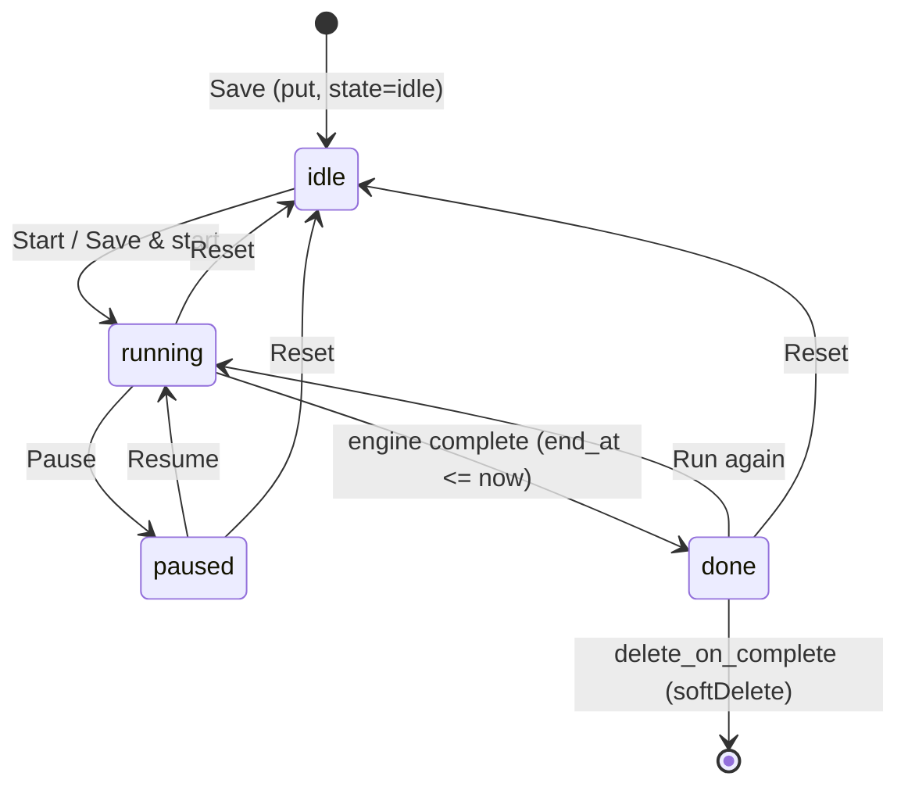
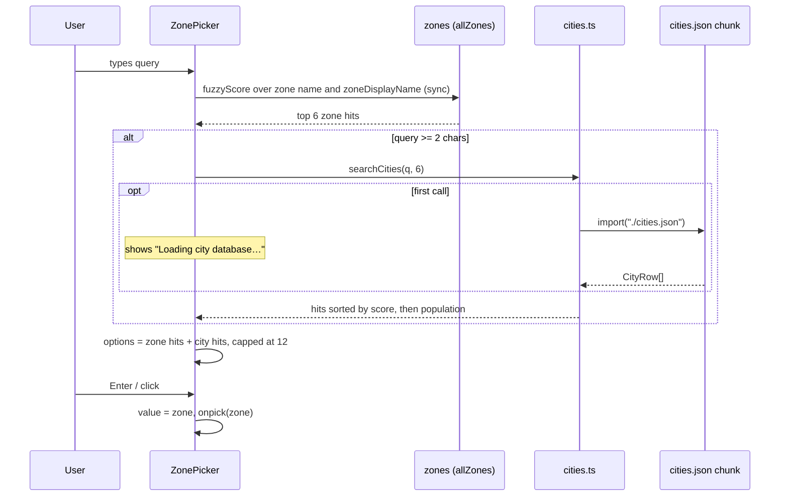

# Time tools

Three tools under the Time category: countdown **timers** (rows in the `timers` store, driven by the [notification engine](../notification-engine.md)), a **stopwatch** (the `stopwatch` singleton), and a **timezone converter** built on the browser's Intl database with a lazily-loaded GeoNames city dataset. Timers and the stopwatch derive their display from stored absolute instants, so nothing is written per tick and reload cannot drift them; the converter stores nothing but the zone pair.

_Describes the code as of v0.5.0 (unreleased; schema v16) — verify against source when in doubt._

## Where it lives

| File | Role |
| --- | --- |
| [timers.astro](../../../src/pages/tools/timers.astro), [stopwatch.astro](../../../src/pages/tools/stopwatch.astro), [timezones.astro](../../../src/pages/tools/timezones.astro) | Routes `/tools/timers/`, `/tools/stopwatch/`, `/tools/timezones/`. |
| [TimersApp.svelte](../../../src/components/apps/TimersApp.svelte) | Timer list, form, start/pause/reset/edit/delete, defaults remembering. |
| [StopwatchApp.svelte](../../../src/components/apps/StopwatchApp.svelte) | The stopwatch and its lap table. |
| [TimezonesApp.svelte](../../../src/components/apps/TimezonesApp.svelte) | Converter page; remembers the zone pair. |
| [ZonePicker.svelte](../../../src/components/apps/ZonePicker.svelte) | Combobox merging IANA-zone hits and city hits. |
| [engine.svelte.ts](../../../src/lib/time/engine.svelte.ts) | Owns `engineState.timers` / `engineState.now`; completes timers. See [notification-engine.md](../notification-engine.md). |
| [duration.ts](../../../src/lib/time/duration.ts) | `hmsToMs`, `msToHms`, `formatCountdown`, `formatElapsed`, `remainingMs`. |
| [timezone.ts](../../../src/lib/time/timezone.ts) | `zoneOffsetMinutes`, `wallTimeToInstant`, `instantInZone`, `offsetLabel`, `allZones`, `isValidZone`, `currentZone`, `zoneDisplayName`. |
| [cities.ts](../../../src/lib/time/cities.ts), [cities.json](../../../src/lib/time/cities.json) | `loadCities`, `citiesLoaded`, `searchCities`; the ~1.4 MB dataset. |
| [build-city-dataset.mjs](../../../tools/build-city-dataset.mjs) | Regenerates `cities.json` from a GeoNames dump. |
| [types.ts](../../../src/lib/db/types.ts) | `Timer`, `Stopwatch`, the timer/tz fields on `Preferences`. |
| [registry.ts](../../../src/lib/registry.ts) | `timers`, `stopwatch`, `timezones` entries (sidebar, home tiles, palette). |

## Timers

### Data model

`Timer` (store `timers`, created by DB migration v3, plain rows — no `fieldMerge`):

| Field | Meaning |
| --- | --- |
| `label` | Required (trimmed, non-empty). |
| `description_md` | Markdown, rendered through `renderMarkdown` (sanitized) inside a `
`. |
| `duration_ms` | Full budget; must be `> 0`. |
| `end_at` | UTC ISO deadline. Non-null **only** while `state === 'running'`. |
| `paused_remaining_ms` | Banked budget. Non-null **only** while `state === 'paused'`. |
| `state` | `'idle' \| 'running' \| 'paused' \| 'done'`. |
| `sound`, `vibrate`, `notify` | Completion actions. |
| `delete_on_complete` | One-shot: the engine soft-deletes the row after it fires. |

### State machine

Who writes what — every transition is one `patch` (or `put` for create), all in `TimersApp` except completion:

| Transition | Function | Write |
| --- | --- | --- |
| create | `doSave` | `put(withSyncFields({...fields, end_at: null, paused_remaining_ms: null, state: 'idle'}))` |
| edit | `doSave` | `patch(id, fields)` — label, description, duration, the four flags. **Never** touches `state`, `end_at` or `paused_remaining_ms`, so editing the duration of a running timer does not move its deadline; the new duration applies on the next run. |
| start / resume / run again | `start` | `patch(id, { state: 'running', end_at: now + budget, paused_remaining_ms: null })` where `budget = paused_remaining_ms` if paused, else `duration_ms`. Also calls `dismissNotice(id)`, `unlockAudio()`, and requests notification permission when `notify` and permission is `default`. |
| pause | `pause` | `patch(id, { state: 'paused', paused_remaining_ms: remainingMs(end_at, now), end_at: null })` |
| reset | `reset` | `patch(id, { state: 'idle', end_at: null, paused_remaining_ms: null })`; also `dismissNotice(id)`. |
| complete | engine `complete` | `patch(id, { state: 'done', end_at: null, paused_remaining_ms: null })`, then `softDelete` if `delete_on_complete`. |
| delete | `del` | `confirm()` then `softDelete('timers', id)`. |

Invariants: `end_at` iff running; `paused_remaining_ms` iff paused; `done` is set only by the engine; nothing is written while a timer runs.

### Display and list

- The engine owns the list. `TimersApp` derives `timers` from `engineState.timers`, sorted `running`, `paused`, `idle`, `done` (`STATE_ORDER`) then `label.localeCompare`.
- `display(t)`: running → `formatCountdown(remainingMs(end_at, engineState.now))`; paused → `formatCountdown(paused_remaining_ms)`; done → `0:00`; idle → the full duration. `formatCountdown` rounds **up** so a running timer never shows `0:00` before it fires; `H:MM:SS` above an hour, `M:SS` below.
- Buttons per state: running → Pause, Reset; paused → Resume, Reset; done → Run again, Reset; idle → Start. Edit and Delete always.

### Form

- `blankDraft()`: 5 minutes, sound on, vibrate/notify/delete-on-complete off. `startCreate` overlays the remembered defaults (`timer_default_*`), masking vibrate/notify by `canVibrate` / `canNotify`.
- Inputs: hours 0–99, minutes 0–59, seconds 0–59 (HTML `min`/`max`); `hmsToMs` clamps negatives to 0. Validation in `doSave`: label required, duration `> 0`. Vibrate and notify checkboxes render only when the platform has `navigator.vibrate` / `Notification`.
- **Save** submits the form; **Save & start** runs `doSave` then `start`.
- `rememberDefaults()` runs after every successful save: if `auto_remember_based_on_last_value` is not `false` and any of the four flags differs from the stored default, one `putSingleton('preferences', { timer_default_sound, timer_default_vibrate, timer_default_notify, timer_default_delete_on_complete })`. Unchanged flags → no preferences write.

## Stopwatch

- One row: `getSingleton('stopwatch')` / `putSingleton('stopwatch', fields)`. Domain fields (`Fields` in the component): `started_at` (UTC ISO, non-null only while running), `elapsed_before_pause_ms`, `laps: number[]` (total elapsed at each press, oldest first), `state: 'idle' | 'running' | 'paused'`.
- `elapsed = elapsed_before_pause_ms + (running ? max(0, now - Date.parse(started_at)) : 0)` — a `$derived` off a 100 ms display interval that writes nothing.
- Every action goes through `write(fields)`, which sets local state and calls `putSingleton` with the whole `Fields` object:
  - Start/Resume: `started_at = now`, `state = 'running'`.
  - Pause: `elapsed_before_pause_ms = elapsed`, `started_at = null`, `state = 'paused'`.
  - Lap: `laps = [...laps, elapsed]`.
  - Reset: `ZERO` (`{ started_at: null, elapsed_before_pause_ms: 0, laps: [], state: 'idle' }`).
- Lap is offered only while running; Reset only while paused. The lap table is newest-first with `split = total - previous total`.
- `formatElapsed` shows tenths, rounding **down** (`H:MM:SS.t` / `M:SS.t`).
- Reload restores from the row; a running stopwatch keeps counting because `started_at` is absolute.

## Timezones

### Conversion (Intl only, no tz data shipped)

- `zoneOffsetMinutes(zone, atMs)`: format the instant in `zone` with `Intl.DateTimeFormat('en-US', { timeZone, hourCycle: 'h23', ... }).formatToParts`, rebuild it with `Date.UTC`, and the difference to `atMs` is the offset (east positive, rounded to minutes).
- `wallTimeToInstant(wall, zone)`: Intl only formats instants, so guess `asUtc − offset(asUtc)`, then re-measure the offset at the guess and correct once more. Two passes settle DST boundaries. A wall time skipped by spring-forward resolves to the post-transition interpretation; the code does not special-case ambiguous fall-back times — the result is whichever offset the second pass measures.
- `instantInZone` (`dateStyle: 'medium', timeStyle: 'short'`, user locale) and `offsetLabel` (`UTC±HH:MM`) format for display.
- `allZones()` is `Intl.supportedValuesOf('timeZone')`. `isValidZone(zone)` tries to construct a `DateTimeFormat` — deliberately **not** list membership, because the city dataset and remembered preferences can carry aliases like `Europe/Kyiv` that Intl accepts but the canonical list spells differently. `currentZone()` reads `resolvedOptions().timeZone`. `zoneDisplayName('America/North_Dakota/New_Salem')` → `New Salem, North Dakota (America)`.

### The page

- `when` is a `datetime-local` value, defaulting to the current local wall clock, and is interpreted as a wall time **in the from-zone** (`parseWhen` → `WallTime`).
- `result` is `$derived.by`: `instant = wallTimeToInstant(wall, from)`; both sides formatted with `instantInZone` and `offsetLabel`; `diffLabel` is the offset difference (`same offset` or `±H:MM vs <from offset>`).
- `remember()` writes `putSingleton('preferences', { tz_last_from, tz_last_to })`. It runs only from explicit picks: `ZonePicker`'s `onpick`, `swap()`, and the two "= my zone" buttons — never as a render effect. `onMount` restores the pair, accepting each value only if `isValidZone`.

### ZonePicker search

- `MAX_ZONES = 6` zone hits (`fuzzyScore` from [fuzzy.ts](../../../src/lib/fuzzy.ts) against both the raw IANA name and the display name, so `edmonton`, `new salem` and `america/ed` all hit), up to `MAX - MAX_ZONES = 6` city hits, `MAX = 12` options total.
- The city `$effect` guards against stale results (`stale` flag in its cleanup) and only sets `loadingCities` when `!citiesLoaded()`.
- Combobox a11y: `role="combobox"`, `aria-activedescendant`, `role="listbox"` / `role="option"`; ArrowUp/Down wrap, Enter picks, Escape closes; options pick on `mousedown` with `preventDefault` so blur does not close the list first. IME composition (`isComposing` / keyCode 229) is ignored.

### City dataset

- `CityRow = [name, countryCode, ianaZone, population]`, population-descending. `searchCities` fuzzy-scores `name`, sorts by score then population (so `tokyo` → Tokyo before Shinjuku), and returns `{ name, country, zone }`. Queries under 2 characters return `[]`.
- `loadCities()` is a memoised `import('./cities.json')` — Vite emits it as its own chunk, so no page pays for it until the first city search. `citiesLoaded()` flips once the import resolves.
- Source: GeoNames `cities15000` (population ≥ 15 000, ~34k rows), **CC BY 4.0**, attribution in the `cities.ts` header. Regenerate with `node tools/build-city-dataset.mjs path/to/cities15000.txt` — it reads TSV columns 1 (name), 8 (country), 14 (population), 17 (timezone), drops rows missing any of name/zone/country, sorts by population, and writes `src/lib/time/cities.json`.
- Offline: the chunk is a fingerprinted `_astro/` asset, so [sw.js](../../../public/sw.js) serves it stale-while-revalidate and caches it on first fetch; the service worker's background crawl also follows dynamic-import specifiers in the built JS, so it is normally precached before anyone searches.
- Zone validity is enforced by test, not at runtime: [cities.test.ts](../../../src/lib/time/cities.test.ts) asserts every zone in the dataset passes `isValidZone`.

## Preferences touched

| Field | Written by | When |
| --- | --- | --- |
| `timer_default_sound`, `timer_default_vibrate`, `timer_default_notify`, `timer_default_delete_on_complete` | `TimersApp.rememberDefaults`; `PreferencesApp` | after a save when auto-remember is on and a flag changed; toggled directly on the Preferences page |
| `timer_alarm_seconds` | `PreferencesApp.saveAlarmSeconds` (1–25) | read by the engine on each completion |
| `auto_remember_based_on_last_value` | `PreferencesApp` | read by `rememberDefaults` (default `true`) |
| `tz_last_from`, `tz_last_to` | `TimezonesApp.remember` | on pick / swap / "= my zone"; shown read-only under "Remembered values" on the Preferences page |

Loading any of the three pages writes nothing. The stopwatch writes only its singleton; the timezone page writes only `preferences`.

## Tests

- Unit (`npm run test:unit`, vitest): [duration.test.ts](../../../src/lib/time/duration.test.ts) (round-trip, clamping, round-up countdown, round-down elapsed, `remainingMs` clamp), [timezone.test.ts](../../../src/lib/time/timezone.test.ts) (UTC/DST/half-hour offsets, winter/summer wall→instant, round-trip across zones incl. `Pacific/Chatham`, deterministic DST-skipped time, zone catalog, display names), [cities.test.ts](../../../src/lib/time/cities.test.ts) (osaka/red deer/munich resolve, every zone Intl-valid, metropolis ranks first, short queries ignored).
- Browser (`npm run test:data`, production build, oracle-audited): [time.spec.ts](../../../tests/local/time.spec.ts) — create writes the row plus only the defaults singleton; running timer survives reload with no writes; pause banks / resume restores; expiry, MISSED, Save & start, delete-on-complete, remembered defaults, alarm loop and preference cap, auto-remember off; stopwatch writes only its singleton and survives reload; timezone page load writes nothing, Edmonton→Tokyo conversion and remembered pair, Osaka via the dataset, swap.

## Known limits and decisions

- No per-tick writes anywhere: timers store `end_at`, the stopwatch stores `started_at`; display is derived from the wall clock. This is what makes reload, navigation and background-tab throttling drift-free.
- Editing a running timer does not reschedule it (see the transition table) — the deadline was set by the user's start gesture and stays.
- Timers are never hard-deleted by the UI (`softDelete` tombstones), so a delete-on-complete timer still round-trips backups as a tombstone.
- The stopwatch has no lap-editing and a single global instance by design (singleton row).
- Timezone conversion is only as good as the browser's tz database; there is no shipped tzdata to update independently.
- The city dataset is name-only fuzzy matching (no country/alias search) and ranks by population; ~1.4 MB is the cost of arbitrary-city lookup offline.
