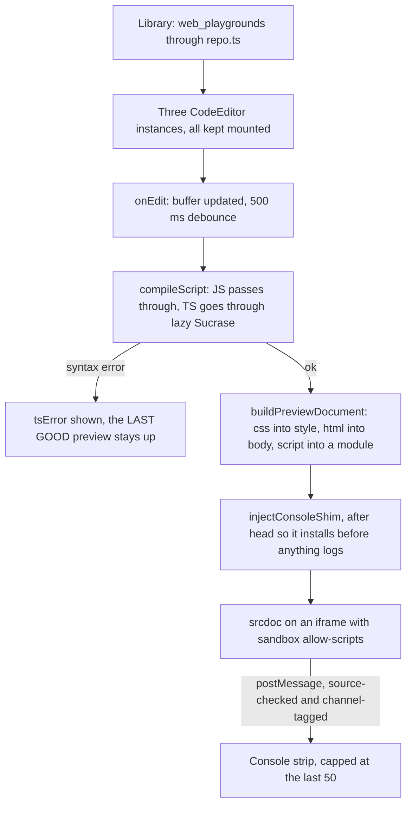

# Web playground

HTML, CSS and JavaScript (or TypeScript) in three editor tabs, with a live preview in a sandboxed iframe, a console strip fed from inside it, and a library of saved sessions in `web_playgrounds`. Ported from learn-anywhere's `WebExercise` — same author, MIT, no vendored third-party code — onto this app's own `CodeEditor`, `Card`, theme tokens, `zip.ts` and `repo.ts`, so there is one editor chassis in the app rather than two.

_Describes the code as of v0.4.0 (unreleased; schema v14) — verify against source when in doubt._

## File map

| Path | Role |
| --- | --- |
| [model.ts](../../../src/lib/playground/model.ts) | `Buffers`, `ScriptLang`, the starter and blank documents, `normalizeSession` (nothing is trusted on read) and `scriptName` |
| [compile.ts](../../../src/lib/playground/compile.ts) | `compileScript` — Sucrase's `typescript` transform, lazily imported, returning a syntax error rather than throwing |
| [export.ts](../../../src/lib/playground/export.ts) | `exportIndexHtml`, `exportFiles` and `archiveName` — the standalone folder the zip holds |
| [WebPlaygroundApp.svelte](../../../src/components/apps/WebPlaygroundApp.svelte) | `/tools/web-playground/` — the three tabs, the preview, the console, the library |
| [SandboxedPreview.svelte](../../../src/components/SandboxedPreview.svelte) | The app's one iframe previewer, shared with the HTTP playground |
| [preview/document.ts](../../../src/lib/preview/document.ts) | Document assembly, the close-tag guard, the console shim and its channel check |
| [types.ts](../../../src/lib/db/types.ts), [db.ts](../../../src/lib/db/db.ts) | `WebPlayground`, the `web_playgrounds` store, migration v14 |
| [registry.ts](../../../src/lib/registry.ts) | `web-playground` under **Playgrounds**, icon `code-xml` |

## The sandbox

The preview frame gets `sandbox="allow-scripts"` and nothing else. **Never `allow-same-origin`:** the two flags together let a framed document remove its own sandbox, and what this frames is code somebody is in the middle of writing. Without `allow-same-origin` the frame has an *opaque origin*, so it cannot read this app's IndexedDB, localStorage or cookies. The spec proves it from the inside rather than by inspection — the framed code prints `location.origin` and it reads `null`.

Two consequences worth knowing before they surprise anyone:

- **The preview cannot fetch across origins.** A page with no origin is refused by every server's CORS rules. The user page leads with this, because it is the first thing someone tries.
- **Messages from the frame arrive with `event.origin === 'null'`.** An origin comparison would prove nothing, so the console shim's messages are identified by `event.source === frame.contentWindow` — which no other window can forge — *plus* a channel tag. Both halves are checked; neither is sufficient alone.

## Editors

All three `CodeEditor` instances stay mounted and are hidden by tab rather than swapped out, so each keeps its buffer, its cursor and — the part people notice — its **undo history** across a tab switch. The buffers themselves are a plain object, not `$state`: the editors own the text and report it through `onDocChange`, and mirroring it into reactive state would only invite a second source of truth.

Emmet is on the HTML and CSS tabs (`Tab` and `Ctrl-E` expand an abbreviation), which is the single highest-value editor affordance for scratch markup and is already proven in the source this was ported from. The script tab loads `@codemirror/lang-javascript` with `typescript: true` so the grammar covers both languages and switching does not reconfigure the editor.

## TypeScript

`compileScript` runs Sucrase's `typescript` transform, which **strips types and nothing else**. There is no checking, no inference and no error for a wrong type: `const n: number = 'not a number'` compiles to `const n = 'not a number'` and runs. The page says so in a note under the language picker, and a unit test pins the claim so it cannot quietly become untrue.

Sucrase is imported inside `compileScript`, so a JavaScript session never fetches it; `payload.spec.ts` has a `sucrase` matcher in `HEAVY`, and the tool's own spec watches the network to prove it arrives only after the language is switched. A syntax error is **returned, not thrown**, and the caller keeps the last preview that worked — a preview that blanks on every half-typed generic is unusable.

## Sessions

A new session is a scratch buffer: it lives in memory and writes nothing. **Save** names it and writes exactly one `web_playgrounds` row plus `preferences.web_last_playground_id`; the spec asserts that delta and no other. Opening the page reads that preference and reopens the session **without writing** — `open()` takes `remember: false` on the load path, the same shape the config playground uses.

Rows are text only (a name, three buffers and a language), so they ride the JSON data layer and a backup byte-identically. Code in a backup is the *point* here, not a leak — the same stance `notes` takes. Nothing is trusted on read: `normalizeSession` replaces any non-string buffer with `''` and falls back on the name and language, because a backup is a text file anyone can edit and the generic data suite writes an array into every column it can.

## Export

`exportFiles` writes `index.html`, `style.css` and `script.js`, plus `script.ts` for a TypeScript session so the export is the work rather than only the result. The `index.html` it writes **links** the siblings instead of inlining them, unlike the preview document — so the unzipped folder opens in a browser and behaves the way the preview did. `archiveName` slugs the session name, which is also what stops a name containing `../` or a path separator from reaching the download.

## Tests

| File | Runner | Covers |
| --- | --- | --- |
| [playground.test.ts](../../../src/lib/playground/playground.test.ts) | vitest | `normalizeSession` against six hostile column values; the language fallback; Sucrase stripping types, dropping interfaces, **not** type-checking, and returning a syntax error instead of throwing; the export file set for both languages and its round trip through `zipEntries`; `archiveName` slugging, its length cap, and that it can never produce a separator or a traversal |
| [document.test.ts](../../../src/lib/preview/document.test.ts) | vitest | The close-tag guard, document assembly, and the console shim EXECUTED against stand-in globals — including the bare-string rejection reason the Playwright spec cannot exercise |
| [web-playground.spec.ts](../../../tests/local/web-playground.spec.ts) | Playwright | Typing reaches the preview and a scratch session writes NOTHING; `console.log`, an uncaught error and an unhandled rejection all reach the strip with their levels; the frame's sandbox attribute and its `null` origin proved from inside; Save is one row plus the preference (isolated delta), reload reopens it writing nothing, re-saving updates rather than adds, delete is a tombstone; the zip read back with `zipEntries`; Sucrase absent for JS and present after the switch, a wrong type compiling anyway, and a syntax error leaving the last good preview up |
| [data.spec.ts](../../../tests/local/data.spec.ts) | Playwright | `web_playgrounds` joins the generic backup round trip through the `TABLES` mirror — no line added to the spec |
| [a11y.spec.ts](../../../tests/local/a11y.spec.ts) | Playwright | The route is in the registry-derived sweep |

## Known limits and decisions

- **No PNG screenshot export.** learn-anywhere does it with a second, deliberately *non-sandboxed* iframe plus a dependency; a sandbox exception is a poor trade for a screenshot when the zip already covers "get my work out" (0.4.0 plan, Q5).
- **TypeScript is stripped, not checked** — see above. Type-checking in the browser means shipping the TypeScript compiler, which is an order of magnitude more than this whole page.
- **One session at a time.** The library opens a session into the editors; there are no tabs across sessions, and no autosave — Save is explicit, which is what makes "a scratch session writes nothing" true.
- **The preview reloads wholesale on every rebuild**, so it loses any state the previewed page had built up. Debounced at 500 ms to keep that tolerable while typing.
- **`sandbox="allow-scripts"` also blocks forms, popups, top-level navigation and pointer lock.** That is the default deny working as intended; adding a flag back means re-reading the decision in [SandboxedPreview.svelte](../../../src/components/SandboxedPreview.svelte), not just adding a word.
